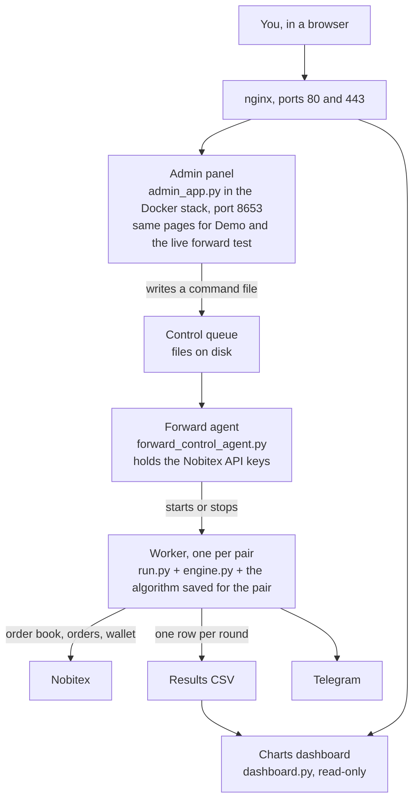
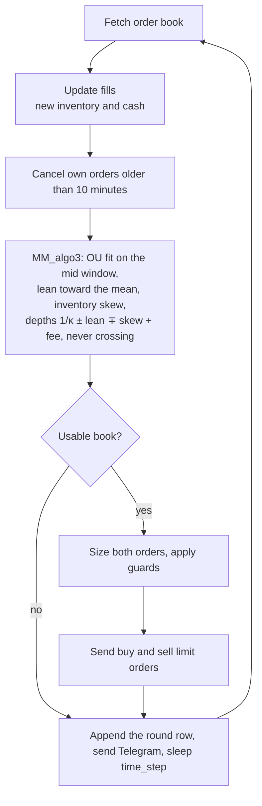

# Project guide — branch MM_algo3

A plain-language map of this repository on the branch `MM_algo3`:
* what every file is;
* how the system runs, from a browser click to an order on Nobitex;
* exactly what MM_algo3 does;
* how order sizes are decided;
* the settings in force;
* the known problems.

`README.md` and `usage.md` remain the detailed references, and
[`docs/algorithms/MM_algo3.md`](docs/algorithms/MM_algo3.md) is the full specification of the algorithm. This
guide is the short path through them.

Contents

1. [What the project is](#1-what-the-project-is)
2. [How the system runs](#2-how-the-system-runs)
3. [What every file is](#3-what-every-file-is)
4. [Where configuration values come from](#4-where-configuration-values-come-from)
5. [One round of the trading loop](#5-one-round-of-the-trading-loop)
6. [MM_algo3 in detail](#6-mm_algo3-in-detail)
7. [How order sizes are decided](#7-how-order-sizes-are-decided)
8. [Known problems](#8-known-problems)
9. [History](#9-history)

---

## 1. What the project is

A market-making bot for the Nobitex exchange. It trades two pairs, BTC/IRT and
USDT/IRT. Every round it places one limit buy below the market and one limit
sell above it, and earns the difference when both fill.

**The algorithm of this branch is MM_algo3**, which decides those two prices from a mean-reverting model of
the price fitted on the last 30 minutes of mids, the fill-intensity decay of the fill table, the inventory and
the fee bar ([section 6](#6-mm_algo3-in-detail)). Its code is `strategy/algo4.py`, and its key in the settings
and the recorded rounds is `algo4`, because it is the fourth algorithm designed for this project. It is shown
everywhere else as **MM_algo3**, the name of this branch.

The code holds four strategy classes:

| Name shown | Code | Status |
|---|---|---|
| **MM_algo3** | `strategy/algo4.py`, key `algo4` | This branch's algorithm. Implemented and tested; runs on the demo of both pairs in its own lane since 23 Oct 2026. |
| **MM_algo2** | `strategy/algo3.py`, key `algo3` | Order-book imbalance and microprice. Kept selectable for comparison, in its own demo lane. Documented on its own branch only: [`MM_algo2.md`](https://github.com/Alireza77n/Limit-Order-Book/blob/MM_algo2/docs/algorithms/MM_algo2.md). |
| **MM_algo1v2** (Algorithm 1 version 2) | `strategy/algo1.py`, key `algo1` | Kept selectable for comparison, in its own demo lane; it is the code default of the setting. Documented on its own branch only: [`ALGORITHM_1_V2.md`](https://github.com/Alireza77n/Limit-Order-Book/blob/MM_algo1v2/docs/algorithms/ALGORITHM_1_V2.md). |
| Avellaneda–Stoikov | `strategy/algo2.py`, key `algo2` | Placeholder only, not implemented; MM_algo3 with its forecast off is that model with the fee correction and the inventory skew. |

On the demo every switched-on algorithm runs at the same time, each in its own lane of the pair's worker
(`algo1_enabled`, `algo3_enabled`, `algo4_enabled`, flipped on the admin panel's **Algorithm** page); a live
worker runs the one algorithm of its `algorithm` setting, read when it is started. The dashboard's **Algorithm** tab shows one algorithm (and
filters every other tab to its rounds) or all of them side by side.

There are two run modes:

| Mode | Market data | Orders | How it is run |
|---|---|---|---|
| `real` (live forward test) | Real | Real orders on Nobitex | systemd services on the server |
| `demo` (paper trading) | Real | Simulated fills in a local ledger | Docker Compose |

---

## 2. How the system runs

### Live forward test



Step by step:

1. You open the admin panel in a browser. nginx forwards the request.
2. On **Live Config** you set the parameters for a pair, including **Algorithm** (MM_algo3, MM_algo2 or MM_algo1v2; the
   **Algorithm** page's *Activate* saves the same value), and save. The values are written to `forward_config_<pair>.json`.
3. On **Live Forward Test** you type the confirmation phrase, for example
   `START BTCIRT LIVE`.
4. The admin panel does not trade and does not have the API keys. It only
   writes a command file into the control queue.
5. The forward agent, a separate service under a separate Linux user, reads
   the command. It accepts only a fixed list of actions (`start_forward_worker`,
   `stop_forward_worker`, `apply_forward_config`, `read_wallet_balances`, `delete_forward_session`) and
   only the pairs `btc` and `usdt`.
6. To start a worker it runs this fixed command, with the algorithm saved in the
   pair's live configuration (`algo4` for MM_algo3, `algo3` for MM_algo2, `algo1` for MM_algo1v2, checked against the catalog):
   `python run.py --profile <pair> --algorithm <algo4|algo3|algo1> --exchange nobitex --mode real --continuous`
7. The worker reads the real wallet balances from Nobitex, uses them as its
   starting inventory and cash, and enters the trading loop
   ([section 5](#5-one-round-of-the-trading-loop)).
8. Every round it appends one row to `btc_track.csv` or `usdt_track.csv`. The
   dashboard reads those files and draws the charts.
9. Stop sends SIGTERM. The worker cancels its own open orders and exits.

The three systemd units are in `deploy/`:

| Unit | Runs | Linux user | Port |
|---|---|---|---|
| `market-maker-forward-admin.service` | `admin_app.py` under gunicorn (internal only: since 2026-10-11 nginx serves `/admin/` on both HTTP and HTTPS from the Docker stack's admin on 8653, which drives the live forward test through the mounted `/var/lib/market-maker-forward/control`; this service lacks the Demo control directory, so its Demo pages fail) | `marketmaker-admin` | 18653 |
| `market-maker-forward-agent.service` | `deploy/forward_control_agent.py` (`KillMode=process`: a restart of the agent, e.g. a deploy, leaves running live workers alive; they are its child processes) | `marketmaker-forward` | none |
| `market-maker-forward-dashboard.service` | `dashboard.py` | `marketmaker-admin` | 18652 |

Runtime state lives outside the code, under `/var/lib/market-maker-forward/`
(`config/`, `control/`, `locks/`, `results/`) and logs under
`/var/log/market-maker-forward/`.

### Demo (paper trading)

The same engine and the same algorithms, but `exchange/demo.py` replaces the
real exchange. Orders go into a local ledger (`paper.py`), and a resting order fills when the real market price
reaches it. It runs under Docker Compose
(`deploy/docker-compose.production.yml`) with its own admin panel, dashboard
and control agent (`deploy/control_agent.py`). Demo mode cannot be wired to
real trading or to MySQL: `safety.py` refuses to start.

---

## 3. What every file is

### Trading core (`market_maker/`)

| File | What it does |
|---|---|
| `run.py` | Entry point. Builds the config for a profile, picks the exchange client and the strategy, takes the worker lock, starts the loop. In demo mode without `--algorithm` it runs `LaneRunner`: one engine per enabled algorithm (`algo1_enabled`, `algo3_enabled`), each in its own thread with its own files (`apply_lane_paths`), started and stopped as the configuration changes. |
| `engine.py` | `SimpleMarketMaker`, the main loop. Fetches the market, tracks fills, inventory and cash, decides order sizes, sends and cancels orders (one resting order per side: a new price outside the requote band replaces the old order), writes the round rows, sends Telegram messages. Has two loops: `run()` for real mode and `_run_demo()` for demo mode. A demo lane runs one engine in a thread of the pair's worker (`run.py`'s `LaneRunner`). |
| `strategy/algo4.py` | **MM_algo3.** A 30-minute window of mids and its Ornstein–Uhlenbeck fit, the admissibility rule, the lean toward the estimated mean, the first-order depths $1/\kappa \pm$ lean $\mp$ skew $+$ risk, the fee shift, the touch clip, the fee-bar widening, the volatility guard, hysteresis. Stateful (its window and clock); reads the fill table through `fill_model.py` for $\kappa$, nothing else. |
| `strategy/algo3.py` | MM_algo2 (order-book imbalance and microprice), kept selectable for comparison; documented on [its branch](https://github.com/Alireza77n/Limit-Order-Book/blob/MM_algo2/docs/algorithms/MM_algo2.md). |
| `strategy/common.py` | Order-book arithmetic shared by the algorithms: tick, mid, returns, the fee bar, inventory position. |
| `strategy/catalog.py` | The list of algorithms (key, display name, class, settings, description). `run.py`, the engine, the admin drop-down and the dashboard's Algorithm tab read it. |
| `strategy/algo1.py` | MM_algo1v2 (Algorithm 1 version 2), selectable for comparison. |
| `fill_model.py`, `tools/build_fill_table.py` | The fill-probability table and its nightly builder, used by MM_algo1v2 only. |
| `strategy/algo2.py` | Placeholder for Avellaneda–Stoikov. Not implemented. |
| `strategy/base.py` | The interface every strategy implements (`decide_order`). |
| `config.py` | The `MMConfig` dataclass and `TRADING_PROFILES`, the default parameters for `btc` and `usdt`, including the `algo3_*` settings. |
| `forward_config.py` | Live-mode settings saved from the admin panel. Accepts the 39 editable fields only (including `algorithm` and the `algo3_*` settings), forces the commission to at least 0.25% (any non-negative target return is allowed), forces both exposure guards on with a ratio of at most 25%. |
| `demo_config.py` | Defines which fields the admin panel may edit (41 per pair), validates them, and reloads changed values into a running demo worker at round boundaries. |
| `safety.py` | Refuses to start demo mode with a real exchange client or with MySQL persistence. |
| `session.py` | Session ids and `WorkerLease`, a file lock that prevents two workers on the same pair. |

### Exchange access

| File | What it does |
|---|---|
| `exchange/base.py` | The interface every exchange client implements. |
| `exchange/nobitex.py` | Nobitex client: order book, wallet balance, send order, cancel order, cancel stale orders. |
| `exchange/nobitex_auth.py` | Signs requests with the API key (Ed25519 over timestamp + method + path + body). |
| `exchange/demo.py` | Paper exchange: real order book, orders stored in the paper ledger, no real orders sent. |
| `order_status.py` | `OrderStatusChecker` lists orders by status with paging. `OrderCanceller` cancels one order. |
| `portfolio.py` | `Nobitex_portfolio`: balances and a multi-currency portfolio snapshot. It is constructed in `run.py` and stored on the engine, but the engine never calls it. |

### Demo-mode machinery

| File | What it does |
|---|---|
| `paper.py` | `PaperLedger`: simulated orders, fills, fees, locked cash and inventory, with state saved to JSON. |
| `result_store.py` | `DemoResultStore`: demo round rows in SQLite, exported to a bounded CSV; its session summary names the algorithm(s) each session ran. |
| `no_quote.py` | Counts consecutive rounds without a quote and decides when to alert. |
| `telegram_lifecycle.py` | Telegram client and the per-order, per-round reporter. |
| `demo_entrypoint.py` | Container entry point that validates the demo environment before starting. |

### User interface

| File | What it does |
|---|---|
| `admin_app.py` | Flask admin panel: login, the Algorithm page (choose an algorithm, activate it per pair on the demo or for live), config pages (the first field is Algorithm), worker start and stop, live forward control, orders, balances, backups, sessions, logs, audit. |
| `templates/admin/*.html` | The 15 admin pages. |
| `static/admin/` | Admin CSS and JavaScript. |
| `control_queue.py` | File-based command queue between the admin panel (writes commands) and the agents (execute them). Includes the audit log. |
| `dashboard.py` | Dash results dashboard, eight tabs. **Algorithm** comes first: choose MM_algo3 (its description, settings, headline numbers and two charts of its own), MM_algo2 or MM_algo1v2, and every other tab then shows that algorithm's rounds only and the Track list its tracks; or show all algorithms side by side. Then Overview, Quote decision (an MM_algo3 round as its mid window with the fitted mean, a price ladder and a step-by-step trace), Fill model (MM_algo1v2's table; MM_algo3 reads it for $\kappa$ only), Order book, Validation (the demo-to-real gate, then the metrics), Rounds, and PnL attribution (`docs/algorithms/PNL_ATTRIBUTION.md`). Reads the result stores, the fill table and the diagnostics files only. |
| `validation/` | Performance metrics for the dashboard: return, Sharpe, Sortino, drawdown, win rate, inventory statistics. |

### Documentation (`docs/`, committed with `git add -f` because `docs/` is in `.gitignore`)

| Path | What it is |
|---|---|
| `docs/algorithms/MM_algo3.md` | MM_algo3, the full specification: the model, the derivation of the quotes, the estimation and its admissibility rule with measured rates, a worked example on a real window, the behaviour on the recorded demo series, settings, outputs, the test map, limitations, departures from the design note. |
| `docs/algorithms/data/` | The recorded demo mids, the fill tables and the real order books every number comes from, and `make_mm_algo3_doc_data.py`, which computes them with this branch's code. |
| `docs/algorithms/figures/` | The specification's figures and the script that draws them. |
| `docs/algorithms/PNL_ATTRIBUTION.md` | How the dashboard splits each round's change in wealth into price PnL and trading PnL. |
| `docs/guide/` | The whole-system guide is rebuilt for this branch once MM_algo3 has run on the demo (its results part needs the numbers); until then the engine and system parts are those of the [`MM_algo2` branch's guide](https://github.com/Alireza77n/Limit-Order-Book/blob/MM_algo2/docs/guide/MARKET_MAKER_EXPLAINED.md). |
| `docs/deployment/` | The admin page and deployment notes. |
| `docs/project_context.md`, `docs/decisions.md`, `docs/changelog.md` | The project's memory for people and AI sessions: stable facts, accepted decisions (ADRs), history. `CLAUDE.md` at the root points every session at them. |
| `docs/reports/`, `docs/superpowers/` | Dated records: the 11 October investor update (about MM_algo1v2, the algorithm then running) and earlier plans. |

### Deployment (`deploy/` and the repository root)

| File | What it does |
|---|---|
| `deploy/forward_control_agent.py` | Live-mode agent. Starts and stops workers with the saved algorithm, reads wallet balances. The only process that holds the API keys. |
| `deploy/control_agent.py` | Demo-mode agent. Manages the Docker workers, config apply and rollback, backups, reset, session deletion. |
| `deploy/market-maker-forward-*.service` | The three systemd units for the live forward test. |
| `deploy/systemd/lob-control-agent.service` | systemd unit for the demo agent. |
| `deploy/*.env.example` | Templates for the environment files. They contain no real keys. |
| `deploy/nginx/` | nginx site configuration. |
| `deploy/docker-compose.production.yml`, `docker-compose.yml`, `Dockerfile` | The demo stack. |
| `deploy/rollback.sh` | Takes the demo deployment down: stops the control agent and the Compose stack. |

### Everything else

| Path | What it is |
|---|---|
| `market_maker/tests/` | The automated tests; MM_algo3's are `test_strategy_algo4.py` (map: `docs/algorithms/MM_algo3.md` §14), with `test_strategy_catalog.py`, `test_requote_lanes.py`, `test_dashboard_algorithms.py` and `test_admin_html_views.py` covering the three algorithms together. |
| `market_maker/research/` | Notebooks estimating parameters for the Avellaneda–Stoikov placeholder. |
| `market_maker/test_nobitex_api.ipynb` | Preflight notebook run by hand before a real-mode start: offline signing test, the API-auth pytest files, public order book, authenticated read-only wallet/order/portfolio calls, `send_order`/`cancel_order` with HTTP mocked, demo lifecycle. Needs `NOBITEX_API_KEY`/`NOBITEX_SECRET_KEY` in `market_maker/.env`. The only cell that can place a real order (12b) is off by default and asks for confirmation. |
| `market_maker/results/` | Runtime output. Not tracked in git. |

---

## 4. Where configuration values come from

A worker's parameters are built in three layers (`run.py`, `make_cfg`):

1. `MMConfig` defaults in `config.py`.
2. The profile in `TRADING_PROFILES` (`btc` or `usdt`) in `config.py`.
3. In live mode, the overlay file `forward_config_<pair>.json`, saved from the
   admin panel's Live Config page. In demo mode, `demo_config_<pair>.json`.

The parameters that matter for MM_algo3:

| Parameter | Meaning |
|---|---|
| `algorithm` | Live worker only: `algo4` = MM_algo3, `algo3` = MM_algo2, `algo1` = MM_algo1v2 (the code default), read when the worker is started. The demo runs the lanes switched on below. |
| `algo4_window_seconds`, `algo4_sample_seconds` | The mid window the mean-reverting model is fitted on (1800 s) and the spacing of its samples (10 s). |
| `algo4_halflife_min_seconds`, `algo4_halflife_max_seconds`, `algo4_use_alpha` | The half-lives the forecast is trusted with (60–900 s); the switch of the forecast (on). The unit-root threshold t < −2.86 is a constant. |
| `algo4_horizon_seconds`, `algo4_lean_clip` | The horizon of the lean (0 = the order lifetime, 180 s) and its cap (0.5 % of the price). |
| `algo4_kappa`, `algo4_risk_perc`, `algo4_sigma_pause` | The fill-intensity decay when the fill table cannot be fitted (400, i.e. 1/κ = 0.25 %; the tables of 17 Oct give 727 on USDT and 626 on BTC), the risk widening of both depths (0) and the volatility pause (0 = off). |
| `commission_perc`, `exp_ret_min` | Fee per leg and the required net return of a round trip: the fee shift of each depth and the bar $A/B > 1 + G$ every pair must clear. |
| `skew_perc` | The inventory skew: how far the inventory moves the centre at the band edges (0.2 %); MM_algo3's $2(\ell + \phi\tau)q$ term in relative units. |
| `inv_min`, `inv_max`, `order_size` | The inventory band and the base order size. They drive the skew, the order sizes, the cap on buying and the thin-book threshold. |
| `inventory_sizing_enabled`, `inventory_sizing_strength`, `inventory_sizing_min_fraction` | The linear size rule ([section 7](#7-how-order-sizes-are-decided)). |
| `hysteresis_ticks`, `refresh_seconds`, `requote_band_perc` | Keep a pair that moved by at most the requote band (this many ticks, or this fraction of the price, whichever is wider) for up to this long; the engine does not re-post an order within the band and replaces a resting order that the new price has left outside it (one order per side). |
| `time_step`, `cancel_after_minutes` | Seconds between rounds; age at which a resting order is cancelled (3 minutes since 20 October 2026). |
| `trend_window_seconds`, `trend_pause_perc` | Trend pause: a fall of the mid by more than the fraction over the window blocks buys (resting buys are cancelled), a rise blocks sells. On by default (0.3 % over 10 minutes) at the operator's request; 0 switches it off. It did not help on the recorded market (the replay is on the [`MM_algo2` branch](https://github.com/Alireza77n/Limit-Order-Book/blob/MM_algo2/docs/algorithms/MM_algo2.md)). |
| `algo1_enabled`, `algo3_enabled`, `algo4_enabled` | Demo lanes: run MM_algo1v2 / MM_algo2 / MM_algo3 on this pair, each in its own lane with its own paper account and results. Ignored by a live worker. |
| `depth_max` | Book levels read for the recorded bid and ask level. |
| `buy_locked_cash_limit_*`, `sell_locked_inventory_limit_*` | The exposure guards: maximum share of cash or inventory locked in open orders. |
| `grid_*`, `one_sided_*`, `cost_basis_reference`, `ev_min`, `adverse_selection_perc`, `fill_kappa`, `fill_lambda_tau`, `fill_queue_volume_ref` | Read by MM_algo1v2 only; `fill_table_*` also by MM_algo3 (for κ). |
| `algo3_*` | Read by MM_algo2 only. |

Values in force on 23 October 2026 (the demo's applied settings and the saved live settings):

| | Demo BTC | Demo USDT | Live BTC | Live USDT |
|---|---:|---:|---:|---:|
| `algorithm` (live only) | — | — | algo1 (MM_algo1v2), saved | none saved, so algo1 (MM_algo1v2) |
| demo lanes on | algo1, algo3, algo4 | algo1, algo3, algo4 | — | — |
| `commission_perc` | 0.0008 | 0.0008 | 0.0025 | 0.0025 |
| `exp_ret_min` | 0.0002 (since 22 Oct; 0.0001 before 20 Oct, 0.002 on 20–22 Oct) | 0.0002 (same) | 0.0001 | 0.0001 |
| MM_algo3 $1/\kappa$ from the fill table of 17 Oct | 0.1596 % | 0.1375 % | (same tables) | (same tables) |
| `inv_min` – `inv_max` | 0 – 0.0037 | 0 – 300 | 0 – 0.0001527 | 0 – 15 |
| `order_size` | 0.000062 | 5 | 0.00001189 | 1 |
| `time_step` | 60 s | 10 s | 60 s | 30 s |
| `cancel_after_minutes` | 10 (3 since 20 Oct) | 10 (3 since 20 Oct) | 10 | 10 |
| `algo4_*`, `algo3_*` | defaults | defaults | defaults | defaults |
| `skew_perc`, `hysteresis_ticks`, `refresh_seconds` | 0.002, 5, 300 | 0.002, 5, 300 | 0.002, 5, 300 | 0.002, 5, 300 |
| `requote_band_perc`, `trend_pause_perc` (since 20 Oct) | 0.0003, 0.003 | 0.0003, 0.003 | 0.0003, 0.003 | 0.0003, 0.003 |
| Exposure guards | off | off | on, 25% | on, 25% |

A changed live config takes effect only after the worker is stopped and started again.

---

## 5. One round of the trading loop

Real mode, `engine.py`, `SimpleMarketMaker.run()`; the demo loop `_run_demo()` has the same steps.



Before the first round the worker reads the real wallet balances of the base
currency and of `rls`. If either read fails it exits without trading.

| Step | What happens | Where |
|---|---|---|
| A | `GET /v3/orderbook/<pair>`. If it fails, the round is skipped. | `exchange/nobitex.py` |
| B | Lists the worker's own open and closed orders. For each, takes the newly matched amount since the last round. A buy adds `matched − fee` to inventory and subtracts `matched × price` from cash. A sell subtracts `matched` from inventory and adds `matched × price − fee` to cash. | `update_inventory_and_cash` |
| C | Cancels the worker's own open orders older than `cancel_after_minutes` (3). Orders it did not send are never touched. Before sending a side, it also cancels its own resting order on that side when the new price lies outside the requote band (one order per side). | `_cancel_owned_stale_orders`, `_cancel_live_order` |
| D, E | [Section 6](#6-mm_algo3-in-detail). MM_algo3 quotes a pair whenever the book is usable and no volatility pause is on; every pair it returns is widened to the fee bar if needed and re-checked on the exact prices. | `strategy/algo4.py` |
| F, G | [Section 7](#7-how-order-sizes-are-decided). | `run()` |
| H | One row appended to the CSV (with `Strategy`, `Imbalance`, `Microprice`), one Telegram message, then `sleep(time_step)`. | `run()` |

On shutdown (SIGTERM, SIGINT, or `max_rounds` reached) the worker cancels all
of its own open orders.

---

## 6. MM_algo3 in detail

The full specification — the model, the derivation of the quotes, the estimation with its measured
admissibility rates, the worked example, the behaviour on the recorded demo series and the test map — is
[`docs/algorithms/MM_algo3.md`](docs/algorithms/MM_algo3.md). This section is the short form. MM_algo3
decides the bid price and the ask price; the engine decides the sizes ([section 7](#7-how-order-sizes-are-decided)).

### Step 1: the price window and the fit

Keep the last 30 minutes of mids, one sample every 10 s, and fit by least squares over consecutive samples:

$$
S_{k+1} = a + b\,S_k + \varepsilon_k, \qquad \theta = -\frac{\ln b}{\Delta t}, \qquad \mu = \frac{a}{1 - b}, \qquad t_{1/2} = \frac{\ln 2}{\theta}, \qquad t = \frac{b - 1}{\mathrm{se}(b)}
$$

Fewer than 30 samples (the first five minutes after a start): the round is quoted without the forecast.

### Step 2: is the forecast admissible?

$$
\text{admissible} \iff 0 < b < 1 \quad\text{and}\quad t < -2.86 \quad\text{and}\quad 60\ \text{s} \le t_{1/2} \le 900\ \text{s}
$$

The second test is the Dickey–Fuller 5 % critical value: on 200 simulated random walks of 180 samples it admits
4.5 % (the design note's t < −2 would admit 25.5 %). A fit that fails is reported but not used.

### Step 3: the lean

$$
m = \frac{(\mu - S)\,\bigl(1 - e^{-\theta\tau}\bigr)}{S}, \qquad \tau = \text{the order lifetime (180 s)}, \qquad \text{clipped to } \pm 0.5\,\%
$$

Zero when the forecast is not admissible or `algo4_use_alpha` is off. Price below its mean: $m > 0$, the bid
comes closer and the ask goes farther.

### Step 4: the depths

$$
\ln\!\left(-\frac{\ln\bigl(1 - P(d)\bigr)}{\tau}\right) = \ln\lambda - \kappa\,d \qquad \text{(fitted on the fill table; else the setting)}
$$

$$
\text{skew} = \sigma_q\,(2x - 1), \qquad
\delta^{+} = \max\!\left(\frac{\epsilon}{S},\ \frac{1}{\kappa} + m - \text{skew} + \rho\right) + f, \qquad
\delta^{-} = \max\!\left(\frac{\epsilon}{S},\ \frac{1}{\kappa} - m + \text{skew} + \rho\right) + f
$$

($\delta^{+}$ the ask depth, $\delta^{-}$ the bid depth, $x$ the inventory position in the band, $\sigma_q$ = `skew_perc`,
$\rho$ = `algo4_risk_perc`, $f$ the fee, $\epsilon$ the tick; the fallback for $\kappa$ is `algo4_kappa`.)

$1/\kappa$ is the fee-free optimal half-spread of the control problem (0.138 % on USDT and
0.160 % on BTC from the tables of 17 October); the lean and the skew move the centre, the width
$2/\kappa + 2\rho + 2f$ depends on neither.

### Step 5: prices on the tick, never crossing, and the fee bar

$$
A = \mathrm{ceil}_\epsilon\!\bigl(\max(S\,(1 + \delta^{+}),\ b_0 + \epsilon)\bigr), \qquad
B = \mathrm{floor}_\epsilon\!\bigl(\min(S\,(1 - \delta^{-}),\ a_0 - \epsilon)\bigr)
$$

$$
\text{if } \frac{A}{B} \le 1 + G: \quad w = \frac{(1 + G)\,B - A}{2 + G} + \epsilon, \quad A \leftarrow A + w, \quad B \leftarrow B - w \quad \text{(re-rounded)}, \qquad G = \frac{1 + r_{\min}}{(1 - f)^2} - 1
$$

$$
\text{send only if } (1 - f)^2\,\frac{A}{B} - 1 > r_{\min}
$$

($b_0$, $a_0$ the best bid and ask, $r_{\min}$ = `exp_ret_min`.)

### Step 6: keep a pair that barely moved

The previous pair is sent again while both prices moved by at most the requote band (`hysteresis_ticks` = 5
ticks or `requote_band_perc` = 0.03 % of the price, whichever is wider), the pair is younger than
`refresh_seconds` (300), and it still clears the bar. The engine does not re-post a side that already rests
within the band, and replaces a resting order that the new price has left outside it.

### Worked example

The USDT demo's recorded mids of 15 October 2026, the 30 minutes ending 20:44:29 Tehran, with the demo's
settings since 22 October (fee 0.08 %, target 0.02 %, band 0–300 USDT, `skew_perc` 0.002) and $\kappa$ from
the USDT fill table (727.1). Output of the actual code
([`MM_algo3.md` §9](docs/algorithms/MM_algo3.md#9-worked-example-a-real-usdtirt-window)):

| Quantity | Value |
|---|---|
| the fit | $b$ = 0.8971, $t$ = -3.02, $\mu$ = 2,663,769, half-life 64 s → admissible |
| mid / best bid / best ask | 2,659,865 / 2,659,730 / 2,660,000 |
| lean $m$ | +0.1260 % of the price |
| $1/\kappa$ | 0.1375 % |
| depths bid / ask, 150 USDT held ($x$ = 0.5) | 0.0915 % / 0.3435 % |
| **bid / ask sent** | **2,657,430 / 2,669,010** (net return 0.275 %) |
| the same with 50 USDT held ($x$ = 0.17) | 2,657,720 / 2,672,550 |
| without the forecast | 2,654,070 / 2,665,660 |

On the recorded demo series the forecast is admissible in 6–8 % of the windows and has no measured skill
(correlation of the lean with the next move −0.03 on USDT, −0.00 on BTC); the design note's rule for that
case is `algo4_use_alpha = false`, and the demo lanes are the test
([`MM_algo3.md` §10](docs/algorithms/MM_algo3.md#10-behaviour-on-the-recorded-demo-series)).

---

## 7. How order sizes are decided

Sizes are decided in `engine.py`, in `_inventory_sized_order_targets`, not in
the strategy, so the rule is the same for every algorithm. Each round that has a quote sends at most one buy
and one sell. The live loop and the demo loop call the same function.

### The linear inventory rule

```
x    = (inventory − inv_min) / (inv_max − inv_min)     clamped to 0..1
buy  = 2 × order_size × (1 − x)
sell = 2 × order_size × x
```

| Inventory `x` | Buy | Sell |
|---|---|---|
| 0 (empty) | 2 × `order_size` | 0 |
| 0.25 | 1.5 × | 0.5 × |
| 0.5 (middle) | 1 × | 1 × |
| 0.75 | 0.5 × | 1.5 × |
| 1 (full) | 0 | 2 × `order_size` |

- `order_size` is the size of each side at the middle of the band. Each side
  ranges from 0 to twice that.
- Buy plus sell is always `2 × order_size`. Volume shifts between the sides;
  it does not grow.
- Inventory is pulled toward the middle of the band: the fuller it is, the
  less the bot buys and the more it sells.
- MM_algo3 always returns both prices; at the band edges this rule is what leaves one side out.

### Resting orders count as inventory

An order can rest for up to `cancel_after_minutes` (3 minutes) and a new pair is sent
whenever the price has left the requote band, so sizing on wallet inventory alone would send the same size
again and again until the first fill. Each side therefore uses its own
effective inventory:

```
buy side:   x from  inventory + amount resting in open buys
sell side:  x from  inventory − amount resting in open sells
```

Example with `order_size` 10, a band of 0 to 100, inventory 50 and no fills:

| Round | Open buys before | Buy sent | Open sells before | Sell sent |
|---|---|---|---|---|
| 1 | 0 | 10 | 0 | 10 |
| 2 | 10 | 8 | 10 | 8 |
| 3 | 18 | 6.4 | 18 | 6.4 |

### Limits applied after the rule

$$
\begin{aligned}
\text{sell} &= \min\bigl(\text{sell target},\ \text{inventory} - \text{amount in open sells} - \text{inv}_{\min}\bigr) \\
\text{buy} &= \min\bigl(\text{buy target},\ (\text{cash} - \text{cash in open buys}) / \text{bid price}\bigr) \\
\text{buy is sent only if} &\quad \text{open buys} + \text{inventory} + \text{buy} \le \text{inv}_{\max}
\end{aligned}
$$

Then, for each side separately:

- Minimum size: a side smaller than 10% of `order_size` is not sent
  (`MIN_ORDER_SIZE_FRACTION`). With the linear rule that means no buy above
  `x = 0.95` and no sell below `x = 0.05`.
- Locked-exposure guard: a side is not sent if it would push the cash (buy) or
  inventory (sell) locked in open orders above the configured ratio, 25% in
  live mode.
- Resting-order guard: a side is not re-sent when one of the worker's own orders already rests within
  the requote band of the price (`resting_order_kept`); an own order outside the band is cancelled first
  (`replaced`), so at most one order rests per side.
- Trend pause (`trend_pause`, 0.3 % over 10 minutes by default): a side blocked by the pause is not sent and its resting order
  is cancelled.

### The settings

| Setting | Value in both profiles | Meaning |
|---|---|---|
| `inventory_sizing_enabled` | `True` | Turns the rule on. Off means both sides are always `order_size`. |
| `inventory_sizing_strength` | `1.0` | The slope `k`. The general form is `order_size × (1 ∓ k × (2x − 1))`; 1.0 gives the table above, 0 gives a fixed size. |
| `inventory_sizing_min_fraction` | `0.0` | A floor on each side as a fraction of `order_size`. 0 means a side may go to zero. |

The defaults are set in `TRADING_PROFILES` in `config.py`. All three can be
changed from the admin panel:

| Page | Applies |
|---|---|
| Demo **Config** (per pair) | At the next round of the running demo worker. |
| **Live Config BTC** / **Live Config USDT** | After the live worker is stopped and started again. |

Values outside the allowed range (strength or floor below 0 or above 1) are
rejected. Turning the rule off sends a fixed `order_size` on both sides.

### Demo mode

- The demo loop uses the same rule. Open buy and sell amounts come from the
  paper ledger.
- When the rule scales a side below the tradable minimum although cash or
  inventory is available, the round row says `not_sent_inventory_sizing`
  instead of `not_sent_insufficient_cash` or `not_sent_insufficient_inventory`.
- The paper ledger fills at most one `order_size` per side per market observation, so an order of
  `2 × order_size` filled by a price touch takes two observations.

---

## 8. Known problems

Found by reading the code paths MM_algo3 runs through. The first group is about the algorithm; the second is
about the engine, and is still open.

MM_algo3:

1. **The forecast has no measured skill on the recorded data** (`MM_algo3.md` §10): where it is admissible
   (6–8 % of the windows) the lean and the next move are uncorrelated. `algo4_use_alpha = false` is the
   design note's own fallback; the demo lanes are the test (ADR-017).
2. **A 30-minute window of 10-second samples detects only minute-long reversion** — mostly the mid bouncing
   between bid and ask (`MM_algo3.md` §7.2); a longer window lags regime changes.
3. **Its spread is wider than the fee bar:** $1/\kappa$ from the fill tables is 0.14–0.16 % plus the fee on
   each side, so it rests farther from the touch than MM_algo2 and fills less often; $\kappa$ itself rests on
   the demo's touch-only fills.
4. **The quotes are first-order:** the $\lambda\kappa h^2$ term of the control problem is dropped
   (`MM_algo3.md` §15).

The engine:

5. **Any transient API error in order-status calls stops the live worker.**
   `update_inventory_and_cash` and `get_open_order_totals` are not wrapped in
   error handling in the real loop. The worker cancels its orders and exits,
   which is safe but fragile for continuous running. This stopped the BTC live worker on 16 October 2026
   after an order-status request timed out.
6. **The full closed-order history is fetched several times per round.**
   `get_status_orders('close')` pages through every closed order on the
   account (`max_pages=100`, no pair or date filter). On a short loop that is a rate-limit
   risk, and once the account has more than 10,000 closed orders
   `order_status.py` raises and the worker stops.
7. **Fills that happen just before a cancel are lost.** When a stale order is
   cancelled its id is removed from tracking immediately. Any amount matched
   between the last accounting pass and the cancel is never added to
   inventory or cash. The ledger is never re-synchronised with the wallet
   during a session, so the error accumulates.
8. **An order can exist on the exchange without the worker knowing.**
   If `send_order` times out after the exchange accepted the order, the id is
   never recorded. The same applies to orders left open by a worker that
   crashed: a restarted worker does not treat them as its own and never
   cancels them.
9. **Each live worker reads the whole rial wallet as its own starting cash**, so the USDT and BTC workers each
   count the same rial; only the 25 % exposure guards keep their combined orders within the real balance.
10. **`portfolio.py` is unused by the engine.** `Nobitex_portfolio` is built
    and stored but never called.
11. **The live order amount is sent as `str(amount)`**, which for small BTC sizes is scientific notation
    (`2.378e-05`). The test suite does not check it against Nobitex; check with the preflight notebook that
    Nobitex accepts it before a live BTC start.

Four findings of the 3 October review do not apply to MM_algo3's path. They were Algorithm 1 version 1
crashes and corner cases:
* no quote above about 1.6 × `inv_max`: MM_algo3 always quotes, and at a full band the sizing sells only;
* a `null` last trade price: MM_algo3 does not use the last trade price;
* a division by zero for an empty band: the position falls back to the middle;
* an ask landing on the best bid: MM_algo3's ask is at least the best bid plus a tick.

---

12. **Fixed on 20 October 2026: orders piled up.** The "resting order kept" rule used 5 ticks (50 rial),
    nothing on BTC, so a new order was added almost every round while the old ones rested for 10 minutes:
    up to 11 (BTC) and 26 (USDT) of our orders were open at once and most fills were of old orders the
    market had run through. The requote band is now a fraction of the price, a resting order outside it is
    replaced, and orders live 3 minutes. The replay of the recorded market cuts the demo's loss by about two
    thirds (the replay is on the [`MM_algo2` branch](https://github.com/Alireza77n/Limit-Order-Book/blob/MM_algo2/docs/algorithms/MM_algo2.md)).
    What remains is mostly the price falling while coins are held, which the trend pause (also added; on by
    default at the operator's request) did not cure in the replay.

## 9. History

### MM_algo3 (2026-10-23, this branch)

| Change | Where |
|---|---|
| MM_algo3: the mean-reverting (Ornstein–Uhlenbeck) fit on a 30-minute window, the admissibility rule, the lean, the first-order depths $1/\kappa \pm m \mp$ skew $+$ risk, the fee shift and the fee-bar widening, the volatility guard, hysteresis | `strategy/algo4.py` |
| $\kappa$ and $\lambda$ fitted on the fill table | `fill_model.py` (`FillTable.fit_intensity`, `FillModel.intensity`) |
| The catalog entry (key `algo4`, shown as MM_algo3); the lane switch `algo4_enabled` and ten `algo4_*` settings, editable for demo and live | `strategy/catalog.py`, `config.py`, `demo_config.py`, `forward_config.py` |
| Dashboard: the MM_algo3 charts (centre vs mid, quoted spread and net return), the Quote decision panels (window and fit, ladder, trace), the three-lane track *Demo, all algorithms (compare)* | `dashboard.py` |
| Tests: 36 for the strategy; the catalog, lane, admin and dashboard suites extended to three algorithms | `tests/test_strategy_algo4.py` and the updated suites |
| Documentation written around MM_algo3, with the data and scripts behind every number; MM_algo2's documentation left to its branch | `README.md`, this guide, `docs/` |

### 20 October 2026 (this branch)

- Engine, both algorithms: requote band in percent with one order per side, orders live 3 minutes, target
  0.20 % (0.02 % since 22 October), trend pause (0.3 % over 10 min). Demo lanes: a pair's worker runs every enabled algorithm at once, each with its
  own paper account and results; the admin Algorithm page switches lanes on and off; the dashboard has a
  track per lane, both lanes together ("compare"), and the single-worker history; since 22 October the
  Track list follows the Algorithm choice.

### MM_algo2 (2026-10-17, branch `MM_algo2`)

| Change | Where |
|---|---|
| MM_algo2: imbalance, microprice centre, inventory skew, fee-bar half-spread, outward rounding, final check, hysteresis | `strategy/algo3.py` |
| Shared order-book arithmetic moved out of Algorithm 1 unchanged | `strategy/common.py` |
| The algorithm catalog; the names shown are the branch names (MM_algo2, MM_algo1v2) | `strategy/catalog.py` |
| `algorithm` setting and the six `algo3_*` settings, editable for demo and live | `config.py`, `demo_config.py`, `forward_config.py` |
| Demo worker switches algorithm at a round boundary; live worker starts with the saved one | `engine.py`, `deploy/forward_control_agent.py`, `run.py` |
| Round rows carry `Strategy`, `Imbalance`, `Microprice`; session summaries name the algorithms | `engine.py`, `result_store.py` |
| Dashboard Algorithm tab (one algorithm, or all side by side); admin Algorithm page and field; session labels | `dashboard.py`, `admin_app.py`, `templates/admin/` |
| Tests for the rule, the catalog, the switch and the dashboard | `tests/test_strategy_algo3.py`, `test_strategy_catalog.py`, `test_dashboard_algorithms.py` |
| Documentation rewritten around MM_algo2, with the data and scripts behind every number | `README.md`, this guide, `docs/` |

MM_algo2 is documented on its own branch ([`MM_algo2.md`](https://github.com/Alireza77n/Limit-Order-Book/blob/MM_algo2/docs/algorithms/MM_algo2.md)).

### Earlier

* **2026-10-11:** Algorithm 1 version 2 (now MM_algo1v2) replaced version 1; its history is on the
  `MM_algo1v2` branch.
* **2026-10-03:** the linear inventory sizing rule of [section 7](#7-how-order-sizes-are-decided) replaced
  fixed sizes; resting orders started counting as inventory.
* **15–16 October 2026, live:** both live workers ran MM_algo1v2 with fee 0.25 % and target 0.01 % and sent no
  order in about 30 hours: their wallets held almost no coins, so only lone buys were allowed, and none reached
  the expected-value floor. The BTC worker stopped on 16 October (problem 5 above).
