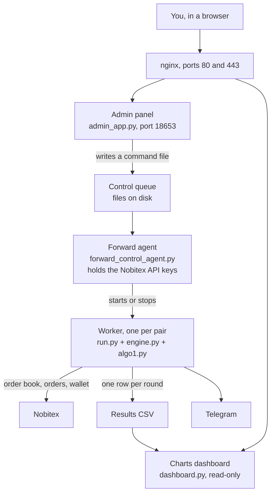
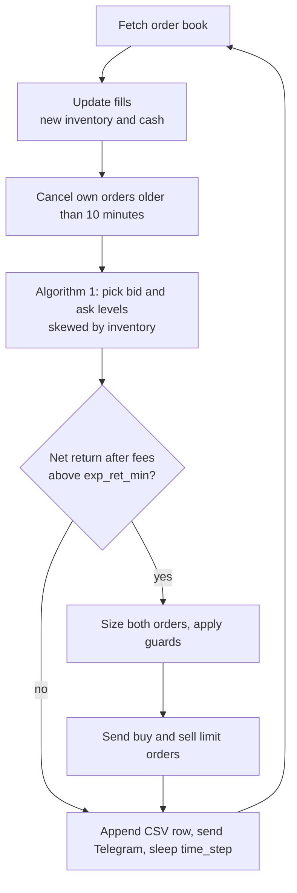

# Project guide

A plain-language map of this repository: what every file is, how the system
runs from a browser click to an order on Nobitex, exactly what Algorithm 1
does, how order sizes are decided (the linear inventory rule added on
2026-10-03), and the problems found in a code review on the same day.

`README.md` and `usage.md` remain the detailed references. This guide is the
short path through them.

Contents

1. [What the project is](#1-what-the-project-is)
2. [How the system runs](#2-how-the-system-runs)
3. [What every file is](#3-what-every-file-is)
4. [Where configuration values come from](#4-where-configuration-values-come-from)
5. [One round of the trading loop](#5-one-round-of-the-trading-loop)
6. [Algorithm 1 in detail](#6-algorithm-1-in-detail)
7. [How order sizes are decided](#7-how-order-sizes-are-decided)
8. [What changed on 2026-10-03](#8-what-changed-on-2026-10-03)
9. [Problems found in review](#9-problems-found-in-review)
10. [What the first live run showed](#10-what-the-first-live-run-showed)

---

## 1. What the project is

A market-making bot for the Nobitex exchange. It trades two pairs, BTC/IRT and
USDT/IRT. Every round it places one limit buy below the market and one limit
sell above it, and earns the difference when both fill.

There are two algorithms in the code:

| | Status |
|---|---|
| Algorithm 1 (`strategy/algo1.py`) | Implemented. This is what runs. |
| Algorithm 2, Avellaneda-Stoikov (`strategy/algo2.py`) | Placeholder only. Not implemented. |

There are two run modes:

| Mode | Market data | Orders | How it is run |
|---|---|---|---|
| `real` (live forward test) | Real | Real orders on Nobitex | systemd services on the server |
| `demo` (paper trading) | Real | Simulated fills in a local ledger | Docker Compose |

---

## 2. How the system runs

### Live forward test



Step by step:

1. You open the admin panel in a browser. nginx forwards the request.
2. On **Live Config** you set the parameters for a pair and save. The values
   are written to `forward_config_<pair>.json`.
3. On **Live Forward Test** you type the confirmation phrase, for example
   `START BTCIRT LIVE`.
4. The admin panel does not trade and does not have the API keys. It only
   writes a command file into the control queue.
5. The forward agent, a separate service under a separate Linux user, reads
   the command. It accepts only four fixed actions (`start_forward_worker`,
   `stop_forward_worker`, `apply_forward_config`, `read_wallet_balances`) and
   only the pairs `btc` and `usdt`.
6. To start a worker it runs this fixed command:
   `python run.py --profile <pair> --algorithm algo1 --exchange nobitex --mode real --continuous`
7. The worker reads the real wallet balances from Nobitex, uses them as its
   starting inventory and cash, and enters the trading loop
   ([section 5](#5-one-round-of-the-trading-loop)).
8. Every round it appends one row to `btc_track.csv` or `usdt_track.csv`. The
   dashboard reads those files and draws the charts.
9. Stop sends SIGTERM. The worker cancels its own open orders and exits.

The three systemd units are in `deploy/`:

| Unit | Runs | Linux user | Port |
|---|---|---|---|
| `market-maker-forward-admin.service` | `admin_app.py` under gunicorn | `marketmaker-admin` | 18653 |
| `market-maker-forward-agent.service` | `deploy/forward_control_agent.py` | `marketmaker-forward` | none |
| `market-maker-forward-dashboard.service` | `dashboard.py` | `marketmaker-admin` | 18652 |

Runtime state lives outside the code, under `/var/lib/market-maker-forward/`
(`config/`, `control/`, `locks/`, `results/`) and logs under
`/var/log/market-maker-forward/`.

### Demo (paper trading)

The same engine and the same Algorithm 1, but `exchange/demo.py` replaces the
real exchange. Orders go into a local ledger (`paper.py`) and fills are
simulated from real market data. It runs under Docker Compose
(`deploy/docker-compose.production.yml`) with its own admin panel, dashboard
and control agent (`deploy/control_agent.py`). Demo mode cannot be wired to
real trading or to MySQL: `safety.py` refuses to start.

---

## 3. What every file is

### Trading core (`market_maker/`)

| File | What it does |
|---|---|
| `run.py` | Entry point. Builds the config for a profile, picks the exchange client and the strategy, takes the worker lock, starts the loop. |
| `engine.py` | `SimpleMarketMaker`, the main loop. Fetches the market, tracks fills, inventory and cash, decides order sizes, sends and cancels orders, writes the CSV, sends Telegram messages. Has two loops: `run()` for real mode and `_run_demo()` for demo mode. |
| `strategy/algo1.py` | Algorithm 1 (version 2). Decides the bid and ask prices, or one of them: distance-anchored candidates, fill probabilities, expected-value selection, one-sided quotes, hysteresis. No network or file access beyond the fill table. |
| `fill_model.py` | `FillModel`: loads `fill_table_<pair>.json` (reloaded when it changes), falls back to the parametric fill formula. |
| `tools/build_fill_table.py` | Builds the fill table from the CSVs (price path + own orders); run daily. |
| `strategy/algo2.py` | Placeholder for Avellaneda-Stoikov. Not implemented. |
| `strategy/base.py` | The interface every strategy implements (`decide_order`). |
| `config.py` | The `MMConfig` dataclass and `TRADING_PROFILES`, the default parameters for `btc` and `usdt`. |
| `forward_config.py` | Live-mode settings saved from the admin panel. Accepts the 33 editable fields only, forces commission and minimum return to at least 0.25%, forces both exposure guards on with a ratio of at most 25%. |
| `demo_config.py` | Defines which fields the admin panel may edit, validates them, and reloads changed values into a running demo worker at round boundaries. |
| `safety.py` | Refuses to start demo mode with a real exchange client or with MySQL persistence. |
| `session.py` | Session ids and `WorkerLease`, a file lock that prevents two workers on the same pair. |

### Exchange access

| File | What it does |
|---|---|
| `exchange/base.py` | The interface every exchange client implements. |
| `exchange/nobitex.py` | Nobitex client: order book, wallet balance, send order, cancel order, cancel stale orders. |
| `exchange/nobitex_auth.py` | Signs requests with the API key (Ed25519 over timestamp + method + path + body). |
| `exchange/demo.py` | Paper exchange: real order book, orders stored in the paper ledger, no real orders sent. |
| `order_status.py` | `OrderStatusChecker` lists orders by status with paging. `OrderCanceller` cancels one order. |
| `portfolio.py` | `Nobitex_portfolio`: balances and a multi-currency portfolio snapshot. It is constructed in `run.py` and stored on the engine, but the engine never calls it. |

### Demo-mode machinery

| File | What it does |
|---|---|
| `paper.py` | `PaperLedger`: simulated orders, fills, fees, locked cash and inventory, with state saved to JSON. |
| `result_store.py` | `DemoResultStore`: demo round rows in SQLite, exported to a bounded CSV. |
| `no_quote.py` | Counts consecutive rounds without a quote and decides when to alert. |
| `telegram_lifecycle.py` | Telegram client and the per-order, per-round reporter. |
| `demo_entrypoint.py` | Container entry point that validates the demo environment before starting. |

### User interface

| File | What it does |
|---|---|
| `admin_app.py` | Flask admin panel: login, config pages, worker start and stop, live forward control, orders, balances, backups, sessions, logs, audit. |
| `templates/admin/*.html` | The 15 admin pages. |
| `static/admin/` | Admin CSS and JavaScript. |
| `control_queue.py` | File-based command queue between the admin panel (writes commands) and the agents (execute them). Includes the audit log. |
| `dashboard.py` | Dash results dashboard, six tabs: Overview (quote rate, fills per hour, realised vs computed spread, adverse selection, PnL, inventory), Quote decision (candidate ladder, expected-value heat map and decision trace of one round, from the diagnostics file), Fill model (measured table vs formula, calibration, table health), Order book (levels, spreads), Validation (demo-to-real gate, then the metrics), Rounds (every round as a table). Reads the result stores, the fill table and the diagnostics file only. |
| `validation/` | Performance metrics for the dashboard: return, Sharpe, Sortino, drawdown, win rate, inventory statistics. |

### Deployment (`deploy/` and the repository root)

| File | What it does |
|---|---|
| `deploy/forward_control_agent.py` | Live-mode agent. Starts and stops workers, reads wallet balances. The only process that holds the API keys. |
| `deploy/control_agent.py` | Demo-mode agent. Manages the Docker workers, config apply and rollback, backups, reset, session deletion. |
| `deploy/market-maker-forward-*.service` | The three systemd units for the live forward test. |
| `deploy/systemd/lob-control-agent.service` | systemd unit for the demo agent. |
| `deploy/*.env.example` | Templates for the environment files. They contain no real keys. |
| `deploy/nginx/` | nginx site configuration. |
| `deploy/docker-compose.production.yml`, `docker-compose.yml`, `Dockerfile` | The demo stack. |
| `deploy/rollback.sh` | Takes the demo deployment down: stops the control agent and the Compose stack. |

### Everything else

| Path | What it is |
|---|---|
| `market_maker/tests/` | 46 automated test files. |
| `market_maker/research/` | Three notebooks estimating parameters for Algorithm 2. |
| `market_maker/test_nobitex_api.ipynb` | Preflight notebook run by hand before a real-mode start: offline signing test, the API-auth pytest files, public order book, authenticated read-only wallet/order/portfolio calls, `send_order`/`cancel_order` with HTTP mocked, demo lifecycle. Needs `NOBITEX_API_KEY`/`NOBITEX_SECRET_KEY` in `market_maker/.env`. The only cell that can place a real order (12b) is off by default and asks for confirmation. |
| `README.md`, `usage.md`, `FORWARD_TEST.md`, `docs/` | Documentation and design notes. |
| `market_maker/results/` | Runtime output. Not tracked in git. |

---

## 4. Where configuration values come from

A worker's parameters are built in three layers (`run.py`, `make_cfg`):

1. `MMConfig` defaults in `config.py`.
2. The profile in `TRADING_PROFILES` (`btc` or `usdt`) in `config.py`.
3. In live mode, the overlay file `forward_config_<pair>.json`, saved from the
   admin panel's Live Config page. In demo mode, `demo_config_<pair>.json`.

The parameters that matter for trading:

| Parameter | Meaning |
|---|---|
| `order_size` | Base-asset amount per order (BTC or USDT) at the middle of the inventory band. Each side is scaled between 0 and 2× this ([section 7](#7-how-order-sizes-are-decided)). |
| `inv_min`, `inv_max` | The inventory band. Drives the price skew and the order sizes, and caps buying. |
| `inventory_sizing_enabled`, `inventory_sizing_strength`, `inventory_sizing_min_fraction` | The linear size rule ([section 7](#7-how-order-sizes-are-decided)). Editable from the admin panel, for demo and for live. |
| `depth_max` | How many order-book levels the strategy may use when anchoring candidates. |
| `commission_perc` | Fee per leg, as a fraction (0.0025 = 0.25%). |
| `exp_ret_min` | Minimum net round-trip return required to quote. |
| `time_step` | Seconds between rounds. |
| `cancel_after_minutes` | Age at which a resting order is cancelled; also the lifetime the fill probabilities refer to. |
| `buy_locked_cash_limit_ratio`, `sell_locked_inventory_limit_ratio` | Maximum share of cash or inventory that may be locked in open orders. |
| `grid_min_perc`, `grid_ratio`, `grid_max_perc` | Candidate distances from the quote centre ([section 6](#6-algorithm-1-in-detail-version-2-2026-10-11), step 2). |
| `skew_perc` | How far the inventory moves the quote centre at the band edges (step 1). |
| `one_sided_lo`, `one_sided_hi`, `cost_basis_reference` | When only one side is quoted and against which reference price (step 5). |
| `ev_min`, `adverse_selection_perc` | Expected-value floor and the one-leg cost in the pair score (step 4). |
| `hysteresis_ticks`, `refresh_seconds` | Keep a resting price / do not re-post within this window (step 6). |
| `fill_table_enabled`, `fill_table_max_age_hours`, `fill_table_min_samples`, `fill_kappa`, `fill_lambda_tau`, `fill_queue_volume_ref` | The fill model (step 3; `docs/algorithms/FILL_MODEL.md`). |

Live-mode values at the time of the review:

| | BTC/IRT | USDT/IRT |
|---|---|---|
| `order_size` | 0.00001189 | 1 |
| `inv_max` | 0.0001527 | 15 |
| `inv_min` | 0 | 0 |
| `depth_max` | 10 | 10 |
| `commission_perc` | 0.0025 | 0.0025 |
| `exp_ret_min` | 0.0025 | 0.0025 |
| `time_step` | 60 s | 10 s |
| `cancel_after_minutes` | 10 | 10 |
| Exposure guards | on, 25% | on, 25% |

A changed live config takes effect only after the worker is stopped and
started again.

---

## 5. One round of the trading loop

Real mode, `engine.py`, `SimpleMarketMaker.run()`.



Before the first round the worker reads the real wallet balances of the base
currency and of `rls`. If either read fails it exits without trading.

| Step | What happens | Where |
|---|---|---|
| A | `GET /v3/orderbook/<pair>`. If it fails, the round is skipped. | `exchange/nobitex.py` |
| B | Lists the worker's own open and closed orders. For each, takes the newly matched amount since the last round. A buy adds `matched − fee` to inventory and subtracts `matched × price` from cash. A sell subtracts `matched` from inventory and adds `matched × price − fee` to cash. | `update_inventory_and_cash` |
| C | Cancels the worker's own open orders older than `cancel_after_minutes`. Orders it did not send are never touched. | `_cancel_owned_stale_orders` |
| D, E | [Section 6](#6-algorithm-1-in-detail). | `strategy/algo1.py` |
| F, G | [Section 7](#7-how-order-sizes-are-decided). | `run()` |
| H | One row appended to the CSV, one Telegram message, then `sleep(time_step)`. | `run()` |

On shutdown (SIGTERM, SIGINT, or `max_rounds` reached) the worker cancels all
of its own open orders.

---

## 6. Algorithm 1 in detail (version 2, 2026-10-11)

The full specification with every formula, figures, the worked example and
the test map is in [`docs/algorithms/ALGORITHM_1_V2.md`](docs/algorithms/ALGORITHM_1_V2.md);
the fill probabilities are explained in [`docs/algorithms/FILL_MODEL.md`](docs/algorithms/FILL_MODEL.md);
the differences from version 1 in [`docs/algorithms/CHANGES_V1_TO_V2.md`](docs/algorithms/CHANGES_V1_TO_V2.md).
Version 1 stays on the git branch `MM_algo1v1`. This section is the short form.

Algorithm 1 decides the bid price and the ask price (or only one of them, or
none); the engine decides the sizes ([section 7](#7-how-order-sizes-are-decided)).

### Step 1: the inventory moves the quote centre

```
x = clamp( (inv − inv_min) / (inv_max − inv_min), 0, 1 )
c = mid × (1 − skew_perc × (2x − 1))
```

Half-full inventory leaves the centre at the mid. A full band moves it
`skew_perc` (0.2%) below the mid, so every ask candidate is nearer the market
and every bid candidate farther; an empty band does the opposite. Inventory
outside the band saturates at 0 or 1 instead of switching the quote off.

### Step 2: candidates at fixed distances from the centre

A geometric grid of distances, 0.05%, 0.07%, 0.10%, … 1.45% (`grid_min_perc`
× `grid_ratio`^k up to `grid_max_perc`). For each distance the first book level
at or beyond the target is found and the price one tick inside it is the
candidate (the same anchoring version 1 used for level indices). When the book
ends before the target the tick-rounded target itself is used. Candidates
never cross the touch and duplicates are kept once. The *real* distance of
each candidate from the centre is what the next step uses.

### Step 3: each candidate gets a fill probability

`p(distance)` = probability that an order resting at that distance is filled
within `cancel_after_minutes`. From the measured table
`fill_table_<pair>.json` (built daily by `tools/build_fill_table.py` from the
CSVs) when it is fresh, otherwise from the fallback formula
`p = 1 − exp(−fill_lambda_tau × exp(−fill_kappa × distance))`.

### Step 4: every bid/ask pair is scored by expected value

```
R_net = ask × (1 − fee)² / bid − 1                      (unchanged from version 1)
J     = p_bid × p_ask × R_net − adverse_selection_perc × (p_bid(1 − p_ask) + p_ask(1 − p_bid))
```

A pair is feasible when `R_net > exp_ret_min` and `J > ev_min`. The feasible
pair with the largest `J` is quoted. All pairs are scored, so one odd level
in the book cannot hide a better pair (version 1 stopped at the first failure).

### Step 5: one side alone when that is what makes sense

A lone sell is allowed when `ask > P_ref × (1 + G)`, a lone buy when
`bid < P_ref / (1 + G)`, with `G = (1 + exp_ret_min)/(1 − fee)² − 1` (0.753% at
0.25%/0.25%) and `P_ref` the centre or, for a sell of inventory we bought
ourselves, its average cost. Used when the inventory position is at or beyond
`one_sided_hi` (asks only) / `one_sided_lo` (bids only), and as the fallback
when no pair is feasible.

### Step 6: resting prices are kept

A new price within `hysteresis_ticks` of the resting one, while the resting
quote is younger than `refresh_seconds`, is replaced by the resting price, and
the engine does not re-post a side when one of its own orders already rests
within that window.

### Worked example

USDT/IRT, fee 0.25%, `exp_ret_min` 0.25%, 25 of 50 USDT held, formula fill
model, the book of `docs/algorithms/ALGORITHM_1_V2.md` §3. Output of the
actual code (pinned by `tests/test_strategy_algo1.py`):

| Inventory | Quote mode | Bid | Ask | Net return | Expected value |
|---|---|---|---|---|---|
| 25 of 50 | pair | 2,650,010 (level 4) | 2,669,990 (level 4) | 0.251% | 0.0100% per lifetime |
| 48 of 50, cost basis 2,640,000 | ask only | — | 2,664,990 (level 3) | 0.44% vs cost | 0.17% |
| 2 of 50 | bid only | 2,640,010 (level 5) | — | 0.44% vs centre | 0.010% |

Version 1 quoted level pairs `(5,10) … (1,6)` at empty inventory and nothing
at all above about 1.6 × `inv_max`.

---

## 7. How order sizes are decided

Sizes are decided in `engine.py`, in `_inventory_sized_order_targets`, not in
the strategy. Each round that has a quote sends at most one buy and one sell.
The live loop and the demo loop call the same function.

### The linear inventory rule

```
x    = (inventory − inv_min) / (inv_max − inv_min)     clamped to 0..1
buy  = 2 × order_size × (1 − x)
sell = 2 × order_size × x
```

| Inventory `x` | Buy | Sell |
|---|---|---|
| 0 (empty) | 2 × `order_size` | 0 |
| 0.25 | 1.5 × | 0.5 × |
| 0.5 (middle) | 1 × | 1 × |
| 0.75 | 0.5 × | 1.5 × |
| 1 (full) | 0 | 2 × `order_size` |

- `order_size` is the size of each side at the middle of the band. Each side
  ranges from 0 to twice that.
- Buy plus sell is always `2 × order_size`. Volume shifts between the sides;
  it does not grow.
- Inventory is pulled toward the middle of the band: the fuller it is, the
  less the bot buys and the more it sells.

### Resting orders count as inventory

An order can rest for up to `cancel_after_minutes` and a new pair is sent
every round, so sizing on wallet inventory alone would send the same size
again and again until the first fill. Each side therefore uses its own
effective inventory:

```
buy side:   x from  inventory + amount resting in open buys
sell side:  x from  inventory − amount resting in open sells
```

Example with `order_size` 10, a band of 0 to 100, inventory 50 and no fills:

| Round | Open buys before | Buy sent | Open sells before | Sell sent |
|---|---|---|---|---|
| 1 | 0 | 10 | 0 | 10 |
| 2 | 10 | 8 | 10 | 8 |
| 3 | 18 | 6.4 | 18 | 6.4 |

### Limits applied after the rule

```
sell = min(sell target, inventory − amount in open sells − inv_min)
buy  = min(buy target, (cash − cash in open buys) / bid price)
buy is sent only if  open buys + inventory + buy ≤ inv_max
```

Then, for each side separately:

- Minimum size: a side smaller than 10% of `order_size` is not sent
  (`MIN_ORDER_SIZE_FRACTION`). With the linear rule that means no buy above
  `x = 0.95` and no sell below `x = 0.05`.
- Locked-exposure guard: a side is not sent if it would push the cash (buy) or
  inventory (sell) locked in open orders above the configured ratio, 25% in
  live mode.

### The settings

| Setting | Value in both profiles | Meaning |
|---|---|---|
| `inventory_sizing_enabled` | `True` | Turns the rule on. Off means both sides are always `order_size`. |
| `inventory_sizing_strength` | `1.0` | The slope `k`. The general form is `order_size × (1 ∓ k × (2x − 1))`; 1.0 gives the table above, 0 gives a fixed size. |
| `inventory_sizing_min_fraction` | `0.0` | A floor on each side as a fraction of `order_size`. 0 means a side may go to zero. |

The defaults are set in `TRADING_PROFILES` in `config.py`. All three can be
changed from the admin panel:

| Page | Applies |
|---|---|
| Demo **Config** (per pair) | At the next round of the running demo worker. |
| **Live Config BTC** / **Live Config USDT** | After the live worker is stopped and started again. |

Values outside the allowed range (strength or floor below 0 or above 1) are
rejected. Turning the rule off sends a fixed `order_size` on both sides.

### Demo mode

- The demo loop uses the same rule. Open buy and sell amounts come from the
  paper ledger.
- When the rule scales a side below the tradable minimum although cash or
  inventory is available, the round row says `not_sent_inventory_sizing`
  instead of `not_sent_insufficient_cash` or `not_sent_insufficient_inventory`.
- The paper ledger's fill budget per market observation is unchanged:
  `order_size × demo_max_fill_per_observation_orders` when no trade volume is
  reported. An order of `2 × order_size` filled by a price touch therefore
  takes two observations. The level-1 fast fill still fills a whole order.

---

## 8. What changed on 2026-10-03

Before this change both sides were always `order_size`. An inventory rule
existed in the code but was switched off, used a slope of 0.75 with a floor of
25%, and looked at wallet inventory only.

| File | Change |
|---|---|
| `market_maker/engine.py` | `_inventory_sized_order_targets` takes the open buy and open sell amounts and sizes each side on its effective inventory. The live loop and the demo loop pass those amounts. The demo loop logs `inventory_sizing` as the not-sent reason when the rule holds a side back. |
| `market_maker/config.py` | Both profiles turn the rule on with strength 1.0 and no floor. The `MMConfig` defaults for strength and floor match. |
| `market_maker/demo_config.py` | The three sizing settings are editable fields again (hot in demo), each with help text. The help text of `order_size` explains the scaling. |
| `market_maker/forward_config.py`, `templates/admin/forward_config.html` | The three sizing settings are part of the Live Config page and of the saved live config. |
| `market_maker/dashboard.py` | Reads `DASHBOARD_REQUESTS_PATHNAME_PREFIX` so the charts work behind nginx at `/forward/`. This was already running on the server and was missing from the repository. |
| `README.md` | The inventory sizing paragraph describes the new rule and defaults. |
| `market_maker/tests/` | New tests for the rule, for both loops and for the new reason. Older tests that assert amounts with a constant order size now switch the rule off explicitly. |

What to expect in a live session:

- A session that starts with no base inventory sends buys of
  `2 × order_size` and no sells until something fills.
- A session that starts with inventory at or above `inv_max` sends sells of up
  to `2 × order_size` and no buys.
- The 25% locked-exposure guards still cap how much can rest at once.

---

## 9. Problems found in review

Found by reading the live-mode code path on 2026-10-03. Items 2 to 5 and 9
are still open; items 1, 6, 7 and 8 were fixed by Algorithm 1 version 2 on
2026-10-11 (inventory is clamped and a full wallet quotes sells only, the last
price is optional, an empty band defaults to the middle position, candidates
never cross the touch). Items 2 to 5 matter for real money.

Fixed since then: the live worker crashed whenever it produced a quote while one
of its own orders was still resting, because Nobitex reports an open order as
`Active` and `get_open_order_totals` accepted only `open`. That ended the
BTC/IRT worker on 2026-09-27. The check now accepts `open`, `Active` and `New`
(`OPEN_ORDER_STATUSES` in `engine.py`).

1. **No quote, and no way to sell down, when inventory is well above
   `inv_max`.** A live session starts from the whole wallet balance. Once
   `inv_d` exceeds `depth_max` there is no valid level pair, so the strategy
   returns no quote at all (`algo1.py`, `leg_pairs`). With `depth_max = 10`
   this happens above roughly 1.6 × `inv_max`. Confirmed with the worked
   example in section 6.

2. **The full closed-order history is fetched several times per round.**
   `get_status_orders('close')` pages through every closed order on the
   account (`max_pages=100`, no pair or date filter) and is called about four
   to five times a round. On the 10-second USDT loop that is a rate-limit
   risk, and once the account has more than 10,000 closed orders
   `order_status.py` raises and the worker stops.

3. **Fills that happen just before a cancel are lost.** When a stale order is
   cancelled its id is removed from tracking immediately. Any amount matched
   between the last accounting pass and the cancel is never added to
   inventory or cash. The ledger is never re-synchronised with the wallet
   during a session, so the error accumulates.

4. **An order can exist on the exchange without the worker knowing.**
   If `send_order` times out after the exchange accepted the order, the id is
   never recorded. The same applies to orders left open by a worker that
   crashed: a restarted worker does not treat them as its own and never
   cancels them.

5. **Any transient API error in order-status calls stops the live worker.**
   `update_inventory_and_cash` and `get_open_order_totals` are not wrapped in
   error handling in the real loop. The worker cancels its orders and exits,
   which is safe but fragile for continuous running.

6. **A `null` `lastTradePrice` crashes the round.** The order-book check only
   tests that the key exists; `float(None)` then raises in `algo1.py`.

7. **Division by zero if `inv_max == inv_min`** in `algo1.py`. The live config
   validator rejects this, the profile defaults do not.

8. **The ask can land on the best bid.** When the gap between best bid and
   best ask is one tick and the chosen ask level is 0, `ask − tick` equals the
   best bid, so the sell would execute as a taker.

9. **`portfolio.py` is unused by the engine.** `Nobitex_portfolio` is built
   and stored but never called.

Test suite: a full run on the server did not complete cleanly. About the
first 60% passed, then tests began failing with `Too many open files` at the
default limit of 1024 open files. The cause was not investigated.

---

## 10. What the first live run showed

BTC/IRT, 26 to 27 September 2026, 1,330 rounds:

- 7 buy orders were sent. No sell orders.
- 1,323 rounds produced no quote, because the market spread did not reach the
  roughly 0.75% that a 0.25% fee per leg plus a 0.25% minimum return requires.
- Inventory and cash did not change during the run: no fills were recorded.

The bot is quiet on BTC/IRT because of the threshold, not because of a fault.

---

## 11. Algorithm 1 version 2 (2026-10-11)

The selection rule of Algorithm 1 was replaced; the fee bar, the sizing rule,
the engine's accounting and the file formats were kept. Short list (details in
`docs/algorithms/`):

| Change | Where |
|---|---|
| Candidates by price distance instead of level index; inventory moves the quote centre continuously | `strategy/algo1.py` |
| Every pair scored by expected value with fill probabilities; best feasible pair wins | `strategy/algo1.py`, `fill_model.py` |
| One-sided quotes at the band edges and as a fallback (reference: centre or own cost basis) | `strategy/algo1.py`, `engine.py` (a quote may omit a side) |
| Resting prices kept; the engine does not re-post a side that already rests at the price | `strategy/algo1.py`, `engine.py` |
| 18 new settings, all editable in the admin panel for demo and live | `config.py`, `demo_config.py`, `forward_config.py` |
| Daily fill-table builder | `tools/build_fill_table.py` |
| Demo matcher's level-1 fast fill switched off in the profiles | `config.py` |
| Tests rewritten for the new rule; new tests for the fill model, the builder and the engine's one-sided handling | `tests/` |

Before switching the new code to real mode, run it in demo for at least five
days and apply the gate in `docs/algorithms/ALGORITHM_1_V2.md` §7.
