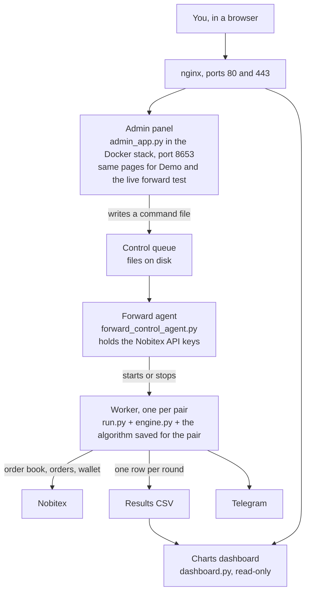
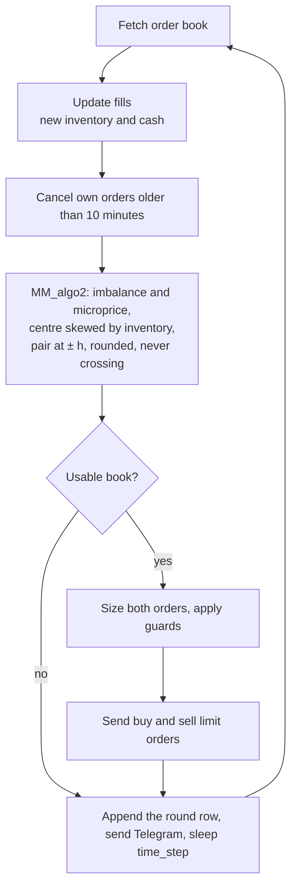

# Project guide — branch MM_algo2

A plain-language map of this repository on the branch `MM_algo2`:
* what every file is;
* how the system runs, from a browser click to an order on Nobitex;
* exactly what MM_algo2 does;
* how order sizes are decided;
* the settings in force;
* the known problems.

`README.md` and `usage.md` remain the detailed references, and
[`docs/algorithms/MM_algo2.md`](docs/algorithms/MM_algo2.md) is the full specification of the algorithm. This
guide is the short path through them.

Contents

1. [What the project is](#1-what-the-project-is)
2. [How the system runs](#2-how-the-system-runs)
3. [What every file is](#3-what-every-file-is)
4. [Where configuration values come from](#4-where-configuration-values-come-from)
5. [One round of the trading loop](#5-one-round-of-the-trading-loop)
6. [MM_algo2 in detail](#6-mm_algo2-in-detail)
7. [How order sizes are decided](#7-how-order-sizes-are-decided)
8. [Known problems](#8-known-problems)
9. [History](#9-history)

---

## 1. What the project is

A market-making bot for the Nobitex exchange. It trades two pairs, BTC/IRT and
USDT/IRT. Every round it places one limit buy below the market and one limit
sell above it, and earns the difference when both fill.

**The algorithm of this branch is MM_algo2**, which decides those two prices from the order book's volumes
(imbalance and microprice), the inventory and the fee bar
([section 6](#6-mm_algo2-in-detail)). Its code is `strategy/algo3.py`, and its key in the settings and the
recorded rounds is `algo3`, because it is the third algorithm designed for this project. It is shown
everywhere else as **MM_algo2**, the name of this branch.

The code holds three strategy classes:

| Name shown | Code | Status |
|---|---|---|
| **MM_algo2** | `strategy/algo3.py`, key `algo3` | This branch's algorithm. Implemented and tested; running on the BTC demo since 17 Oct 2026, 11:15 UTC. |
| **MM_algo1v2** (Algorithm 1 version 2) | `strategy/algo1.py`, key `algo1` | Kept selectable for comparison; it is the code default of the setting. Documented on its own branch; summary in [`docs/algorithms/MM_algo1v2.md`](docs/algorithms/MM_algo1v2.md). |
| Avellaneda–Stoikov | `strategy/algo2.py`, key `algo2` | Placeholder only, not implemented. Unrelated to the name MM_algo2. |

Which one a worker runs is the `algorithm` setting, chosen per pair on the admin
panel's **Algorithm** page (a drop-down, then a Demo table and a Live table with
their active sessions; also the first field of the config pages): a demo worker
switches at its next round, a live worker when it is started. The dashboard's **Algorithm** tab shows one algorithm (and
filters every other tab to its rounds) or all of them side by side.

There are two run modes:

| Mode | Market data | Orders | How it is run |
|---|---|---|---|
| `real` (live forward test) | Real | Real orders on Nobitex | systemd services on the server |
| `demo` (paper trading) | Real | Simulated fills in a local ledger | Docker Compose |

---

## 2. How the system runs

### Live forward test



Step by step:

1. You open the admin panel in a browser. nginx forwards the request.
2. On **Live Config** you set the parameters for a pair, including **Algorithm** (MM_algo2 or MM_algo1v2; the
   **Algorithm** page's *Activate* saves the same value), and save. The values are written to `forward_config_<pair>.json`.
3. On **Live Forward Test** you type the confirmation phrase, for example
   `START BTCIRT LIVE`.
4. The admin panel does not trade and does not have the API keys. It only
   writes a command file into the control queue.
5. The forward agent, a separate service under a separate Linux user, reads
   the command. It accepts only a fixed list of actions (`start_forward_worker`,
   `stop_forward_worker`, `apply_forward_config`, `read_wallet_balances`, `delete_forward_session`) and
   only the pairs `btc` and `usdt`.
6. To start a worker it runs this fixed command, with the algorithm saved in the
   pair's live configuration (`algo3` for MM_algo2, `algo1` for MM_algo1v2, checked against the catalog):
   `python run.py --profile <pair> --algorithm <algo3|algo1> --exchange nobitex --mode real --continuous`
7. The worker reads the real wallet balances from Nobitex, uses them as its
   starting inventory and cash, and enters the trading loop
   ([section 5](#5-one-round-of-the-trading-loop)).
8. Every round it appends one row to `btc_track.csv` or `usdt_track.csv`. The
   dashboard reads those files and draws the charts.
9. Stop sends SIGTERM. The worker cancels its own open orders and exits.

The three systemd units are in `deploy/`:

| Unit | Runs | Linux user | Port |
|---|---|---|---|
| `market-maker-forward-admin.service` | `admin_app.py` under gunicorn (internal only: since 2026-10-11 nginx serves `/admin/` on both HTTP and HTTPS from the Docker stack's admin on 8653, which drives the live forward test through the mounted `/var/lib/market-maker-forward/control`; this service lacks the Demo control directory, so its Demo pages fail) | `marketmaker-admin` | 18653 |
| `market-maker-forward-agent.service` | `deploy/forward_control_agent.py` (`KillMode=process`: a restart of the agent, e.g. a deploy, leaves running live workers alive; they are its child processes) | `marketmaker-forward` | none |
| `market-maker-forward-dashboard.service` | `dashboard.py` | `marketmaker-admin` | 18652 |

Runtime state lives outside the code, under `/var/lib/market-maker-forward/`
(`config/`, `control/`, `locks/`, `results/`) and logs under
`/var/log/market-maker-forward/`.

### Demo (paper trading)

The same engine and the same algorithms, but `exchange/demo.py` replaces the
real exchange. Orders go into a local ledger (`paper.py`), and a resting order fills when the real market price
reaches it. It runs under Docker Compose
(`deploy/docker-compose.production.yml`) with its own admin panel, dashboard
and control agent (`deploy/control_agent.py`). Demo mode cannot be wired to
real trading or to MySQL: `safety.py` refuses to start.

---

## 3. What every file is

### Trading core (`market_maker/`)

| File | What it does |
|---|---|
| `run.py` | Entry point. Builds the config for a profile, picks the exchange client and the strategy, takes the worker lock, starts the loop. |
| `engine.py` | `SimpleMarketMaker`, the main loop. Fetches the market, tracks fills, inventory and cash, decides order sizes, sends and cancels orders, writes the round rows, sends Telegram messages. Has two loops: `run()` for real mode and `_run_demo()` for demo mode. In demo it builds a new strategy at a round boundary when the `algorithm` setting changes. |
| `strategy/algo3.py` | **MM_algo2.** Imbalance of the top levels, microprice centre (leaned by $\beta I$, skewed by inventory), one symmetric half-spread (the smallest that clears the fee bar, plus a tick), outward rounding that never crosses the touch, a final fee-bar check, hysteresis. Pure: no network or file access. |
| `strategy/common.py` | Order-book arithmetic shared by the algorithms: tick, mid, returns, the fee bar, inventory position. |
| `strategy/catalog.py` | The list of algorithms (key, display name, class, settings, description). `run.py`, the engine, the admin drop-down and the dashboard's Algorithm tab read it. |
| `strategy/algo1.py` | MM_algo1v2 (Algorithm 1 version 2), selectable for comparison. |
| `fill_model.py`, `tools/build_fill_table.py` | The fill-probability table and its nightly builder, used by MM_algo1v2 only. |
| `strategy/algo2.py` | Placeholder for Avellaneda–Stoikov. Not implemented. |
| `strategy/base.py` | The interface every strategy implements (`decide_order`). |
| `config.py` | The `MMConfig` dataclass and `TRADING_PROFILES`, the default parameters for `btc` and `usdt`, including the `algo3_*` settings. |
| `forward_config.py` | Live-mode settings saved from the admin panel. Accepts the 39 editable fields only (including `algorithm` and the `algo3_*` settings), forces the commission to at least 0.25% (any non-negative target return is allowed), forces both exposure guards on with a ratio of at most 25%. |
| `demo_config.py` | Defines which fields the admin panel may edit (41 per pair), validates them, and reloads changed values into a running demo worker at round boundaries. |
| `safety.py` | Refuses to start demo mode with a real exchange client or with MySQL persistence. |
| `session.py` | Session ids and `WorkerLease`, a file lock that prevents two workers on the same pair. |

### Exchange access

| File | What it does |
|---|---|
| `exchange/base.py` | The interface every exchange client implements. |
| `exchange/nobitex.py` | Nobitex client: order book, wallet balance, send order, cancel order, cancel stale orders. |
| `exchange/nobitex_auth.py` | Signs requests with the API key (Ed25519 over timestamp + method + path + body). |
| `exchange/demo.py` | Paper exchange: real order book, orders stored in the paper ledger, no real orders sent. |
| `order_status.py` | `OrderStatusChecker` lists orders by status with paging. `OrderCanceller` cancels one order. |
| `portfolio.py` | `Nobitex_portfolio`: balances and a multi-currency portfolio snapshot. It is constructed in `run.py` and stored on the engine, but the engine never calls it. |

### Demo-mode machinery

| File | What it does |
|---|---|
| `paper.py` | `PaperLedger`: simulated orders, fills, fees, locked cash and inventory, with state saved to JSON. |
| `result_store.py` | `DemoResultStore`: demo round rows in SQLite, exported to a bounded CSV; its session summary names the algorithm(s) each session ran. |
| `no_quote.py` | Counts consecutive rounds without a quote and decides when to alert. |
| `telegram_lifecycle.py` | Telegram client and the per-order, per-round reporter. |
| `demo_entrypoint.py` | Container entry point that validates the demo environment before starting. |

### User interface

| File | What it does |
|---|---|
| `admin_app.py` | Flask admin panel: login, the Algorithm page (choose an algorithm, activate it per pair on the demo or for live), config pages (the first field is Algorithm), worker start and stop, live forward control, orders, balances, backups, sessions, logs, audit. |
| `templates/admin/*.html` | The 15 admin pages. |
| `static/admin/` | Admin CSS and JavaScript. |
| `control_queue.py` | File-based command queue between the admin panel (writes commands) and the agents (execute them). Includes the audit log. |
| `dashboard.py` | Dash results dashboard, eight tabs. **Algorithm** comes first: choose MM_algo2 (its description, settings, headline numbers and two charts of its own) or MM_algo1v2, and every other tab then shows that algorithm's rounds only; or show all algorithms side by side. Then Overview, Quote decision (an MM_algo2 round as its book levels, a price ladder and a step-by-step trace), Fill model (MM_algo1v2's table; it says that MM_algo2 makes no forecast), Order book, Validation (the demo-to-real gate, then the metrics), Rounds, and PnL attribution (`docs/algorithms/PNL_ATTRIBUTION.md`). Reads the result stores, the fill table and the diagnostics file only. |
| `validation/` | Performance metrics for the dashboard: return, Sharpe, Sortino, drawdown, win rate, inventory statistics. |

### Documentation (`docs/`, committed with `git add -f` because `docs/` is in `.gitignore`)

| Path | What it is |
|---|---|
| `docs/algorithms/MM_algo2.md` | MM_algo2, the full specification: every step with its formula and proof, three worked examples (a USDT book, a real BTC demo round, the design note's book), behaviour on 1,276 real books, the calibration of $\beta$, what the live settings would send, the test map, the settings, the demo-to-real gate. |
| `docs/algorithms/data/` | The real order books, settings and demo rounds every number comes from, and `make_mm_algo2_doc_data.py`, which computes them with this branch's code. |
| `docs/algorithms/figures/` | The specification's figures and the script that draws them. |
| `docs/algorithms/PNL_ATTRIBUTION.md` | How the dashboard splits each round's change in wealth into price PnL and trading PnL. |
| `docs/algorithms/MM_algo1v2.md` | One page on the comparison algorithm, with links to its branch. |
| `docs/guide/MARKET_MAKER_EXPLAINED.md` (and `.html`) | The whole system explained from the ground up around MM_algo2: one round of a worker, the order decision as numbered checks, every formula with proofs, the book signal on real data, the dashboard metrics, operations, the live forward test, limitations, glossary and pseudocode. |
| `docs/deployment/` | The admin page and deployment notes. |
| `docs/reports/`, `docs/superpowers/` | Dated records: the 11 October investor update (about MM_algo1v2, the algorithm then running) and earlier plans. |

### Deployment (`deploy/` and the repository root)

| File | What it does |
|---|---|
| `deploy/forward_control_agent.py` | Live-mode agent. Starts and stops workers with the saved algorithm, reads wallet balances. The only process that holds the API keys. |
| `deploy/control_agent.py` | Demo-mode agent. Manages the Docker workers, config apply and rollback, backups, reset, session deletion. |
| `deploy/market-maker-forward-*.service` | The three systemd units for the live forward test. |
| `deploy/systemd/lob-control-agent.service` | systemd unit for the demo agent. |
| `deploy/*.env.example` | Templates for the environment files. They contain no real keys. |
| `deploy/nginx/` | nginx site configuration. |
| `deploy/docker-compose.production.yml`, `docker-compose.yml`, `Dockerfile` | The demo stack. |
| `deploy/rollback.sh` | Takes the demo deployment down: stops the control agent and the Compose stack. |

### Everything else

| Path | What it is |
|---|---|
| `market_maker/tests/` | The automated tests; MM_algo2's are `test_strategy_algo3.py`, `test_strategy_catalog.py` and `test_dashboard_algorithms.py` (map: `docs/algorithms/MM_algo2.md` §14). |
| `market_maker/research/` | Notebooks estimating parameters for the Avellaneda–Stoikov placeholder. |
| `market_maker/test_nobitex_api.ipynb` | Preflight notebook run by hand before a real-mode start: offline signing test, the API-auth pytest files, public order book, authenticated read-only wallet/order/portfolio calls, `send_order`/`cancel_order` with HTTP mocked, demo lifecycle. Needs `NOBITEX_API_KEY`/`NOBITEX_SECRET_KEY` in `market_maker/.env`. The only cell that can place a real order (12b) is off by default and asks for confirmation. |
| `market_maker/results/` | Runtime output. Not tracked in git. |

---

## 4. Where configuration values come from

A worker's parameters are built in three layers (`run.py`, `make_cfg`):

1. `MMConfig` defaults in `config.py`.
2. The profile in `TRADING_PROFILES` (`btc` or `usdt`) in `config.py`.
3. In live mode, the overlay file `forward_config_<pair>.json`, saved from the
   admin panel's Live Config page. In demo mode, `demo_config_<pair>.json`.

The parameters that matter for MM_algo2:

| Parameter | Meaning |
|---|---|
| `algorithm` | Which algorithm runs: `algo3` = MM_algo2, `algo1` = MM_algo1v2 (the code default). Demo: applied at the next round; live: when the worker is started. |
| `algo3_depth_k`, `algo3_decay_rho` | Levels per side in the imbalance (3) and the weight of each deeper level (0.5). |
| `algo3_imbalance_clip`, `algo3_min_volume_orders` | The clip of the imbalance (0.8) and the thin-book guard: a top of book thinner than this many order sizes (20) carries no signal. |
| `algo3_beta` | The lean of the centre per unit of imbalance (0 until estimated, `docs/algorithms/MM_algo2.md` §12). |
| `algo3_half_spread` | The half-spread; 0 (the default) = the smallest that clears the fee bar, plus one tick. |
| `commission_perc`, `exp_ret_min` | Fee per leg and the required net return of a round trip; together they fix MM_algo2's half-spread $h_{\min} = G/(2+G)$. |
| `skew_perc` | How far the inventory moves the quote centre at the band edges (0.2 %). |
| `inv_min`, `inv_max`, `order_size` | The inventory band and the base order size. They drive the skew, the order sizes, the cap on buying and the thin-book threshold. |
| `inventory_sizing_enabled`, `inventory_sizing_strength`, `inventory_sizing_min_fraction` | The linear size rule ([section 7](#7-how-order-sizes-are-decided)). |
| `hysteresis_ticks`, `refresh_seconds` | Keep a pair that moved by at most this many ticks for up to this long; the engine also does not re-post an order within that window. |
| `time_step`, `cancel_after_minutes` | Seconds between rounds; age at which a resting order is cancelled. |
| `depth_max` | Book levels read for the recorded bid and ask level. |
| `buy_locked_cash_limit_*`, `sell_locked_inventory_limit_*` | The exposure guards: maximum share of cash or inventory locked in open orders. |
| `grid_*`, `one_sided_*`, `cost_basis_reference`, `ev_min`, `adverse_selection_perc`, `fill_*` | Read by MM_algo1v2 only. |

Values in force on 17 October 2026 (the demo's applied settings and the saved live settings):

| | Demo BTC | Demo USDT | Live BTC | Live USDT |
|---|---:|---:|---:|---:|
| `algorithm` | **algo3 (MM_algo2)** since 11:15 UTC | algo1 (MM_algo1v2) | **algo3 (MM_algo2)**, saved; the worker is stopped | none saved, so algo1 (MM_algo1v2) |
| `commission_perc` | 0.0008 | 0.0008 | 0.0025 | 0.0025 |
| `exp_ret_min` | 0.0001 | 0.0001 | 0.0001 | 0.0001 |
| MM_algo2 half-spread $h_{\min}$ | 0.0850 % | 0.0850 % | 0.2553 % | 0.2553 % |
| `inv_min` – `inv_max` | 0 – 0.0037 | 0 – 300 | 0 – 0.0001527 | 0 – 15 |
| `order_size` | 0.000062 | 5 | 0.00001189 | 1 |
| `time_step` | 60 s | 10 s | 60 s | 30 s |
| `cancel_after_minutes` | 10 | 10 | 10 | 10 |
| `algo3_*` | defaults | defaults | defaults | defaults |
| `skew_perc`, `hysteresis_ticks`, `refresh_seconds` | 0.002, 5, 300 | 0.002, 5, 300 | 0.002, 5, 300 | 0.002, 5, 300 |
| Exposure guards | off | off | on, 25% | on, 25% |

A changed live config takes effect only after the worker is stopped and started again.

---

## 5. One round of the trading loop

Real mode, `engine.py`, `SimpleMarketMaker.run()`; the demo loop `_run_demo()` has the same steps.



Before the first round the worker reads the real wallet balances of the base
currency and of `rls`. If either read fails it exits without trading.

| Step | What happens | Where |
|---|---|---|
| A | `GET /v3/orderbook/<pair>`. If it fails, the round is skipped. | `exchange/nobitex.py` |
| B | Lists the worker's own open and closed orders. For each, takes the newly matched amount since the last round. A buy adds `matched − fee` to inventory and subtracts `matched × price` from cash. A sell subtracts `matched` from inventory and adds `matched × price − fee` to cash. | `update_inventory_and_cash` |
| C | Cancels the worker's own open orders older than `cancel_after_minutes`. Orders it did not send are never touched. | `_cancel_owned_stale_orders` |
| D, E | [Section 6](#6-mm_algo2-in-detail). MM_algo2 quotes a pair whenever the book is usable; every pair it returns clears the fee bar by construction. | `strategy/algo3.py` |
| F, G | [Section 7](#7-how-order-sizes-are-decided). | `run()` |
| H | One row appended to the CSV (with `Strategy`, `Imbalance`, `Microprice`), one Telegram message, then `sleep(time_step)`. | `run()` |

On shutdown (SIGTERM, SIGINT, or `max_rounds` reached) the worker cancels all
of its own open orders.

---

## 6. MM_algo2 in detail

The full specification, with every formula and its proof, the worked examples, the behaviour on real books,
the calibration of $\beta$ and the test map, is
[`docs/algorithms/MM_algo2.md`](docs/algorithms/MM_algo2.md). This section is the short form. MM_algo2
decides the bid price and the ask price; the engine decides the sizes ([section 7](#7-how-order-sizes-are-decided)).

### Step 1: read the book signal

```
V_b = sum over the top k levels of rho^i x bid volume      (k = 3, rho = 0.5)
V_a = the same on the ask side
I   = (V_b - V_a) / (V_b + V_a)        in [-1, 1]
if V_b + V_a < algo3_min_volume_orders x order_size:  I = 0, and the centre starts at the mid
else:                                                  clip I to +-0.8
```

$I > 0$: more volume waits to buy than to sell. **While `algo3_beta` = 0 (now), $I$ does not move the quotes**;
it is recorded and charted, and $V_b + V_a$ decides the thin-book test.

### Step 2: the microprice

```
microprice = (a0 x v_b0 + b0 x v_a0) / (v_b0 + v_a0)  =  mid + (spread / 2) x I0
```

$I_0$ is the imbalance of the best level alone. The microprice always lies between the best bid and the best
ask, nearer the side with less volume.

### Step 3: the quote centre

```
x = clamp( (inv - inv_min) / (inv_max - inv_min), 0, 1 )
c = microprice x (1 + beta x I) x (1 - skew_perc x (2x - 1))
```

A half-full band leaves the centre at the microprice; a full band moves it `skew_perc` (0.2 %) down, so
selling becomes more likely; an empty band moves it 0.2 % up.

### Step 4: the half-spread from the fee bar

```
G     = (1 + exp_ret_min) / (1 - fee)^2 - 1
h_min = G / (2 + G)                       0.0850 % in demo, 0.2553 % live
h     = max(algo3_half_spread, h_min + tick / c)
```

With $B = c(1-h)$ and $A = c(1+h)$, a completed round trip returns $(1-f)^2(1+h)/(1-h) - 1$, which is above
`exp_ret_min` exactly when $h > h_{\min}$. The centre, and with it the signal and the inventory, cancels out.

### Step 5: prices on the tick, never crossing

```
B = floor_to_tick( min(c (1 - h), best ask - tick) )
A = ceil_to_tick ( max(c (1 + h), best bid + tick) )
```

The clip and the rounding only lower the bid and raise the ask, so every pair sent still clears the bar. The
code re-checks it on the exact prices anyway (`net_return_below_bar`, which cannot fire while $h > h_{\min}$).

### Step 6: keep a pair that barely moved

The previous pair is sent again while both prices moved by at most `hysteresis_ticks` (5 ticks, 50 rial), the
pair is younger than `refresh_seconds` (300), and it still clears the bar. The engine also does not re-post a
side that already rests within 5 ticks.

### Worked example

A real USDT/IRT book of 17 October 2026, 11:40:34 UTC, with the USDT demo's settings that day (fee 0.08 %,
target 0.01 %, band 0–300 USDT, order size 5) and its holding of 92.4712 USDT. Output of the actual code
([`MM_algo2.md` §8](docs/algorithms/MM_algo2.md#8-worked-example-1-a-usdtirt-book-of-17-october)):

| Quantity | Value |
|---|---|
| best bid / best ask | 2,633,020 (384.6 USDT) / 2,634,000 (698.87 USDT) |
| imbalance $I$ (top 3 levels) | −0.40493 |
| microprice | 2,633,367.87 (142.13 rial below the mid) |
| inventory position $x$; skew | 0.30824; ×1.00076705 |
| centre | 2,635,387.80 |
| half-spread $h$ | 0.0854112 % |
| **bid / ask sent** | **2,633,130 / 2,637,640** |
| net return of the pair | 0.011069 % |
| sizes | buy 6.9176 USDT, sell 3.0824 USDT |

A real round of the BTC demo, with every recorded number recomputed by the code, is in
[`MM_algo2.md` §9](docs/algorithms/MM_algo2.md#9-worked-example-2-a-real-round-of-the-btc-demo).

---

## 7. How order sizes are decided

Sizes are decided in `engine.py`, in `_inventory_sized_order_targets`, not in
the strategy, so the rule is the same for every algorithm. Each round that has a quote sends at most one buy
and one sell. The live loop and the demo loop call the same function.

### The linear inventory rule

```
x    = (inventory − inv_min) / (inv_max − inv_min)     clamped to 0..1
buy  = 2 × order_size × (1 − x)
sell = 2 × order_size × x
```

| Inventory `x` | Buy | Sell |
|---|---|---|
| 0 (empty) | 2 × `order_size` | 0 |
| 0.25 | 1.5 × | 0.5 × |
| 0.5 (middle) | 1 × | 1 × |
| 0.75 | 0.5 × | 1.5 × |
| 1 (full) | 0 | 2 × `order_size` |

- `order_size` is the size of each side at the middle of the band. Each side
  ranges from 0 to twice that.
- Buy plus sell is always `2 × order_size`. Volume shifts between the sides;
  it does not grow.
- Inventory is pulled toward the middle of the band: the fuller it is, the
  less the bot buys and the more it sells.
- MM_algo2 always returns both prices; at the band edges this rule is what leaves one side out.

### Resting orders count as inventory

An order can rest for up to `cancel_after_minutes` and a new pair is sent
every round, so sizing on wallet inventory alone would send the same size
again and again until the first fill. Each side therefore uses its own
effective inventory:

```
buy side:   x from  inventory + amount resting in open buys
sell side:  x from  inventory − amount resting in open sells
```

Example with `order_size` 10, a band of 0 to 100, inventory 50 and no fills:

| Round | Open buys before | Buy sent | Open sells before | Sell sent |
|---|---|---|---|---|
| 1 | 0 | 10 | 0 | 10 |
| 2 | 10 | 8 | 10 | 8 |
| 3 | 18 | 6.4 | 18 | 6.4 |

### Limits applied after the rule

```
sell = min(sell target, inventory − amount in open sells − inv_min)
buy  = min(buy target, (cash − cash in open buys) / bid price)
buy is sent only if  open buys + inventory + buy ≤ inv_max
```

Then, for each side separately:

- Minimum size: a side smaller than 10% of `order_size` is not sent
  (`MIN_ORDER_SIZE_FRACTION`). With the linear rule that means no buy above
  `x = 0.95` and no sell below `x = 0.05`.
- Locked-exposure guard: a side is not sent if it would push the cash (buy) or
  inventory (sell) locked in open orders above the configured ratio, 25% in
  live mode.
- Resting-order guard: a side is not re-sent when one of the worker's own orders already rests within
  `hysteresis_ticks` of the price (`resting_order_kept`).

With the live BTC settings and an empty wallet, MM_algo2's first buy is 0.00002378 BTC (8.83 % of the rial
wallet), and at most three unfilled buys can rest before the 25 % guard refuses a fourth
([`MM_algo2.md` §13](docs/algorithms/MM_algo2.md#13-what-mm_algo2-would-send-with-the-live-settings)).

### The settings

| Setting | Value in both profiles | Meaning |
|---|---|---|
| `inventory_sizing_enabled` | `True` | Turns the rule on. Off means both sides are always `order_size`. |
| `inventory_sizing_strength` | `1.0` | The slope `k`. The general form is `order_size × (1 ∓ k × (2x − 1))`; 1.0 gives the table above, 0 gives a fixed size. |
| `inventory_sizing_min_fraction` | `0.0` | A floor on each side as a fraction of `order_size`. 0 means a side may go to zero. |

The defaults are set in `TRADING_PROFILES` in `config.py`. All three can be
changed from the admin panel:

| Page | Applies |
|---|---|
| Demo **Config** (per pair) | At the next round of the running demo worker. |
| **Live Config BTC** / **Live Config USDT** | After the live worker is stopped and started again. |

Values outside the allowed range (strength or floor below 0 or above 1) are
rejected. Turning the rule off sends a fixed `order_size` on both sides.

### Demo mode

- The demo loop uses the same rule. Open buy and sell amounts come from the
  paper ledger.
- When the rule scales a side below the tradable minimum although cash or
  inventory is available, the round row says `not_sent_inventory_sizing`
  instead of `not_sent_insufficient_cash` or `not_sent_insufficient_inventory`.
- The paper ledger fills at most one `order_size` per side per market observation, so an order of
  `2 × order_size` filled by a price touch takes two observations.

---

## 8. Known problems

Found by reading the code paths MM_algo2 runs through. The first group is about the algorithm; the second is
about the engine, and is still open.

MM_algo2:

1. **The lean is off.** `algo3_beta` = 0 until the imbalance is shown to predict the next move
   (`MM_algo2.md` §12); until then the quotes follow the microprice, the inventory and the fee bar only.
2. **Every completed round trip earns about `exp_ret_min`.** The half-spread is the smallest that clears the
   bar; nothing weighs the chance of a fill or the cost of only one side filling.
3. **Its orders usually wait behind the best prices** (`MM_algo2.md` §11): at the demo fee the pair spans at
   least 0.17 %, at the live fee 0.51 %, while the market spread is usually narrower.
4. **The hysteresis window is in ticks:** 5 ticks are meaningful for USDT and almost nothing for BTC.

The engine:

5. **Any transient API error in order-status calls stops the live worker.**
   `update_inventory_and_cash` and `get_open_order_totals` are not wrapped in
   error handling in the real loop. The worker cancels its orders and exits,
   which is safe but fragile for continuous running. This stopped the BTC live worker on 16 October 2026
   after an order-status request timed out.
6. **The full closed-order history is fetched several times per round.**
   `get_status_orders('close')` pages through every closed order on the
   account (`max_pages=100`, no pair or date filter). On a short loop that is a rate-limit
   risk, and once the account has more than 10,000 closed orders
   `order_status.py` raises and the worker stops.
7. **Fills that happen just before a cancel are lost.** When a stale order is
   cancelled its id is removed from tracking immediately. Any amount matched
   between the last accounting pass and the cancel is never added to
   inventory or cash. The ledger is never re-synchronised with the wallet
   during a session, so the error accumulates.
8. **An order can exist on the exchange without the worker knowing.**
   If `send_order` times out after the exchange accepted the order, the id is
   never recorded. The same applies to orders left open by a worker that
   crashed: a restarted worker does not treat them as its own and never
   cancels them.
9. **Each live worker reads the whole rial wallet as its own starting cash**, so the USDT and BTC workers each
   count the same rial; only the 25 % exposure guards keep their combined orders within the real balance.
10. **`portfolio.py` is unused by the engine.** `Nobitex_portfolio` is built
    and stored but never called.
11. **The live order amount is sent as `str(amount)`**, which for small BTC sizes is scientific notation
    (`2.378e-05`). The test suite does not check it against Nobitex, and MM_algo2 sends one from its first live
    BTC round; check with the preflight notebook that Nobitex accepts it.

Four findings of the 3 October review do not apply to MM_algo2's path. They were Algorithm 1 version 1
crashes and corner cases:
* no quote above about 1.6 × `inv_max`: MM_algo2 always quotes, and at a full band the sizing sells only;
* a `null` last trade price: MM_algo2 does not use the last trade price;
* a division by zero for an empty band: the position falls back to the middle;
* an ask landing on the best bid: MM_algo2's ask is at least the best bid plus a tick.

---

## 9. History

### MM_algo2 (2026-10-17, this branch)

| Change | Where |
|---|---|
| MM_algo2: imbalance, microprice centre, inventory skew, fee-bar half-spread, outward rounding, final check, hysteresis | `strategy/algo3.py` |
| Shared order-book arithmetic moved out of Algorithm 1 unchanged | `strategy/common.py` |
| The algorithm catalog; the names shown are the branch names (MM_algo2, MM_algo1v2) | `strategy/catalog.py` |
| `algorithm` setting and the six `algo3_*` settings, editable for demo and live | `config.py`, `demo_config.py`, `forward_config.py` |
| Demo worker switches algorithm at a round boundary; live worker starts with the saved one | `engine.py`, `deploy/forward_control_agent.py`, `run.py` |
| Round rows carry `Strategy`, `Imbalance`, `Microprice`; session summaries name the algorithms | `engine.py`, `result_store.py` |
| Dashboard Algorithm tab (one algorithm, or all side by side); admin Algorithm page and field; session labels | `dashboard.py`, `admin_app.py`, `templates/admin/` |
| Tests for the rule, the catalog, the switch and the dashboard | `tests/test_strategy_algo3.py`, `test_strategy_catalog.py`, `test_dashboard_algorithms.py` |
| Documentation rewritten around MM_algo2, with the data and scripts behind every number | `README.md`, this guide, `docs/` |

The BTC demo switched to MM_algo2 on 17 October 2026 at 11:15 UTC. Before any real money: run it in demo for at
least five days and check the gate (`MM_algo2.md` §17).

### Earlier

* **2026-10-11:** Algorithm 1 version 2 (now MM_algo1v2) replaced version 1; its history is on the
  `MM_algo1v2` branch.
* **2026-10-03:** the linear inventory sizing rule of [section 7](#7-how-order-sizes-are-decided) replaced
  fixed sizes; resting orders started counting as inventory.
* **15–16 October 2026, live:** both live workers ran MM_algo1v2 with fee 0.25 % and target 0.01 % and sent no
  order in about 30 hours: their wallets held almost no coins, so only lone buys were allowed, and none reached
  the expected-value floor. The BTC worker stopped on 16 October (problem 5 above). MM_algo2 under the same
  settings would place a buy in its first round (`MM_algo2.md` §13).
