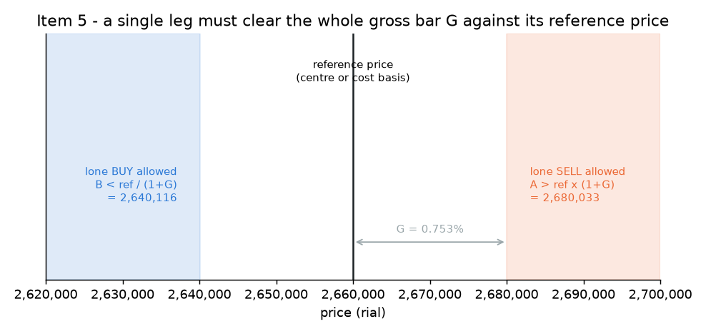

# Crypto Market-Making Project

## Project info

This repository contains implementations and experiments focused on **limit order book (LOB) dynamics** in cryptocurrency markets.

The project currently includes:

* **Algorithm 1:** a custom depth-aware, inventory-skewed quoting strategy — **implemented, tested, and runnable live** against Nobitex.
* **Algorithm 2:** the Avellaneda-Stoikov optimal market-making model — **not implemented**. Only documented below and explored in parameter-estimation notebooks (`market_maker/research/`). See [Algorithm 2](#algorithm-2-avellaneda-stoikov-model) for the full model and [Known limitations / next steps](#known-limitations--next-steps) for the honest picture of what's missing.

The goal of this project is to simulate, backtest, and compare different market-making approaches on cryptocurrency order book data.

| | Algorithm 1 | Algorithm 2 |
|---|---|---|
| Status | Implemented, tested | **Not implemented** (stub only) |
| Code | `market_maker/strategy/algo1.py` | `market_maker/strategy/algo2.py` (raises `NotImplementedError`) |
| Runnable live | Yes, via `run.py --algorithm algo1` | No |

---

## Table of contents

- [Limit order book and market-making fundamentals](#limit-order-book-and-market-making-fundamentals) — start here if you're new to the topic
  - [What is a limit order book?](#what-is-a-limit-order-book)
  - [Key order book terms](#key-order-book-terms)
  - [What is market making?](#what-is-market-making)
  - [Core risks a market maker faces](#core-risks-a-market-maker-faces)
  - [Two approaches in this repository](#two-approaches-in-this-repository)
- [Algorithm 1: Distance-Anchored, Expected-Value Quoting (version 2)](#algorithm-1-distance-anchored-expected-value-quoting-version-2)
  - [Main idea](#main-idea)
  - [Order book notation](#order-book-notation)
  - [Step 1: inventory position and quote centre](#step-1-inventory-position-and-quote-centre)
  - [Step 2: candidates by distance](#step-2-candidates-by-distance)
  - [Step 3: fill probability](#step-3-fill-probability)
  - [Step 4: expected value and selection](#step-4-expected-value-and-selection)
  - [Step 5: one-sided quotes](#step-5-one-sided-quotes)
  - [Step 6: hysteresis](#step-6-hysteresis)
  - [Algorithm 1 summary](#algorithm-1-summary)
  - [Output of Algorithm 1](#output-of-algorithm-1)
  - [Algorithm 1 in practice: the example book](#algorithm-1-in-practice-the-example-book)
- [Algorithm 1 pipeline: code trace](#algorithm-1-pipeline-code-trace)
  - [Pipeline overview](#pipeline-overview)
  - [Stage 6 — the strategy, function by function](#stage-6--the-strategy-function-by-function)
  - [Stage 7 — engine-side checks](#stage-7--engine-side-checks)
  - [Logical weaknesses: status after version 2](#logical-weaknesses-status-after-version-2)
- [Algorithm 2: Avellaneda-Stoikov Model](#algorithm-2-avellaneda-stoikov-model)
  - [The idea](#the-idea)
  - [The formulas](#the-formulas)
  - [Reading the formulas in plain English](#reading-the-formulas-in-plain-english)
  - [What's missing to implement it](#whats-missing-to-implement-it)
  - [Algorithm 1 vs. Algorithm 2](#algorithm-1-vs-algorithm-2)
- [Architecture](#architecture)
- [Project structure](#project-structure)
- [Tracked vs. local-only files](#tracked-vs-local-only-files)
- [Setup, running, and testing](#setup-running-and-testing)
- [Known limitations / next steps](#known-limitations--next-steps)
- [Extending](#extending)
- [Example workflow](#example-workflow)
- [Research purpose](#research-purpose)
- [Disclaimer](#disclaimer)

---

# Limit order book and market-making fundamentals

This section is a from-scratch primer. If you already know what a bid, an
ask, and a spread are, skip to [Algorithm 1](#algorithm-1-depth-aware-inventory-skewed-quoting-strategy).

## What is a limit order book?

Almost every modern exchange — crypto or otherwise — matches buyers and
sellers through a **limit order book (LOB)**. Instead of negotiating
directly with a counterparty, every participant submits a **limit order**:
an instruction of the form "buy up to X units at price P or better" (or
the sell equivalent). The exchange collects every open order into two
ordered lists:

* The **bid side** — every outstanding *buy* order, sorted from the
  highest offered price (the most eager buyer) down to the lowest.
* The **ask side** (also called the *offer* side) — every outstanding
  *sell* order, sorted from the lowest offered price (the most eager
  seller) up to the highest.

A trade happens the instant a new order's price crosses an order already
resting on the other side — the exchange matches them automatically, at
the resting order's price. Everything that doesn't cross yet simply
*rests* in the book, visible to everyone, until it's matched or cancelled.

Two orders at the exact same price are typically matched in **price-time
priority**: the better price is always filled first, and among orders at
the same price, the one that arrived first is filled first. This is why
being an early, well-priced order in the book matters — it's queued ahead
of everyone who arrives later at the same price.

## Key order book terms

These are used throughout this README and the codebase; Algorithm 1's
notation below builds directly on them.

| Term | Meaning |
|---|---|
| **Best bid** (`B0`) | The highest price any buyer is currently willing to pay. |
| **Best ask** (`A0`) | The lowest price any seller is currently willing to accept. |
| **Spread** | `A0 - B0` — the gap between the best bid and best ask. A tighter spread generally means a more liquid, more competitively traded market. |
| **Mid-price** | `(B0 + A0) / 2` — a common single-number reference for "the price" of the asset right now, even though no trade necessarily happens exactly there. |
| **Depth / level** | Orders don't all sit at the best price — some rest one tick below the best bid (`B1`), one tick below that (`B2`), and so on (mirrored on the ask side as `A1`, `A2`, ...). "Depth" is how much volume is available at or near the top of the book; a "level" is one specific price tier away from the touch. |
| **Tick size** | The smallest allowed price increment on the exchange — prices can only take values that are multiples of the tick size. |
| **Order book imbalance** | The relative amount of resting volume on the bid side vs. the ask side. Heavy bid-side volume can signal upward pressure (more people want in than out), and vice versa — though it's a signal, not a guarantee. |
| **Inventory** | How much of the asset a market maker currently holds (positive = long, negative = short), as a result of its own past fills. |

## What is market making?

A **market maker** is a participant who continuously quotes *both* sides
of the book at once — a bid to buy and an ask to sell, usually straddling
the current mid-price — rather than taking a directional view on where
price is headed. Their business is the **spread**: buy low (at their bid,
when someone sells to them), sell high (at their ask, when someone buys
from them), and pocket the difference, over and over, at high volume and
thin margin per trade.

This is a genuine service to the market — it's what lets any other trader
buy or sell *immediately* at a reasonable price instead of waiting for a
matching counterparty to show up — and exchanges often reward market
makers with lower fees (sometimes rebates) in exchange for it. But it is
not free money: every quote a market maker posts is a standing offer that
*anyone* can trade against, including someone who knows something the
market maker doesn't yet. That asymmetry is where most of the risk below
comes from.

## Core risks a market maker faces

* **Inventory risk.** Every fill on one side leaves the market maker
  holding more or less inventory than before. If the price then moves
  against that position before it can be worked back to neutral, the
  market maker loses money on the position itself — separately from
  whatever spread it earned getting into it. This is *the* central
  tension a market-making strategy has to manage: quote tightly and
  symmetrically to maximize fill rate and spread capture, or skew quotes
  to manage inventory and accept fewer/worse fills. Both algorithms in
  this repo exist specifically to answer that tradeoff — Algorithm 1 by
  a direct, rule-based inventory skew (see [Step 2](#step-2-inventory-dependent-level-pair-generation)); Algorithm 2 by solving
  it as a formal utility-maximization problem (see [The formulas](#the-formulas)).
* **Adverse selection risk.** A market maker's quotes are filled
  precisely when someone *wants* to trade against them — and the people
  most eager to trade right now are often the ones who know the price is
  about to move (news, a large incoming order, a faster/better-informed
  trader). Getting filled isn't automatically good news; it can mean
  being picked off just before the market moves against the new
  position.
* **Execution risk.** The reverse problem: a quote sitting in the book is
  not guaranteed to be filled at all. If the market moves away before
  anyone trades against it, the market maker earns nothing on that quote
  and has to reprice — repeatedly, if the market keeps moving.
  Quoting too conservatively (too far from the touch) reduces adverse
  selection risk but increases execution risk; quoting too aggressively
  does the opposite. There is no setting that eliminates both.
* **Order book / liquidity risk.** Depth is not static — it can thin out
  or disappear during volatile periods, exactly when a market maker most
  needs to unwind inventory. A strategy that assumes yesterday's depth
  will still be there today can end up quoting into a much thinner book
  than intended.
* **Tick-size and fee constraints.** A quote isn't valid or meaningful
  just because it looks profitable on paper — it has to land on an
  allowed tick, and it has to clear the exchange's trading commission
  *and* whatever minimum profit margin the strategy requires, or the
  "profit" is actually a loss once fees are paid. Both algorithms enforce
  this explicitly rather than assuming it away — see Algorithm 1's
  [Step 3](#step-3-spread-feasibility-condition) and this project's `commission_perc`/`exp_ret_min` config fields.

## Two approaches in this repository

1. A **deterministic depth-aware strategy** ([Algorithm 1](#algorithm-1-depth-aware-inventory-skewed-quoting-strategy)):
   a rule-based heuristic that reads inventory and order book depth
   directly and picks quotes from a fixed decision procedure — no
   probability model, no calibration required.
2. A **model-based optimal strategy** ([Algorithm 2](#algorithm-2-avellaneda-stoikov-model)):
   the Avellaneda-Stoikov framework, which models the market
   stochastically and *solves* for the utility-maximizing quotes given
   that model, at the cost of needing calibrated parameters for how the
   market actually behaves.

Algorithm 1 is a practical baseline that works today with no data-fitting
step. Algorithm 2 is a theoretical benchmark — more principled in theory,
but only as good as its calibration in practice, and not yet implemented
in this repository (see [Known limitations / next steps](#known-limitations--next-steps)).

---

# Algorithm 1: Distance-Anchored, Expected-Value Quoting (version 2)

> Full specification with every formula, the worked example and the test map:
> [`docs/algorithms/ALGORITHM_1_V2.md`](docs/algorithms/ALGORITHM_1_V2.md).
> Where the fill probabilities come from: [`docs/algorithms/FILL_MODEL.md`](docs/algorithms/FILL_MODEL.md).
> What changed from version 1 and why: [`docs/algorithms/CHANGES_V1_TO_V2.md`](docs/algorithms/CHANGES_V1_TO_V2.md).
> Version 1 is kept on the branch `MM_algo1v1`.

## Main idea

A market maker earns the spread between a buy it fills and a sell it fills.
Algorithm 1 decides, once per round, **where** to put its bid and its ask so
that the round trip is profitable after fees *and* has a realistic chance of
happening. Version 2 keeps the profitability rule of version 1 and changes how
candidates are built and chosen:

1. the inventory moves a **quote centre** away from the mid-price
   (too many coins → centre below the mid → selling is favoured);
2. candidate prices are placed at fixed **distances** from the centre (0.05 %,
   0.07 %, 0.10 %, … 1.45 %) and anchored one tick inside the first real book
   level beyond each distance;
3. every candidate gets a **fill probability** for one order lifetime, from a
   table measured on the project's own data or a parametric fallback;
4. every bid/ask pair is scored by **expected value** — chance both legs fill
   × net profit, minus the expected cost of only one leg filling — and the best
   pair that clears the profit bar is quoted;
5. when the inventory sits at a band edge, or when no pair but one leg is
   profitable against a reference price, a **single side** is quoted;
6. a resting price within a few ticks of the new one is **kept** instead of
   being cancelled and re-posted.

The engine then sizes the orders with the linear inventory rule (unchanged)
and sends them.

## Order book notation

| Symbol | Meaning |
|---|---|
| $b_i, v^b_i$ / $a_j, v^a_j$ | bid / ask price and volume at level $i$ / $j$; level 0 is the best |
| $m = (b_0 + a_0)/2$, $\epsilon$ | mid-price; tick (10 rial on IRT pairs) |
| $q,\ q_{\min},\ q_{\max}$ | inventory and its band |
| $f,\ r_{\min}$ | fee per leg; required net return per round trip (`commission_perc`, `exp_ret_min`) |
| $G = (1+r_{\min})/(1-f)^2 - 1$ | gross bar ≈ $2f + r_{\min}$ (0.753 % at 0.25 %/0.25 %) |
| $\tau$ | order lifetime (`cancel_after_minutes`) |

## Step 1: inventory position and quote centre

$$x = \operatorname{clamp}\!\left(\frac{q - q_{\min}}{q_{\max} - q_{\min}},\,0,\,1\right),\qquad
c = m\,\bigl(1 - \sigma_q\,(2x - 1)\bigr)\quad(\sigma_q = \texttt{skew\_perc}).$$

Half-full inventory leaves $c = m$; a full band moves the centre $\sigma_q$ below
the mid, an empty band $\sigma_q$ above it. Inventory outside the band saturates
instead of disabling the quote.


## Step 2: candidates by distance

Grid $\delta_k = \delta_{\min}\rho^{k-1}$ while $\delta_k \le \delta_{\max}$
(`grid_min_perc`, `grid_ratio`, `grid_max_perc`). For each distance:

$$B_\delta = b_{i(\delta)} + \epsilon,\ \ i(\delta) = \min\{i : b_i \le c(1-\delta)\};\qquad
A_\delta = a_{j(\delta)} - \epsilon,\ \ j(\delta) = \min\{j : a_j \ge c(1+\delta)\}.$$

If the book ends before the target the tick-rounded target is used
(*synthetic* candidate). Candidates never cross the touch ($B \le a_0-\epsilon$,
$A \ge b_0+\epsilon$); duplicates are kept once; the realised distance
$(c-B)/c$ is what the fill model sees.


## Step 3: fill probability

$p(\delta)$ = P(an order at distance $\delta$ is filled within $\tau$): the
measured table `fill_table_<pair>.json` when fresh, else

$$p(\delta) = 1 - \exp\!\bigl(-\lambda_\tau e^{-\kappa\delta}\bigr)\qquad(\kappa = \texttt{fill\_kappa},\ \lambda_\tau = \texttt{fill\_lambda\_tau}).$$


## Step 4: expected value and selection

$$R_{\text{net}} = (1-f)^2\frac{A}{B} - 1,\qquad
J = p_b\,p_a\,R_{\text{net}} - \eta\bigl[p_b(1-p_a) + p_a(1-p_b)\bigr],$$

$$(B^*, A^*) = \arg\max J \quad\text{over pairs with } R_{\text{net}} > r_{\min} \text{ and } J > J_{\min}.$$

All pairs are scored; nothing is hidden behind a single failing pair.


## Step 5: one-sided quotes

A lone ask is allowed when $A > P_{\text{ref}}(1+G)$, a lone bid when
$B < P_{\text{ref}}/(1+G)$, with $P_{\text{ref}}$ the centre or — for a sell of
inventory we bought ourselves — its average cost $\bar P$. Used when
$x \ge$ `one_sided_hi` (asks only), $x \le$ `one_sided_lo` (bids only), or as the
fallback when no pair is feasible.



## Step 6: hysteresis

A new price within `hysteresis_ticks` of the resting one, while the resting
quote is younger than `refresh_seconds`, is replaced by the resting price; the
engine does not re-post a side when one of its own orders already rests within
that window (`resting_order_kept`).

## Algorithm 1 summary

```text
inputs : book {bids, asks, lastTradePrice}, inventory q, cfg
x  = clamp((q − inv_min)/(inv_max − inv_min), 0, 1);   c = mid·(1 − skew·(2x − 1))
bids, asks = anchored candidates on the distance grid (one tick inside the level; no cross)
p  = fill probability per candidate (table or formula)
if x ≥ hi: best lone ask vs (cost basis or c)       elif x ≤ lo: best lone bid vs c
else: best pair by J with R_net > r_min and J > ev_min;  if none: best lone leg;  if none: no quote
apply hysteresis;  return {bid, ask (either may be None), levels, economics, probabilities, reason}
```

## Output of Algorithm 1

`bid`, `ask` (either may be `None`), `bid level`, `ask level`, `mid price`,
`centre`, `inventory position`, `gross return`, `net return`, `relative quoted
spread`, `min required return`, `bid distance`, `ask distance`, `bid exec prob`,
`ask exec prob`, `expected value`, `quote mode` (`pair` / `bid_only` /
`ask_only`), `selection reason`, `reference price`, `bid kept`, `ask kept`.
No-quote reasons: `invalid_or_single_level_order_book`, `no_candidates`,
`no_side_clears_bar`, `expected_value_below_floor`.

## Algorithm 1 in practice: the example book

USDT/IRT, fee 0.25 %, `exp_ret_min` 0.25 %, 25 of 50 USDT held, formula fill
model. Candidate distances 0.07 / 0.19 / 0.38 / 0.75 / 1.13 / 1.50 % on both
sides with fill probabilities 0.52 / 0.38 / 0.20 / 0.05 / 0.011 / 0.0025.
Winner: bid **2,650,010** / ask **2,669,990** (levels 4 / 4),
$R_{\text{net}} = 0.2508\%$, $J = 0.0100\%$ per 10-minute lifetime. With 48 of 50
USDT held and a cost basis of 2,640,000 the algorithm quotes a single sell at
2,664,990 ($R_{\text{net}} = 0.44\%$); version 1 posted nothing there. The engine
sizes the orders: 1 USDT each at 25/50, a 1.92 USDT sell at 48/50.

---

# Algorithm 1 pipeline: code trace

## Pipeline overview

```text
run.py main() ── make_cfg(profile, mode) ── make_bot(cfg) ── SimpleMarketMaker.run()
                                                                    │
   every time_step seconds:  (A) update_filled_amounts              │ engine.py
                             (B) exchange.get_orderbook             │ exchange/nobitex.py
                             (C) update_inventory_and_cash          │
                             (C2) cancel stale orders               │
                             (D) strategy.decide_order(ob, inv) ◄───┼── strategy/algo1.py + fill_model.py
                             (E) get_open_order_totals → sizes      │ _inventory_sized_order_targets
                             (F) sell leg → send_order  (skipped if ask is None / resting)
                             (G) buy  leg → send_order  (skipped if bid is None / resting)
                             (H) CSV row, Telegram, sleep
```

## Stage 6 — the strategy, function by function

| Function (`strategy/algo1.py`) | Step | What it returns |
|---|---|---|
| `inventory_position(q)` | 1 | $x \in [0,1]$ |
| `quote_centre(ob, q)` | 1 | $c$, or `None` for a crossed/empty top of book |
| `distance_grid()` | 2 | the list of $\delta_k$ |
| `build_candidates(ob, c)` | 2 | two lists of `Candidate(price, distance, level, anchored, volume_ahead)` |
| `fill_probability(candidate)` | 3 | $p$ via `FillModel.probability`, times the optional queue factor |
| `pair_value(bid, ask)` | 4 | `PairResult(gross, net, expected_value, passed)` |
| `single_value(candidate, reference)` | 5 | `SingleResult(net, expected_value, passed)` |
| `evaluate(ob, q)` | 4–5 | the whole decision (`Evaluation`), pure |
| `decide_order(ob, q)` | 6 | the quote dict after hysteresis and cost-basis update |
| `diagnostics(ob, q, round_no=, session_id=)` | — | JSON-safe document of the same decision, pure |
| `no_quote_reason(ob, q)` | — | the reason string |

## Stage 7 — engine-side checks

Unchanged from version 1 except that a side the strategy left out is skipped
(`one_sided_quote`) and a side whose price is within `hysteresis_ticks` of one
of our resting orders is not re-posted (`resting_order_kept`). Sizes, cash and
inventory caps and the locked-exposure guards are as described in
[`PROJECT_GUIDE.md` §7](PROJECT_GUIDE.md#7-how-order-sizes-are-decided).

## Logical weaknesses: status after version 2

| Version-1 finding | Status |
|---|---|
| W1 inventory skew silently dropped in a shallow book | fixed — candidates are distances, synthetic when the book is shallow |
| W2 `d_q` unclamped and asymmetric | fixed — $x$ clamped, continuous centre shift |
| W3 one-tick improvement untested for profitability | unchanged (already fixed before v2): the bar is applied to the submitted prices |
| W4 `break` assumes a monotone book | fixed — all pairs scored |
| W5 the bid can never quote at level 0 | fixed — candidates may anchor at level 0 without crossing |
| W6 execution probability is a placeholder | fixed — fill model (table + fallback) |
| W7 no volatility / imbalance / trade-flow input | open — see `Suggested Algorithm/` (Algorithms 3 and 4) |
| W8 `denom == 0` and standalone `exp_ret_min = None` raise | fixed — position defaults to 0.5; `exp_ret_min` bootstraps to the fee |

Still open and outside the strategy: transient API errors stop the live
worker, no HTTP 403 back-off, full closed-order history polling, orphan
orders after a crash (PROJECT_GUIDE.md §9).

---

# Algorithm 2: Avellaneda-Stoikov Model

**Current status: not implemented.** This section documents the model this repository intends to implement, not a working feature. `market_maker/strategy/algo2.py` (`Algo2Strategy`) is a placeholder whose `decide_order()` raises `NotImplementedError`; `market_maker/research/` holds notebooks that estimate two of the model's parameters (see below) but do not implement the quoting decision itself.

## The idea

In the Avellaneda-Stoikov framework:

* the mid-price is modeled as a stochastic process (typically arithmetic Brownian motion with volatility (\sigma))
* order arrivals depend on quote distance from the mid-price, with intensity governed by a decay parameter (\kappa)
* the market maker chooses bid and ask quotes to maximize expected utility over a finite time horizon
* the utility function balances expected profit against inventory risk, controlled by a risk-aversion parameter (\gamma)

The model produces two things: a **reservation price** (a mid-price adjusted for current inventory) and an **optimal spread** around it.

## The formulas

The reservation price, given current mid-price (s), inventory (q), risk aversion (\gamma), volatility (\sigma), and time remaining (T-t):

```math
r(s, q, t) = s - q \, \gamma \, \sigma^2 \, (T - t)
```

Positive inventory ((q > 0)) shifts the reservation price down (encouraging sells); negative inventory shifts it up (encouraging buys) — the same qualitative goal as Algorithm 1's inventory skew, reached through a different, stochastic-control derivation.

The optimal total spread around the reservation price:

```math
\delta_b + \delta_a = \gamma \, \sigma^2 \, (T - t) + \frac{2}{\gamma} \ln\left(1 + \frac{\gamma}{\kappa}\right)
```

giving bid/ask quotes:

```math
p_b = r(s,q,t) - \delta_b, \qquad p_a = r(s,q,t) + \delta_a
```

(In the symmetric formulation above, half the total spread sits on each
side: (\delta_b = \delta_a = \frac{1}{2}(\delta_b+\delta_a)), so the bid
and ask are placed equally far from the reservation price.)

## Reading the formulas in plain English

The reservation price is what Algorithm 1's inventory skew ([Step 2](#step-2-inventory-dependent-level-pair-generation))
is doing informally, made precise: instead of picking a *level* to shift
toward, Avellaneda-Stoikov computes an actual *price* — a "fair value"
that has already been shifted away from the true mid-price (`s`) to
account for inventory risk, and centers both quotes on that adjusted
price instead of on the raw mid-price.

* **`-q * gamma * sigma^2 * (T-t)`** is the size of that shift. It grows
  with three things, each for an intuitive reason:
  * **`q`** (inventory): more inventory, more risk, more urgency to shift
    the price to encourage trading it off.
  * **`sigma^2`** (volatility): in a calmer market, holding inventory
    for a while is not very risky, so the model barely needs to shift
    away; the more volatile the price, the more that same inventory
    could swing in value before it's unwound, so the shift grows.
  * **`(T-t)`** (time remaining): far from the end of the trading
    horizon, there's more time left for the price to move against an
    open position, so the model shifts more; as `t -> T`, this term
    shrinks toward zero and the reservation price converges back to the
    plain mid-price.
  * **`gamma`** (risk aversion) scales all of the above — a more
    risk-averse market maker shifts its price further for the same
    inventory/volatility/time.
* **The optimal spread** `delta_b + delta_a` has two additive pieces with
  different jobs:
  * **`gamma * sigma^2 * (T-t)`** — the same "risk penalty" term as the
    reservation-price shift, widening the spread to compensate for
    holding inventory risk over the remaining horizon.
  * **`(2/gamma) * ln(1 + gamma/kappa)`** — a separate term driven by
    **`kappa`**, how quickly order arrivals fall off as a quote moves
    away from the mid-price (a market where orders arrive readily even
    far from mid has a *small* effect from widening — low `kappa`
    sensitivity — while a market where arrivals drop off sharply as you
    move away punishes a wide quote with far fewer fills — high `kappa`
    sensitivity). This term balances "quote wide enough to earn a good
    spread per fill" against "don't quote so wide that fills stop
    arriving at all."

The practical difference from Algorithm 1: Algorithm 1 answers "which
*existing order-book level* should I quote at?" using today's real book
depth. Avellaneda-Stoikov answers "what *price* is optimal?" using a
model of how the market behaves — which is more principled if that model
is correctly calibrated to the real market ((\sigma) and (\kappa) fit from
data), but produces nothing meaningful if it isn't.

## What's missing to implement it

* Coding the formulas above into `Algo2Strategy.decide_order()`.
* A source for (\sigma) (volatility) and (\kappa) (order-arrival intensity decay) — `market_maker/research/sigma_estimation.ipynb` and `market_maker/research/kappa_estimation.ipynb` estimate these from historical trade/order-book data, but as of today are exploratory notebooks with hardcoded local file paths, not a callable estimation module.
* A decision on (\gamma) (risk aversion) and (T) (time horizon) as configuration.
* Characterization tests analogous to Algorithm 1's, once there's real behavior to pin.

## Algorithm 1 vs. Algorithm 2

* Algorithm 1 is deterministic and order-book based; Avellaneda-Stoikov is stochastic and model-based.
* Algorithm 1 is easier to implement, interpret, and test; Avellaneda-Stoikov requires calibrating (\sigma) and (\kappa) from data.
* Algorithm 1 is implemented and running; Avellaneda-Stoikov is a documented target, not yet built.

---

# Architecture

```
                  ┌─────────────────────┐
   run.py  ─────► │  SimpleMarketMaker   │  (the engine: run() loop,
  --algorithm     │      (engine.py)      │   inventory/cash/PnL bookkeeping,
  --exchange      └──────────┬───────────┘   CSV + MySQL persistence,
  --profile                  │               optional Telegram notify)
  --mode         ┌───────────┼───────────┐
                 ▼                       ▼
        ┌─────────────────┐      ┌──────────────────┐
        │     Strategy      │      │   ExchangeClient   │
        │ (strategy/base.py) │      │ (exchange/base.py)  │
        └────────┬─────────┘      └─────────┬────────┘
                 │                           │
     ┌───────────┴───────────┐    ┌──────────┼──────────────┐
     ▼                       ▼    ▼                          ▼
Algo1Strategy          Algo2Strategy   NobitexExchangeClient   DemoExchangeClient
(implemented,           (stub, raises  (get_orderbook,          (wraps a real
 fully tested)           NotImplementedError) send_order,        NobitexExchangeClient for
                                              wallet_balance,     market data; send_order is
                                              order status/       simulated -- --mode demo)
                                              cancellation via
                                              order_status.py)
```

* **`Strategy`** (`market_maker/strategy/base.py`): the only method the engine relies on is `decide_order(orderbook, inventory) -> quote_dict | None`. Anything implementing this can be plugged into `SimpleMarketMaker` via its optional `strategy=` constructor argument (defaults to `Algo1Strategy` if omitted).
* **`ExchangeClient`** (`market_maker/exchange/base.py`): `get_orderbook`, `send_order`, `wallet_balance`, `get_order_list_status`, `cancel_order`, `cancel_all_open_orders`, `cancel_old_orders`. `SimpleMarketMaker` takes an `exchange=` constructor argument (required) implementing this. Two implementations exist: `NobitexExchangeClient` (real) and `DemoExchangeClient` (real market data, simulated fills — see usage.md §1b).
* **`portfolio.py`** (`Nobitex_portfolio`): read-only wallet/portfolio valuation helper, independent of the trading engine. **Still Nobitex-specific** — not behind `ExchangeClient` (see [Known limitations](#known-limitations--next-steps)).
* **`order_status.py`** (`OrderStatusChecker`, `OrderCanceller`): raw Nobitex order-status/cancellation HTTP calls, composed inside `NobitexExchangeClient` rather than called directly by the engine.
* **`config.py`** (`MMConfig`): a single dataclass holding both strategy knobs (`inv_max`, `depth_max`, `commission_perc`, ...) and exchange config (`token`, `url_send_order`, ...). Not yet split — see [Known limitations](#known-limitations--next-steps). Also defines `TRADING_PROFILES` (every currency pair's full config, including its demo starting inventory) and `RESULTS_DIR`/`demo_csv_path` (where `run.py` and `dashboard.py` both write/read CSV output) — the single source of truth both modules import from, so they can never disagree about a pair's settings or file locations.
* **`run.py`**: the single entry point. `STRATEGIES`/`EXCHANGES` registries (algorithm/exchange choices) plus `config.TRADING_PROFILES` (currency-pair configs) select what actually runs; `--mode real|demo` selects real vs. simulated order placement.
* **Telegram notifications & cost tracking** (`engine.py` + `telegram_lifecycle.py`, optional): `SimpleMarketMaker` can push a startup message, a per-round summary (quote, market data, inventory/cash/wealth, buy/sell activity, transaction cost this round, and cumulative cost per-symbol and combined), and threaded order-lifecycle replies (opened/partial/filled/cancelled, each reason-tagged) to a Telegram chat if `TELEGRAM_BOT_TOKEN`/`TELEGRAM_CHAT_ID` are set. Each round's summary is the parent message that lifecycle updates reply to. Cumulative fee totals persist across restarts in `results/paper_fee_scopes.json`. Entirely best-effort — never raises, never required. See usage.md §1.7/§6.8.

---

# Project structure

Everything lives under one top-level package, `market_maker/`, with three
small Docker files at the repo root for containerized runs:

```text
Dockerfile                       One image (Python + deps + market_maker/), used
                                  by every docker-compose service below
docker-compose.yml                 session-init / btc-demo / usdt-demo / dashboard
docker-compose.validation.yml        credential-empty override for audits (usage.md §6.6)
.dockerignore                       Excludes .env, results/, .git, tests/, etc.

market_maker/
  engine.py             SimpleMarketMaker: the run() loop and engine glue
  fill_model.py         fill-probability table + parametric fallback used by Algorithm 1 v2
  tools/build_fill_table.py  builds fill_table_<pair>.json from the CSVs (daily job)
  config.py              MMConfig dataclass; TRADING_PROFILES (per-pair
                          config incl. demo_inv_initial); RESULTS_DIR /
                          demo_csv_path; loads secrets from .env
  safety.py               Demo/Real mode guards (TradingMode, DemoSafetyError)
  session.py               Shared stack-session file + WorkerLease (Docker)
  paper.py                  Canonical Demo paper-order ledger: open-first
                             lifecycle, partial fills, locks, fee scopes,
                             cancellation reasons/context, archive rotation
  result_store.py            DemoResultStore: bounded SQLite round history
                              behind the CSV export dashboard.py reads
  no_quote.py                 NoQuoteMonitor: sustained no-quote episode
                               tracking/alerting, no strategy change
  telegram_lifecycle.py        PaperTelegramReporter: round-summary-threaded
                                order opened/partial/filled/cancelled messages
  portfolio.py            Nobitex_portfolio: wallet/portfolio valuation
  order_status.py         OrderStatusChecker, OrderCanceller (raw Nobitex calls)
  run.py                  Entry point: --algorithm / --exchange / --profile /
                           --mode / --continuous; installs shutdown signal handlers
  dashboard.py             Dash history dashboard, reads SQLite (falls back to CSV)
  strategy/
    base.py                Strategy interface (decide_order contract)
    algo1.py                Algorithm 1 v2: distance-anchored, expected-value quoting (pure, no I/O)
    algo2.py                Algorithm 2 stub (raises NotImplementedError)
  exchange/
    base.py                 ExchangeClient interface
    nobitex.py                NobitexExchangeClient (Nobitex HTTP calls)
    demo.py                    DemoExchangeClient (real data, simulated fills
                                driven by the canonical paper.py ledger)
  research/
    kappa_estimation.ipynb    Estimates Algorithm 2's kappa parameter
    sigma_estimation.ipynb     Estimates Algorithm 2's sigma parameter
    algo2.ipynb                 Empty -- was meant to hold Algorithm 2's implementation
  tests/                   pytest suite (171 deterministic tests; run from repo root)
  results/                 stack_session.json, *_track_demo.sqlite3 (canonical),
                            *_track_demo.csv (bounded export), paper_<session>_<symbol>.json
                            (hot ledger) + *_archive*.jsonl (rotated terminal orders),
                            paper_fee_scopes.json (cumulative fees) --
                            gitignored runtime state; directory itself tracked via .gitkeep
  .env.example              Template for required environment variables
  .env                      Real secrets -- gitignored, never committed
```

No other top-level code directory exists — there used to be a separate `algo2_/` folder holding only notebooks; it's gone, and its contents now live in `market_maker/research/` above, renamed to consistent `snake_case` (`Alg2.ipynb` → `algo2.ipynb`, `Kapa Estimation.ipynb` → `kappa_estimation.ipynb`, fixing a typo in the filename along the way; `sigma_estimation.ipynb` was already correctly named).

---

# Tracked vs. local-only files

Everything under `market_maker/` and this README are committed and visible to the whole team (and anyone with repo access). These are deliberately gitignored and never pushed:

| Path | What it is | Why it's local-only |
|---|---|---|
| `market_maker/.env` | Real Nobitex token, MySQL credentials, optional Telegram bot token/chat id | Secrets — `market_maker/.env.example` is the committed template |
| `market_maker/results/*.csv` | Every `run.py` session's logged output (real and demo, both pairs) | Runtime data, machine-specific, not a project deliverable — the `results/` directory itself is tracked (via `.gitkeep`) so it always exists |
| `market_maker/results/*.sqlite3(-wal/-shm)` | Canonical bounded Demo round history behind the CSV export (usage.md §6.4) | Local runtime database, machine-specific |
| `market_maker/results/paper_*.json`, `paper_*_archive*.jsonl` | Canonical Demo paper-order ledger, cumulative fee scopes, and rotated terminal-order archives | Local runtime state, regenerated per machine, not meaningful to share |
| `docs/reports/` | This author's own working notes on the refactor (audit/fix reports, decisions, deferred items) | Personal analysis notes, not a project deliverable |

If you're missing `market_maker/.env`, copy `market_maker/.env.example` and fill in real values — see **[usage.md](usage.md)** for full setup, running, and testing instructions. `reports/` isn't needed to build, test, or run anything — it exists only as a paper trail for this refactor.

---

# Setup, running, and testing

Full details — environment setup, every way to run the bot (which modes touch a real account/real money and which don't), and how to run the test suite — are in **[usage.md](usage.md)**, kept as its own document so this README stays focused on what the project *is* rather than how to operate it.

Quick summary: `run.py --profile btc|usdt` places **real orders on Nobitex with real money** and needs a live MySQL server. `--mode demo` trades against the same real market data with a deterministic simulated paper-order lifecycle instead (open-first, partial fills, queue/stale/shutdown cancellation) — no real orders, no MySQL required (see usage.md §1b). The test suite (`python3 -m pytest -q` from the repo root) needs neither a real account, MySQL, nor network/Telegram access — all 171 tests are deterministic (mocks and replay fixtures).

An investor-facing update on Algorithm 1 version 2 and the demo (the quoting rule with formulas and pseudocode, the fill model, every dashboard figure explained, the demo-to-real gate, and Algorithm 3 as the next step) is in **[docs/reports/INVESTOR_UPDATE_2026-10-11.md](docs/reports/INVESTOR_UPDATE_2026-10-11.md)**.

A live-updating results dashboard (`python dashboard.py`) shows, for every real/demo × BTC/USDT track, the headline numbers (quote rate, fills per hour, realised vs computed spread, adverse selection, PnL, inventory position), one round's quote decision (candidate ladder, expected-value heat map, decision trace), the fill model (measured table vs formula, calibration), the order-book view, the demo-to-real validation gate and every round as a table — see usage.md §3. A separate, authenticated admin control page (`python admin_app.py`, Demo-only, no Real Mode surface) adds worker/session/config/backup control on top of that read-only view — see usage.md §3 and `docs/deployment/ADMIN_PAGE.md`.

`docker compose up -d --build --wait` (repo root) runs a shared session initializer, both pairs in continuous demo mode, the dashboard, and the authenticated Admin service, sharing bind-mounted runtime data. Admin mutations use the separate local host agent (`python3 deploy/control_agent.py --mode local`) rather than a Docker socket — see usage.md §6–7.

---

# Known limitations / next steps

* **`config.py` mixes strategy and exchange config** in one `MMConfig` dataclass. Splitting it (e.g. `StrategyConfig` + `ExchangeConfig`) was deferred to keep each refactor step small; do it before adding a second exchange, since exchange-specific fields (`url_send_order`, ...) would otherwise leak into every strategy's config.
* **Persistence (`save_to_db`, the MySQL connection in `__init__`) is not behind an interface** — `SimpleMarketMaker` still requires a live MySQL server to be constructed at all. Extracting a `TradeLogStore` interface (mirroring `ExchangeClient`) is the natural next seam.
* **`portfolio.py`'s `Nobitex_portfolio` is not behind `ExchangeClient`** — `run.py`'s `--exchange` flag today only changes order execution/quotes, not portfolio valuation.
* **Git history contains the original hardcoded secrets** (the Nobitex token and MySQL password, from commits predating the `.env` migration). Moving them to `.env` stops new exposure but doesn't erase history — rotating both credentials is recommended and is a team/repo-owner decision.
* **Demo mode's fills are still an approximation, not a matching engine** — `--mode demo` now runs a paper-order lifecycle with level-1 delay/fraction, explicit trade evidence, finite per-observation fill budgets, optional queue-ahead consumption, adverse/non-adverse fill probabilities, and partial fills against real market data. It does not model Nobitex's real slippage or true queue priority. Transaction cost *is* simulated realistically from `commission_perc`, tracked per-symbol and combined across symbols, and reported via optional Telegram notifications. See usage.md §1b/§1.7/§6.8.
* **Algorithm 2 has no real implementation**, only a stub and this README's math — see [Algorithm 2](#algorithm-2-avellaneda-stoikov-model).

---

# Extending

**Add a new algorithm:** implement `Strategy` (`decide_order`) in `market_maker/strategy/`, add it to `run.py`'s `STRATEGIES` dict. No engine or exchange changes needed.

**Add a new exchange:** implement `ExchangeClient` (`market_maker/exchange/base.py`) in `market_maker/exchange/`, add it to `run.py`'s `EXCHANGES` dict. No engine or strategy changes needed.

**Add a new currency pair:** add an entry to `config.py`'s `TRADING_PROFILES` dict with the pair's `MMConfig` values (including its own `demo_inv_initial`). No new files, and `run.py`/`dashboard.py` pick it up automatically.

---

# Example workflow

A typical experiment follows this workflow:

```text
1. Load cryptocurrency order book data.
2. Initialize the portfolio and configuration.
3. For each order book snapshot:
       a. Compute bid and ask quotes using Algorithm 1 or Algorithm 2.
       b. Submit or simulate limit orders.
       c. Track order status.
       d. Update portfolio inventory and cash balance.
       e. Compute PnL and performance metrics.
4. Compare the performance of different strategies.
```

---

# Research purpose

This project is designed for experimentation with cryptocurrency market-making strategies.

Possible experiments include:

* comparing Algorithm 1 with Avellaneda-Stoikov (once implemented)
* studying how inventory limits affect performance
* testing different depth caps
* evaluating the effect of tick size
* measuring PnL and inventory stability
* studying quote aggressiveness under different market conditions
* adding empirical execution-probability models
* testing the strategy on different crypto assets

---

# Disclaimer

This project is for research and educational purposes only.

It is not financial advice and should not be used for live trading without careful testing, validation, and risk management.
