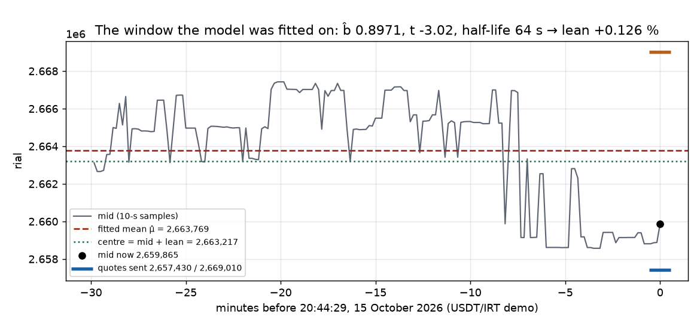
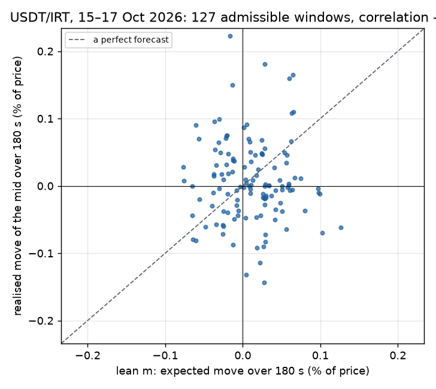

# Crypto Market-Making Project — branch MM_algo3

> **This branch runs MM_algo3**, a market maker with a mean-reverting price signal and quotes from stochastic
> control (the Avellaneda–Stoikov / Cartea–Jaimungal family), for the Nobitex exchange. Everything below
> describes MM_algo3. Other branches: [`MM_algo2`](https://github.com/Alireza77n/Limit-Order-Book/tree/MM_algo2) holds the order-book imbalance and
> microprice market maker with its own documentation, [`MM_algo1v2`](https://github.com/Alireza77n/Limit-Order-Book/tree/MM_algo1v2) Algorithm 1
> version 2, and `MM_algo1v1` the old version 1.

## Project info

This repository is a market-making bot for the Nobitex exchange, trading **BTC/IRT** and **USDT/IRT**.
Every round, a worker reads the order book, places one limit buy below the market and one limit sell above
it, and earns the difference when both fill, after the exchange fee on each. It runs in two modes:

* **demo** (paper trading): real order books, simulated fills in a local ledger;
* **live** (the forward test): real orders with real money.

A results dashboard and an authenticated admin panel go with it.

**MM_algo3** decides the two prices. Once per round it:

* fits a **mean-reverting model** of the price (Ornstein–Uhlenbeck) to the last 30 minutes of mids and, when
  the fit is trustworthy, **leans** its quotes toward the estimated mean;
* sets the **depths** of the two orders from the solution of an inventory-penalised control problem: the
  fee-free optimal half-spread $1/\kappa$ ($\kappa$ = how fast fills decay with depth, fitted on the fill
  table), plus or minus the lean, minus or plus the inventory **skew**, plus the fee;
* sends the pair on the tick, never crossing the touch, widened if needed to clear the fee bar.

Its code is `market_maker/strategy/algo4.py`.

| | MM_algo3 |
|---|---|
| Status | Implemented and tested (36 tests of its own). Runs on the **demo** of both pairs in its own lane, next to MM_algo2 and MM_algo1v2, since 23 October 2026. Not selected for live. |
| Code | `market_maker/strategy/algo4.py` (`Algo4Strategy`), shared arithmetic in `strategy/common.py`, the fill-intensity fit in `fill_model.py` (`FillTable.fit_intensity`) |
| Selected by | the demo lane switch `algo4_enabled` (admin panel → **Algorithm** → MM_algo3 → *Activate*); for live, the `algorithm` setting = `algo4`; on the command line `run.py --algorithm algo4` |
| Full specification | [`docs/algorithms/MM_algo3.md`](docs/algorithms/MM_algo3.md): the model, the derivation of the quotes, the estimation and its admissibility rule with measured rates, a worked example on a real window, the behaviour on the recorded demo series, settings, outputs, tests, limitations, and where it departs from the design note |
| The whole system explained | the guide `docs/guide/MARKET_MAKER_EXPLAINED.md` is rebuilt for this branch once MM_algo3 has run on the demo (its results part needs the numbers); until then the engine and system parts are those of the [`MM_algo2` branch's guide](https://github.com/Alireza77n/Limit-Order-Book/blob/MM_algo2/docs/guide/MARKET_MAKER_EXPLAINED.md) |

**Why the code says `algo4`.** MM_algo3 is the fourth algorithm designed for this project (design note
*"Algorithm 4 — Market Making with a Mean-Reverting Signal (Stochastic Control)"*), so its key in the code,
the settings and the recorded rounds is `algo4`. It is shown everywhere else as **MM_algo3**, the name of this
branch. `strategy/algo2.py` is unrelated: an empty placeholder for the plain Avellaneda–Stoikov model, which
MM_algo3 reduces to when its forecast is switched off (`algo4_use_alpha`).

**Other algorithms in the code** ([details](#other-algorithms-in-the-code)): **MM_algo2** (`strategy/algo3.py`,
key `algo3`) and **MM_algo1v2** (`strategy/algo1.py`, key `algo1`) stay selectable here, so the three can be
compared on the same dashboard, each in its own demo lane; their documentation lives on their own branches.

---

## Table of contents

- [Limit order book and market-making fundamentals](#limit-order-book-and-market-making-fundamentals) — start here if you're new to the topic
  - [What is a limit order book?](#what-is-a-limit-order-book)
  - [Key order book terms](#key-order-book-terms)
  - [What is market making?](#what-is-market-making)
  - [Core risks a market maker faces](#core-risks-a-market-maker-faces)
- [MM_algo3: a mean-reverting signal and optimal quotes](#mm_algo3-a-mean-reverting-signal-and-optimal-quotes)
  - [Main idea](#main-idea)
  - [Notation](#notation)
  - [Step 1: the price window and the fit](#step-1-the-price-window-and-the-fit)
  - [Step 2: is the forecast admissible?](#step-2-is-the-forecast-admissible)
  - [Step 3: the lean](#step-3-the-lean)
  - [Step 4: the depths](#step-4-the-depths)
  - [Step 5: prices on the tick, never crossing, and the fee bar](#step-5-prices-on-the-tick-never-crossing-and-the-fee-bar)
  - [Step 6: keeping a pair that barely moved](#step-6-keeping-a-pair-that-barely-moved)
  - [MM_algo3 summary](#mm_algo3-summary)
  - [Output of MM_algo3](#output-of-mm_algo3)
  - [MM_algo3 in practice: a real USDT window](#mm_algo3-in-practice-a-real-usdt-window)
  - [How MM_algo3 behaves on recorded data](#how-mm_algo3-behaves-on-recorded-data)
  - [Why the forecast is on, and what would switch it off](#why-the-forecast-is-on-and-what-would-switch-it-off)
- [MM_algo3 pipeline: code trace](#mm_algo3-pipeline-code-trace)
  - [Pipeline overview](#pipeline-overview)
  - [Stage 6 — the strategy, function by function](#stage-6--the-strategy-function-by-function)
  - [Stage 7 — engine-side checks](#stage-7--engine-side-checks)
- [Choosing and comparing algorithms](#choosing-and-comparing-algorithms)
- [Other algorithms in the code](#other-algorithms-in-the-code)
- [Architecture](#architecture)
- [Project structure](#project-structure)
- [Tracked vs. local-only files](#tracked-vs-local-only-files)
- [Setup, running, and testing](#setup-running-and-testing)
- [Known limitations / next steps](#known-limitations--next-steps)
- [Extending](#extending)
- [Research purpose](#research-purpose)
- [Disclaimer](#disclaimer)

---

# Limit order book and market-making fundamentals

This section is a from-scratch primer. If you already know what a bid, an
ask, and a spread are, skip to [MM_algo3](#mm_algo3-a-mean-reverting-signal-and-optimal-quotes).

## What is a limit order book?

Almost every modern exchange — crypto or otherwise — matches buyers and
sellers through a **limit order book (LOB)**. Instead of negotiating
directly with a counterparty, every participant submits a **limit order**:
an instruction of the form "buy up to X units at price P or better" (or
the sell equivalent). The exchange collects every open order into two
ordered lists:

* The **bid side** — every outstanding *buy* order, sorted from the
  highest offered price (the most eager buyer) down to the lowest.
* The **ask side** (also called the *offer* side) — every outstanding
  *sell* order, sorted from the lowest offered price (the most eager
  seller) up to the highest.

A trade happens the instant a new order's price crosses an order already
resting on the other side — the exchange matches them automatically, at
the resting order's price. Everything that doesn't cross yet simply
*rests* in the book, visible to everyone, until it's matched or cancelled.

Two orders at the exact same price are typically matched in **price-time
priority**: the better price is always filled first, and among orders at
the same price, the one that arrived first is filled first. This is why
being an early, well-priced order in the book matters — it's queued ahead
of everyone who arrives later at the same price.

## Key order book terms

These are used throughout this README and the codebase; MM_algo3's
notation below builds directly on them.

| Term | Meaning |
|---|---|
| **Best bid** ($b_0$) | The highest price any buyer is currently willing to pay. |
| **Best ask** ($a_0$) | The lowest price any seller is currently willing to accept. |
| **Spread** | $a_0 - b_0$, the gap between the best bid and the best ask. A tighter spread generally means a more liquid, more competitively traded market. |
| **Mid-price** | $(b_0 + a_0)/2$, a common single-number reference for "the price" of the asset right now, even though no trade necessarily happens exactly there. |
| **Depth / level** | Orders don't all sit at the best price. Level 0 is the best price on a side, level 1 the next price that has orders, and so on. "Depth" is how much volume rests at or near the top of the book. |
| **Tick size** | The smallest allowed price increment: 10 rial on Nobitex's rial pairs. Prices are multiples of it. |
| **Order book imbalance** | The relative amount of resting volume on the bid side against the ask side. Heavy bid-side volume can signal upward pressure (more people want in than out), and vice versa — a signal, not a guarantee. MM_algo2 (on its own branch) quotes on it; MM_algo3 does not read it. |
| **Microprice** | The mid shifted toward the side with *less* volume at the best level: if far more waits to buy than to sell, the ask is likely to be taken first, so the "fair" price sits nearer the ask. MM_algo3 centres on the mid and leans it with its own forecast instead. |
| **Inventory** | How much of the asset a market maker currently holds, as a result of its own past fills. |

## What is market making?

A **market maker** is a participant who continuously quotes *both* sides
of the book at once — a bid to buy and an ask to sell, usually straddling
the current mid-price — rather than taking a directional view on where
price is headed. Their business is the **spread**: buy low (at their bid,
when someone sells to them), sell high (at their ask, when someone buys
from them), and pocket the difference, over and over, at high volume and
thin margin per trade.

This is a genuine service to the market — it's what lets any other trader
buy or sell *immediately* at a reasonable price instead of waiting for a
matching counterparty to show up — and exchanges often reward market
makers with lower fees (sometimes rebates) in exchange for it. But it is
not free money: every quote a market maker posts is a standing offer that
*anyone* can trade against, including someone who knows something the
market maker doesn't yet. That asymmetry is where most of the risk below
comes from.

## Core risks a market maker faces

* **Inventory risk.** Every fill on one side leaves the market maker
  holding more or less inventory than before. If the price then moves
  against that position before it can be worked back to neutral, the
  market maker loses money on the position itself — separately from
  whatever spread it earned getting into it. MM_algo3 manages it twice:
  its depths are skewed against the inventory
  ([Step 4](#step-4-the-depths)), and the engine sizes each side by
  the inventory (more selling when full, more buying when empty).
* **Adverse selection risk.** A market maker's quotes are filled
  precisely when someone *wants* to trade against them — and the people
  most eager to trade right now are often the ones who know the price is
  about to move (news, a large incoming order, a faster/better-informed
  trader). Getting filled isn't automatically good news; it can mean
  being picked off just before the market moves against the new
  position. Centring on the microprice, rather than on the mid, is a
  first step against it: the quotes move toward where the price is more
  likely to go next.
* **Execution risk.** The reverse problem: a quote sitting in the book is
  not guaranteed to be filled at all. If the market moves away before
  anyone trades against it, the market maker earns nothing on that quote
  and has to reprice — repeatedly, if the market keeps moving.
  Quoting too conservatively (too far from the touch) reduces adverse
  selection risk but increases execution risk; quoting too aggressively
  does the opposite. There is no setting that eliminates both.
* **Order book / liquidity risk.** Depth is not static — it can thin out
  or disappear during volatile periods, exactly when a market maker most
  needs to unwind inventory. MM_algo3 reads how fast fills thin out with
  depth from the fill table ($\kappa$, [Step 4](#step-4-the-depths)) and
  pauses in a volatility burst when asked to.
* **Tick-size and fee constraints.** A quote isn't valid or meaningful
  just because it looks profitable on paper — it has to land on an
  allowed tick, and it has to clear the exchange's trading commission
  *and* whatever minimum profit margin the strategy requires, or the
  "profit" is actually a loss once fees are paid. MM_algo3 adds the fee to
  each depth and widens the pair to the fee bar whenever the model's own
  spread would fall short ([Step 5](#step-5-prices-on-the-tick-never-crossing-and-the-fee-bar)),
  and re-checks the exact prices it sends
  ([Step 5](#step-5-prices-on-the-tick-never-crossing-and-the-fee-bar)).


---

# MM_algo3: a mean-reverting signal and optimal quotes

> Full specification — the model, the derivation of the quotes, the estimation and its admissibility rule
> with measured rates, a worked example on a real window, the behaviour on the recorded demo series, settings,
> outputs, the map from each property to the test that pins it, and the departures from the design note:
> [`docs/algorithms/MM_algo3.md`](docs/algorithms/MM_algo3.md).
> Every number below was produced by running this branch's code on recorded demo data:
> [`docs/algorithms/data/make_mm_algo3_doc_data.py`](docs/algorithms/data/make_mm_algo3_doc_data.py).

## Main idea

The two earlier algorithms map the current book and inventory to two prices by a fixed rule. MM_algo3 starts
from a **model** of how the price, the fills and the inventory evolve and asks for the bid and ask depths that
maximise the expected wealth at the end of a horizon, minus a penalty for carrying inventory (Avellaneda &
Stoikov 2008; Cartea, Jaimungal & Penalva 2015, chapter 10). The answer, to first order, is a pair of depths
with four readable terms:

$$
\begin{aligned}
\text{ask depth} &= \frac{1}{\kappa} + \text{lean} - \text{skew} + \text{risk} \\
\text{bid depth} &= \frac{1}{\kappa} - \text{lean} + \text{skew} + \text{risk}
\end{aligned}
\qquad (\text{then } + f \text{ on each side})
$$

* **1/κ** is the fee-free optimal half-spread: $\kappa$ measures how fast the chance of a fill decays with
  the depth of the order, so slow decay (patient takers) means tighter quotes;
* the **lean** is the price move the model expects over the order's lifetime — the price's reversion toward
  its estimated mean. Price below the mean: the bid comes closer (buy before it comes back), the ask goes
  farther (do not sell cheaply); above the mean: the reverse;
* the **skew** is the inventory skew the other algorithms also use: holding coins moves both quotes down;
* the **risk** term widens both sides (off by default).

The lean and the skew move the *centre*; the width $2/\kappa + 2\,\text{risk} + 2f$ depends on neither.
The forecast is used only when the fit passes a statistical test; otherwise the lean is zero and the quotes
are the plain Avellaneda–Stoikov ones.

## Notation

| Symbol | Meaning | Setting |
|---|---|---|
| $S$, $b_0$, $a_0$, $\epsilon$ | mid, best bid, best ask, tick (10 rial) | |
| $b$, $a$, $s_\varepsilon$ | slope, intercept and residual sd of the regression $S_{k+1} = a + b S_k + \varepsilon$ | |
| $\theta$, $\mu$, $t_{1/2}$ | reversion speed, long-run mean, half-life $\ln 2/\theta$ | window `algo4_window_seconds` (1800), samples every `algo4_sample_seconds` (10) |
| $\tau$ | the horizon of the lean | `algo4_horizon_seconds` (0 = the order lifetime, 3 min) |
| $m$ | the lean, relative to $S$ | capped by `algo4_lean_clip` (0.005) |
| $\kappa$ | fill-intensity decay per unit of relative depth | fitted on the fill table; fallback `algo4_kappa` (400) |
| $q$, $x$, $\sigma_q$ | inventory; its position in the band $[q_{\min}, q_{\max}]$; the skew at its edges | `inv_min`, `inv_max`; `skew_perc` (0.002) |
| $\rho$ | the risk widening | `algo4_risk_perc` (0) |
| $f$, $r_{\min}$, $G$ | fee per leg, required net return, $G = (1 + r_{\min})/(1-f)^2 - 1$ | `commission_perc`, `exp_ret_min` |

## Step 1: the price window and the fit

The strategy keeps the last 30 minutes of mids, one sample every 10 seconds, and fits the exact discretisation
of the mean-reverting model $dS = \theta(\mu - S)\,dt + \sigma\,dW$:

$$
S_{k+1} = a + b\,S_k + \varepsilon_k \qquad \text{(ordinary least squares over consecutive samples)}
$$

$$
\theta = -\frac{\ln b}{\Delta t}, \qquad \mu = \frac{a}{1 - b}, \qquad t_{1/2} = \frac{\ln 2}{\theta}, \qquad t = \frac{b - 1}{\mathrm{se}(b)}
$$

Fewer than 30 samples (the first five minutes after a start): the round is quoted without the forecast.

## Step 2: is the forecast admissible?

The lean is used only when **0 < b < 1**, the unit root is rejected (**t < −2.86**, the Dickey–Fuller 5 %
critical value) and the **half-life is between 60 s and 15 min**. Measured on 200 simulated random walks of 180
samples, this admits 4.5 % of them (the design note's looser t < −2 would admit 25.5 %); on
simulated mean-reverting paths it admits 17.5 % of those with a 60-second half-life, 14.5 % at
120 s and 3.0 % at 300 s — a 30-minute window of 10-second samples can confirm fast reversion and little
else. A fit that fails is still reported; the quotes are then the Avellaneda–Stoikov pair.

## Step 3: the lean

$$
m = \frac{(\mu - S)\,\bigl(1 - e^{-\theta\tau}\bigr)}{S}
$$

clipped to ±0.5 % (`algo4_lean_clip`): the expected reversion over the order's lifetime $\tau$ (180 s), as a
fraction of the price; zero when the
forecast is not admissible or `algo4_use_alpha` is off.

## Step 4: the depths

$$
\ln\!\left(-\frac{\ln\bigl(1 - P(d)\bigr)}{\tau}\right) = \ln\lambda - \kappa\,d \qquad \text{(fitted over the fill-table buckets)}
$$

$$
x = \mathrm{clamp}\!\left(\frac{q - q_{\min}}{q_{\max} - q_{\min}},\ 0,\ 1\right), \qquad \text{skew} = \sigma_q\,(2x - 1)
$$

$$
\delta^{+} = \max\!\left(\frac{\epsilon}{S},\ \frac{1}{\kappa} + m - \text{skew} + \rho\right) + f, \qquad
\delta^{-} = \max\!\left(\frac{\epsilon}{S},\ \frac{1}{\kappa} - m + \text{skew} + \rho\right) + f
$$

($\delta^{+}$ the ask depth, $\delta^{-}$ the bid depth; $\kappa$ falls back to `algo4_kappa` when the table has too few
buckets.)

On the fill tables of 17 October 2026, $\kappa$ = 727 for USDT/IRT ($1/\kappa$ = 0.138 %) and
626 for BTC/IRT ($1/\kappa$ = 0.160 %). The fee shift $+f$ on each side is exact: with a proportional fee a
fill at the ask yields $(1-f)(S + \delta^+) \approx S + \delta^+ - fS$, which shifts the optimum by $fS$.

## Step 5: prices on the tick, never crossing, and the fee bar

$$
A = \mathrm{ceil}_\epsilon\!\bigl(\max(S\,(1 + \delta^{+}),\ b_0 + \epsilon)\bigr), \qquad
B = \mathrm{floor}_\epsilon\!\bigl(\min(S\,(1 - \delta^{-}),\ a_0 - \epsilon)\bigr)
$$

$$
\text{if } \frac{A}{B} \le 1 + G: \quad w = \frac{(1 + G)\,B - A}{2 + G} + \epsilon, \quad A \leftarrow A + w, \quad B \leftarrow B - w \quad \text{(re-rounded; symmetric widening)}
$$

$$
\text{send only if } (1 - f)^2\,\frac{A}{B} - 1 > r_{\min} \ \text{ and } \ B < A
$$

The widening keeps the lean and the skew and only raises the spread to the bar. With the demo's fee 0.08 %
and target 0.02 % the bar is $G$ = 0.180 %; the fitted $1/\kappa$ plus the fee shift clears it without widening.

## Step 6: keeping a pair that barely moved

The previous pair is sent again while both prices moved by at most the requote band (`hysteresis_ticks` = 5
ticks or `requote_band_perc` = 0.03 % of the price, whichever is wider), the pair is younger than
`refresh_seconds` (300) and it still clears the bar. The engine does not re-post a side that already rests
within the band, and replaces a resting order that the new price has left outside it (one order per side).

## MM_algo3 summary

1. **Inputs:** the book (bids, asks, last trade price), the inventory $q$, the settings, and the strategy's own
   window and clock.
2. **Window and fit:** $S = (b_0 + a_0)/2$; append $(t, S)$ to the window every 10 s and keep 30 min; fit $a$, $b$,
   $s_\varepsilon$ and derive $\theta$, $\mu$, $t_{1/2}$ and the $t$-statistic.
3. **Admissible:** $0 < b < 1$, $t < -2.86$ and $60\ \text{s} \le t_{1/2} \le 900\ \text{s}$.
4. **Lean:** $m = (\mu - S)(1 - e^{-\theta\tau})/S$ clipped at ±0.5 % when admissible, else $m = 0$.
5. **Skew and $\kappa$:** $x = \mathrm{clamp}((q - q_{\min})/(q_{\max} - q_{\min}),\ 0,\ 1)$, $\text{skew} = \sigma_q\,(2x - 1)$;
   $\kappa$ from the fill-table fit or `algo4_kappa`.
6. **Depths:** $\delta^{+} = \max(\epsilon/S,\ 1/\kappa + m - \text{skew} + \rho) + f$ and
   $\delta^{-} = \max(\epsilon/S,\ 1/\kappa - m + \text{skew} + \rho) + f$.
7. **Prices:** $A = S(1 + \delta^{+})$ and $B = S(1 - \delta^{-})$; clip to the touch; round $A$ up and $B$ down; widen
   symmetrically to the fee bar.
8. **Hysteresis and output:** keep the resting pair while it is inside the requote band; return the bid $B$, the ask
   $A$, the levels, the centre, the net return, the estimates and the reason.

## Output of MM_algo3

The keys every algorithm returns (`bid`, `ask`, `bid level`, `ask level`, `mid price`, `centre`,
`net return`, `quote mode`, `selection reason` …) plus its own: `lean`, `mu hat`, `theta hat`, `half life`,
`forecast admissible`, `kappa`, `bid depth`, `ask depth`. `selection reason` is `mean_reversion_pair` when the
forecast was used and `symmetric_pair` otherwise (`_kept` when the hysteresis kept the pair). The round row
records `Strategy = algo4` and `Centre` = the leaned and skewed centre; `Imbalance` and `Microprice` stay
empty. The diagnostics document of each round carries the window, the fit, the admissibility, the lean, $\kappa$
and its source, the depths and the prices — what the dashboard's Quote decision tab draws
([`MM_algo3.md` §12](docs/algorithms/MM_algo3.md#12-what-mm_algo3-hands-back-and-records)).

## MM_algo3 in practice: a real USDT window

The USDT demo's recorded mids of 15 October 2026, the 30 minutes ending 20:44:29 Tehran, with the demo's
settings since 22 October (fee 0.08 %, target 0.02 %, band 0–300 USDT, `skew_perc` 0.002) and $\kappa$ from
the USDT fill table (727.1). Output of the actual code
([`MM_algo3.md` §9](docs/algorithms/MM_algo3.md#9-worked-example-a-real-usdtirt-window)):

| Quantity | Value |
|---|---|
| the fit | $b$ = 0.8971, $t$ = -3.02, $\mu$ = 2,663,769, half-life 64 s → admissible |
| mid / best bid / best ask | 2,659,865 / 2,659,730 / 2,660,000 |
| lean $m$ | +0.1260 % of the price (the price sits 3,904 rial below its mean) |
| $1/\kappa$ | 0.1375 % |
| depths bid / ask (150 USDT held, no skew) | 0.0915 % / 0.3435 % |
| **bid / ask sent** | **2,657,430 / 2,669,010** (net return 0.275 %) |
| the same with 50 USDT held ($x$ = 0.17, skew -0.133 %) | 2,657,720 / 2,672,550 |
| without the forecast | 2,654,070 / 2,665,660 |



The lean pulled both quotes up by 0.126 %; in the next 180 seconds the mid fell by
1,645 rial — this forecast was wrong, which is what the next section finds on average.

## How MM_algo3 behaves on recorded data

The estimator, run on a 30-minute window every minute over the recorded demo mids (USDT: 10-second rounds,
15–17 October; BTC: 60-second rounds, 12–17 October), with the lean compared with the mid's actual move over
the next 180 seconds ([`MM_algo3.md` §10](docs/algorithms/MM_algo3.md#10-behaviour-on-the-recorded-demo-series)):

| | USDT/IRT | BTC/IRT |
|---|---:|---:|
| windows fitted / admissible | 1,627 / 127 (7.8 %) | 1,638 / 102 (6.1 %) |
| median half-life of the admissible fits | 69 s | 72 s |
| median \|lean\| vs median \|realised move\| | 0.028 % vs 0.037 % | 0.021 % vs 0.044 % |
| correlation of the lean with the realised move | **-0.030** | **-0.002** |
| sign agreement | 48 % | 49 % |



The forecast is admissible in about 7 % of the windows, those are minute-long half-lives — at 10-second
sampling mostly the mid bouncing between bid and ask — and where it is used it has **no measured skill**: the
lean and the next move are uncorrelated, the sign is a coin flip, and the lean is a few hundredths of a
percent against a $1/\kappa$ of 0.14 %.

## Why the forecast is on, and what would switch it off

The design note's own rule for this finding is to run the algorithm with the forecast off — the
Avellaneda–Stoikov quotes with the inventory skew — and to revisit the signal (an imbalance-based alpha, a
longer window). The forecast stays **on** by default so the demo lane exercises the whole algorithm and its
estimates are visible on the dashboard; `algo4_use_alpha = false` on Config BTC / USDT removes the lean. The
demo comparison with the other two lanes — same market, same time — is the test that decides it.

---

# MM_algo3 pipeline: code trace

## Pipeline overview

```text
run.py main() ── LaneRunner (demo: one lane per enabled algorithm) ── make_cfg(profile, "demo", lane) ──
                 strategy/catalog.build_strategy(cfg, lane) ── SimpleMarketMaker.run()
                                                                    │
   every time_step seconds:  (A) settle fills, cancel orders > 3 min │ engine.py, paper.py (demo)
                             (B) exchange.get_orderbook               │ exchange/nobitex.py
                             (C) demo: re-read the admin settings     │ demo_config.py (hot fields)
                             (D) strategy.decide_order(book, q)  ◄────┼── strategy/algo4.py (MM_algo3)
                                 + diagnostics document               │ <pair>_track_demo_algo4_diagnostics.jsonl
                             (E) sizes from the inventory band        │ _inventory_sized_order_targets
                             (F) replace / keep resting orders (band), trend pause, caps
                             (G) sell leg → send;  buy leg → send
                             (H) round row (Strategy, Centre, ...), Telegram, wait
```

## Stage 6 — the strategy, function by function

| `strategy/algo4.py` (`Algo4Strategy`) | Step | What it returns |
|---|---|---|
| `window_seconds()`, `sample_seconds()`, `horizon_seconds()`, `halflife_bounds()`, `use_alpha()`, `lean_clip()`, `risk_widening()`, `sigma_pause()`, `skew()`, `configured_kappa()` | settings | the settings, clamped to their valid ranges |
| `observe(mid, now)` | 1 | appends a sample when the sampling interval has passed, trims the window, marks the fit stale |
| `ou_fit(samples, …)` (module function), `estimate()` | 1–2 | `OUEstimate`: $b$, $a$, $s_\varepsilon$, $t$, $\theta$, $\mu$, $\sigma$, half-life, admissible or the reason; pure |
| `kappa()` | 4 | $(\kappa, \text{source}, \lambda)$ from `FillModel.intensity()` (the table) or the setting |
| `evaluate(ob, q)` | 2–5 | `Algo4Evaluation`: every intermediate value, or the no-quote reason; pure (no sample, no hysteresis) |
| `_apply_hysteresis(B, A)` | 6 | the pair to send, and whether it is the kept one |
| `decide_order(ob, q)` | 1–6 | observes, evaluates, applies the hysteresis; the quote or `None` |
| `diagnostics(ob, q, round_no=, session_id=)` | — | the JSON document of the same decision; the memory is left alone |
| `no_quote_reason(ob, q)` | — | `quote_available` or the reason |
| `reset_memory()` | 6 | forgets the remembered pair (the window stays) |

Inherited from `QuoteArithmetic` (`strategy/common.py`, shared with the other algorithms so that "profitable"
means the same thing everywhere): `tick_size()`, `mid_price()`, `inventory_position()`, `gross_return()`,
`net_return()`, `min_required_return()`, `gross_bar()`, `requote_band()`, `relative_quoted_spread()`,
`depth_cap()`, and the rounding helpers. `fill_model.py::FillTable.fit_intensity` and `FillModel.intensity`
give $\kappa$ and $\lambda$ from the pair's fill table.

## Stage 7 — engine-side checks

The engine sizes the two orders by the inventory band: with no open orders, buy $= 2S(1-x)$ and sell $= 2Sx$.
Resting orders count as if already filled. It then cancels a resting order of ours that the new price has
left outside the requote band (one order per side), skips a side when one of its own orders already rests
within the band of the price, when the trend pause blocks it (0.3 % over 10 minutes by default), when the size
is below $0.1S$ or not affordable, when the buy would take the inventory above `inv_max`, and, in live, when
the 25 % exposure guards would be exceeded. MM_algo3 always returns both prices; at the band edges it is the
sizing that leaves one side out. Orders are cancelled after 3 minutes. Details:
[`PROJECT_GUIDE.md` §7](PROJECT_GUIDE.md#7-how-order-sizes-are-decided).

---

# Choosing and comparing algorithms

**Names.** The dashboard and the admin panel name each algorithm after the git branch it was built on:
**MM_algo3** (this branch's algorithm; key `algo4`), **MM_algo2** (order-book imbalance and microprice; key
`algo3`) and **MM_algo1v2** (Algorithm 1 version 2; key `algo1`).

**In the admin panel** (`https://37.32.31.162/admin/`). Open **Algorithm** (second item of the menu; the
same drop-down is on *Overview* and *Live Forward Test*) and choose an algorithm. Two tables follow, each
with its active session ID next to it:

* **1. Demo (paper trading):** the demo runs every algorithm at once — a pair's worker runs each enabled
  algorithm (`algo1_enabled`, `algo3_enabled`, `algo4_enabled`) in its own lane, with its own paper account
  and result files (`<pair>_track_demo_<lane>.*`). The table shows, per pair, the chosen algorithm's name
  with its lane state (Running / Starting / Off), its session as `MM_algo3 · <session id>`, the other lanes
  also running, and *Activate* / *Switch off*, which start or stop that one lane without touching the others.
  **Start a new demo session** (same page) restarts the running demo workers in a fresh session; each lane's
  paper account starts again from its starting balances.
* **2. Live forward test (real money):** per pair, the worker, the algorithm it runs now, the one saved for
  its next start, and **Activate**, which saves the algorithm in the pair's live configuration. Nothing is
  started or stopped there: a stopped worker uses it when it is started on *Live Forward Test* (typed
  confirmation), and a running worker keeps the algorithm it started with until it is stopped and started
  again. The live worker keeps one algorithm per pair: two on one real wallet would trade against each other.
* The `algorithm` setting is the first field of *Config BTC/USDT* and *Live Config BTC/USDT*, next to each
  algorithm's own settings (`algo4_*` for MM_algo3).

**On the results dashboard** (`http://37.32.31.162/`). The first tab is **Algorithm**: **MM_algo1v2**,
**MM_algo2**, **MM_algo3**, or **All algorithms — side by side**; the Track list follows the choice (one
algorithm offers the live track, its own demo lane and the single-worker history; *All algorithms* every
track, including *Demo, all algorithms (compare)*).

* Choosing MM_algo3 shows its description, the settings in force, its headline numbers (rounds, quote rate,
  fills per hour, realised against computed spread, adverse selection, net PnL) and two charts of its own:
  where the centre sat relative to the mid (the lean plus the skew), and the quoted spread with the net return
  of the pair. Every other tab then shows MM_algo3's rounds only. The Quote decision tab draws an MM_algo3
  round as the mid window with the fitted mean, a price ladder and a step-by-step trace.
* *All algorithms* shows a comparison table, bars and the running net PnL of each algorithm.
* The choice is remembered per browser tab; deep link `?tab=algorithm&algo=algo4`. Each session in the
  session list starts with the algorithm(s) it ran, in the order they ran; a live session id is its start
  time, shown with the date.

**Command line.** `python run.py --profile btc --mode demo --algorithm algo4` runs MM_algo3 alone in the
single-worker files.

**A fair comparison** needs the same market at the same time: the three demo lanes of a pair run on the same
books in the same session, so the dashboard's *All algorithms* view compares like with like.

---

# Other algorithms in the code

* **MM_algo2** (`strategy/algo3.py`, key `algo3`): the order-book imbalance and microprice market maker — a
  microprice centre leaned with the imbalance, skewed against the inventory, and one symmetric half-spread,
  the smallest that clears the fee bar. It stays selectable here and runs in its own demo lane. Its
  documentation lives on the branch [`MM_algo2`](https://github.com/Alireza77n/Limit-Order-Book/tree/MM_algo2); nothing about it is documented on this
  branch.
* **MM_algo1v2** (Algorithm 1 version 2, `strategy/algo1.py`, key `algo1`). It places candidate prices at fixed
  distances from an inventory-skewed centre and scores each by the chance it fills (from a measured table)
  times its profit after fees; the best pair that clears the fee bar is quoted. It stays selectable here, it
  is the code default of the `algorithm` setting, and it runs in its own demo lane. Its documentation, the
  fill model and its history are on the branch [`MM_algo1v2`](https://github.com/Alireza77n/Limit-Order-Book/tree/MM_algo1v2); nothing about it is
  documented on this branch.
* **Avellaneda–Stoikov** (`strategy/algo2.py`, key `algo2`): a placeholder whose `decide_order()` raises
  `NotImplementedError`. MM_algo3 with `algo4_use_alpha = false` is that model with the project's fee
  correction and inventory skew.

---

# Architecture

```text
run.py  --algorithm  --exchange  --profile  --mode
  │
  ▼
SimpleMarketMaker (engine.py)       the round loop, inventory / cash / PnL bookkeeping,
  │                                 CSV + SQLite + MySQL persistence, optional Telegram
  │
  ├── Strategy (strategy/base.py)   built by strategy/catalog.py from cfg.algorithm (or the lane)
  │     ├── Algo4Strategy (algo4.py)   MM_algo3: this branch's algorithm (key algo4)
  │     ├── Algo3Strategy (algo3.py)   MM_algo2: imbalance and microprice (key algo3), for comparison
  │     ├── Algo1Strategy (algo1.py)   MM_algo1v2: Algorithm 1 version 2 (key algo1), for comparison
  │     └── Algo2Strategy (algo2.py)   Avellaneda-Stoikov placeholder, raises NotImplementedError
  │
  └── ExchangeClient (exchange/base.py)
        ├── NobitexExchangeClient (nobitex.py)   get_orderbook, send_order, wallet_balance,
        │                                        order status / cancellation via order_status.py
        └── DemoExchangeClient (demo.py)         real market data from Nobitex, simulated
                                                 fills (--mode demo)
```

* **`Strategy`** (`market_maker/strategy/base.py`): the only method the engine relies on is `decide_order(orderbook, inventory) -> quote_dict | None`. Anything implementing this can be plugged into `SimpleMarketMaker`; MM_algo3 adds a window and a clock of its own, which the engine never sees.
* **`ExchangeClient`** (`market_maker/exchange/base.py`): `get_orderbook`, `send_order`, `wallet_balance`, `get_order_list_status`, `cancel_order`, `cancel_all_open_orders`, `cancel_old_orders`.
* **`portfolio.py`** (`Nobitex_portfolio`): read-only wallet/portfolio valuation helper, independent of the trading engine; still Nobitex-specific.
* **`order_status.py`** (`OrderStatusChecker`, `OrderCanceller`): raw Nobitex order-status/cancellation HTTP calls, composed inside `NobitexExchangeClient`.
* **`config.py`** (`MMConfig`): a single dataclass holding the strategy knobs (`inv_max`, `commission_perc`, the `algo4_*` settings, ...) and the exchange config.
* **`run.py`**: the single entry point. `STRATEGIES` (the `--algorithm` choices, from `strategy/catalog.py`) and `EXCHANGES` plus `config.TRADING_PROFILES`; a demo worker without `--algorithm` runs the `LaneRunner`, one lane per enabled algorithm.
* **Telegram notifications & cost tracking** (`engine.py` + `telegram_lifecycle.py`, optional): a startup message naming the algorithm (for example "MM_algo3"), a per-round summary, and threaded order messages.

---

# Project structure

Everything lives under one top-level package, `market_maker/`, with three
small Docker files at the repo root for containerized runs:

```text
Dockerfile                       One image (Python + deps + market_maker/), used
                                  by every docker-compose service below
docker-compose.yml                 session-init / btc-demo / usdt-demo / dashboard
docker-compose.validation.yml        credential-empty override for audits (usage.md §6.6)
.dockerignore                       Excludes .env, results/, .git, tests/, etc.

market_maker/
  engine.py             SimpleMarketMaker: the round loop and engine glue
  config.py              MMConfig dataclass; TRADING_PROFILES (per-pair
                          config incl. the algo4_* settings and demo_inv_initial);
                          RESULTS_DIR / demo_csv_path; loads secrets from .env
  strategy/
    algo4.py                MM_algo3: mean-reverting signal, optimal depths, fee bar (stateful window; reads the fill table)
    common.py               Order-book arithmetic shared by the algorithms (tick, mid, returns, fee bar, requote band)
    catalog.py              The algorithms: keys, display names, the selectable ones, build_strategy()
    base.py                 Strategy interface (decide_order contract)
    algo3.py                MM_algo2 (imbalance and microprice), selectable for comparison
    algo1.py                MM_algo1v2 (Algorithm 1 version 2), selectable for comparison
    algo2.py                Avellaneda-Stoikov placeholder (raises NotImplementedError)
  fill_model.py         fill-probability table + fallback (MM_algo1v2) and the fill-intensity fit (MM_algo3's kappa)
  tools/build_fill_table.py  builds fill_table_<pair>.json (nightly job)
  safety.py               Demo/Real mode guards (TradingMode, DemoSafetyError)
  session.py               Shared stack-session file + WorkerLease (Docker)
  paper.py                  Canonical Demo paper-order ledger: open-first
                             lifecycle, partial fills, locks, fee scopes,
                             cancellation reasons/context, archive rotation
  result_store.py            DemoResultStore: bounded SQLite round history
                              behind the CSV export dashboard.py reads
  no_quote.py                 NoQuoteMonitor: sustained no-quote episode
                               tracking/alerting, no strategy change
  telegram_lifecycle.py        PaperTelegramReporter: round-summary-threaded
                                order opened/partial/filled/cancelled messages
  portfolio.py            Nobitex_portfolio: wallet/portfolio valuation
  order_status.py         OrderStatusChecker, OrderCanceller (raw Nobitex calls)
  run.py                  Entry point: --algorithm / --exchange / --profile /
                           --mode / --continuous; the demo LaneRunner; shutdown signal handlers
  dashboard.py             Dash results dashboard (Algorithm tab first), reads SQLite (falls back to CSV)
  admin_app.py             Authenticated admin panel (algorithm page, config pages, workers, live forward test, ...)
  exchange/
    base.py                 ExchangeClient interface
    nobitex.py                NobitexExchangeClient (Nobitex HTTP calls)
    demo.py                    DemoExchangeClient (real data, simulated fills
                                driven by the canonical paper.py ledger)
  research/                 notebooks estimating Avellaneda-Stoikov parameters
  tests/                   pytest suite (about 1,040 deterministic tests; run from repo root)
  results/                 runtime state (round stores, paper ledgers, fee scopes) --
                            gitignored; the directory itself is tracked via .gitkeep
  .env.example              Template for required environment variables
  .env                      Real secrets -- gitignored, never committed

docs/
  algorithms/MM_algo3.md     MM_algo3, the full specification
  algorithms/data/           the recorded demo mids, the fill tables and the order books behind every number,
                             and make_mm_algo3_doc_data.py, which computes them with this branch's code
  algorithms/figures/        the specification's figures and make_mm_algo3_figures.py
  algorithms/PNL_ATTRIBUTION.md  the dashboard's split of each round's PnL into price and trading
  deployment/                admin panel and deployment notes
  project_context.md, decisions.md, changelog.md   the project's memory for people and AI sessions (see CLAUDE.md)
```

---

# Tracked vs. local-only files

Everything under `market_maker/` and this README are committed and visible to the whole team (and anyone with repo access). These are deliberately gitignored and never pushed:

| Path | What it is | Why it's local-only |
|---|---|---|
| `market_maker/.env` | Real Nobitex keys, MySQL credentials, optional Telegram bot token/chat id | Secrets — `market_maker/.env.example` is the committed template |
| `market_maker/results/*.csv` | Every `run.py` session's logged output (real and demo, both pairs) | Runtime data, machine-specific, not a project deliverable — the `results/` directory itself is tracked (via `.gitkeep`) so it always exists |
| `market_maker/results/*.sqlite3(-wal/-shm)` | Canonical bounded Demo round history behind the CSV export (usage.md §6.4) | Local runtime database, machine-specific |
| `market_maker/results/paper_*.json`, `paper_*_archive*.jsonl` | Canonical Demo paper-order ledger, cumulative fee scopes, and rotated terminal-order archives | Local runtime state, regenerated per machine, not meaningful to share |

`docs/` is ignored by default in `.gitignore`; the documents and data files listed above are committed
explicitly (`git add -f`). If you're missing `market_maker/.env`, copy `market_maker/.env.example` and fill in
real values — see **[usage.md](usage.md)**.

---

# Setup, running, and testing

Full details — environment setup, every way to run the bot (which modes touch a real account/real money and which don't), and how to run the test suite — are in **[usage.md](usage.md)**.

Quick summary: `run.py --profile btc|usdt --algorithm algo4` places **real orders on Nobitex with real money**
and needs a live MySQL server. `--mode demo` trades against the same real market data with a deterministic
simulated paper-order lifecycle instead — no real orders, no MySQL required (see usage.md §1b). The test suite
(`python3 -m pytest -q` from the repo root) needs neither a real account, MySQL, nor network/Telegram access —
all of its tests (about 960) are deterministic (mocks and replay fixtures).

The results dashboard (`python dashboard.py`) shows, for every real/demo × BTC/USDT track and for the
algorithm chosen on its first tab, the headline numbers, one round's quote decision, the order book, the
demo-to-real validation gate, the PnL attribution and every round as a table — see usage.md §3. The
authenticated admin panel (`python admin_app.py`) adds worker, session, configuration (including the
algorithm of each pair), backup and live-forward control — see usage.md §3 and
`docs/deployment/ADMIN_PAGE.md`.

`docker compose up -d --build --wait` (repo root) runs a shared session initializer, both pairs in continuous demo mode, the dashboard, and the authenticated Admin service, sharing bind-mounted runtime data. Admin mutations use the separate local host agent (`python3 deploy/control_agent.py --mode local`) rather than a Docker socket — see usage.md §6–7.

---

# Known limitations / next steps

MM_algo3:

* **The forecast has no measured skill on the recorded data** (correlation of the lean with the next move
  −0.03 on USDT, −0.00 on BTC, over the windows where it is admissible); `algo4_use_alpha = false` is the
  design note's own fallback and the demo lanes are the test.
* **A 30-minute window of 10-second samples detects only minute-long reversion** — mostly the mid bouncing
  between bid and ask; a longer window lags regime changes (`algo4_window_seconds`, `algo4_sample_seconds`).
* **$1/\kappa$ rests on the demo's touch-only fill table**: real fills would give another $\kappa$; the
  fallback is `algo4_kappa`.
* **The quotes are first-order**: the $\lambda\kappa h^2$ term of the control problem is dropped; the exact
  solution can be computed on a grid and substituted without changing the procedure.
* **Its spread is wider than MM_algo2's** ($1/\kappa$ of 0.14–0.16 % plus the fee, against the fee bar
  alone), so fewer fills per hour; the demo comparison weighs that against the lean and the skew.
* **The requote band is one fraction of the price for both pairs** (0.03 %): a narrower band replaces orders
  more often, a wider one leaves a staler order; it replaced the 5-tick window on 20 October 2026.
* **Demo results so far are hours, not days**: run MM_algo3 in demo for at least five days next to the other
  two lanes and check the validation gate before real money; its forecast has no measured skill on the
  recorded data ([`MM_algo3.md` §10](docs/algorithms/MM_algo3.md#10-behaviour-on-the-recorded-demo-series)).

The engine and the project:

* **Any API error other than a failed order-book read ends a live worker** (after it cancels its own orders).
  This stopped the BTC live worker on 16 October 2026.
* **Live order amounts are sent as `str(amount)`**, which for small BTC sizes is scientific notation
  (`2.378e-05`). The test suite does not check it against Nobitex.
* **`config.py` mixes strategy and exchange config** in one `MMConfig` dataclass. Splitting it (e.g. `StrategyConfig` + `ExchangeConfig`) was deferred; do it before adding a second exchange.
* **Persistence (`save_to_db`, the MySQL connection in `__init__`) is not behind an interface** — `SimpleMarketMaker` still requires a live MySQL server to be constructed in real mode.
* **`portfolio.py`'s `Nobitex_portfolio` is not behind `ExchangeClient`** — `run.py`'s `--exchange` flag today only changes order execution/quotes, not portfolio valuation.
* **Git history contains the original hardcoded secrets** (from commits predating the `.env` migration). Rotating those credentials is recommended and is a team/repo-owner decision.
* **Demo mode's fills are an approximation, not a matching engine**: a resting paper order fills when the real market price reaches it, at its own limit price. It does not model Nobitex's real queue priority or slippage. See usage.md §1b.
* **The diagnostics file keeps the name `…_algo1_diagnostics.jsonl`** for both algorithms (each document carries `algorithm`).

---

# Extending

**Add a new algorithm:** implement `Strategy` (`decide_order`, plus `diagnostics` / `no_quote_reason` for the dashboard and alerts) in `market_maker/strategy/` with a class attribute `key`, and add one `AlgorithmInfo` entry to `strategy/catalog.py` (its `label` is the name shown everywhere, by convention the git branch it is built on); add its key to `demo_config.ALGORITHM_CHOICES` (pinned equal by a test) and its settings to both `TRADING_PROFILES`, `demo_config.FIELD_DEFINITIONS` and `forward_config.FORWARD_FIELDS`. The CLI, the admin drop-down and the dashboard's Algorithm tab pick it up from the catalog. No engine or exchange changes needed.

**Add a new exchange:** implement `ExchangeClient` (`market_maker/exchange/base.py`) in `market_maker/exchange/`, add it to `run.py`'s `EXCHANGES` dict. No engine or strategy changes needed.

**Add a new currency pair:** add an entry to `config.py`'s `TRADING_PROFILES` dict with the pair's `MMConfig` values (including its own `demo_inv_initial`). No new files, and `run.py`/`dashboard.py` pick it up automatically.

---

# Research purpose

This project is designed for experimentation with cryptocurrency market-making strategies. With MM_algo3 in
particular:

* measuring the forecast's skill on more data and other signal forms (an imbalance-based alpha, longer
  windows, coarser samples), and switching the lean on only if it predicts;
* comparing MM_algo3 with MM_algo2 and MM_algo1v2 on the same market (the three demo lanes; the dashboard's
  *All algorithms* view);
* testing $\kappa$ from real fills against the table's $\kappa$, and the risk widening $\phi\tau$;
* solving the control problem exactly on a grid and comparing with the first-order quotes;
* measuring adverse selection after fills, and the PnL split into price and trading.

---

# Disclaimer

This project is for research and educational purposes only.

It is not financial advice and should not be used for live trading without careful testing, validation, and risk management.
