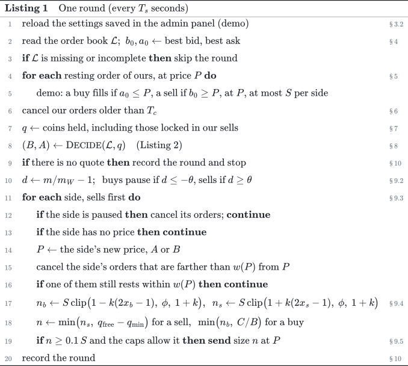
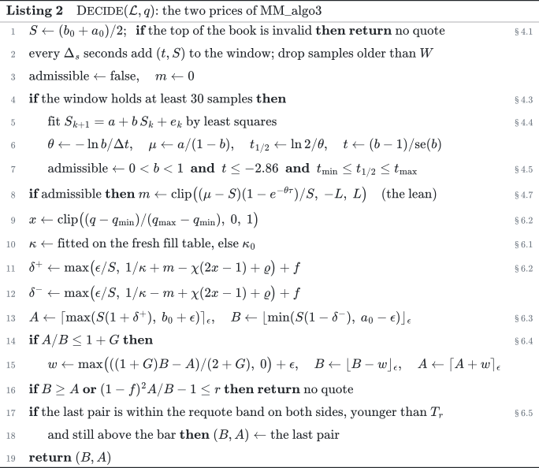

# Limit-Order-Book: branch MM_algo3

This is a market-making bot for the Nobitex exchange. Every round a worker reads the order book of a rial
market, keeps one limit buy below the mid and one limit sell above it, and earns the spread when both fill,
after the fee on each leg. It runs in two modes:

* **demo**: real order books, simulated fills in a paper ledger;
* **live**: real orders, real money.

A results dashboard and an authenticated admin panel go with it. This branch documents **MM_algo3**.
[MM_algo2](https://github.com/Alireza77n/Limit-Order-Book/tree/MM_algo2) and
[MM_algo1v2](https://github.com/Alireza77n/Limit-Order-Book/tree/MM_algo1v2) document their own algorithms.
The code of all three is here, so they can run side by side.

## MM_algo3

MM_algo3 (code key `algo4`, `market_maker/strategy/algo4.py`) works in four steps:

* It fits an Ornstein–Uhlenbeck mean-reversion model to the last 30 minutes of mids.
* When a unit-root test and a half-life bound admit the fit, it leans its quotes toward the fitted mean, by
  the expected reversion over the order lifetime.
* Each depth comes from the first-order solution of an inventory-penalised optimal market-making problem
  (Avellaneda–Stoikov, Cartea–Jaimungal): $`1/\kappa`$, plus or minus the lean, minus or plus the inventory
  skew, plus the fee. $`\kappa`$ is the fill-intensity decay, fitted on the measured fill table.
* The pair is put on the tick and widened if needed to clear the fee bar.

The complete specification covers a round from its first step to its last, with every derivation, worked
examples and the measured forecast skill: **[docs/MM_algo3.md](docs/MM_algo3.md)**.

## One round

<picture>
  <source media="(prefers-color-scheme: dark)" srcset="docs/figures/listing1_round_dark.svg">
  
</picture>

<picture>
  <source media="(prefers-color-scheme: dark)" srcset="docs/figures/listing2_decide_dark.svg">
  
</picture>

The grey § numbers are sections of [docs/MM_algo3.md](docs/MM_algo3.md). Listing 1 is
`market_maker/engine.py` (live: `SimpleMarketMaker.run`), Listing 2 is `market_maker/strategy/algo4.py`.

**Listing 1.** $`T_s`$ time step, $`T_c`$ order lifetime (3 min), $`Q`$ order size, $`q_{\min}, q_{\max}`$
inventory band, $`x_b`$ and $`x_s`$ the position in the band counting our open buys and leaving out our open
sells, $`q_{\mathrm{free}}`$ and $`C`$ free coins and free cash, $`S_W`$ the oldest mid of the last $`W`$ =
600 s, $`\theta`$ = 0.3 %, $`w(P) = \max(5\epsilon,\ 0.0003\,P)`$ the requote band ($`\epsilon`$: the tick).
The caps are the band ceiling for buys and, live, the exposure guards.

**Listing 2.** $`S`$ the mid, $`\Delta_s`$ = 10 s the sample spacing, $`W`$ = 1800 s the window, $`\Delta t`$
the mean spacing of the samples, $`\mathrm{se}(b)`$ the standard error of $`b`$, $`t_{\min}, t_{\max}`$ = 60 s
and 900 s, $`\tau`$ the order lifetime, $`L`$ = 0.5 %, $`\kappa_0`$ = 400, $`\chi`$ the inventory skew,
$`\varrho`$ the widening (0), $`f`$ the fee, $`r`$ the required return, $`G = (1 + r)/(1 - f)^2 - 1`$,
$`T_r`$ = 300 s. Two switches are left out: the lean needs `algo4_use_alpha` (on), and the volatility pause
`algo4_sigma_pause` (off) would return no quote when the residual is too large.

## Key formulas

```math
\begin{aligned}
&\text{fit:} && S_{k+1} = a + b\,S_k + \varepsilon_k,\qquad \theta = -\frac{\ln b}{\Delta t},\qquad \mu = \frac{a}{1-b},\qquad t_{1/2} = \frac{\ln 2}{\theta}\\
&\text{admissible:} && 0 < b < 1,\qquad \frac{b-1}{\mathrm{se}(b)} \le -2.86,\qquad t_{\min} \le t_{1/2} \le t_{\max}\\
&\text{lean:} && m = \mathrm{clip}\Big(\frac{(\mu - S)(1 - e^{-\theta\tau})}{S},\ -L,\ L\Big)\quad\text{(0 when not admissible)}\\
&\text{depths:} && \delta^{\pm} = \max\Big(\frac{\epsilon}{S},\ \frac1\kappa \pm m \mp \chi\,(2x-1) + \varrho\Big) + f\\
&\text{prices:} && A = \big\lceil S(1+\delta^+)\big\rceil_\epsilon,\qquad B = \big\lfloor S(1-\delta^-)\big\rfloor_\epsilon\\
&\text{fee bar:} && (1-f)^2\,\frac AB - 1 > r\ \Longleftrightarrow\ \frac AB > 1 + G,\qquad G = \frac{1+r}{(1-f)^2} - 1
\end{aligned}
```

$`1/\kappa + f`$ is the depth that maximises the expected gain $`\lambda e^{-\kappa\delta}(\delta - f)`$ of
one order, and the Avellaneda–Stoikov half-spread as risk aversion goes to zero. The lean, the skew
$`\chi(2x-1)`$ and the widening $`\varrho`$ are the other terms of the first-order optimal quotes.

## Settings

The defaults are in `market_maker/config.py` (`TRADING_PROFILES`). The demo values are edited per market on
the admin panel and applied at the next round.

| Setting | Meaning | Default |
|---|---|---:|
| `algo4_enabled` | Demo: run MM_algo3 in its own lane on this market | on |
| `algo4_use_alpha` | use the forecast (off: the plain optimal quotes) | on |
| `algo4_window_seconds`, `algo4_sample_seconds` | window length and minimum sample spacing, s | 1800, 10 |
| `algo4_horizon_seconds` | horizon $`\tau`$ of the lean; 0 = the order lifetime | 0 |
| `algo4_halflife_min_seconds`, `algo4_halflife_max_seconds` | admissible half-lives, s | 60, 900 |
| `algo4_kappa` | $`\kappa`$ when the fill table cannot be fitted ($`1/\kappa`$ = 0.25 %) | 400 |
| `algo4_risk_perc` | widening $`\varrho`$ of both depths | 0 |
| `algo4_lean_clip` | largest lean $`L`$, fraction of the price | 0.005 |
| `algo4_sigma_pause` | no quote while the residual exceeds this fraction of the price; 0 = off | 0 |
| `skew_perc` | inventory skew $`\chi`$ at the band edges | 0.002 |
| `commission_perc`, `exp_ret_min` | fee $`f`$ per leg, required net return $`r`$ | 0.0010, 0.0002 |
| `hysteresis_ticks`, `requote_band_perc`, `refresh_seconds` | requote band and the longest a pair is kept | 5, 0.0003, 300 |
| `fill_table_enabled`, `fill_table_max_age_hours`, `fill_table_min_samples` | when the fill table is fitted for $`\kappa`$ | on, 48, 50 |
| `cancel_after_minutes` | order lifetime, min | 3 |
| `trend_window_seconds`, `trend_pause_perc` | trend pause | 600, 0.003 |
| `order_size`, `inv_min`, `inv_max`, `time_step` | sizes, inventory band and round spacing | per market |

The demo runs on five markets, BTCIRT, USDTIRT, ETHIRT, XAUTIRT and TRXIRT, each worker running every
enabled algorithm in its own lane.

## Run, test, deploy

```bash
pip install -r requirements-dev.txt
```

Demo of one market, every enabled algorithm in its own lane:

```bash
cd market_maker && python run.py --profile usdt --mode demo --continuous
```

MM_algo3 alone:

```bash
cd market_maker && python run.py --profile usdt --mode demo --algorithm algo4
```

The tests run from the repository root; they are deterministic and need no network or account:

```bash
python -m pytest -q
```

The local stack (the five demo workers, the dashboard, the admin panel and its control agent):

```bash
docker compose up -d --build --wait
```

On the server, the demo stack runs from `deploy/docker-compose.production.yml`:

```bash
docker compose -f deploy/docker-compose.production.yml up -d --build
```

`--mode real` places real orders with real money, using the Nobitex keys in `market_maker/.env` (see
`market_maker/.env.example`). The live forward test has its own units in `deploy/`
(`market-maker-forward-*.service`), and only the operator starts or stops a live worker.
