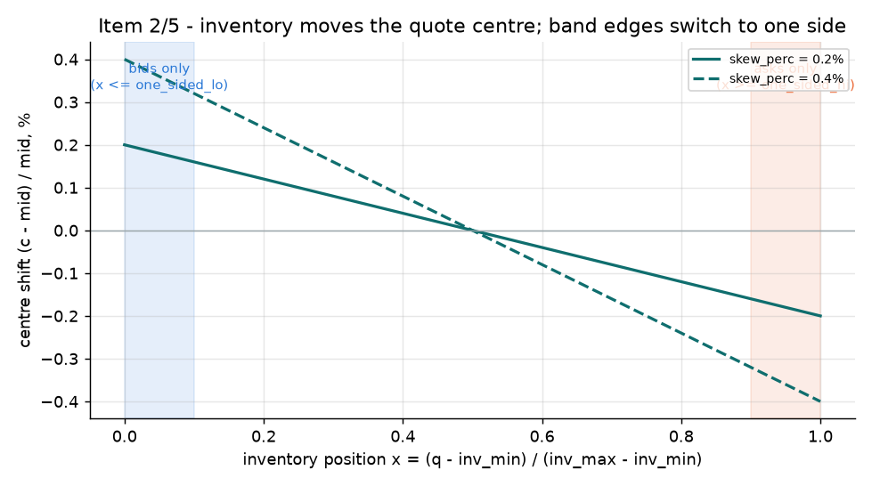
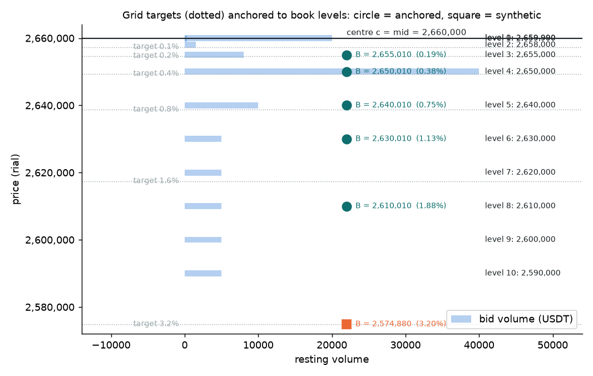
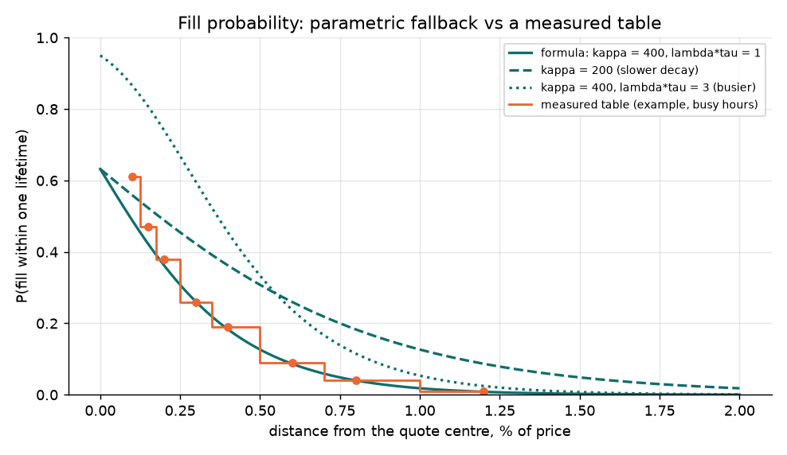
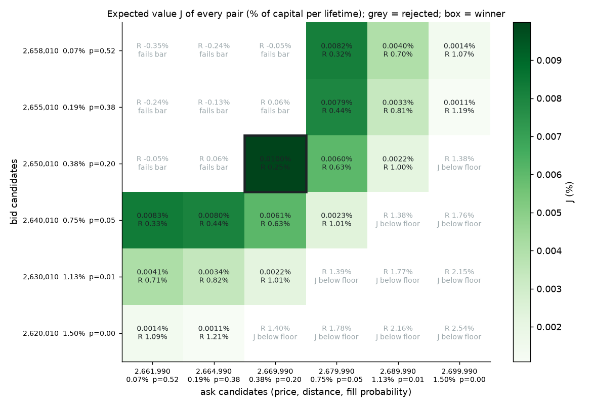
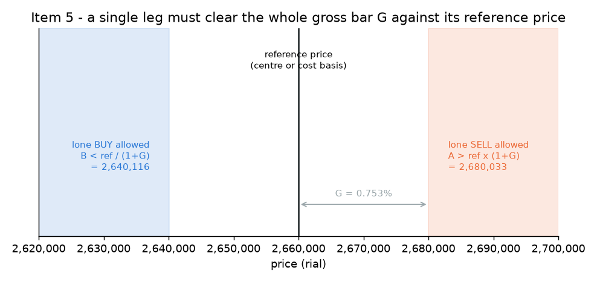

# MM_algo1v2: Algorithm 1, version 2 (complete specification)

This file describes the market-making algorithm of branch `MM_algo1v2` from the first step of a round
to the last: what the code reads, every formula it computes, why the formula has that form, which
orders it sends, and what it records. The short version, with pseudocode, is the
[README](../README.md). Every number in the examples is produced by running this branch's code
(section 12.8 says how).

| Part | Code |
|---|---|
| round loop (demo and live) | [`engine.py`](../market_maker/engine.py): `SimpleMarketMaker._run_demo`, `SimpleMarketMaker.run` |
| quote decision | [`strategy/algo1.py`](../market_maker/strategy/algo1.py): `Algo1Strategy` |
| fill probability | [`fill_model.py`](../market_maker/fill_model.py): `FillModel`, `FillTable`, `formula_probability` |
| fill table builder | [`tools/build_fill_table.py`](../market_maker/tools/build_fill_table.py) |
| paper exchange (demo) | [`paper.py`](../market_maker/paper.py): `PaperLedger`; [`exchange/demo.py`](../market_maker/exchange/demo.py) |
| Nobitex client (live) | [`exchange/nobitex.py`](../market_maker/exchange/nobitex.py): `NobitexExchangeClient` |
| settings | [`config.py`](../market_maker/config.py), [`demo_config.py`](../market_maker/demo_config.py), [`forward_config.py`](../market_maker/forward_config.py) |
| measurement | [`dashboard.py`](../market_maker/dashboard.py): `gate_rows`, `pnl_attribution` |

## Contents

1. [One round at a glance](#1-one-round-at-a-glance)
2. [Notation](#2-notation)
3. [Round start: timing and settings](#3-round-start-timing-and-settings)
4. [Reading the order book](#4-reading-the-order-book)
5. [Fills of our resting orders](#5-fills-of-our-resting-orders)
6. [Stale cancel](#6-stale-cancel)
7. [Account snapshot](#7-account-snapshot)
8. [The strategy: from the book to a quote](#8-the-strategy-from-the-book-to-a-quote)
9. [The engine: from the quote to orders](#9-the-engine-from-the-quote-to-orders)
10. [What is recorded](#10-what-is-recorded)
11. [Settings](#11-settings)
12. [Worked examples](#12-worked-examples)
13. [Limitations](#13-limitations)
14. [Appendix A. Measuring results](#appendix-a-measuring-results)
15. [Appendix B. Differences from version 1](#appendix-b-differences-from-version-1)
16. [Appendix C. Tests](#appendix-c-tests)

## 1. One round at a glance

The engine runs one round every `time_step` seconds (10 s on USDT/IRT, 60 s on BTC/IRT). In order:

1. **Start** (section 3): wait for the round's start time; in the demo, apply settings saved from the admin panel.
2. **Order book** (section 4): read the book; end the round early if it is missing or malformed.
3. **Fills** (section 5): settle our resting orders that the market reached since the last round.
4. **Stale cancel** (section 6): cancel our orders older than the order lifetime $`\tau`$ (3 minutes).
5. **Account** (section 7): inventory, cash, and what is locked in resting orders.
6. **Decision** (section 8): the strategy turns the book and the inventory into a bid and an ask,
   one of them, or nothing.
7. **Orders** (section 9): trend pause, one order per side, sizes, caps, sending.
8. **Records** (section 10): the round row, the decision diagnostics, Telegram.

The demo (paper trading on the real Nobitex book) and live (real orders) run the same strategy; where
the engine differs between them, the section says so.

## 2. Notation

| Symbol | Meaning | Setting |
|---|---|---|
| $`b_i,\ v^b_i`$ | price and volume of bid level $`i`$; $`i = 0`$ is the best bid | |
| $`a_j,\ v^a_j`$ | price and volume of ask level $`j`$; $`j = 0`$ is the best ask | |
| $`m = (b_0 + a_0)/2`$ | mid price | |
| $`\epsilon`$ | tick: 10 on pairs ending in IRT (prices in rial), 0.01 otherwise | |
| $`D`$ | deepest level used, $`\min(D_{\max},\ n_b - 1,\ n_a - 1)`$ | `depth_max` |
| $`q`$ | inventory, in units of the base coin | |
| $`q_{\min},\ q_{\max}`$ | inventory band | `inv_min`, `inv_max` |
| $`x`$ | position of $`q`$ inside the band, in $`[0, 1]`$ | |
| $`\sigma`$ | shift of the quote centre at the band edges, fraction of price | `skew_perc` |
| $`c`$ | quote centre | |
| $`\delta`$ | distance from $`c`$, fraction of price | |
| $`\delta_{\min},\ \rho,\ \delta_{\max}`$ | distance grid: first point, ratio, last point | `grid_min_perc`, `grid_ratio`, `grid_max_perc` |
| $`B,\ A`$ | a bid price and an ask price we may submit | |
| $`f`$ | fee per leg, fraction | `commission_perc` |
| $`r_{\min}`$ | required net return of a round trip | `exp_ret_min` |
| $`G`$ | gross bar, section 8.7 | |
| $`\tau`$ | order lifetime in seconds, 60 times `cancel_after_minutes` | `cancel_after_minutes` |
| $`p_b,\ p_a`$ | probability that a bid or an ask fills within $`\tau`$ | section 8.6 |
| $`\kappa,\ \lambda_\tau`$ | fallback fill formula: decay with distance, fills per lifetime at distance 0 | `fill_kappa`, `fill_lambda_tau` |
| $`\eta`$ | cost charged when only one leg fills | `adverse_selection_perc` |
| $`J`$ | expected value of a quote over one lifetime, fraction of capital | |
| $`J_{\min}`$ | expected-value floor | `ev_min` |
| $`x_{lo},\ x_{hi}`$ | band positions at or beyond which only one side is quoted | `one_sided_lo`, `one_sided_hi` |
| $`\bar P`$ | average price paid for the coins we bought ourselves | section 8.1 |
| $`w(P)`$ | requote band around a price $`P`$ | `hysteresis_ticks`, `requote_band_perc` |
| $`S`$ | base order size | `order_size` |
| $`C`$ | cash, in the quote currency | |

## 3. Round start: timing and settings

### 3.1 Timing

Demo (`SimpleMarketMaker._wait_for_next_round`): rounds keep a fixed rate. If the round that just
ended was due at $`T`$ and $`\Delta`$ = `time_step`, the next one is due at $`T + \Delta`$; when the
work overran that time, the missed starts are skipped:

```math
T' =
\begin{cases}
T + \Delta & \text{if } t_{\mathrm{now}} \le T + \Delta \\
T + \Delta + \Bigl(\Bigl\lfloor \dfrac{t_{\mathrm{now}} - T - \Delta}{\Delta} \Bigr\rfloor + 1\Bigr)\Delta & \text{otherwise}
\end{cases}
```

and the worker sleeps $`\max(0,\ T' - t_{\mathrm{now}})`$. A round that ends early (section 4) waits in
the same way. Live (`SimpleMarketMaker.run`): the worker sleeps `time_step` seconds after each
round's work, so live rounds drift by the time the work takes.

### 3.2 Settings

Demo: at the start of every round `RuntimeConfigSynchronizer.reload_at_round_boundary` applies the
per-pair overlay saved from the admin panel (fields in `demo_config.FIELD_DEFINITIONS`). Every setting
of this algorithm applies at the next round, except `commission_perc`, `cash_initial` and
`demo_inv_initial`, which apply when a new session starts. A reload that fails is logged
(`demo_config_reload_failed`) and the round runs with the previous settings.

Live: the overlay saved from the admin Live Config page (fields in `forward_config.FORWARD_FIELDS`)
is read when the worker starts. The code enforces floors on it: `commission_perc` at least 0.0025;
`exp_ret_min` starts at the larger of the profile value and 0.0025 until a value is saved (any value
of at least 0 can be saved); the buy and sell exposure guards of section 9.5 are on, with ratios at
most 0.25.

In both modes, when the worker is built, an unset `exp_ret_min` becomes `commission_perc` and an unset
`order_size` becomes `inv_max`/100.

### 3.3 End of a session

A worker started with `--continuous` (as the Docker services are) runs until it is stopped. Otherwise
it stops at midnight `time_horizon_days` days after it started, or after `max_rounds` rounds. On the
way out the demo cancels its open paper orders (`session_end`, or `coordinated_stack_shutdown` when
the container is stopped) and live cancels our open orders on the exchange.

## 4. Reading the order book

`NobitexExchangeClient.get_orderbook` sends `GET https://apiv2.nobitex.ir/v3/orderbook/<PAIR>`
(timeout 5 s, no authentication). The response is used only when the HTTP status is 200 and it
carries `bids`, `asks` and `lastTradePrice`; each level is `[price, volume]`, best first. The engine
then reads $`b_0`$, $`a_0`$ and the last trade price. In the demo all three must parse as numbers (the
last trade price values the paper account), otherwise the round ends here. Live, a missing last trade
price is taken as 0 (it is used only to value the account in the round row).

The strategy adds its own validity rules (section 8):

* only levels $`0 \dots D`$ are used, with $`D = \min(D_{\max},\ n_b - 1,\ n_a - 1)`$; a book where
  $`D = 0`$ (one level on a side, or malformed) gives no quote (`invalid_or_single_level_order_book`);
* the mid is defined only when $`b_0 > 0`$, $`a_0 > 0`$ and $`b_0 \le a_0`$; a crossed book gives no
  quote (same reason);
* a locked book ($`b_0 = a_0`$) has a mid but no candidate prices (`no_candidates`);
* the last trade price never enters a decision.

## 5. Fills of our resting orders

### 5.1 Demo: the paper fill rule

`PaperLedger.process_market` settles the open paper orders against the book just read. Orders are
taken best price first on each side (the highest buy, the lowest sell), then oldest first. For an
order with limit price $`L`$ and remaining amount $`r`$:

* **touch**: a buy is reached when $`a_0 \le L`$, a sell when $`b_0 \ge L`$;
* **trade**: when the book response carries a `tradePrice` $`P_T`$, a buy is also reached when
  $`P_T \le L`$, a sell when $`P_T \ge L`$ (`get_orderbook` passes the response through unchanged;
  without a `tradePrice` only the touch rule applies);
* an order that is not reached waits; a reached order fills at $`P_T`$ when the trade rule applies,
  otherwise at its own limit $`L`$, with reason `trade_cross` or `price_touch`;
* the amount is $`\min(r,\ \text{budget})`$, where the budget of each side for this round is the
  book's `tradedVolume` when present, otherwise `order_size` times
  `demo_max_fill_per_observation_orders` (1.0), shared by the orders of that side in the order above.
  A larger order therefore fills over several rounds (`partially_filled`).

Three optional parts of the matcher are off in both profiles: the level-1 fast fill
(`demo_level1_fast_fill_enabled`), the queue model (`demo_queue_enabled`) and random fill
probabilities (`demo_adverse_fill_enabled`).

Accounting of a fill of $`n`$ coins at price $`P`$, fee rate $`f`$:

```math
\begin{aligned}
\text{buy:}\quad & C \leftarrow C - nP, & q &\leftarrow q + n(1-f), & \text{fee} &= nf \text{ coins, worth } nfP \\
\text{sell:}\quad & C \leftarrow C + nP(1-f), & q &\leftarrow q - n, & \text{fee} &= nPf
\end{aligned}
```

### 5.2 Live

Our orders are settled by Nobitex. At the start of each round the engine fetches the status of the
orders it sent (`update_filled_amounts`, `update_inventory_and_cash`), and applies only the change
since the previous round in each order's cumulative matched amount $`\Delta n`$ and cumulative fee
$`\Delta\phi`$, at the order's price $`P`$: a buy adds $`\Delta n - \Delta\phi`$ coins and removes
$`P\,\Delta n`$ cash; a sell removes $`\Delta n`$ coins and adds $`P\,\Delta n - \Delta\phi`$ cash. If
the lookup fails, inventory and cash stay as they were; the amounts are cumulative, so the next
successful round applies the missing change once.

## 6. Stale cancel

Every resting order of ours whose age is more than $`\tau`$ = 60 times `cancel_after_minutes`
(180 s by default) is cancelled, after this round's fills: in the demo by `PaperLedger.cancel_stale`
(reason `stale_timeout`), live by `_cancel_owned_stale_orders` (only orders whose client id this
worker sent). $`\tau`$ is also the horizon that the fill probabilities of section 8.6 refer to.

## 7. Account snapshot

Demo (`PaperLedger.snapshot`), with $`r_j`$ the remaining amount and $`L_j`$ the limit of resting
order $`j`$:

```math
L_C = \sum_{j \in \text{buys}} r_j L_j, \qquad
L_q = \sum_{j \in \text{sells}} r_j, \qquad
C_{\mathrm{free}} = \max(0,\ C - L_C), \qquad
q_{\mathrm{free}} = \max(0,\ q - L_q), \qquad
W = q\,P_{\mathrm{last}} + C .
```

The strategy is given the whole inventory $`q`$, including the coins locked in resting sells. Live,
$`q`$ and $`C`$ come from section 5.2 and the round row records $`W = q\,P_{\mathrm{last}} + C`$; the
locked amounts are read from the exchange later in the round (section 9.3).

## 8. The strategy: from the book to a quote

`Algo1Strategy.decide_order(book, q)` makes the decision. It updates the cost basis (8.1), evaluates
the book (8.2 to 8.9, the pure function `evaluate`), applies the hysteresis (8.10) and returns the
quote (8.11). `diagnostics` and `no_quote_reason` call the same `evaluate`, so the recorded
decision and the traded one are computed by the same code.

### 8.1 Cost basis

The engine has no fill hook, so the strategy infers its own purchases from the inventory it is given.
With $`q'`$ the inventory seen in the previous round and $`\Delta = q - q'`$:

* first call: remember $`q`$; nothing else;
* $`\Delta > 10^{-12}`$: if the strategy issued a bid price $`B'`$ last time, the increase is taken as
  a purchase at $`B'`$ (below); if no bid was issued, the coins came from outside the strategy and
  nothing changes;
* $`\Delta < -10^{-12}`$: a sale consumes known-cost units, $`n \leftarrow \max(0,\ n + \Delta)`$;
  $`\bar P`$ is unchanged.

With $`n`$ the number of units whose cost is known, a purchase updates

```math
\bar P \leftarrow \frac{\bar P\, n + B'\,\Delta}{n + \Delta}, \qquad n \leftarrow n + \Delta
\qquad (\bar P \leftarrow B' \text{ when } n = 0).
```

$`\bar P`$ is known while $`n > 0`$. In the paper ledger a buy of $`n_0`$ coins at $`B'`$ raises
$`q`$ by $`n_0(1-f)`$; recording that increase at $`B'`$ (not at $`B'/(1-f)`$) is what the lone-sell
return of section 8.9 expects, because that return already contains the factor $`(1-f)^2`$. This
memory lives in the worker process, so a restart clears it.

### 8.2 Inventory position

```math
x = \min\Bigl(1,\ \max\Bigl(0,\ \frac{q - q_{\min}}{q_{\max} - q_{\min}}\Bigr)\Bigr),
```

and $`x = 0.5`$ when the band $`q_{\max} - q_{\min}`$ is not positive or not finite. Inventory outside
the band saturates at 0 or 1.

### 8.3 Quote centre

```math
c = m\,\bigl(1 - \sigma\,(2x - 1)\bigr), \qquad m\,(1 - \sigma) \le c \le m\,(1 + \sigma).
```

Every candidate price is placed at a distance from $`c`$, not from $`m`$. With $`x > 1/2`$ (more coins
than the middle of the band) $`c < m`$: the ask candidates come nearer to the bids, so a sale becomes
more likely, and the bid candidates move further down, so a purchase becomes less likely. With
$`x < 1/2`$ it is the opposite, and $`x = 1/2`$ gives $`c = m`$. With the default $`\sigma = 0.2\%`$
the centre moves by at most 0.2 % of the price.



### 8.4 Distance grid

```math
\delta_k = \delta_{\min}\,\rho^{\,k-1}, \qquad k = 1, 2, \dots \quad \text{while } \delta_k \le \delta_{\max}\,(1 + 10^{-9}) \text{ and } k \le 64,
```

with $`\rho`$ raised to 1.05 when set lower, and an empty grid when $`\delta_{\min}`$ is not positive.
The number of points is about $`\lfloor \ln(\delta_{\max}/\delta_{\min}) / \ln \rho \rfloor + 1`$. The
defaults ($`\delta_{\min}`$ = 0.05 %, $`\rho`$ = 1.4, $`\delta_{\max}`$ = 2 %) give 11 points: 0.05,
0.07, 0.098, 0.1372, 0.1921, 0.2689, 0.3765, 0.5271, 0.7379, 1.0331 and 1.4463 %. A geometric grid
puts most of its points near the touch, where the fill probability changes fastest.

### 8.5 Candidate prices (anchoring)

For each grid point $`\delta`$ the strategy finds the first book level at or beyond the target price
and quotes one tick in front of it, the way a trader would join the book. Bid side, with levels
$`0 \dots D`$:

```math
i^{*} = \min\{\, i \le D : b_i \le c\,(1 - \delta) \,\}, \qquad
B =
\begin{cases}
b_{i^{*}} + \epsilon & \text{anchored, when } i^{*} \text{ exists} \\
\epsilon \left\lfloor c\,(1-\delta)/\epsilon \right\rfloor & \text{synthetic, when the book ends first}
\end{cases}
```

```math
V_b = \sum_{k < i^{*}} v^b_k \ \text{(anchored)}, \qquad V_b = \sum_{k \le D} v^b_k \ \text{(synthetic)} .
```

Then:

* **no crossing**: if $`B > a_0 - \epsilon`$, the bid becomes $`B = a_0 - \epsilon`$ with $`V_b = 0`$
  (an anchored candidate is then reported as level 0);
* **one candidate per price**: grid points that land on the same price give one candidate;
* **realised distance**: $`\hat\delta_b = (c - B)/c`$. This, not the grid point, is what the fill model
  and the selection use; the candidates are sorted by it.

The ask side mirrors it: $`j^{*} = \min\{\, j \le D : a_j \ge c(1 + \delta) \,\}`$,
$`A = a_{j^{*}} - \epsilon`$ (anchored) or the target rounded up to the tick (synthetic),
$`V_a = \sum_{k < j^{*}} v^a_k`$, no crossing $`A \ge b_0 + \epsilon`$, and
$`\hat\delta_a = (A - c)/c`$.

$`V`$ is the volume resting at prices at least as good as ours on our side, which a new order at our
price would queue behind. It is used only by the optional queue correction of section 8.6.4.

**Bound.** For every candidate, $`\hat\delta \ge \delta - \epsilon/c`$, where $`\delta`$ is the grid
point that produced it. Proof for the bid: anchored, $`b_{i^{*}} \le c(1-\delta)`$ gives
$`B \le c(1-\delta) + \epsilon`$; synthetic, $`B \le c(1-\delta)`$; the no-crossing rule only lowers
$`B`$. The ask is symmetric. On the example book of section 12, $`\epsilon/c`$ is 0.0004 %.

With $`K`$ grid points and $`D + 1`$ levels, building the candidates costs $`O(K D)`$ per round.



*The figure uses a wider grid (0.1 %, ratio 2, up to 4 %) than the default, so that the anchoring is
visible; circles are anchored candidates, squares synthetic ones.*

### 8.6 Fill probability

Every candidate gets $`p = P(\text{an order resting at distance } \hat\delta \text{ fills within } \tau)`$
from `FillModel.probability(distance, side)`: the measured table when it can answer (8.6.2), the
formula otherwise (8.6.1), then the optional queue correction (8.6.4), clamped to $`[0, 1]`$.

#### 8.6.1 The formula

Fills of an order at distance $`\delta`$ are modelled as a Poisson process whose intensity decays
exponentially with distance, $`\lambda(\delta) = \lambda_0 e^{-\kappa\delta}`$. The probability of at
least one fill within $`\tau`$ is

```math
p(\delta) = P\bigl(N(\tau) \ge 1\bigr) = 1 - \exp\bigl(-\lambda_0\tau\, e^{-\kappa\delta}\bigr)
= 1 - \exp\bigl(-\lambda_\tau\, e^{-\kappa\delta}\bigr), \qquad \lambda_\tau = \lambda_0 \tau .
```

The inputs are clamped at 0 ($`\delta`$, $`\kappa`$ and $`\lambda_\tau`$). $`\lambda_\tau`$ is the
expected number of fills at distance 0 in one lifetime and $`1/\kappa`$ the distance over which the
intensity falls by a factor $`e`$: with the defaults $`\kappa = 400`$ and $`\lambda_\tau = 1`$,
$`1/\kappa`$ is 0.25 % of the price and $`p`$ is 0.6321 at distance 0, 0.4885 at 0.10 %, 0.3078 at
0.25 %, 0.1266 at 0.50 %, 0.0181 at 1 % and 0.0003 at 2 %.

#### 8.6.2 The measured table

The table is the file `fill_table_<pair in lower case>.json` in the results directory (for example
`fill_table_usdtirt.json`), or the path in `fill_table_path`. It is read again whenever its
modification time changes, so a rebuilt table reaches a running worker at its next round. Schema:

```json
{
  "pair": "USDTIRT",
  "horizon_seconds": 180,
  "updated_at": "2026-11-10T03:00:00+00:00",
  "method": "price_path+own_orders",
  "buckets": [
    {"distance": 0.001, "p_bid": 0.61, "p_ask": 0.58, "n_bid": 900, "n_ask": 900},
    {"distance": 0.002, "p_bid": 0.38, "p_ask": 0.36, "n_bid": 800, "n_ask": 800}
  ]
}
```

The builder also writes `n_<side>_path`, `n_<side>_own`, `samples`, `own_orders`, `window_days`,
`half_life_days`, `queue_factor`, `sources`, `first_sample` and `last_sample`. A file that does not
parse, or has no bucket, or a bucket with a distance that is not positive, is ignored (the formula is
used and the error is reported in the diagnostics).

The table is used when `fill_table_enabled` is on and it is fresh: `updated_at` is at most
`fill_table_max_age_hours` (48) old. A setting of 0 or less accepts any age; a table without
`updated_at` is then accepted, otherwise it is treated as stale.

For one side, the usable buckets are those with at least `fill_table_min_samples` (50) observations
on that side, $`d_1 < \dots < d_n`$ with probabilities $`p_1, \dots, p_n`$. The lookup interpolates
linearly between them and is flat outside them:

```math
p(\delta) =
\begin{cases}
p_1 & \delta \le d_1 \\
p_k + \dfrac{\delta - d_k}{d_{k+1} - d_k}\,(p_{k+1} - p_k) & d_k \le \delta \le d_{k+1} \\
p_n & \delta \ge d_n
\end{cases}
```

A thin bucket is skipped (its neighbours are interpolated across it); the formula is used for a side
only when no bucket on that side has enough observations. The table must be built for the same
horizon as $`\tau`$; the model does not check `horizon_seconds`.

#### 8.6.3 How the table is built

`tools/build_fill_table.py` combines two estimates per bucket $`d`$ (default buckets 0.10, 0.15, 0.20,
0.30, 0.40, 0.60, 0.80, 1.20, 1.60 and 2.40 %), from the CSVs the engine writes, over the last
`--window-days` (14) days of samples.

**Price path.** A bid at $`m_t(1-d)`$ is filled when the sellers come down to it, that is when the best
ask reaches it; an ask symmetrically. For every sample time $`t`$ with mid $`m_t`$:

```math
\hat p^{\,\mathrm{path}}_b(d) = \frac{\sum_t w_t\,\mathbf{1}\bigl[\min_{t < u \le t + \tau} a_0(u) \le m_t(1-d)\bigr]}{\sum_t w_t},
\qquad
\hat p^{\,\mathrm{path}}_a(d) = \frac{\sum_t w_t\,\mathbf{1}\bigl[\max_{t < u \le t + \tau} b_0(u) \ge m_t(1+d)\bigr]}{\sum_t w_t},
```

with age weights $`w_t = 2^{-\mathrm{age}_t/h}`$ (half-life $`h`$ = `--half-life-days`, 3; age measured
from the last sample). A sample is skipped when no later sample falls inside its window, when the last
sample of its window is less than $`0.8\,\tau`$ after it, or when its window contains a gap longer than
the larger of 3 median sampling steps and 30 s (a stopped worker, a blocked request). The estimate can
be scaled by `--queue-factor` (default 1) once calibrated, because volume ahead of us absorbs some of
the trades that reach our price.

**Own orders.** Every placed order of ours with a final status (filled, partially filled, cancelled,
expired) gives its distance from the mid at placement and whether it filled (partially filled counts
as filled). Each order goes to the bucket nearest in log-distance, and
$`\hat p^{\,\mathrm{own}} = \text{filled}/\text{placed}`$.

**Blend.** With $`n_{\mathrm{own}}`$ own orders in the bucket,

```math
p = \omega\,\hat p^{\,\mathrm{own}} + (1 - \omega)\,\hat p^{\,\mathrm{path}}, \qquad
\omega = \frac{n_{\mathrm{own}}}{n_{\mathrm{own}} + 100},
```

or the one estimate that exists. Finally a weighted pool-adjacent-violators pass makes $`p`$
non-increasing in $`d`$ (weights: the bucket's observations), and each bucket stores
$`n = n_{\mathrm{path}} + n_{\mathrm{own}}`$, where $`n_{\mathrm{path}}`$ is the sum of the age
weights. The server rebuilds both tables once a day:

```bash
cd /opt/market-maker-forward/market_maker
venv/bin/python -m tools.build_fill_table --pair usdt --horizon-seconds 180 \
  --csv /var/lib/market-maker-forward/results/usdt_track.csv \
  --csv /var/lib/market-maker-forward/results/usdt_track_demo.csv \
  --out /var/lib/market-maker-forward/results/fill_table_usdtirt.json
```

(and the same with `btc` and `fill_table_btcirt.json`).

#### 8.6.4 Queue correction

When `fill_queue_volume_ref` $`V_{\mathrm{ref}} > 0`$ and the volume ahead $`V > 0`$:
$`p \leftarrow p\,e^{-V/V_{\mathrm{ref}}}`$. It is off (0) in both profiles.



*The orange table in the figure is an illustration, not measured data.*

### 8.7 Profit bar

Buying $`n`$ coins at $`B`$ costs $`nB`$ and delivers $`n(1-f)`$ coins (the fee is taken on the
coins); selling those at $`A`$ returns $`n(1-f)A(1-f)`$. Per unit of capital:

```math
R_{\mathrm{gross}} = \frac{A - B}{B}, \qquad
R_{\mathrm{net}} = \frac{n(1-f)^2A - nB}{nB} = (1-f)^2\,\frac{A}{B} - 1 = (1-f)^2(1 + R_{\mathrm{gross}}) - 1 .
```

A round trip clears the bar when $`R_{\mathrm{net}} > r_{\min}`$ (strictly), with $`r_{\min}`$ =
`exp_ret_min` (equal to $`f`$ when unset). Equivalently

```math
\frac{A}{B} > 1 + G, \qquad G = \frac{1 + r_{\min}}{(1-f)^2} - 1 \approx 2f + r_{\min} .
```

With $`f = r_{\min}`$ = 0.25 %, $`G`$ = 0.7531 %; with the profile values $`f`$ = 0.10 % and
$`r_{\min}`$ = 0.02 %, $`G`$ = 0.2203 %. Returns are always measured on the prices actually submitted;
the mid appears only in the descriptive relative quoted spread $`(A - B)/m`$.

### 8.8 Pair value and selection

For a bid candidate with probability $`p_b`$ and an ask candidate with $`p_a`$, the model treats the
two fills within one lifetime as independent. Both fill with probability $`p_b p_a`$ and earn
$`R_{\mathrm{net}}`$; exactly one fills with probability $`p_b(1-p_a) + p_a(1-p_b)`$ and leaves an
open position whose expected cost is $`\eta`$; neither fills with the rest and earns 0. The expected
value per unit of capital per lifetime is

```math
J(B, A) = p_b\,p_a\,R_{\mathrm{net}}(B, A) - \eta\,\bigl[p_b(1 - p_a) + p_a(1 - p_b)\bigr].
```

A pair is feasible when $`R_{\mathrm{net}} > r_{\min}`$ and $`J > J_{\min}`$. Every bid is paired with
every ask (at most $`11 \times 11`$ with the defaults, $`O(K^2)`$ in general) and the feasible pair
with the largest $`J`$ wins:

```math
(B^{*}, A^{*}) = \arg\max \bigl\{\, J(B, A) : R_{\mathrm{net}}(B, A) > r_{\min},\ J(B, A) > J_{\min} \,\bigr\},
```

ties going to the smaller $`\hat\delta_b + \hat\delta_a`$. Because every pair is scored, one book level
out of order cannot hide a better pair. $`J`$ balances two forces: far pairs earn more per fill but
rarely fill, near pairs fill often but do not clear the bar. $`\eta`$ is 0 until it is measured (the
dashboard's Fill model tab shows the mid move after our fills).



*Example A of section 12.2: $`f = r_{\min}`$ = 0.25 %, $`q`$ = 25 of 50.*

### 8.9 One-sided quotes

A lone leg is judged against a reference price $`P_{\mathrm{ref}}`$, the price at which the position it
opens or closes is valued:

```math
R^{\mathrm{ask}} = (1-f)^2\,\frac{A}{P_{\mathrm{ref}}} - 1, \qquad
R^{\mathrm{bid}} = (1-f)^2\,\frac{P_{\mathrm{ref}}}{B} - 1, \qquad
J_1 = p\,R - \eta\,p .
```

A lone ask is a round trip whose purchase happened at $`P_{\mathrm{ref}}`$; a lone bid is one whose
sale will happen at $`P_{\mathrm{ref}}`$. The leg is feasible when $`R > r_{\min}`$ and
$`J_1 > J_{\min}`$, that is when $`A > P_{\mathrm{ref}}(1 + G)`$ or $`B < P_{\mathrm{ref}}/(1 + G)`$
and the expected value clears the floor. References: for an ask, $`\bar P`$ when
`cost_basis_reference` is on and $`\bar P`$ is known, otherwise $`c`$; for a bid, $`c`$. Among
feasible legs the largest $`J_1`$ wins, ties to the smaller distance.

`evaluate` decides in this order:

| Step | Condition | Result | Reason |
|---|---|---|---|
| 1 | $`x \ge x_{hi}`$ (and an ask candidate exists) | the best lone ask, or no quote | `ask_only_inventory_edge`, `no_side_clears_bar` |
| 2 | $`x \le x_{lo}`$ (and a bid candidate exists) | the best lone bid, or no quote | `bid_only_inventory_edge`, `no_side_clears_bar` |
| 3 | a feasible pair exists | the best pair | `pair_selected` |
| 4 | a feasible lone leg exists on either side | the best of them | `ask_only_fallback`, `bid_only_fallback` |
| 5 | otherwise | no quote | `expected_value_below_floor` if some pair cleared the bar, else `no_side_clears_bar` |

At a band edge the other side is not quoted at all, even if a pair would be feasible. The two earlier
exits are `invalid_or_single_level_order_book` (section 4) and `no_candidates` (no candidate on
either side).



*$`f = r_{\min}`$ = 0.25 %, reference 2,660,000.*

### 8.10 Hysteresis and the requote band

The requote band around a price $`P`$ is

```math
w(P) = \max\bigl(n_h\,\epsilon,\ \omega P\bigr),
```

with $`n_h`$ = `hysteresis_ticks` (5) and $`\omega`$ = `requote_band_perc` (0.0003). The percentage
term is the wider one whenever $`P > n_h\epsilon/\omega`$, which is 166,667 rial on the IRT pairs, so
in practice the band is 0.03 % of the price. The strategy remembers, per side, the last price it
issued as new, $`P_s`$, and when, $`t_s`$. For a new price $`P'`$ on that side:

* the side is not quoted this time: forget $`(P_s, t_s)`$;
* $`w(P_s) > 0`$, $`\lvert P' - P_s \rvert \le w(P_s)`$ and $`t_{\mathrm{now}} - t_s`$ is less than
  `refresh_seconds` (300): quote $`P_s`$ again (reported as kept);
* otherwise: quote $`P'`$ and remember $`(P', t_{\mathrm{now}})`$.

A kept price keeps its first time, so it is re-used for at most `refresh_seconds`. If a price was
kept, the quote is checked once more: a pair must still have $`R_{\mathrm{net}} > r_{\min}`$ at the
quoted prices, a lone leg must still have $`R > r_{\min}`$ against its reference; if not, the new
prices are quoted and remembered. When `evaluate` gives no quote, both memories are cleared.

The engine applies the same band to the orders that actually rest (section 9.3), so that "the same
price" means the same thing in both places.

### 8.11 The quote

`decide_order` returns `None` (no quote) or a dictionary:

| Key | Content |
|---|---|
| `bid`, `ask` | the limit prices; either may be `None` (one-sided quote) |
| `bid level`, `ask level` | the anchored level, or `None` (synthetic or absent side) |
| `mid price`, `centre`, `inventory position` | $`m`$, $`c`$, $`x`$ |
| `gross return`, `net return` | at the quoted prices; for a lone leg against its reference |
| `relative quoted spread` | $`(A - B)/m`$ for a pair, `None` for a lone leg |
| `min required return` | $`r_{\min}`$ |
| `buy fee`, `sell fee` | $`f`$ |
| `bid spread`, `ask spread` | $`m - B`$ and $`A - m`$ |
| `bid distance`, `ask distance`, `bid exec prob`, `ask exec prob` | $`\hat\delta`$ and $`p`$ of the evaluated candidates |
| `expected value` | $`J`$ of the evaluated pair, or $`J_1`$ of the lone leg at the quoted price |
| `quote mode` | `pair`, `bid_only` or `ask_only` |
| `selection reason` | the reason of section 8.9 |
| `reference price` | $`P_{\mathrm{ref}}`$ of a lone leg |
| `bid kept`, `ask kept` | whether the hysteresis kept the previous price |
| `lastTradePrice` | the book's last price (recorded only) |

## 9. The engine: from the quote to orders

### 9.1 Before the orders

Before the decision the engine writes the decision diagnostics of this round (section 10). After it,
the no-quote monitor counts the rounds without a quote and sends a Telegram alert when a run of them
reaches `no_quote_alert_rounds` (30) rounds or `no_quote_alert_seconds` (300 s), at most once per
`no_quote_alert_cooldown_seconds` (1,800 s), and a recovery message when quoting resumes.

### 9.2 Trend pause

Every round in the demo (live: every round with a quote) the engine appends $`(t, m)`$ to a history,
drops the samples older than $`t - W`$ ($`W`$ = `trend_window_seconds`, 600) and compares the mid with
the oldest sample left, $`(t_0, m_0)`$:

```math
\text{paused} =
\begin{cases}
\{\text{buy}\} & \text{if } m/m_0 - 1 \le -\theta \\
\{\text{sell}\} & \text{if } m/m_0 - 1 \ge \theta \\
\varnothing & \text{otherwise, or when } t_0 > t - W/2
\end{cases}
```

with $`\theta`$ = `trend_pause_perc` (0.003). Nothing is paused until the samples cover at least half
the window; $`W = 0`$ or $`\theta = 0`$ turns the pause off. The bot stops buying into a fall and stops
selling into a rise.

### 9.3 One order per side

With a quote, for the sell side and then the buy side:

* a paused side: every resting order of ours on that side is cancelled (`trend_pause`) and nothing is
  sent;
* otherwise, when the quote has a price $`P`$ on that side: every resting order of ours on that side
  with $`\lvert L - P \rvert > w(P)`$ is cancelled (`replaced`); a resting order within $`w(P)`$ stops
  the side from being sent this round (`resting_order_kept`).

So at most one order of ours rests per side. A side that the quote leaves out keeps its resting orders
until they age out; a round without a quote cancels nothing. Live, the resting orders are read from the
exchange (`get_open_order_totals`, only orders this worker sent); if that read fails, the round sends
nothing.

### 9.4 Sizes

`_inventory_sized_order_targets` sets the buy and sell sizes from the inventory, counting resting
orders as if filled: $`O_b`$ is the remaining amount of our resting buys, $`O_s`$ that of our resting
sells.

```math
x_b = \mathrm{clip}\Bigl(\frac{q + O_b - q_{\min}}{q_{\max} - q_{\min}},\ 0,\ 1\Bigr), \qquad
x_s = \mathrm{clip}\Bigl(\frac{q - O_s - q_{\min}}{q_{\max} - q_{\min}},\ 0,\ 1\Bigr),
```

```math
\text{buy} = S\,\mathrm{clip}\bigl(1 - k(2x_b - 1),\ \phi,\ 1 + k\bigr), \qquad
\text{sell} = S\,\mathrm{clip}\bigl(1 + k(2x_s - 1),\ \phi,\ 1 + k\bigr),
```

with $`k`$ = `inventory_sizing_strength` (1) and $`\phi`$ = `inventory_sizing_min_fraction` (0), both
clamped to $`[0, 1]`$. With the defaults, buy $`= 2S(1 - x_b)`$ and sell $`= 2S x_s`$: at the middle of
the band both are $`S`$, buying fades to 0 as the band fills and selling fades to 0 as it empties.
Counting resting orders stops the engine from adding a full-size order every round before the first
fill arrives. With `inventory_sizing_enabled` off, or a band that is not positive, both sizes are
$`S`$. The sizes do not depend on $`p`$ or $`J`$.

In the demo, $`O_b`$ is read after this round's cancellations, but $`O_s`$ and the free coins below
come from the snapshot of section 7, taken before them (see section 13).

### 9.5 Caps and guards

The smallest order sent is $`s_{\min} = \max(10^{-10},\ 0.1\,S)`$ (`MIN_ORDER_SIZE_FRACTION` = 0.1):
0.1 USDT and 0.0000015 BTC with the profile sizes.

Sell, decided first:

```math
s_{\mathrm{sell}} = \max\bigl(0,\ \min(\text{sell},\ q_{\mathrm{free}} - q_{\min})\bigr).
```

The demo records the first matching reason in this order: no ask in the quote (`one_sided_quote`);
the side is paused (`trend_pause`); a resting sell within the band (`resting_order_kept`);
$`s_{\mathrm{sell}} \ge s_{\min}`$ but the exposure guard refuses it (`locked_inventory_limit`);
$`s_{\mathrm{sell}} \ge s_{\min}`$: **send**; the sizing rule gave less than $`s_{\min}`$ although enough
coins are free (`inventory_sizing`); coins are held but locked in resting sells
(`inventory_locked_in_open_orders`); otherwise `insufficient_inventory`.

Buy, with a fresh snapshot taken after the sell:

```math
s_{\mathrm{buy}} = \max\bigl(0,\ \min(\text{buy},\ C_{\mathrm{free}}/B)\bigr).
```

Reasons in order: no bid (`one_sided_quote`); paused (`trend_pause`); a resting buy within the band
(`resting_order_kept`); the sizing rule gave less than $`s_{\min}`$ (`inventory_sizing`);
$`s_{\mathrm{buy}} < s_{\min}`$ (`insufficient_cash`); $`O_b + q + s_{\mathrm{buy}} > q_{\max}`$
(`inventory_cap`); the exposure guard refuses it (`locked_cash_limit`); otherwise **send**.

Exposure guards (`_locked_exposure_guard_reason`): a new buy is refused when
$`(L_C + s_{\mathrm{buy}}B)/C > \gamma_C`$ and a new sell when $`(L_q + s_{\mathrm{sell}})/q > \gamma_q`$,
with $`C`$ and $`q`$ the totals including what is locked. They are off in both profiles
(`buy_locked_cash_limit_enabled`, `sell_locked_inventory_limit_enabled`, ratios 0.8); live forces them
on with ratios of at most 0.25.

Live applies the same sizes, caps and guards without reason codes (a refused side gets size 0), with
the free amounts taken from the exchange's list of our open orders.

### 9.6 Sending

Demo: `DemoExchangeClient.send_order` passes the order to `PaperLedger.submit_order`, with client id
`<pair>-<side>-<round>-<milliseconds>`. The ledger rejects a buy whose cost exceeds the free cash and
a sell larger than the free coins (status `rejected`); otherwise the order rests, and its cash or
coins count as locked from then on. Nothing reaches Nobitex.

Live: `NobitexExchangeClient.send_order` posts to `https://apiv2.nobitex.ir/market/orders/add` the
compact JSON body

```json
{"type": "buy", "srcCurrency": "usdt", "dstCurrency": "rls", "amount": "1.0", "price": 2650010.0, "clientOrderId": "buy-17-1792483200000"}
```

(`amount` as a string, client id `<side>-<round>-<milliseconds>`), signed with the account's Ed25519
API key over the exact body (headers `Nobitex-Key`, `Nobitex-Signature`, `Nobitex-Timestamp`),
timeout 20 s. The order counts as placed only when the response is HTTP 2xx with status `ok` and
echoes the same `clientOrderId`.

## 10. What is recorded

* **Round row.** Demo: one row per round in the SQLite store `usdt_track_demo.sqlite3` (BTC:
  `btc_track_demo.sqlite3`), exported to `usdt_track_demo.csv` (newest 10,000 rows) at most every
  `demo_csv_export_interval_seconds` (60 s); order rows are updated when the orders fill or are
  cancelled. Live: one row per round in `usdt_track.csv` (BTC: `btc_track.csv`). The row holds the
  inventory, cash, locked and free amounts, wealth, best bid and ask, last price, the
  quoted prices, mid, relative quoted spread, gross, net and required return, per side the order id,
  status or not-sent reason, amounts, fill reason and limit price, the fees, and the decision columns
  `Quote Mode`, `Selection Reason`, `Centre`, `Bid Distance`, `Ask Distance`, `Bid Fill Prob`,
  `Ask Fill Prob`, `Expected Value` and `Reference Price`. A side not sent is recorded as
  `not_sent_<reason>` with the reasons of section 9.5.
* **Decision diagnostics.** When `algo1_diagnostics_enabled` is on, one JSON document per round in
  `usdtirt_algo1_diagnostics.jsonl` (BTC: `btcirt_algo1_diagnostics.jsonl`): the grid, every
  candidate (price, distance, level, anchored, volume ahead, fill probability), every scored pair
  (prices, returns, $`p_b`$, $`p_a`$, $`J`$, feasible), every lone leg, the choice, $`G`$, $`\bar P`$
  and the fill model's status (table file, age, method, buckets, formula parameters). The newest `algo1_diagnostics_keep_rounds` (2,000) documents are kept;
  the file is rewritten when it reaches twice that. Version-1 keys are kept for older readers
  (`candidate_results`, `required_threshold`, `inv_d` = $`\lfloor 10x \rfloor - 5`$,
  `fallback_detected` = false).
* **Telegram** (when configured): a summary of every round, a message per order event, the no-quote
  alerts of section 9.1. A side not quoted is shown as a dash.

## 11. Settings

All settings are per pair in `TRADING_PROFILES` of `config.py`. The value column gives the profile
value (BTC / USDT where they differ); the `MMConfig` default is noted where it differs. Demo: edited
from the admin panel, applied at the next round except where noted. Live: saved from the Live Config
page, read at worker start.

| Setting | Meaning | Value |
|---|---|---|
| `grid_min_perc`, `grid_ratio`, `grid_max_perc` | distance grid $`\delta_{\min}`$, $`\rho`$ (at least 1.05), $`\delta_{\max}`$ | 0.0005, 1.4, 0.02 |
| `depth_max` | deepest book level used | 10 (`MMConfig`: 15) |
| `skew_perc` | centre shift at the band edges $`\sigma`$ | 0.002 |
| `one_sided_lo`, `one_sided_hi` | band positions for bids only, asks only | 0.1, 0.9 |
| `cost_basis_reference` | judge a lone sell against $`\bar P`$ when known | true |
| `commission_perc` | fee per leg $`f`$; demo: applies at the next session | 0.0010 (`MMConfig`: 0.0025; live at least 0.0025) |
| `exp_ret_min` | required net return $`r_{\min}`$ | 0.0002 (`MMConfig`: unset, then $`f`$; live starts at 0.0025) |
| `ev_min` | expected-value floor $`J_{\min}`$ | 0.00001 |
| `adverse_selection_perc` | one-leg cost $`\eta`$ | 0 |
| `hysteresis_ticks`, `requote_band_perc` | requote band $`w(P)`$ | 5, 0.0003 |
| `refresh_seconds` | longest time a price is kept | 300 |
| `fill_table_enabled`, `fill_table_max_age_hours`, `fill_table_min_samples` | when the measured table is used | true, 48, 50 |
| `fill_kappa`, `fill_lambda_tau` | fallback formula $`\kappa`$, $`\lambda_\tau`$ | 400, 1.0 |
| `fill_queue_volume_ref` | queue correction $`V_{\mathrm{ref}}`$, 0 = off | 0 |
| `fill_table_path` | table file, when not the default | unset |
| `cancel_after_minutes` | order lifetime, $`\tau`$ = 60 times this | 3 |
| `time_step` | seconds between rounds | 60 / 10 |
| `inv_min`, `inv_max` | inventory band | 0, 0.000472 / 0, 50 |
| `order_size` | base size $`S`$ | 0.000015 / 1 |
| `inventory_sizing_enabled`, `inventory_sizing_strength`, `inventory_sizing_min_fraction` | sizing rule, $`k`$, $`\phi`$ | true, 1.0, 0.0 (`MMConfig`: off) |
| `trend_window_seconds`, `trend_pause_perc` | trend pause $`W`$, $`\theta`$ | 600, 0.003 |
| `buy_locked_cash_limit_enabled`, `buy_locked_cash_limit_ratio` | buy exposure guard | off, 0.8 (live: on, at most 0.25) |
| `sell_locked_inventory_limit_enabled`, `sell_locked_inventory_limit_ratio` | sell exposure guard | off, 0.8 (live: on, at most 0.25) |
| `cash_initial`, `demo_inv_initial` | demo starting cash and coins; apply at the next session | 30,000,000, 0 |
| `demo_level1_fast_fill_enabled`, `demo_queue_enabled`, `demo_adverse_fill_enabled` | optional paper matcher parts | off (`MMConfig`: fast fill on) |
| `demo_max_fill_per_observation_orders` | paper fill budget per side per round, in units of $`S`$ | 1.0 |
| `algo1_diagnostics_enabled`, `algo1_diagnostics_keep_rounds` | decision diagnostics | true, 2000 (`MMConfig`: off) |
| `no_quote_alert_rounds`, `no_quote_alert_seconds`, `no_quote_alert_cooldown_seconds` | no-quote alerts | 30, 300, 1800 |

The admin panel checks ranges (for example `grid_ratio` from 1.05 to 10, `skew_perc` up to 0.1); the
live validator also requires `grid_min_perc` at most `grid_max_perc` and `one_sided_lo` below
`one_sided_hi`.

## 12. Worked examples

### 12.1 The book and the settings

An illustrative USDT/IRT book with 10-rial ticks and mid 2,660,000 (prices in rial, volumes in USDT):

| Level | Bid | Volume | Ask | Volume |
|---|---|---|---|---|
| 0 | 2,659,990 | 20,000 | 2,660,010 | 5,000 |
| 1 | 2,659,900 | 300 | 2,660,100 | 400 |
| 2 | 2,658,000 | 1,500 | 2,662,000 | 2,000 |
| 3 | 2,655,000 | 8,000 | 2,665,000 | 6,000 |
| 4 | 2,650,000 | 40,000 | 2,670,000 | 30,000 |
| 5 | 2,640,000 | 10,000 | 2,680,000 | 12,000 |
| 6 to 10 | 2,630,000 down to 2,590,000 | 5,000 each | 2,690,000 up to 2,730,000 | 5,000 each |

Settings: the USDT profile ($`q_{\min}`$ = 0, $`q_{\max}`$ = 50, $`S`$ = 1, $`D_{\max}`$ = 10,
$`\sigma`$ = 0.002, default grid, $`J_{\min}`$ = 0.00001, $`\eta`$ = 0), the fill formula with
$`\kappa`$ = 400 and $`\lambda_\tau`$ = 1 (no table), and $`f = r_{\min}`$ = 0.25 %, the floor that
the live validator enforces, except in example C.

### 12.2 Example A: a pair, 25 of 50 USDT held

$`x = 0.5`$, so $`c = m`$ = 2,660,000 and $`G`$ = 0.7531 %. The 11 grid points give 6 candidates per
side:

| Grid points | B | Level | Distance | Volume ahead | p_b | A | Level | Distance | Volume ahead | p_a |
|---|---|---|---|---|---|---|---|---|---|---|
| 0.05, 0.07 % | 2,658,010 | 2 | 0.0748 % | 20,300 | 0.5235 | 2,661,990 | 2 | 0.0748 % | 5,400 | 0.5235 |
| 0.098, 0.1372 % | 2,655,010 | 3 | 0.1876 % | 21,800 | 0.3764 | 2,664,990 | 3 | 0.1876 % | 7,400 | 0.3764 |
| 0.1921, 0.2689 % | 2,650,010 | 4 | 0.3756 % | 29,800 | 0.1996 | 2,669,990 | 4 | 0.3756 % | 13,400 | 0.1996 |
| 0.3765, 0.5271, 0.7379 % | 2,640,010 | 5 | 0.7515 % | 69,800 | 0.0483 | 2,679,990 | 5 | 0.7515 % | 43,400 | 0.0483 |
| 1.033 % | 2,630,010 | 6 | 1.1274 % | 79,800 | 0.0109 | 2,689,990 | 6 | 1.1274 % | 55,400 | 0.0109 |
| 1.446 % | 2,620,010 | 7 | 1.5034 % | 84,800 | 0.0024 | 2,699,990 | 7 | 1.5034 % | 60,400 | 0.0024 |

All 36 pairs are scored; 28 clear the bar and 18 are feasible. "bar" marks $`R_{\mathrm{net}}`$ at or
below 0.25 %, "floor" marks $`J`$ at or below $`J_{\min}`$ = 0.001 %:

| bid \ ask | 2,661,990 | 2,664,990 | 2,669,990 | 2,679,990 | 2,689,990 | 2,699,990 |
|---|---|---|---|---|---|---|
| 2,658,010 | R -0.350 %, bar | R -0.238 %, bar | R -0.051 %, bar | J 0.0082 % | J 0.0040 % | J 0.0014 % |
| 2,655,010 | R -0.238 %, bar | R -0.125 %, bar | R 0.062 %, bar | J 0.0079 % | J 0.0033 % | J 0.0011 % |
| 2,650,010 | R -0.050 %, bar | R 0.063 %, bar | **J 0.0100 %** | J 0.0060 % | J 0.0022 % | J 0.00067 %, floor |
| 2,640,010 | J 0.0083 % | J 0.0080 % | J 0.0061 % | J 0.0023 % | J 0.00073 %, floor | J 0.00021 %, floor |
| 2,630,010 | J 0.0041 % | J 0.0034 % | J 0.0022 % | J 0.00074 %, floor | J 0.00021 %, floor | J 0.00006 %, floor |
| 2,620,010 | J 0.0014 % | J 0.0011 % | J 0.00068 %, floor | J 0.00021 %, floor | J 0.00006 %, floor | J 0.00002 %, floor |

The winner is $`B^{*}`$ = 2,650,010 and $`A^{*}`$ = 2,669,990 (both level 4):

```math
\frac{A^{*}}{B^{*}} = 1.007540, \qquad
R_{\mathrm{net}} = 0.9975^2 \times 1.007540 - 1 = 0.2508\,\%, \qquad
J = 0.1996 \times 0.1996 \times 0.2508\,\% = 0.0100\,\% .
```

It is neither the most profitable pair per fill nor the most likely to fill. $`J = 10^{-4}`$ says what
quoting is worth if the fill probabilities are right: 1 rial per 10,000 rial of capital per lifetime.
The quote also carries the relative quoted spread 0.7511 % and the requote bands
$`w(B^{*})`$ = 795.0 and $`w(A^{*})`$ = 801.0 rial.

### 12.3 Hysteresis over five rounds

The same settings, with the whole book shifted by the amount shown and the clock at the time shown:

| Time | Book shift | Evaluated B / A | Quoted B / A | Kept | Why |
|---|---|---|---|---|---|
| 0 s | 0 | 2,650,010 / 2,669,990 | 2,650,010 / 2,669,990 | no | first quote, remembered at 0 s |
| 60 s | +500 | 2,650,510 / 2,670,490 | 2,650,010 / 2,669,990 | yes | moved 500, within 795.0; 60 s old |
| 120 s | +900 | 2,650,910 / 2,670,890 | 2,650,910 / 2,670,890 | no | moved 900, outside 795.0; remembered at 120 s |
| 300 s | +500 | 2,650,510 / 2,670,490 | 2,650,910 / 2,670,890 | yes | moved 400, within 795.3; 180 s old |
| 420 s | +500 | 2,650,510 / 2,670,490 | 2,650,510 / 2,670,490 | no | 300 s old, not younger than `refresh_seconds` |

Every kept pair still clears the bar ($`R_{\mathrm{net}}`$ = 0.2508 % and 0.2506 %). In the engine the
order placed at 120 s is cancelled at the first round after it is more than 180 s old; the strategy
keeps quoting the same price until 420 s, so the engine posts it again at that price.

### 12.4 Example B: one side, 48 of 50 USDT held

$`x`$ = 0.96 is at least $`x_{hi}`$ = 0.9, so only asks are scored. The centre moves down:
$`c = 2{,}660{,}000 \times (1 - 0.002 \times 0.92)`$ = 2,655,105.6. Seven ask candidates appear (the
nearest is 2,660,000, one tick in front of the best ask). Against the cost basis
$`\bar P`$ = 2,640,000 the bar price is $`\bar P(1 + G)`$ = 2,659,882.8:

| A | Distance from c | p_a | R | J | Feasible |
|---|---|---|---|---|---|
| 2,660,000 | 0.1843 % | 0.3802 | 0.2544 % | 0.09673 % | yes |
| **2,661,990** | 0.2593 % | 0.2984 | 0.3294 % | 0.09831 % | yes |
| 2,664,990 | 0.3723 % | 0.2019 | 0.4425 % | 0.08936 % | yes |
| 2,669,990 | 0.5606 % | 0.1008 | 0.6309 % | 0.06357 % | yes |
| 2,679,990 | 0.9372 % | 0.0233 | 1.0078 % | 0.02345 % | yes |
| 2,689,990 | 1.3139 % | 0.0052 | 1.3847 % | 0.00721 % | yes |
| 2,699,990 | 1.6905 % | 0.0012 | 1.7616 % | 0.00204 % | yes |

The quote is a lone ask at 2,661,990 (`ask_only_inventory_edge`). With `cost_basis_reference` off,
the reference is $`c`$, the bar price is 2,675,102.2 and the same candidates give:

| A | Distance from c | p_a | R | J | Feasible |
|---|---|---|---|---|---|
| 2,660,000 | 0.1843 % | 0.3802 | -0.3160 % | -0.12013 % | no |
| 2,661,990 | 0.2593 % | 0.2984 | -0.2414 % | -0.07204 % | no |
| 2,664,990 | 0.3723 % | 0.2019 | -0.1290 % | -0.02604 % | no |
| 2,669,990 | 0.5606 % | 0.1008 | 0.0584 % | 0.00589 % | no |
| **2,679,990** | 0.9372 % | 0.0233 | 0.4332 % | 0.01008 % | yes |
| 2,689,990 | 1.3139 % | 0.0052 | 0.8079 % | 0.00421 % | yes |
| 2,699,990 | 1.6905 % | 0.0012 | 1.1827 % | 0.00137 % | yes |

Coins bought cheaply can be sold nearer to the market: 2,661,990 against 2,679,990, with nearly ten
times the expected value (0.09831 % against 0.01008 %).

### 12.5 Example C: the profile fee and target

With the USDT profile values of this branch as of 12 November 2026, $`f`$ = 0.10 % and $`r_{\min}`$ =
0.02 % ($`G`$ = 0.2203 %), the same book at $`x = 0.5`$ gives 35 pairs that clear the bar and 25
feasible ones:

| bid \ ask | 2,661,990 | 2,664,990 | 2,669,990 | 2,679,990 | 2,689,990 | 2,699,990 |
|---|---|---|---|---|---|---|
| 2,658,010 | R -0.050 %, bar | J 0.0123 % | J 0.0261 % | J 0.0158 % | J 0.0057 % | J 0.0018 % |
| 2,655,010 | J 0.0123 % | J 0.0248 % | J 0.0273 % | J 0.0134 % | J 0.0046 % | J 0.0014 % |
| 2,650,010 | J 0.0263 % | **J 0.0274 %** | J 0.0220 % | J 0.0090 % | J 0.0029 % | J 0.00082 %, floor |
| 2,640,010 | J 0.0160 % | J 0.0135 % | J 0.0090 % | J 0.0031 % | J 0.00089 %, floor | J 0.00024 %, floor |
| 2,630,010 | J 0.0058 % | J 0.0046 % | J 0.0029 % | J 0.00090 %, floor | J 0.00025 %, floor | J 0.00007 %, floor |
| 2,620,010 | J 0.0018 % | J 0.0014 % | J 0.00083 %, floor | J 0.00025 %, floor | J 0.00007 %, floor | J 0.00002 %, floor |

The winner, 2,650,010 / 2,664,990 ($`R_{\mathrm{net}}`$ = 0.3643 %, $`J`$ = 0.02736 %), is not
symmetric: its mirror 2,655,010 / 2,669,990 has the same probabilities but a slightly lower
$`A/B`$, so $`J`$ = 0.02728 %. A lower bar moves the choice nearer to the market.

### 12.6 Sizes and the trend pause

Sizes from `_inventory_sized_order_targets` with the USDT profile ($`S`$ = 1, band 0 to 50,
$`s_{\min}`$ = 0.1):

| q | Resting buys | Resting sells | Buy | Sell |
|---|---|---|---|---|
| 25 | 0 | 0 | 1.0000 | 1.0000 |
| 48 | 0 | 0 | 0.0800 | 1.9200 |
| 2 | 0 | 0 | 1.9200 | 0.0800 |
| 25 | 1 | 0 | 0.9600 | 1.0000 |
| 48 | 0 | 1.92 | 0.0800 | 1.8432 |

At $`q`$ = 48 the strategy quotes only an ask (example B), so the buy is not sent
(`one_sided_quote`) before its size matters; a buy of 0.08 would be below $`s_{\min}`$.

Trend pause with $`W`$ = 600 s and $`\theta`$ = 0.3 %, one mid sample per row:

| Time | Mid | Oldest sample in the window | Change | Paused |
|---|---|---|---|---|
| 0 s | 2,660,000 | 0 s, 2,660,000 | (window not half covered) | none |
| 300 s | 2,655,000 | 0 s, 2,660,000 | -0.1880 % | none |
| 600 s | 2,651,000 | 0 s, 2,660,000 | -0.3383 % | buy |
| 610 s | 2,651,500 | 300 s, 2,655,000 | -0.1318 % | none |

The reference is the oldest sample still in the window, not the highest one.

### 12.7 A table lookup

An illustrative table with buckets at 0.10, 0.20, 0.40 and 0.80 % (bid probabilities 0.61, 0.38,
0.19, 0.04; ask 0.58, 0.36, 0.18, 0.05), where the 0.40 % bucket has only 30 bid observations
(fewer than 50):

| Distance | p_b | p_a | How |
|---|---|---|---|
| 0.05 % | 0.61 | 0.58 | below the first bucket: its value |
| 0.15 % | 0.495 | 0.47 | between 0.10 and 0.20 % |
| 0.30 % | 0.3233 | 0.27 | bid: the 0.40 % bucket is thin, so between 0.20 and 0.80 %; ask: between 0.20 and 0.40 % |
| 1.00 % | 0.04 | 0.05 | beyond the last bucket: its value |

### 12.8 Reproducing the numbers

From `market_maker/`, with the project's Python environment:

```python
import os; os.environ["LOB_DISABLE_DOTENV"] = "1"
from config import MMConfig, TRADING_PROFILES
from strategy.algo1 import Algo1Strategy

cfg = MMConfig(**TRADING_PROFILES["usdt"])
cfg.fill_table_enabled = False                  # formula only
cfg.commission_perc = cfg.exp_ret_min = 0.0025  # examples A, B and 12.3
book = {"bids": [[2_659_990, "20000"], [2_659_900, "300"], [2_658_000, "1500"], [2_655_000, "8000"],
                 [2_650_000, "40000"], [2_640_000, "10000"], [2_630_000, "5000"], [2_620_000, "5000"],
                 [2_610_000, "5000"], [2_600_000, "5000"], [2_590_000, "5000"]],
        "asks": [[2_660_010, "5000"], [2_660_100, "400"], [2_662_000, "2000"], [2_665_000, "6000"],
                 [2_670_000, "30000"], [2_680_000, "12000"], [2_690_000, "5000"], [2_700_000, "5000"],
                 [2_710_000, "5000"], [2_720_000, "5000"], [2_730_000, "5000"]],
        "lastTradePrice": "2660000"}
strategy = Algo1Strategy(cfg)
evaluation = strategy.evaluate(book, 25.0)      # candidates, pairs, the choice
quote = strategy.decide_order(book, 25.0)       # bid 2650010.0, ask 2669990.0
```

`tests/test_strategy_algo1.py::test_pair_selection_matches_the_specification_example` pins example A.

## 13. Limitations

* **Fill probabilities.** The table's price-path estimate is measured from the mid, while the strategy
  asks it at distances from the skewed centre; it ignores the queue in front of us (hence
  `--queue-factor`); and it must be rebuilt by hand with `--horizon-seconds` equal to $`\tau`$. The
  formula's $`\lambda_\tau`$ = 1 was chosen for the earlier 10-minute lifetime and has not been
  re-estimated for 3 minutes.
* **Expected value.** $`J`$ assumes the two legs fill independently and equal in size, while the
  sizing rule makes them unequal away from the middle of the band; $`\eta`$ stays 0 until it is
  measured.
* **Cost basis.** Any inventory increase is booked at the last bid the strategy issued, even when that
  bid was not sent (paused, capped) or the coins came from elsewhere while a bid was out. The
  diagnostics of a round are computed before `decide_order` updates the cost basis, so in the round
  after a fill they can show the previous $`\bar P`$.
* **Demo fill rule.** Without trade data in the book, a paper order fills only when the opposite best
  price reaches it; trades that hit the order without moving the best price are not seen. The
  per-round budget of $`S`$ per side splits a larger order over several rounds.
* **Demo sell sizing.** The sell side is sized and capped with the snapshot taken before this round's
  cancellations, so coins in a sell just cancelled as `replaced` or `trend_pause` still count as locked
  in that round; when they were the only free coins, the new sell is sent one round later. Live reads
  the open orders again after its cancellations.
* **Timing.** `refresh_seconds` (300) is longer than the lifetime (180 s), so a kept price can outlive
  its order and be posted again. The strategy's band is measured at the remembered price and the
  engine's at the new one; they differ by at most $`\omega\,\lvert\Delta P\rvert`$.
* **Inputs.** No volume imbalance, volatility or forecast enters the decision; sizes do not depend on
  $`p`$ or $`J`$. Live reads its settings only at worker start and samples the trend only in rounds
  with a quote.

## Appendix A. Measuring results

### A.1 PnL attribution

The dashboard's PnL attribution tab (`dashboard.pnl_attribution`, `attribution_totals`) splits the
change of wealth into what the market did to the inventory we held and what our own fills earned.
With $`C_t`$, $`q_t`$ and $`m_t`$ the cash, inventory and mid recorded after round $`t`$ (`Mid Price`,
or the best bid/ask midpoint when the row has none):

```math
W_t = C_t + q_t\,m_t, \qquad
W_t - W_{t-1} = \underbrace{q_{t-1}\,(m_t - m_{t-1})}_{P_t\ \text{price}} + \underbrace{(C_t - C_{t-1}) + (q_t - q_{t-1})\,m_t}_{T_t\ \text{trading}} .
```

The identity is exact (expand $`q_t m_t - q_{t-1}m_{t-1}`$). If in round $`t`$ we bought $`\beta`$
coins at $`p^b`$ and sold $`s`$ at $`p^s`$, paying fees worth $`F_t`$ at the mid, then
$`T_t = \beta(m_t - p^b) + s(p^s - m_t) - F_t`$: how far below the mid we bought and above it we sold,
minus fees, which is what our quotes earned if the price had not moved. $`P_t`$ is what a passive
holder of the same inventory earned. Over a session $`W_T - W_1 = \sum P_t + \sum T_t`$, the first
round being the baseline; the verdict is "mainly trading" when
$`\lvert\sum T_t\rvert \ge \lvert\sum P_t\rvert`$, otherwise "mainly price". Demo rows also record the
fees (`Round Fee`), so the gross edge $`T_t + F_t`$ can be shown.

Example (pinned by `tests/test_dashboard_v2.py`): 10 coins and 1,000 cash at mid 100; round 2 buys 2
at 98 while the mid slips to 99; round 3 sells 1 at 102 with a 0.5 fee while the mid returns to 100.

| Round | Mid | q | C | W | P | T | Change |
|---|---|---|---|---|---|---|---|
| 1 | 100 | 10 | 1,000.0 | 2,000.0 | 0 | 0 | 0 |
| 2 | 99 | 12 | 804.0 | 1,992.0 | -10.0 | 2.0 | -8.0 |
| 3 | 100 | 11 | 905.5 | 2,005.5 | 12.0 | 1.5 | 13.5 |

Session: price +2.0, trading +3.5, total +5.5, verdict "mainly trading". In rial: buying 10 USDT at
2,660,000 with mid 2,662,000 and the paper fee of 0.25 % on the coins (9.975 USDT received) gives
$`T`$ = -46,550 (an edge of 20,000 minus a fee worth 66,550); if the mid then falls by 5,000,
$`P`$ = -49,875.

Caveats: a fill is valued at the mid of the round in which it is processed, not of its instant; the
round row's `Portfolio Wealth` uses the last trade price while the split uses the mid (this moves a
little between $`P`$ and $`T`$, not their sum); a row without mid, inventory or cash carries the
previous values forward.

### A.2 Validation gate

The dashboard's Validation tab (`dashboard.gate_rows`) evaluates the demo-to-live gate on the selected
track and session; it is meant to be read over at least five days of demo rounds (a policy, not
enforced by the code).

| Metric | How it is computed | Gate |
|---|---|---|
| rounds with a quote | rounds whose `Quote Mode` is `pair`, `bid_only` or `ask_only`, over all rounds | at least 50 % |
| fills per hour | filled or partially filled orders over the hours spanned | at least 1 |
| completed round trips | buy fills matched first-in first-out with later sell fills | at least 30 |
| realised minus computed net spread | amount-weighted mean of $`(1-f)^2 p^s/p^b - 1`$ over the trips, minus the mean `Net Return` of pair rounds | at least -0.05 % |
| adverse selection 60 s after fills | mean of $`(m_{+60} - P)/P`$ for buys and $`(P - m_{+60})/P`$ for sells, from the placement row | at least -0.10 % |
| fill forecast error | sum of predicted `Fill Prob` of placed orders over the number that filled, minus 1 | within 30 % either way |
| time at the band edges | share of rounds with $`x < 0.1`$ or $`x > 0.9`$ | at most 10 % |
| net PnL after fees | last minus first `Portfolio Wealth` | above 0 |
| mark-to-market drawdown | largest fall of `Portfolio Wealth` from its running peak, relative | at most 1 % |

## Appendix B. Differences from version 1

Version 1 is kept on branch `MM_algo1v1`.

| Version 1 | Version 2 (this branch) |
|---|---|
| inventory staircase `inv_d` = int(10x) - 5, unclamped; no quote at all far above `inv_max` | $`x`$ clamped to $`[0, 1]`$; continuous centre shift $`c = m(1 - \sigma(2x - 1))`$ |
| candidates are level-index pairs, so "level 10" means 0.1 % on one book and 3 % on another | candidates at fixed price distances (geometric grid), one tick in front of the first level beyond each |
| scan from the widest pair inward and stop at the first failure | every pair scored by $`J`$; the best feasible pair wins |
| two-sided or nothing | one side at the band edges, and as a fallback against the centre or the cost basis |
| re-decided and re-posted every round | hysteresis in the strategy, one order per side in the engine |
| crash on a null last trade price; division by zero when `inv_max` = `inv_min`; an ask could land on the best bid | last price optional; $`x`$ = 0.5 on an empty band; candidates never cross the touch |
| unchanged | the fee bar $`R_{\mathrm{net}} > r_{\min}`$ on the submitted prices, the sizing rule, the engine's accounting |

Removed: `Algo1Strategy.leg_pairs`, `Algo1Strategy.algo1_bid_ask_prices` and their engine wrappers.
`spread_ok(ob, i, j)` remains as a diagnostic helper.

## Appendix C. Tests

| Behaviour | Tests in `market_maker/tests/` |
|---|---|
| grid, anchoring, no crossing, one candidate per price | `test_strategy_algo1.py::test_distance_grid_*`, `test_candidates_*` |
| position and centre | `test_strategy_algo1.py::test_inventory_position_*`, `test_quote_centre_*` |
| pair selection, example A, a level out of order, floor, $`\eta`$ | `test_strategy_algo1.py::test_pair_selection_matches_the_specification_example`, `test_one_non_monotone_level_*`, `test_expected_value_floor_*`, `test_adverse_selection_*` |
| every returned pair clears the bar (random books) | `test_strategy_algo1.py::test_every_returned_pair_clears_the_fee_bar` |
| one-sided quotes, cost basis | `test_strategy_algo1.py::test_full_inventory_*`, `test_empty_inventory_*`, `test_lone_leg_*`, `test_cost_basis_*` |
| hysteresis | `test_strategy_algo1.py::test_resting_price_is_kept_*`, `test_hysteresis_is_off_*` |
| requote band, one order per side, lifetime, trend pause | `test_requote_rules.py` |
| diagnostics | `test_algo1_diagnostics.py` |
| engine: missing side, resting-order guard, both loops | `test_engine_one_sided.py`, `test_algo1_baseline.py` |
| sizes, exposure guards | `test_inventory_sizing.py`, `test_locked_exposure_guard.py` |
| fill model and table builder | `test_fill_model.py`, `test_build_fill_table.py` |
| PnL attribution and validation gate | `test_dashboard_v2.py` |
| no untested fallback, no order accumulation | `test_algo1_fallback_regression.py` |
