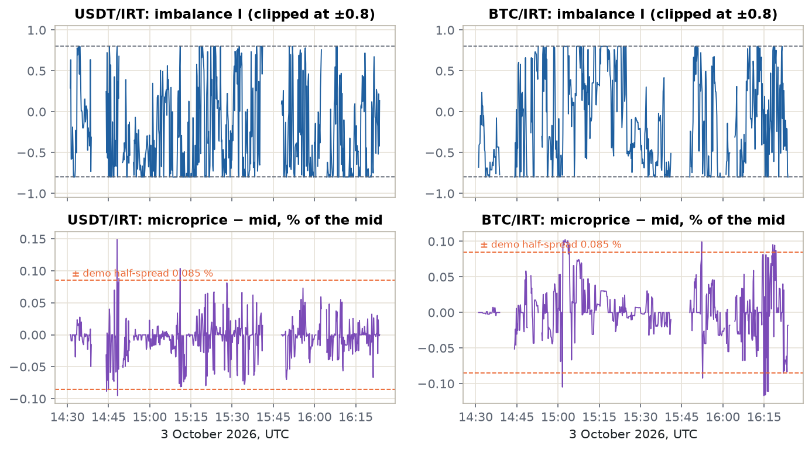
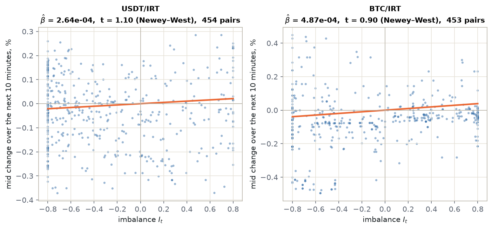
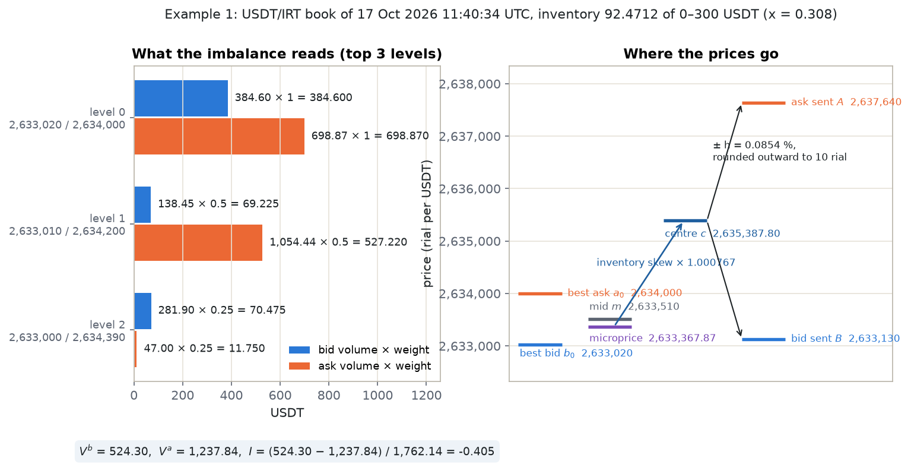
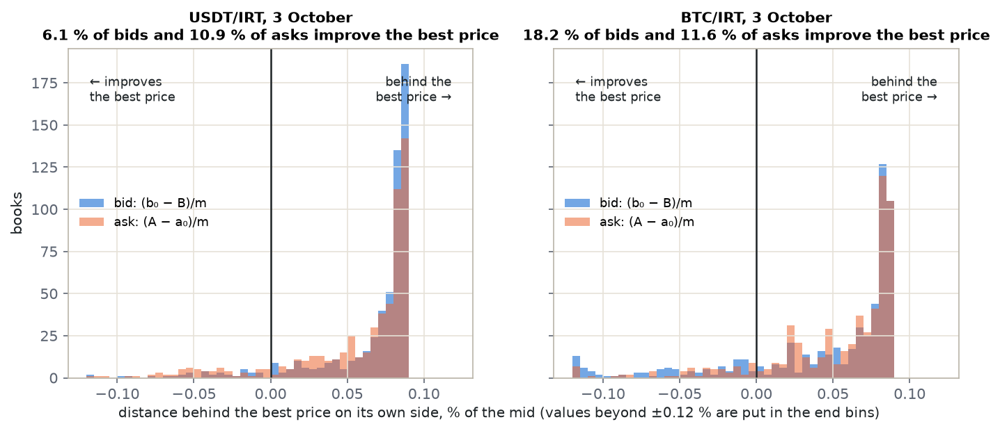
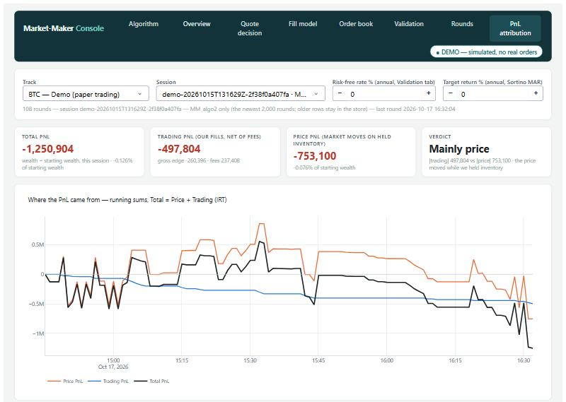

# MM_algo2: the complete algorithm

**MM_algo2** is the quoting algorithm of the git branch `MM_algo2`: an order-book imbalance and microprice
market maker for the Nobitex pairs BTC/IRT and USDT/IRT. In the code and in the saved settings it has the
key `algo3` (the class `Algo3Strategy` in [`market_maker/strategy/algo3.py`](../market_maker/strategy/algo3.py)),
because it is the third algorithm of the project's design notes. The file `strategy/algo2.py` is unrelated:
an empty placeholder for the Avellaneda–Stoikov model.

This document follows one round from its first step to its last: what the worker reads, what the strategy
computes (every formula, with its proof), what the engine does with the two prices, what is recorded, and
how the results are judged. The short version, with pseudocode, is the [README](../README.md).

**Where the numbers come from.** Every number in the examples was produced by running the code of this
branch (`Algo3Strategy`, the engine's sizing rule, `config.py`) on order books recorded from Nobitex. Settings
that were in force on a past date, and differ from today's defaults, are marked with that date.

## Contents

1. [One round at a glance](#1-one-round-at-a-glance)
2. [Notation](#2-notation)
3. [Round start: timing and settings](#3-round-start-timing-and-settings)
4. [Reading the order book](#4-reading-the-order-book)
5. [Fills of our resting orders](#5-fills-of-our-resting-orders)
6. [Stale orders](#6-stale-orders)
7. [The account snapshot](#7-the-account-snapshot)
8. [The strategy, step by step](#8-the-strategy-step-by-step)
9. [Forecasting in MM_algo2](#9-forecasting-in-mm_algo2)
10. [The engine: from two prices to orders](#10-the-engine-from-two-prices-to-orders)
11. [What is recorded](#11-what-is-recorded)
12. [How results are measured](#12-how-results-are-measured)
13. [The demo-to-real gate](#13-the-demo-to-real-gate)
14. [Settings](#14-settings)
15. [Worked examples](#15-worked-examples)
16. [Limitations](#16-limitations)
17. [Appendix A. PnL attribution](#appendix-a-pnl-attribution)
18. [Appendix B. Properties and the tests that pin them](#appendix-b-properties-and-the-tests-that-pin-them)
19. [Appendix C. History](#appendix-c-history)

---

## 1. One round at a glance

A worker runs one round every `time_step` seconds (BTC 60 s, USDT 10 s by default). It works in one of two
modes:

* **demo**: real Nobitex order books, simulated orders in a local paper ledger (no real money);
* **live**: real orders on the Nobitex account (real money).

In demo, one worker per pair runs every enabled algorithm at the same time, each in its own **lane** with its
own paper account and result files; the MM_algo2 lane is switched on by `algo3_enabled`. A live worker runs
one algorithm, the one named by its `algorithm` setting.

| Step | What happens | Code |
|---:|---|---|
| 1 | reload the settings (demo) | `engine.py::SimpleMarketMaker._run_demo`, `demo_config.py::RuntimeConfigSynchronizer` |
| 2 | read the order book | `exchange/nobitex.py::NobitexExchangeClient.get_orderbook` |
| 3 | fill our resting orders that the market reached | `paper.py::PaperLedger.process_market` (demo); order statuses from Nobitex (live) |
| 4 | cancel our orders older than 3 minutes | `paper.py::PaperLedger.cancel_stale`; `engine.py::SimpleMarketMaker._cancel_owned_stale_orders` |
| 5 | take the account snapshot: inventory, cash, open orders | `paper.py::PaperLedger.snapshot` |
| 6 | **the strategy**: book and inventory in, two prices (or no quote) out | `strategy/algo3.py::Algo3Strategy.decide_order` |
| 7 | trend pause, one order per side, sizes, caps | `engine.py::SimpleMarketMaker._run_demo` / `run` |
| 8 | send at most one buy and one sell | `exchange/demo.py` (paper ledger); `exchange/nobitex.py::send_order` (live) |
| 9 | record the round, wait for the next one | `result_store.py`, the diagnostics JSONL |

The strategy (step 6) is a pure function of the book, the inventory and the settings, apart from one memory:
the last pair it issued (section 8.12). It never estimates a fill probability.

---

## 2. Notation

| Symbol | Meaning | Setting (default) |
|---|---|---|
| $`b_i,\ v^b_i`$ | bid price and volume at level $`i`$ ($`i=0`$ is the best bid) | — |
| $`a_i,\ v^a_i`$ | ask price and volume at level $`i`$ | — |
| $`m=(b_0+a_0)/2`$ | mid price | — |
| $`s=a_0-b_0`$ | market spread | — |
| $`\epsilon`$ | tick: 10 rial on both pairs (every pair ending in IRT) | — |
| $`k`$ | levels per side in the imbalance | `algo3_depth_k` (3) |
| $`\rho`$ | weight of each deeper level: level $`i`$ counts $`\rho^{\,i}`$ | `algo3_decay_rho` (0.5) |
| $`V^b,\ V^a`$ | weighted volume of the top $`k`$ levels, bid and ask | — |
| $`I_{\mathrm{raw}},\ I`$ | imbalance, raw and as used | — |
| $`I_{\max}`$ | clip of the imbalance | `algo3_imbalance_clip` (0.8) |
| $`I_0`$ | imbalance of level 0 alone | — |
| $`S`$ | order size, in coins | `order_size` (BTC 0.000015, USDT 1) |
| $`n_V,\ V_{\min}=n_V S`$ | thin-book threshold, in order sizes and in coins | `algo3_min_volume_orders` (20) |
| $`p_{\mathrm{micro}}`$ | microprice | — |
| $`\beta`$ | lean of the centre per unit of imbalance, a fraction of price | `algo3_beta` (0) |
| $`q`$ | inventory, in coins | — |
| $`q_{\min},\ q_{\max}`$ | inventory band | `inv_min` (0), `inv_max` (BTC 0.000472, USDT 50) |
| $`x`$ | position of $`q`$ in the band, $`0\le x\le 1`$ | — |
| $`\sigma_q`$ | largest inventory shift of the centre, a fraction of price | `skew_perc` (0.002) |
| $`c`$ | quote centre | — |
| $`f`$ | fee per filled order, a fraction of its value | `commission_perc` (0.0010) |
| $`r_{\min}`$ | required net return of a round trip | `exp_ret_min` (0.0002) |
| $`G`$ | gross bar: how much the sell price must exceed the buy price | — |
| $`h_{\min},\ h_{\mathrm{cfg}},\ h`$ | smallest, configured and used half-spread, fractions of $`c`$ | `algo3_half_spread` $`=h_{\mathrm{cfg}}`$ (0 = automatic) |
| $`B,\ A`$ | bid and ask the strategy issues | — |
| $`n,\ \omega`$ | requote band: ticks and fraction of price | `hysteresis_ticks` (5), `requote_band_perc` (0.0003) |
| $`T`$ | age after which a kept pair is re-issued | `refresh_seconds` (300) |

Prices are in rial, volumes in BTC or USDT.

---

## 3. Round start: timing and settings

**Timing.** A demo worker starts its rounds on a fixed grid, `time_step` seconds apart; when a round runs
late, the missed slots are skipped. A live worker sleeps `time_step` seconds after each round.

**Settings in demo.** At the start of every round the worker re-reads the configuration saved in the admin
panel (`config_sync.reload_at_round_boundary`). Every MM_algo2 setting takes effect at the next round. Three
settings wait for the next demo session, because they belong to the paper account: `commission_perc`,
`cash_initial` and `demo_inv_initial`. A paper account keeps the fee it was created with, and the strategy
uses that same fee, so the fee bar of section 8.8 always matches the fee the ledger charges. A lane's
algorithm is pinned to the lane: in the MM_algo2 lane the strategy is always `Algo3Strategy`.

**Settings in live.** A live worker reads its saved configuration once, when it is started. Two rules are
forced on it (`forward_config.py`): the fee used is at least 0.25 % (`commission_perc` ≥ 0.0025), and both
exposure guards of section 10.4 are on, at 25 % at most.

---

## 4. Reading the order book

The worker sends `GET https://apiv2.nobitex.ir/v3/orderbook/<PAIR>` (for example `BTCIRT`) with a 5 s timeout.
The reply must carry `bids`, `asks` and `lastTradePrice`; `bids` and `asks` are lists of `[price, volume]`
written as text, best first.

| Case | Demo | Live |
|---|---|---|
| HTTP error, timeout, or a missing key | no row is written; the worker waits for the next round | the round ends; nothing is sent |
| best bid, best ask or last price unreadable | the same | the same |
| a usable book | continue with section 5 | continue with section 5 |

When the book cannot be read, nothing else happens in that round: no fills are processed, no order is
cancelled or sent (a live worker has already refreshed the status of its orders, which it does first). The
next round starts on time.

---

## 5. Fills of our resting orders

**Demo: the paper fill rule** (`paper.py::PaperLedger.process_market`). Every order of ours still resting is
checked against the new book:

* a **buy** at limit $`B`$ fills when the best ask has come down to it, $`a_0\le B`$;
* a **sell** at limit $`A`$ fills when the best bid has come up to it, $`b_0\ge A`$.

The fill price is the order's own limit price (reason `price_touch`). If the reply carried a trade price
(`tradePrice`) that crosses the limit, the fill would be at that price (`trade_cross`), but the Nobitex
order book carries none, so every demo fill is a touch. Per round and per side, at most one order size is
filled in total (`demo_max_fill_per_observation_orders` = 1, times $`S`$); the orders are served best price
first (highest buy, lowest sell), then oldest first. An order that fills only in part keeps resting with the
rest. The optional queue, adverse-fill and level-1 models are off in both profiles.

The fee is charged on every fill, as on Nobitex: a buy of $`a`$ coins at price $`P`$ pays its fee in coins,
a sell pays it in rial:

```math
\text{buy: } q \mathrel{+}= a(1-f),\quad \text{cash} \mathrel{-}= aP;\qquad
\text{sell: } q \mathrel{-}= a,\quad \text{cash} \mathrel{+}= aP(1-f).
```

**Live.** The worker asks Nobitex for the status of the orders it placed and books their filled amounts
(`update_filled_amounts`, `update_inventory_and_cash`).

---

## 6. Stale orders

Every order of ours older than `cancel_after_minutes` (3 minutes) is cancelled before the new quote is
computed. In demo, "older" means strictly more than 180 s since it was placed (reason `stale_timeout`); in
live, the worker cancels its own open orders on Nobitex that are older than 3 minutes. A failed lookup in live
leaves the orders for the next round.

---

## 7. The account snapshot

In demo the paper ledger reports, after the fills and cancellations:

| Quantity | Definition |
|---|---|
| inventory $`q`$ | all coins held, including coins locked in our open sells |
| locked coins | the remaining amounts of our open sells |
| free coins | $`q`$ minus the locked coins |
| cash | all rial held, including rial locked in our open buys |
| locked cash | the sum of remaining amount times limit price over our open buys |
| free cash | cash minus the locked cash |
| wealth | $`q`$ valued at the last trade price, plus cash |

The strategy receives $`q`$, the total holding. In live, $`q`$ and the cash come from the worker's own
accounting of its fills, starting from the wallet balances it read when it was started.

---

## 8. The strategy, step by step

Every step below is `Algo3Strategy.evaluate`, then the hysteresis of `decide_order`
([`strategy/algo3.py`](../market_maker/strategy/algo3.py); the shared arithmetic is in
[`strategy/common.py`](../market_maker/strategy/common.py)).

### 8.1 Is the book usable?

| Condition | Result |
|---|---|
| no best bid or ask, a price $`\le 0`$, or a crossed top ($`b_0>a_0`$) | no quote: `invalid_or_single_level_order_book` |
| fewer than $`k`$ levels on either side | no quote: `book_shallower_than_depth_k` |
| a level that cannot be read as numbers, or a price $`\le 0`$ among the levels read | no quote: `invalid_or_single_level_order_book` |

The levels read are the first $`\max(k,\ d+1)`$ of each side, where $`d`$ is the smaller of `depth_max` (10)
and the deepest index present on both sides. Only the first $`k`$ enter the decision; the others serve the
recorded book levels of section 8.11.

### 8.2 Imbalance

```math
V^b=\sum_{i=0}^{k-1}\rho^{\,i}\,v^b_i,\qquad
V^a=\sum_{i=0}^{k-1}\rho^{\,i}\,v^a_i,\qquad
I_{\mathrm{raw}}=\frac{V^b-V^a}{V^b+V^a}\quad(0\ \text{when}\ V^b+V^a=0).
```

$`I_{\mathrm{raw}}>0`$ means more volume waits to buy than to sell near the top of the book. With
$`\rho=0.5`$, level 1 counts half as much as level 0 and level 2 a quarter.

**Claim 1.** $`-1\le I_{\mathrm{raw}}\le 1`$, with $`I_{\mathrm{raw}}=\pm1`$ only when one side's weighted
volume is zero.

*Proof.* Volumes and weights are non-negative, so $`V^b,V^a\ge 0`$ and
$`\lvert V^b-V^a\rvert\le V^b+V^a`$, with equality exactly when $`V^b=0`$ or $`V^a=0`$. ∎

### 8.3 The thin-book guard

If the top of the book holds little volume, its imbalance says little. With $`V_{\min}=n_V S`$:

```math
\text{thin book}\iff V_{\min}>0\ \text{and}\ V^b+V^a<V_{\min}.
```

On a thin book the strategy sets $`I=0`$ and starts the centre at the mid $`m`$ instead of the microprice.
With the defaults, $`V_{\min}=20\times 0.000015=0.0003`$ BTC and $`20\times 1=20`$ USDT. $`n_V=0`$ switches
the guard off.

### 8.4 The clip

Otherwise the imbalance is clipped:

```math
I=\max\bigl(-I_{\max},\ \min(I_{\max},\ I_{\mathrm{raw}})\bigr).
```

One large level, possibly placed only to be pulled again, then cannot push the lean of section 8.7 to its
maximum. On the recorded books about a quarter of the imbalances were beyond ±0.8 (section 15.4).

### 8.5 The microprice

```math
p_{\mathrm{micro}}=\frac{a_0\,v^b_0+b_0\,v^a_0}{v^b_0+v^a_0}\qquad(\text{the mid when}\ v^b_0+v^a_0=0).
```

It weights each best price by the volume on the **other** side, so it sits nearer the side with less volume.

**Proposition 1.** $`p_{\mathrm{micro}}=m+\tfrac{s}{2}\,I_0`$, where $`I_0=(v^b_0-v^a_0)/(v^b_0+v^a_0)`$.

*Proof.*

```math
\begin{aligned}
p_{\mathrm{micro}}-m
&=\frac{2a_0v^b_0+2b_0v^a_0-(a_0+b_0)(v^b_0+v^a_0)}{2\,(v^b_0+v^a_0)}
 =\frac{a_0v^b_0-a_0v^a_0-b_0v^b_0+b_0v^a_0}{2\,(v^b_0+v^a_0)}\\
&=\frac{(a_0-b_0)(v^b_0-v^a_0)}{2\,(v^b_0+v^a_0)}
 =\frac{s}{2}\,I_0 .
\end{aligned}
```

∎

**Corollary.** $`b_0\le p_{\mathrm{micro}}\le a_0`$: $`\lvert I_0\rvert\le1`$ gives
$`\lvert p_{\mathrm{micro}}-m\rvert\le s/2`$. In example 1 (section 15.1) the identity holds to
$`4.5\times10^{-11}`$ rial: $`p_{\mathrm{micro}}-m=-142.12880836567`$ and
$`\tfrac{s}{2}I_0=-142.12880836571`$.

$`I_0`$ is not clipped; it enters only through the microprice. Section 9.1 explains why the microprice is a
forecast.

### 8.6 Inventory position

```math
x=\mathrm{clamp}\Bigl(\frac{q-q_{\min}}{q_{\max}-q_{\min}},\ 0,\ 1\Bigr),
\qquad x=\tfrac12\ \text{when}\ q_{\max}\le q_{\min}.
```

$`x=0`$ is an empty band, $`x=1`$ a full one; an inventory outside the band counts as the nearest edge.

### 8.7 The centre: lean and skew

```math
c=p\cdot\underbrace{(1+\beta I)}_{\text{lean}}\cdot\underbrace{\bigl(1-\sigma_q\,(2x-1)\bigr)}_{\text{skew}},
\qquad
p=\begin{cases}p_{\mathrm{micro}} & \text{normal book,}\\ m & \text{thin book.}\end{cases}
```

* **Lean.** With $`\beta>0`$, buying pressure ($`I>0`$) raises the centre, so both prices rise. The default
  is $`\beta=0`$: no lean (section 9.2 explains why).
* **Skew.** An inventory above the middle of the band ($`x>\tfrac12`$) lowers the centre, so our ask gets
  nearer the market and our bid farther from it: selling becomes more likely, buying less. A half-full band
  leaves the centre where it is; a full band lowers it by $`\sigma_q`$ = 0.2 %, an empty band raises it by
  0.2 %.

**Claim 2.** For $`\beta\ge0`$:
$`(1-\beta I_{\max})(1-\sigma_q)\le c/p\le(1+\beta I_{\max})(1+\sigma_q)`$.

*Proof.* $`\lvert I\rvert\le I_{\max}`$ and $`\lvert 2x-1\rvert\le1`$; both factors are positive for the
admitted settings ($`\beta\le0.05`$, $`I_{\max}\le1`$, $`\sigma_q\le0.1`$). ∎ With $`\beta=0`$ and
$`\sigma_q=0.002`$ the centre is always within 0.2 % of $`p`$. A centre $`c\le0`$ gives no quote
(`invalid_centre`); it cannot happen with admitted settings and a usable book.

### 8.8 The fee bar and the half-spread

**The return of a round trip.** Spend 1 rial on a buy at $`B`$: it brings $`(1-f)/B`$ coins, because the fee
is taken in coins. Sell them at $`A`$: they bring $`(1-f)A/B`$ rial, less the fee in rial. What comes back
per rial spent, minus the rial:

```math
R(B,A)=(1-f)^2\,\frac{A}{B}-1 .
```

The pair is good enough when $`R(B,A)>r_{\min}`$, that is when

```math
\frac{A}{B}>1+G,\qquad G=\frac{1+r_{\min}}{(1-f)^2}-1\approx 2f+r_{\min}.
```

($`r_{\min}`$ is `exp_ret_min`; when it is unset, it falls back to `commission_perc`.)

**The half-spread.** MM_algo2 places the two prices symmetrically around the centre, $`B=c(1-h)`$ and
$`A=c(1+h)`$, so

```math
R(h)=(1-f)^2\,\frac{1+h}{1-h}-1 ,
```

which depends on $`h`$ alone: the centre, and with it the signal and the inventory, cancels out.

**Proposition 2.** For $`0\le h<1`$: $`R(h)>r_{\min}\iff h>h_{\min}=\dfrac{G}{2+G}`$.

*Proof.* Using $`1-h>0`$:
$`R(h)>r_{\min}\iff\frac{1+h}{1-h}>1+G\iff 1+h>(1+G)(1-h)\iff h\,(2+G)>G`$. The function
$`(1+h)/(1-h)`$ is strictly increasing on $`[0,1)`$, so every $`h`$ above $`h_{\min}`$ clears the bar and
nothing at or below it does. ∎

MM_algo2 uses one tick of margin above the bar:

```math
h=\max\Bigl(h_{\mathrm{cfg}},\ \frac{G}{2+G}+\frac{\epsilon}{c}\Bigr).
```

With `algo3_half_spread` = 0 (the default) this is $`h_{\min}`$ plus one tick. If $`h\ge1`$ there is no
quote: `half_spread_not_attainable` (it takes $`f\ge1`$, or a centre of only a few ticks).

| Settings | $`f`$ | $`r_{\min}`$ | $`G`$ | $`h_{\min}`$ | $`R`$ at $`h_{\min}`$ |
|---|---:|---:|---:|---:|---:|
| profile defaults (`config.py`, both pairs) | 0.10 % | 0.02 % | 0.2203 % | 0.1100 % | 0.020000 % |
| the live floor (fee forced to at least 0.25 %) | 0.25 % | 0.02 % | 0.5220 % | 0.2603 % | 0.020000 % |
| demo of 17 October 2026 (dated) | 0.08 % | 0.01 % | 0.1702 % | 0.0850 % | 0.010000 % |
| the design note's example | 0.25 % | 0.25 % | 0.7531 % | 0.3752 % | 0.250000 % |

So with the profile defaults MM_algo2 quotes about ±0.110 % around its centre, and at the live floor about
±0.260 %. The tick margin $`\epsilon/c`$ is 0.00038 % of the price on USDT (about 2,630,000 rial) and
$`4.7\times10^{-11}`$ on BTC (about $`2.14\times10^{11}`$ rial), so on BTC the net return of a quote equals
$`r_{\min}`$ to six significant figures.

### 8.9 Prices on the tick, never crossing

```math
B=\epsilon\,\Bigl\lfloor\frac{\min\bigl(c(1-h),\ a_0-\epsilon\bigr)}{\epsilon}\Bigr\rfloor,\qquad
A=\epsilon\,\Bigl\lceil\frac{\max\bigl(c(1+h),\ b_0+\epsilon\bigr)}{\epsilon}\Bigr\rceil .
```

The bid is rounded down and the ask up, after each has been held one tick away from the other side of the
book (the **touch clip**).

**Proposition 3.** Every pair MM_algo2 computes satisfies:

1. $`B\le a_0-\epsilon`$ and $`A\ge b_0+\epsilon`$: neither order can trade at once against the book;
2. $`B`$ and $`A`$ are multiples of $`\epsilon`$;
3. $`A/B\ge(1+h)/(1-h)>1+G`$, so $`R(B,A)>r_{\min}`$ on the prices actually sent.

*Proof.* (1) The minimum with $`a_0-\epsilon`$, then rounding down, can only lower the bid; $`a_0-\epsilon`$
is itself a multiple of $`\epsilon`$, so $`B\le a_0-\epsilon`$. The same holds for the ask with
$`b_0+\epsilon`$ and rounding up. (2) By construction. (3) The minimum and the rounding down give
$`B\le c(1-h)`$; the maximum and the rounding up give $`A\ge c(1+h)`$. Hence
$`A/B\ge c(1+h)/\bigl(c(1-h)\bigr)`$, and Proposition 2 with $`h>h_{\min}`$ gives the rest. ∎

**The clip only widens the quote.** The design note says the touch clip "can narrow" the quote. It cannot:
the clip and the rounding only ever lower the bid and raise the ask. Example 1's full-band variant
(section 15.1) is a real case: the ask is lifted from 2,630,345.86 to 2,633,030, and the net return of the
pair rises from about 0.011 % to 0.1131 %.

### 8.10 The final check

The code re-checks the prices it will issue: if $`B\le0`$, $`B\ge A`$, or $`R(B,A)\le r_{\min}`$, there is no
quote (`net_return_below_bar`). By Proposition 3 this cannot happen while $`h>h_{\min}`$; the check is a
safety net in case the arithmetic or the settings change.

### 8.11 Book levels, for the record only

```math
i^*=\max\{\,i: b_i\ge B\,\},\qquad j^*=\max\{\,j: a_j\le A\,\}\qquad(0\ \text{when the set is empty}),
```

over the levels read (section 8.1). $`i^*`$ is the deepest bid level at or above our bid; when our bid is
above the best bid, no level qualifies and $`i^*=0`$. The levels are recorded and shown on the dashboard;
they play no part in the decision.

### 8.12 Keeping a pair that barely moved (hysteresis)

The strategy remembers the last pair it issued, $`(B^\circ,A^\circ)`$, and when it issued it, $`t^\circ`$. The
**requote band** of a price is

```math
w(p)=\max(n\,\epsilon,\ \omega\,p),
```

the wider of $`n`$ = 5 ticks and $`\omega`$ = 0.03 % of the price (`strategy/common.py::requote_band`): about
790 rial on USDT at 2,633,510 and about 64,209,000 rial on BTC at 214,030,000,000. A new pair $`(B,A)`$ is
replaced by $`(B^\circ,A^\circ)`$ when all of these hold:

* $`\lvert B-B^\circ\rvert\le w(B^\circ)`$ and $`\lvert A-A^\circ\rvert\le w(A^\circ)`$;
* $`(B^\circ,A^\circ)`$ was issued less than $`T`$ = 300 s ago; keeping a pair does not restart its clock,
  so after 300 s a fresh pair is always issued;
* $`R(B^\circ,A^\circ)>r_{\min}`$ with the current settings.

The quote then says `microprice_pair_kept` instead of `microprice_pair`. A round without a quote forgets the
remembered pair, and so does a new strategy object (a worker or lane restart).

The engine uses the same band $`w`$ for its own resting orders (section 10.2). Together the two rules keep a
price that moved less than the band from churning orders, and replace an order once the price has left it.

---

## 9. Forecasting in MM_algo2

MM_algo2 has two forecasting parts. Both rest on one idea about the top of the book: **the side with less
volume waiting is the one more likely to run out first, and the price then moves toward that side.**

### 9.1 The microprice: an implicit forecast that is always on

Read the microprice as an expected price. Suppose the next change of the best prices comes from one of the
two top queues running out: if the ask queue runs out first the price moves up to about $`a_0`$, if the bid
queue runs out first it moves down to about $`b_0`$. Suppose further that the chance of the ask running out
first is the share of the volume waiting on the bid side, $`\pi_{\uparrow}=v^b_0/(v^b_0+v^a_0)`$: the more
buyers wait, the faster the sellers at the best ask are consumed. Then

```math
\mathbb{E}[p']=\pi_{\uparrow}\,a_0+(1-\pi_{\uparrow})\,b_0
=\frac{a_0\,v^b_0+b_0\,v^a_0}{v^b_0+v^a_0}=p_{\mathrm{micro}} .
```

This is the model behind the formula, not something the code measures. Starting the centre at
$`p_{\mathrm{micro}}`$ instead of $`m`$ moves both of our prices toward where the price is expected to go,
so we buy a little less eagerly before a fall and sell a little less eagerly before a rise.

**How large it is.** On the recorded books (section 15.4) the median distance between the microprice and
the mid was 0.0043 % to 0.0455 % of the price (90th percentile 0.030 % to 0.072 %). The half-spread is
0.110 % with the profile defaults. So the microprice shifts the centre by a small part of the half-spread
in a typical book; it decides whether our bid or our ask sits nearer the market, not whether we quote.



*The 3 October 2026 books: the imbalance (top) and the microprice offset from the mid (bottom). The dashed
lines of the bottom panels mark the half-spread of the demo settings of 17 October 2026 (0.085 %).*

### 9.2 The explicit forecast: the lean $`\beta I`$, switched off

The lean answers: per unit of imbalance of the top three levels, how far does the mid move over the next
$`\tau`$ seconds? It is worth switching on only if the imbalance really predicts that move. The design note's
procedure regresses the forward return of the mid on the imbalance, with no constant:

```math
r_{t,\tau}=\frac{m_{t+\tau}}{m_t}-1=\beta\,I_t+e_t,\qquad
\hat\beta=\frac{\sum_t I_t\,r_{t,\tau}}{\sum_t I_t^2},
```

and uses $`\hat\beta`$ only if its $`t`$-statistic exceeds 3. Here $`I_t`$ is the imbalance the strategy
computes (clipped, with the thin-book guard) and $`m_{t+\tau}`$ is the mid of the first book at or after
$`t+\tau`$, at most 30 s late.

**Why the standard error needs care.** Books arrive every 10 s, while $`\tau`$ is up to 600 s, so the windows
of neighbouring books overlap: at $`\tau`$ = 600 s, 60 consecutive books share most of their window, and
their errors are strongly correlated. The ordinary standard error ignores that and makes $`t`$ too large. The
calibration uses the Newey–West estimator with $`L=\lceil\tau/10\ \mathrm{s}\rceil`$ lags:

```math
\widehat{\mathrm{Var}}(\hat\beta)=
\frac{\sum_t u_t^2+2\sum_{l=1}^{L}\bigl(1-\frac{l}{L+1}\bigr)\sum_t u_t\,u_{t-l}}{\bigl(\sum_t I_t^2\bigr)^2},
\qquad u_t=I_t\,\hat e_t,\qquad
t_{\mathrm{NW}}=\frac{\hat\beta}{\sqrt{\widehat{\mathrm{Var}}(\hat\beta)}} .
```

**Results** on the books of 3 October 2026 (578 per pair, 14:31–16:23 UTC, 10 s apart):

| Pair | $`\tau`$ | Pairs $`(I_t,r_t)`$ | $`\hat\beta`$ | $`t`$, Newey–West | $`t`$, ignoring overlap | Independent windows | $`\hat\beta`$ × median $`\lvert I\rvert`$ |
|---|---:|---:|---:|---:|---:|---:|---:|
| USDT | 60 s | 543 | $`9.08\times10^{-5}`$ | 1.40 | 2.23 | 112.6 | 0.0054 % |
| USDT | 300 s | 471 | $`1.65\times10^{-4}`$ | 0.79 | 2.04 | 22.5 | 0.0098 % |
| USDT | 600 s | 454 | $`2.64\times10^{-4}`$ | 1.10 | 2.22 | 11.3 | 0.0161 % |
| BTC | 60 s | 543 | $`1.73\times10^{-4}`$ | 2.70 | 4.66 | 112.6 | 0.0089 % |
| BTC | 300 s | 471 | $`7.94\times10^{-5}`$ | 0.68 | 1.26 | 22.5 | 0.0040 % |
| BTC | 600 s | 453 | $`4.87\times10^{-4}`$ | 0.90 | 3.68 | 11.3 | 0.0278 % |

**Decision: $`\beta=0`$.** No estimate passes $`t>3`$. The strongest, BTC at 60 s ($`t`$ = 2.70), would move
the centre by about 0.009 % for a typical book, under a tenth of the half-spread. The column "ignoring
overlap" shows why the correction matters: it would have accepted two estimates (BTC at 60 s and 600 s) that
the corrected standard error rejects. Two hours of books hold only about 11 independent 10-minute windows.
With the raw, unclipped imbalance every $`t`$ changes by less than 0.2.



### 9.3 What the imbalance changes while $`\beta=0`$

**Claim 3.** With $`\beta=0`$ the quote does not depend on $`I`$, $`k`$ or $`\rho`$, except through the
thin-book test.

*Proof.* $`I`$ enters the rule only through the lean factor $`1+\beta I`$, which is 1 when $`\beta=0`$.
$`V^b+V^a`$, and with it $`k`$ and $`\rho`$, enter only through the test $`V^b+V^a<V_{\min}`$. ∎

So, today, the book moves MM_algo2's prices through three things only: the top level (via the microprice),
the best prices (the touch clip) and the thin-book guard. The imbalance is still computed every round,
recorded and charted on the dashboard. Example 1's variant "$`k=1`$, $`\rho=1`$" shows it: the imbalance
changes from −0.405 to −0.290 and the quote stays the same.

### 9.4 What it would take to switch the lean on

Days of books with volumes, not hours: the demo's diagnostics file records the top $`k`$ levels of every
round, which is the data the regression needs. The rule stays: estimate $`\hat\beta`$ with the Newey–West
error and set `algo3_beta` only if $`t>3`$. A real, active forecast lives in another algorithm (MM_algo3, on
its own branch).

---

## 10. The engine: from two prices to orders

The strategy returns $`(B,A)`$; the engine decides how much to send, and whether to send at all. These rules
are the same for every algorithm.

### 10.1 The trend pause

Every round with a usable book (in live: every round with a quote), the engine appends $`(t,m_t)`$ to a
history and drops the samples older than
the window $`W`$ = `trend_window_seconds` (600 s). Let $`t_0`$ be the oldest sample left. If
$`t_0>t-W/2`$, the history is too short and nothing is paused. Otherwise, with $`\theta`$ =
`trend_pause_perc` (0.003):

```math
d_t=\frac{m_t}{m_{t_0}}-1,\qquad
d_t\le-\theta\ \Rightarrow\ \text{buys paused},\qquad
d_t\ge\theta\ \Rightarrow\ \text{sells paused}.
```

On a paused side every resting order of ours is cancelled (reason `trend_pause`) and no new order is sent
this round: in a falling market the bot stops adding coins, in a rising one it stops selling them.
$`W=0`$ or $`\theta=0`$ switches the pause off.

### 10.2 One order per side

For the sell side, then the buy side, the engine cancels every resting order of ours whose price is farther
than $`w(p)`$ from the new price $`p`$ of that side (reason `replaced`; $`w`$ as in section 8.12). An order
of ours within the band is kept, and then no new order is sent on that side (`resting_order_kept`). So a side
has at most one resting order, and it follows the quote in steps of at least the band.

### 10.3 Sizes

With $`k_s`$ = `inventory_sizing_strength` (1), the floor $`\phi`$ = `inventory_sizing_min_fraction` (0),
and $`o_b`$, $`o_s`$ the amounts still resting in our open buys and sells:

```math
\pi(e)=2\,\mathrm{clamp}\Bigl(\frac{e-q_{\min}}{q_{\max}-q_{\min}},0,1\Bigr)-1,
```

```math
\text{buy target}=S\cdot\mathrm{clamp}\bigl(1-k_s\,\pi(q+o_b),\ \phi,\ 1+k_s\bigr),\qquad
\text{sell target}=S\cdot\mathrm{clamp}\bigl(1+k_s\,\pi(q-o_s),\ \phi,\ 1+k_s\bigr).
```

With the defaults and no open orders this is buy $`=2S(1-x)`$ and sell $`=2Sx`$: the two add up to $`2S`$,
the buy fades to 0 at a full band and the sell at an empty one. Open orders count before they fill: an open
buy makes the next buy smaller, an open sell the next sell smaller. (In demo, $`o_b`$ is measured after this
round's replacements and $`o_s`$ before them; see section 16.) With sizing off, or a band of zero width,
both targets are $`S`$.

The smallest order sent is $`0.1\,S`$ (`MIN_ORDER_SIZE_FRACTION`).

### 10.4 Caps, in the order they are checked

The demo engine checks the sell side first, then the buy side. The first condition that holds decides, and
the round row records its reason:

| # | Sell side, at $`A`$ | Buy side, at $`B`$ |
|---:|---|---|
| 1 | no ask: `one_sided_quote` | no bid: `one_sided_quote` |
| 2 | sells paused: `trend_pause` | buys paused: `trend_pause` |
| 3 | a sell of ours rests within $`w(A)`$: `resting_order_kept` | a buy of ours rests within $`w(B)`$: `resting_order_kept` |
| 4 | size $`=\min(\text{target},\ \text{free coins}-q_{\min})\ge0.1S`$ but the locked-coin guard refuses: `locked_inventory_limit` | target $`<0.1S`$: `inventory_sizing` |
| 5 | size $`\ge0.1S`$: **send** (refused by the ledger: `rejected`) | size $`=\min(\text{target},\ \text{free cash}/B)<0.1S`$: `insufficient_cash` |
| 6 | target $`<0.1S`$ while free coins allow $`0.1S`$: `inventory_sizing` | open buys + $`q`$ + size $`>q_{\max}`$: `inventory_cap` |
| 7 | coins locked in our open sells and $`q>q_{\min}`$: `inventory_locked_in_open_orders` | the locked-cash guard refuses: `locked_cash_limit` |
| 8 | otherwise: `insufficient_inventory` | otherwise: **send** (refused by the ledger: `rejected`) |

MM_algo2 always returns both prices, so row 1 never applies to it; at the band edges it is the sizing, or
the lack of coins, that leaves one side out (at a full band the buy target is 0; at an empty one the sell
target is 0 and there is nothing to sell).

**Exposure guards.** A guard refuses a new order when the locked amount after it would exceed its share of
the whole resource:

```math
\frac{\text{locked cash}+\text{size}\cdot B}{\text{cash}}>\lambda_{\mathrm{buy}},\qquad
\frac{\text{locked coins}+\text{size}}{q}>\lambda_{\mathrm{sell}} .
```

They are off in the demo profiles; a live worker always has them on with $`\lambda\le0.25`$.

**Live.** The same caps apply, with two differences: the guards are checked before the band cap on the buy
side, and the row records only "not sent", without the reason.

### 10.5 Sending

**Demo.** The paper ledger accepts the order if it is covered: a buy needs size × $`B`$ of free cash, a sell
needs size of free coins; otherwise the order is `rejected`. Order ids are `<pair>-<side>-<round>-<ms>`, for
example `btcirt-buy-2761-…`.

**Live.** The worker sends a signed `POST https://apiv2.nobitex.ir/market/orders/add` with a 20 s timeout.
The body, for the buy of example 2 (section 15.2):

```json
{"type":"buy","srcCurrency":"btc","dstCurrency":"rls","amount":"3.018014669170777e-05","price":213851262480.0,"clientOrderId":"buy-2761-<ms>"}
```

The amount is written with Python's `str()`, the price as a JSON number. The signature is Ed25519 over the
timestamp, `POST`, the path and the exact body (`exchange/nobitex_auth.py`), sent in the headers
`Nobitex-Key`, `Nobitex-Signature` and `Nobitex-Timestamp`. A reply outside 2xx counts as not sent. On exit a
live worker cancels all its own open orders.

---

## 11. What is recorded

### 11.1 The quote

`decide_order` returns a dictionary; the engine reads it and writes most of it into the round row.

| Key | Value |
|---|---|
| `bid`, `ask` | $`B`$, $`A`$ (after the hysteresis) |
| `bid level`, `ask level` | $`i^*`$, $`j^*`$ of the newly computed pair (section 8.11) |
| `mid price`, `lastTradePrice` | $`m`$; the last trade price (recorded, not used) |
| `centre`, `inventory position` | $`c`$, $`x`$ |
| `gross return`, `net return` | $`A/B-1`$; $`R(B,A)`$ |
| `buy fee`, `sell fee`, `min required return` | $`f`$, $`f`$, $`r_{\min}`$ |
| `relative quoted spread` | $`(A-B)/m`$ |
| `bid spread`, `ask spread` | $`m-B`$, $`A-m`$, in rial |
| `bid distance`, `ask distance` | $`(c-B)/c`$, $`(A-c)/c`$ |
| `imbalance`, `microprice` | $`I`$, $`p`$ (the mid on a thin book) |
| `quote mode`, `selection reason` | always `pair`; `microprice_pair` or `microprice_pair_kept` |
| `bid kept`, `ask kept` | whether the hysteresis kept the pair |
| `bid exec prob`, `ask exec prob`, `expected value`, `reference price` | empty: MM_algo2 makes no fill forecast |

### 11.2 The round row

A demo row has 72 columns, a live row 32. Both end with the same 11 decision columns: `Quote Mode`,
`Selection Reason`, `Centre`, `Bid Distance`, `Ask Distance`, `Bid Fill Prob`, `Ask Fill Prob`,
`Expected Value`, `Reference Price`, `Imbalance` and `Microprice`; for MM_algo2 the fill-probability,
expected-value and reference columns are empty. Every row carries `Strategy` = `algo3`. A demo row also
records the account (inventory, cash, free and locked amounts, wealth), the fee of the round, each side's
order (status, amount, price, filled amount) or its not-sent reason, and the no-quote counters. Demo rows go
to a SQLite store (`<pair>_track_demo_algo3.sqlite3` for the lane) with a bounded CSV export; live rows to
a CSV.

### 11.3 The diagnostics document

While `algo1_diagnostics_enabled` is on (it is, in both profiles), every round appends the strategy's whole
evaluation to a JSONL file, before the decision is taken: the MM_algo2 lane writes
`<pair>_track_demo_algo3_diagnostics.jsonl`; a live worker writes `<pair>irt_algo1_diagnostics.jsonl` (a
historical name shared by both algorithms; each document carries `"algorithm": "algo3"`). The file is cut
back to its newest 2,000 rounds when it reaches twice that. The dashboard's Quote decision tab reads it.

| Keys | Content |
|---|---|
| `symbol`, `session_id`, `round`, `algorithm`, `algorithm_version` | identity (`algo3`, version 3) |
| `inventory`, `inv_min`, `inv_max`, `inventory_position` | $`q`$, the band, $`x`$ |
| `mid_price`, `spread`, `last_price` | $`m`$, $`s`$, the last trade |
| `depth_k`, `decay_rho`, `levels` | $`k`$, $`\rho`$, the top $`k`$ levels with volumes and weights |
| `volume_bid`, `volume_ask`, `min_volume`, `thin_book` | $`V^b`$, $`V^a`$, $`V_{\min}`$, the thin-book test |
| `imbalance_raw`, `imbalance`, `imbalance_level0`, `imbalance_clip` | $`I_{\mathrm{raw}}`$, $`I`$, $`I_0`$, $`I_{\max}`$ |
| `microprice`, `microprice_shift` | $`p`$, $`p/m-1`$ |
| `beta`, `lean_factor`, `skew_perc`, `skew_factor`, `centre`, `centre_shift` | $`\beta`$, $`1+\beta I`$, $`\sigma_q`$, $`1-\sigma_q(2x-1)`$, $`c`$, $`c/m-1`$ |
| `commission_perc`, `exp_ret_min`, `gross_bar`, `h_min`, `h_config`, `tick_fraction`, `h` | $`f`$, $`r_{\min}`$, $`G`$, $`h_{\min}`$, $`h_{\mathrm{cfg}}`$, $`\epsilon/c`$, $`h`$ |
| `raw_bid`, `raw_ask`, `clipped_bid`, `clipped_ask` | $`c(1-h)`$, $`c(1+h)`$, whether the touch clip moved them |
| `selected_bid_price`, `selected_ask_price`, `selected_bid_level`, `selected_ask_level` | $`B`$, $`A`$ before the hysteresis, $`i^*`$, $`j^*`$ |
| `gross_return`, `net_return`, `relative_quoted_spread` | of $`B`$ and $`A`$ |
| `selection_reason`, `quote_mode` | `microprice_pair` or a no-quote reason; `pair` or `none` |
| `hysteresis` | $`n`$, $`T`$, and the remembered pair with its age |
| `candidate_results` | the one evaluated pair, in the shape the Telegram and admin readers expect |

### 11.4 No-quote reasons and the alert

| Reason | When |
|---|---|
| `invalid_or_single_level_order_book` | no usable best bid or ask, a crossed top, unreadable or non-positive levels (8.1) |
| `book_shallower_than_depth_k` | fewer than $`k`$ levels on a side (8.1) |
| `invalid_centre` | $`c\le0`$ (8.7) |
| `half_spread_not_attainable` | $`h\ge1`$ (8.8) |
| `net_return_below_bar` | the final check failed (8.10); impossible while $`h>h_{\min}`$ |

A no-quote round is still recorded, with its reason. When no quote has been possible for 30 rounds or for
300 s, whichever comes first (`no_quote_alert_rounds`, `no_quote_alert_seconds`), Telegram gets an alert, and
another when quoting resumes.

---

## 12. How results are measured

The results dashboard reads the round rows and the diagnostics. With MM_algo2 chosen on its first tab
(**Algorithm**), every other tab shows MM_algo2's rounds only. The measures it uses:

* **Wealth and its split** (tab *PnL attribution*): $`W_t=c_t+q_tm_t`$ with $`c_t`$ the cash, split exactly
  into a price part (the inventory held times the move of the mid) and a trading part (our fills against the
  mid, net of fees). The derivation and a worked example are in [Appendix A](#appendix-a-pnl-attribution).
* **Round trips**: buy fills matched first-in, first-out against later sell fills; each trip's net return is
  $`(1-f)^2\,P_{\mathrm{sell}}/P_{\mathrm{buy}}-1`$.
* **Realised against computed spread**: the amount-weighted mean net return of the completed round trips,
  minus the mean `Net Return` the strategy computed at placement.
* **Adverse selection**: for each filled order at price $`P`$, placed in the round at time $`t`$, the mid
  60 s after that round, signed so that a negative value is a move against the position taken:
  $`(m_{t+60}-P)/P`$ for a buy and $`(P-m_{t+60})/P`$ for a sell. The clock starts at the round that placed
  the order, not at the fill, because a demo row records when an order was placed.
* **Fills per hour**, **time at the band edges** ($`x<0.1`$ or $`x>0.9`$), **net PnL** (last wealth minus
  first) and the **mark-to-market drawdown** (the largest fall of wealth from its running peak, as a
  fraction of that peak).

---

## 13. The demo-to-real gate

The dashboard's Validation tab (`dashboard.py::gate_rows`) scores the demo against nine conditions before
the same settings may be trusted with real money. The rule: run MM_algo2 in demo for at least five days;
every measurable condition must pass.

| Condition | Pass if | For MM_algo2 |
|---|---:|---|
| rounds with a quote | ≥ 50 % | measured; MM_algo2 quotes every round with a usable book |
| fills per hour | ≥ 1 | measured |
| completed round trips (first-in, first-out) | ≥ 30 | measured |
| realised − computed net spread | ≥ −0.05 % | measured |
| adverse selection, 60 s after the placing round (section 12) | ≥ −0.10 % | measured |
| fill forecast error | within ±30 % | not measurable: MM_algo2 makes no fill forecast (shown as "—") |
| time at the band edges | ≤ 10 % | measured |
| net PnL after fees | > 0 | measured |
| mark-to-market drawdown | ≤ 1 % | measured |

---

## 14. Settings

All settings are fields of both trading profiles in `config.py` and are editable in the admin panel. In demo
every one of them is applied at the next round, except `commission_perc`, `cash_initial` and
`demo_inv_initial`, which wait for the next demo session; a live worker reads its settings when it is
started.

| Setting | Symbol | Meaning | Default (BTC / USDT) | Admin range |
|---|---|---|---|---|
| `algorithm` | — | the algorithm a **live** worker runs: `algo3` = MM_algo2, `algo1` = MM_algo1v2 | `algo1` | catalog keys |
| `algo3_enabled` | — | demo: run the MM_algo2 lane on this pair | on | on / off |
| `algo3_depth_k` | $`k`$ | levels per side in the imbalance | 3 | 1–50 |
| `algo3_decay_rho` | $`\rho`$ | weight of each deeper level | 0.5 | 0.05–1 |
| `algo3_beta` | $`\beta`$ | lean per unit of imbalance (section 9.2) | 0 | 0–0.05 |
| `algo3_half_spread` | $`h_{\mathrm{cfg}}`$ | half-spread; 0 = the smallest that clears the bar, plus a tick | 0 | 0–0.5 |
| `algo3_min_volume_orders` | $`n_V`$ | thin-book threshold, in order sizes; 0 = always trust the book | 20 | ≥ 0 |
| `algo3_imbalance_clip` | $`I_{\max}`$ | clip of the imbalance | 0.8 | 0–1 |
| `skew_perc` | $`\sigma_q`$ | inventory skew of the centre (shared with MM_algo1v2) | 0.002 | 0–0.1 |
| `commission_perc` | $`f`$ | fee per fill (live: at least 0.0025) | 0.0010 | 0–1 |
| `exp_ret_min` | $`r_{\min}`$ | required net return of a round trip | 0.0002 | 0–1 |
| `inv_min`, `inv_max` | $`q_{\min}`$, $`q_{\max}`$ | inventory band, in coins | 0 and 0.000472 / 0 and 50 | ≥ 0 |
| `order_size` | $`S`$ | order size, in coins | 0.000015 / 1 | ≥ 0 |
| `hysteresis_ticks` | $`n`$ | ticks in the requote band | 5 | 0–10,000 |
| `requote_band_perc` | $`\omega`$ | fraction of the price in the requote band | 0.0003 | 0–0.1 |
| `refresh_seconds` | $`T`$ | a kept pair is re-issued after this many seconds | 300 | ≥ 0 |
| `cancel_after_minutes` | — | life of a resting order | 3 | ≥ 0 |
| `trend_window_seconds` | $`W`$ | trend-pause window, seconds; 0 = off | 600 | ≥ 0 |
| `trend_pause_perc` | $`\theta`$ | trend-pause threshold; 0 = off | 0.003 | 0–0.5 |
| `time_step` | — | seconds between rounds | 60 / 10 | ≥ 1 |
| `depth_max` | — | deepest level index read for the recorded levels | 10 | ≥ 1 |
| `inventory_sizing_enabled`, `inventory_sizing_strength`, `inventory_sizing_min_fraction` | —, $`k_s`$, $`\phi`$ | linear sizing (section 10.3) | on, 1, 0 | —, 0–1, 0–1 |
| `buy_locked_cash_limit_enabled` / `_ratio`, `sell_locked_inventory_limit_enabled` / `_ratio` | $`\lambda`$ | exposure guards (section 10.4) | off, 0.8 (live: on, at most 0.25) | 0–1 |
| `demo_max_fill_per_observation_orders` | — | paper fill budget per side and round, in order sizes | 1 | > 0 |
| `cash_initial`, `demo_inv_initial` | — | a new paper account's rial and coins | 30,000,000 and 0 | ≥ 0 |

The MM_algo1v2 settings (`grid_*`, `one_sided_*`, `ev_min`, `adverse_selection_perc`, `fill_*`,
`cost_basis_reference`) are not read by MM_algo2.

---

## 15. Worked examples

### 15.1 Example 1: a USDT/IRT book of 17 October 2026

**The book.** Captured from Nobitex on 17 October 2026 at 11:40:34 UTC (book 27 of the 60 recorded between
11:36 and 11:46 UTC), chosen as a typical book: not thin, imbalance not clipped, spread of at least two ticks, and
$`\lvert I_{\mathrm{raw}}\rvert`$ nearest the median.

| Level | Bid price | Bid volume (USDT) | Ask price | Ask volume (USDT) |
|---:|---:|---:|---:|---:|
| 0 | 2,633,020 | 384.6 | 2,634,000 | 698.87 |
| 1 | 2,633,010 | 138.45 | 2,634,200 | 1,054.44 |
| 2 | 2,633,000 | 281.9 | 2,634,390 | 47 |
| 3 | 2,632,000 | 34.15 | 2,634,400 | 878.24 |
| 4 | 2,631,990 | 26.58 | 2,634,500 | 10 |
| 5 | 2,631,270 | 5 | 2,634,870 | 4 |

**The settings: the USDT demo's of 17 October 2026 (dated).** $`f`$ = 0.08 %, $`r_{\min}`$ = 0.01 %, band
0–300 USDT, $`S`$ = 5 USDT, $`\sigma_q`$ = 0.2 %, $`k`$ = 3, $`\rho`$ = 0.5, $`\beta`$ = 0, $`n_V`$ = 20
(so $`V_{\min}`$ = 100 USDT), $`I_{\max}`$ = 0.8. The inventory is the USDT demo's holding that afternoon,
$`q`$ = 92.4712 USDT.

| Step | Computation | Value |
|---|---|---|
| mid, spread | $`(2{,}633{,}020+2{,}634{,}000)/2`$; $`2{,}634{,}000-2{,}633{,}020`$ | $`m`$ = 2,633,510; $`s`$ = 980 rial (98 ticks) |
| weighted volumes | $`384.6+0.5\cdot138.45+0.25\cdot281.9`$; $`698.87+0.5\cdot1{,}054.44+0.25\cdot47`$ | $`V^b`$ = 524.3; $`V^a`$ = 1,237.84 USDT |
| thin-book test | $`V^b+V^a`$ = 1,762.14 against $`V_{\min}`$ = 100 | not thin |
| imbalance | $`(524.3-1{,}237.84)/1{,}762.14`$ | $`I_{\mathrm{raw}}=I`$ = −0.40493, inside ±0.8 |
| level-0 imbalance | $`(384.6-698.87)/(384.6+698.87)`$ | $`I_0`$ = −0.29006 |
| microprice | $`m+490\,I_0`$ | $`p_{\mathrm{micro}}`$ = 2,633,367.87, 142.13 rial below the mid |
| inventory position | $`92.4712/300`$ | $`x`$ = 0.30824 |
| lean, skew | $`1+0\cdot I`$; $`1-0.002\,(2\cdot0.30824-1)`$ | 1; 1.00076705 |
| centre | $`2{,}633{,}367.87\times1.00076705`$ | $`c`$ = 2,635,387.80, 0.0713 % above the mid |
| half-spread | $`h_{\min}`$ = 0.0850317 %; $`\epsilon/c`$ = 0.0003795 % | $`h`$ = 0.0854112 % |
| raw prices | $`c(1-h)`$; $`c(1+h)`$ | 2,633,136.88; 2,637,638.71 |
| touch clip | $`a_0-\epsilon`$ = 2,633,990; $`b_0+\epsilon`$ = 2,633,030 | neither price is clipped |
| rounding | bid down, ask up, to 10 rial | **$`B`$ = 2,633,130; $`A`$ = 2,637,640** |
| final check | $`0.9992^2\times2{,}637{,}640/2{,}633{,}130-1`$ | $`R`$ = 0.011069 % > 0.01 %: quoted |
| recorded levels | $`i^*`$, $`j^*`$ over the 11 levels read | bid level 0, ask level 10 |
| sizes (no open orders) | $`2\cdot5\cdot(1-0.30824)`$; $`2\cdot5\cdot0.30824`$ | buy 6.9176 USDT; sell 3.0824 USDT (minimum 0.5) |

**Reading it.** The book leans to the sell side ($`I`$ = −0.405): more volume waits to sell, which puts the
microprice 142 rial below the mid. The inventory is low ($`x`$ = 0.31), which pushes the centre 0.077 % up.
The skew wins and the centre ends 0.071 % above the mid. The bid, 380 rial below the mid, sits 110 rial
**above** the best bid: it becomes the new best bid, which is how a low inventory asks to buy first. The ask,
4,130 rial above the mid, waits 3,640 rial behind the best ask. Today's requote band around these prices is
about 790 rial.



**Variants on the same book.** Each line changes one thing and reruns the strategy:

| Variant | Centre | Raw $`B`$ / raw $`A`$ | $`B`$ / $`A`$ issued | Net return |
|---|---:|---:|---:|---:|
| as above ($`x`$ = 0.308) | 2,635,387.80 | 2,633,136.88 / 2,637,638.71 | 2,633,130 / 2,637,640 | 0.0111 % |
| half-full band, $`x`$ = 0.5 | 2,633,367.87 | 2,631,118.67 / 2,635,617.07 | 2,631,110 / 2,635,620 | 0.0112 % |
| full band, $`x`$ = 1 | 2,628,101.14 | 2,625,856.42 / 2,630,345.86 | 2,625,850 / **2,633,030** (clipped to $`b_0+\epsilon`$) | 0.1131 % |
| empty band, $`x`$ = 0 | 2,638,634.61 | 2,636,380.93 / 2,640,888.28 | **2,633,990** (clipped to $`a_0-\epsilon`$) / 2,640,890 | 0.1016 % |
| $`\beta`$ = 0.001 (lean 0.99959507) | 2,634,320.66 | 2,632,070.65 / 2,636,570.66 | 2,632,070 / 2,636,580 | 0.0111 % |
| $`k`$ = 1, $`\rho`$ = 1 ($`I`$ = −0.29006) | 2,635,387.80 | 2,633,136.88 / 2,637,638.71 | 2,633,130 / 2,637,640 | 0.0111 % |
| $`h_{\mathrm{cfg}}`$ = 0.2 % | 2,635,387.80 | 2,630,117.02 / 2,640,658.57 | 2,630,110 / 2,640,660 | 0.2405 % |
| today's fee bar ($`f`$ = 0.10 %, $`r_{\min}`$ = 0.02 %; $`h`$ = 0.1104284 %) | 2,635,387.80 | 2,632,477.58 / 2,638,298.02 | 2,632,470 / 2,638,300 | 0.0211 % |

* At the band edges the skew moves the centre 0.2 % away from the microprice, more than the half-spread of
  0.085 %. One raw price then lands across the book and the touch clip pulls it back to one tick inside: the
  pair gets wider than needed (Proposition 3) and its net return rises to about 0.1 %.
* The $`\beta`$ line shows what the lean would do: with $`I`$ = −0.405 it lowers the centre by 0.04 %,
  toward the expected fall.
* The $`k=1`$ line is Claim 3: a different imbalance, the same quote.
* The last line is the same book with the fee bar of today's profile defaults: the half-spread grows from
  0.085 % to 0.110 % and the net return of the pair is 0.0211 %, just above the new bar of 0.02 %.

### 15.2 Example 2: a real round of the BTC demo (17 October 2026)

Round 2761 of the BTC demo, session `demo-20261015T131629Z-2f38f0a407fa`, at 14:58:04 Tehran time, as
recorded in the diagnostics file and the round row. The settings were the BTC demo's of that day (dated):
$`f`$ = 0.08 %, $`r_{\min}`$ = 0.01 %, band 0–0.0037 BTC, $`S`$ = 0.000062 BTC, a requote band of 5 ticks
only.

| Level | Bid price | Bid volume (BTC) | Ask price | Ask volume (BTC) | Weight |
|---:|---:|---:|---:|---:|---:|
| 0 | 213,870,000,000 | 0.04582 | 214,189,998,500 | 0.00088 | 1 |
| 1 | 213,797,307,160 | 0.000046 | 214,189,999,320 | 0.000598 | 0.5 |
| 2 | 213,769,696,940 | 0.00088 | 214,190,000,000 | 0.00171 | 0.25 |

| Step | Recorded value |
|---|---|
| inventory, position | $`q`$ = 0.0025009 BTC (0.0018628 free, 0.0006381 locked in sells); $`x`$ = 0.0025009 / 0.0037 = 0.67591 |
| mid, spread | $`m`$ = 214,029,999,250; $`s`$ = 319,998,500 rial (0.1495 % of the mid) |
| weighted volumes | $`V^b`$ = 0.046063; $`V^a`$ = 0.0016065 BTC; $`V_{\min}`$ = 0.00124: not thin |
| imbalance | $`I_{\mathrm{raw}}`$ = 0.93260, **clipped** to $`I`$ = 0.8; $`I_0`$ = 0.96231 |
| microprice | 214,183,968,549.68, 0.0719 % above the mid: 52 times more BTC waits at the best bid than at the best ask |
| skew | $`1-0.002\,(2\cdot0.67591-1)`$ = 0.99929635 (above half-full, so the centre is lowered) |
| centre | $`c`$ = 214,033,258,711.29, 0.0015 % above the mid |
| half-spread | $`h`$ = 0.0850318 % ($`h_{\min}`$ = 0.0850317 % plus $`\epsilon/c=4.7\times10^{-11}`$) |
| raw prices | 213,851,262,483.11 / 214,215,254,939.48 |
| prices | **$`B`$ = 213,851,262,480**, 18,737,520 rial below the best bid; **$`A`$ = 214,215,254,940**, 25,256,440 rial above the best ask |
| net return | 0.0100000 %: the bar plus a negligible tick margin |
| recorded levels | bid level 0, ask level 2 |
| hysteresis that day | the remembered pair 213,852,301,030 / 214,216,295,260, issued 63.9 s earlier, differed by 1,038,550 and 1,040,320 rial, more than the 50-rial band of that day: replaced |
| orders | buy 0.00003018 BTC at $`B`$ and sell 0.00006459 BTC at $`A`$, both open at the end of the round |

**Recomputed.** Running `Algo3Strategy` with that day's BTC demo settings on the three recorded levels and
the recorded inventory gives the same two prices, here and in every one of the 15 MM_algo2 rounds recorded
in the file (14:45–14:59 Tehran time).

**With today's requote band.** Re-run on the same round with the same remembered pair, the strategy keeps
it: $`w(B^\circ)`$ = 64,155,690 rial and $`w(A^\circ)`$ = 64,264,889 rial, far wider than the 1.04-million
moves, so the quote is `microprice_pair_kept` at 213,852,301,030 / 214,216,295,260, whose net return
(0.0100001 %) still clears the bar.

**The sizes** were set by the rules of that day: orders from earlier rounds were still resting and counted
in the sizing (section 10.3), which is why the sell is larger than the buy and neither is the plain
$`2S(1-x)`$ / $`2Sx`$.

### 15.3 Example 3: the design note's book

The design note's own example, a made-up USDT/IRT book, run through `Algo3Strategy`; the test
`test_spec_worked_example_reproduces_every_number` pins every number.

* **Book:** best bid 2,658,990 (20,000 USDT), best ask 2,659,010 (5,000 USDT); the top three levels hold
  20,000 / 8,000 / 6,000 against 5,000 / 4,000 / 3,000.
* **Settings:** $`k`$ = 3, $`\rho`$ = 1, $`\beta`$ = 0.001, $`\sigma_q`$ = 0.002, $`h_{\mathrm{cfg}}`$ = 0.38 %,
  $`f=r_{\min}`$ = 0.25 %, no thin-book guard ($`n_V`$ = 0); inventory 10 in the band $`[0,50]`$.

| Step | Value |
|---|---|
| $`V^b,\ V^a`$ | 34,000 and 12,000 |
| $`I`$ | $`22{,}000/46{,}000`$ = 0.47826 |
| $`p_{\mathrm{micro}}`$ | $`(2{,}659{,}010\cdot20{,}000+2{,}658{,}990\cdot5{,}000)/25{,}000`$ = 2,659,006 $`(=m+10\times0.6)`$ |
| $`x`$; skew | 0.2; $`1-0.002\,(0.4-1)`$ = 1.0012 |
| lean | $`1+0.001\times0.47826`$ = 1.00047826 |
| $`c`$ | 2,663,470.03 |
| $`h_{\min}`$; $`h`$ | 0.37516 %; $`\max(0.38\,\%,\ 0.37516\,\%+0.00038\,\%)`$ = 0.38 % |
| $`B`$, $`A`$ | 2,653,348.85 → **2,653,340**; 2,673,591.22 → **2,673,600** |
| $`R`$ | $`0.9975^2\times2{,}673{,}600/2{,}653{,}340-1`$ = 0.26038 % > 0.25 % |

### 15.4 Many real books (3 and 17 October 2026)

The strategy was run on every book of four recorded samples, fed in order at their real times so that the
hysteresis acts as in a worker polling every 10 s. Settings: the demo's of 17 October 2026 ($`f`$ = 0.08 %,
$`r_{\min}`$ = 0.01 %) with today's requote band; the inventory held at the middle of the band
($`x=\tfrac12`$), so that only the book moves the quote.

| | USDT, 3 Oct | BTC, 3 Oct | USDT, 17 Oct | BTC, 17 Oct |
|---|---:|---:|---:|---:|
| books (about 10 s apart) | 578 | 578 | 60 | 60 |
| books quoted | 578 | 578 | 60 | 60 |
| thin books | 0.52 % | 0.52 % | 0 % | 0 % |
| mean $`I_{\mathrm{raw}}`$ | −0.275 | −0.077 | −0.350 | +0.502 |
| median $`\lvert I_{\mathrm{raw}}\rvert`$ | 0.592 | 0.515 | 0.566 | 0.784 |
| books beyond ±0.8 (clipped) | 25.4 % | 22.7 % | 23.3 % | 45.0 % |
| market spread, median (90th percentile) | 0.0294 % (0.1384 %) | 0.0616 % (0.1899 %) | 0.0258 % (0.0675 %) | 0.1495 % (0.1495 %) |
| books with a one-tick spread | 15.7 % | 11.6 % | 6.7 % | 11.7 % |
| microprice offset $`\lvert p_{\mathrm{micro}}/m-1\rvert`$, median (90th percentile) | 0.0080 % (0.0528 %) | 0.0130 % (0.0664 %) | 0.0043 % (0.0300 %) | 0.0455 % (0.0724 %) |
| half-spread $`h`$, median | 0.0854 % | 0.0850 % | 0.0854 % | 0.0850 % |
| bid / ask distance from the mid, median | 0.0859 % / 0.0853 % | 0.0850 % / 0.0850 % | 0.0861 % / 0.0851 % | 0.0849 % / 0.0852 % |
| bid above the best bid (improves it) | 6.1 % | 18.2 % | 0 % | 40.0 % |
| ask below the best ask (improves it) | 10.9 % | 11.6 % | 0 % | 15.0 % |
| pairs moved by the touch clip | 0 % | 0 % | 0 % | 0 % |
| pairs kept by the hysteresis | 66.3 % | 74.2 % | 78.3 % | 80.0 % |
| smallest net return | 0.01078 % | 0.01000 % | 0.01077 % | 0.01000 % |

* **Quotes usually wait behind the best prices.** MM_algo2 asks for at least $`2h`$ between its two prices
  (0.17 % here, 0.22 % with today's defaults), while the market spread was smaller in most books. So most of
  the time its bid is below the best bid and its ask above the best ask, and a fill needs the price to come
  to it. It improves a side only when the microprice (or, in a worker, the skew) moves its centre far
  enough.
* **The microprice moves the centre by less than the half-spread** (section 9.1).
* **Every quote clears the bar:** the smallest net return is $`r_{\min}`$ on BTC, and a little more on USDT,
  where the tick margin is larger.
* **The imbalance is often extreme:** a quarter of the books, and 45 % of the BTC books of 17 October, are
  beyond ±0.8. This is why the clip matters once $`\beta`$ is switched on.
* **The hysteresis keeps two pairs in three or more** at a 10 s cadence with today's band of 0.03 %.



---

## 16. Limitations

| Limitation | Effect |
|---|---|
| $`\beta=0`$ until it is estimated (section 9.2) | The imbalance does not move the quotes (Claim 3); MM_algo2 is a microprice-centred, inventory-skewed, fixed-spread quoter. |
| The half-spread is the fee bar, not a choice | Every completed round trip earns about $`r_{\min}`$ and nothing more; nothing in the rule weighs the chance of a fill or the cost of only one side filling. |
| Quotes usually wait behind the best prices (section 15.4) | Fewer fills than a quote at the best price; at the live floor ($`2h\approx0.52`$ %) the orders wait far from the market. |
| One side filling is not priced | When only the buy fills and the price keeps falling, the coins lose value; the skew and the sizing slow the accumulation, the band caps it. |
| A fall over hours is not caught | The trend pause looks at 10 minutes; the skew (at most 0.2 %) and the sizing only slow the buying. |
| The requote band is one fraction of the price for both pairs | 0.03 % is about 79 ticks on USDT and about 64 million rial on BTC; a narrower band replaces orders more often, a wider one leaves a staler order. |
| Spoofing (volume placed and pulled) | Limited by the clip and by $`\rho<1`$; harmless while $`\beta=0`$, because only level 0 moves the microprice. |
| Demo fills are an approximation | A paper order fills only when the opposite best price reaches it, at its own price, at most one order size per round; there is no queue and no taker trading into our order. A real account is needed to measure real fills. |
| Demo sell sizing after a replacement | In a round that replaces a sell, the new sell is sized from the snapshot taken before the replacement: the cancelled sell still counts as resting, so when it held the free coins the new sell goes out one round later (the buy side and the live worker use the counts after the replacement). |
| No order book (for example HTTP 403) | No round is recorded; resting orders are cancelled by the 3-minute rule at the next readable round. |
| Live amounts are sent as `str(amount)` | Small BTC sizes become scientific notation (`3e-05` for 0.00003 BTC); the test suite does not check that format against Nobitex. |
| The live diagnostics file is named `…_algo1_diagnostics.jsonl` | A historical name shared by both algorithms; each document carries `algorithm`. |

---

## Appendix A. PnL attribution

A market maker's wealth changes for two reasons that look the same in one PnL number: its own fills (buying
a little below the market, selling a little above it, paying fees) and the market moving while it holds
inventory. The dashboard's **PnL attribution** tab (`dashboard.py::pnl_attribution`, `attribution_totals`)
splits them exactly.

**What each round records.** For one pair and one session, after round $`t`$: the mid $`m_t`$ (`Mid Price`,
else the mean of best bid and best ask), the inventory $`q_t`$ (`inv_current`), the cash $`c_t`$
(`cash_current`), and in demo the fees of the round $`f_t`$ (`Round Fee`; in live rows the fees are already
inside $`c_t`$).

**Wealth and one round's bookkeeping.** With $`b_t`$ units bought at $`p^b_t`$ and $`s_t`$ units sold at
$`p^s_t`$ during round $`t`$:

```math
W_t=c_t+q_t\,m_t,\qquad
c_t=c_{t-1}-b_t\,p^b_t+s_t\,p^s_t-f_t,\qquad
q_t=q_{t-1}+b_t-s_t .
```

**The split.** Substituting and regrouping:

```math
W_t-W_{t-1}
=\underbrace{q_{t-1}\,(m_t-m_{t-1})}_{P_t\ \text{(price PnL)}}
+\underbrace{b_t\,(m_t-p^b_t)+s_t\,(p^s_t-m_t)-f_t}_{T_t\ \text{(trading PnL)}} .
```

* **Price PnL** $`P_t`$: the inventory already held, times the move of the mid. A passive holder of the same
  inventory would have earned exactly this.
* **Trading PnL** $`T_t`$: how far below the mid we bought, how far above it we sold, minus the fee: what
  our quotes earned if the price had not moved.

The identity is exact; there is no third term. Substituting the bookkeeping removes the fill prices:

```math
T_t=(c_t-c_{t-1})+(q_t-q_{t-1})\,m_t,\qquad
P_t=q_{t-1}\,(m_t-m_{t-1}),\qquad
W_T-W_0=\sum_{t=1}^{T}P_t+\sum_{t=1}^{T}T_t ,
```

so every round needs only $`c_t`$, $`q_t`$ and $`m_t`$, which every demo and live row carries, and the split
can be computed for any recorded session. The first round of a session is the baseline ($`P_1=T_1=0`$). In
demo the gross edge $`T_t+f_t`$ is shown next to the net number.

**Verdict.** If $`\lvert\sum T_t\rvert\ge\lvert\sum P_t\rvert`$ the result is "mainly trading", otherwise
"mainly price".

**Worked example** (pinned by `tests/test_dashboard_v2.py::test_pnl_attribution_splits_every_round_exactly`).
Start with 10 units and 1,000 in cash at mid 100, so $`W_0`$ = 2,000.

| Round | Event | $`m_t`$ | $`q_t`$ | $`c_t`$ | $`W_t`$ | $`P_t`$ | $`T_t`$ | $`W_t-W_{t-1}`$ |
|---:|---|---:|---:|---:|---:|---:|---:|---:|
| 1 | baseline | 100 | 10 | 1,000.0 | 2,000.0 | 0 | 0 | 0 |
| 2 | bought 2 at 98; the mid slips to 99 | 99 | 12 | 804.0 | 1,992.0 | $`10\cdot(99-100)=-10`$ | $`-196+2\cdot99=+2`$ | −8 |
| 3 | sold 1 at 102, fee 0.5; the mid returns to 100 | 100 | 11 | 905.5 | 2,005.5 | $`12\cdot(100-99)=+12`$ | $`101.5-1\cdot100=+1.5`$ | +13.5 |

Session: $`\sum P_t`$ = +2, $`\sum T_t`$ = +3.5, $`W_3-W_0`$ = +5.5; verdict "mainly trading".

**In rial:** at mid 2,662,000, buying 10 USDT at 2,660,000 with a 0.25 % fee earns an edge of 20,000 rial and
pays a fee of 66,500 rial, so $`T_t`$ = −46,500: the edge was smaller than the fee. If the mid then falls by
5,000 while the 10 USDT are held, $`P_{t+1}`$ = −50,000.

**What the tab shows.** Four tiles (total, trading net of fees with the gross edge and the fees, price,
verdict) and one chart of three running sums: orange $`\sum P`$, blue $`\sum T`$ and black $`W_t-W_0`$,
which is always orange plus blue. Where black follows orange, the market made the result; where it follows
blue, our quotes did.



*MM_algo2's first 108 rounds on the BTC demo, 17 October 2026 (dated settings): price −753,100, trading
−497,804 (gross edge −260,396, fees 237,408), total −1,250,904 rial, −0.126 % of the starting wealth.*

**Caveats.** Fills are marked at the mid of the round in which they were processed, not at the instant of
the fill, so a few seconds of drift inside a round leak into $`T_t`$. The engine values its own
`Portfolio Wealth` at the last trade price, not the mid; the difference shifts a little between $`P_t`$ and
$`T_t`$, never their sum. A row without a mid, inventory or cash carries the previous round's values
forward.

---

## Appendix B. Properties and the tests that pin them

| Property | Section | Test (`market_maker/tests/`) |
|---|---|---|
| The design note's example, number for number | 15.3 | `test_strategy_algo3.py::test_spec_worked_example_reproduces_every_number` |
| $`h_{\min}=G/(2+G)`$; the default $`h`$ is $`h_{\min}`$ plus a tick | 8.8 | `test_minimum_half_spread_is_g_over_two_plus_g`, `test_half_spread_defaults_to_the_minimum_plus_one_tick` |
| The microprice identity (Proposition 1) | 8.5 | `test_microprice_is_the_mid_shifted_by_half_spread_times_level0_imbalance` |
| Weights $`\rho^i`$, the clip, the thin book | 8.2–8.4 | `test_imbalance_weights_deeper_levels_by_rho_to_the_i`, `test_imbalance_is_clipped_so_one_large_level_cannot_dominate`, `test_a_thin_book_carries_no_signal_and_centres_on_the_mid` |
| A fixed spread around the mid when the signals are off | 8.7 | `test_reduces_to_a_fixed_spread_around_the_mid` |
| Monotone in the imbalance and the inventory | 8.7 | `test_buying_pressure_moves_both_quotes_up`, `test_more_inventory_moves_both_quotes_down` |
| $`A/B`$ before rounding does not depend on $`I`$ or $`x`$ | 8.8 | `test_spread_ratio_does_not_depend_on_the_signal_or_the_inventory` |
| Proposition 3 on 2,000 random books and settings | 8.9 | `test_every_quote_clears_the_fee_bar_never_crosses_and_sits_on_the_tick` |
| The touch clip only widens | 8.9 | `test_clipping_at_the_touch_only_widens_the_quote` |
| The final check fires when forced | 8.10 | `test_the_final_check_on_the_sent_prices_rejects_an_unprofitable_quote` |
| No-quote reasons | 11.4 | `test_unusable_books_give_no_quote_with_a_reason` |
| The hysteresis keeps, refreshes, forgets | 8.12 | `test_a_pair_that_barely_moved_is_kept_until_it_is_refreshed`, `test_no_quote_forgets_the_resting_pair`, `test_requote_lanes.py::test_algo3_hysteresis_keeps_a_pair_inside_the_percent_band` |
| The requote band; one order per side; order life; the trend pause | 8.12, 10.1–10.2, 6 | `test_requote_lanes.py`: `test_requote_band_is_the_wider_of_ticks_and_percent`, `test_a_new_price_outside_the_band_replaces_the_resting_order`, `test_orders_live_cancel_after_minutes`, `test_trend_pause_blocks_buys_after_a_fall_and_cancels_the_resting_buy` |
| Linear sizing, open orders counted | 10.3 | `test_inventory_sizing.py` (all) |
| Diagnostics leave the memory alone; the quote keys the engine needs | 11 | `test_diagnostics_describe_the_decision_without_touching_the_memory`, `test_engine_facing_quote_keys_are_complete` |
| Round rows carry `Strategy`, `Imbalance`, `Microprice` | 11.2 | `test_engine_quote_fields.py::test_quote_extra_fields_carry_algorithm_3_numbers`, `test_strategy_catalog.py::test_a_demo_round_with_algorithm_3_records_its_signals_and_its_name` |
| Lanes: own files, pinned algorithm | 1, 3 | `test_requote_lanes.py::test_lane_config_has_its_own_files_and_a_pinned_algorithm`, `test_lane_keeps_its_algorithm_when_the_overlay_names_another` |
| The PnL split | A | `test_dashboard_v2.py::test_pnl_attribution_splits_every_round_exactly` |

---

## Appendix C. History

* **10 October 2026.** The design note *Algorithm 3 — Order-Book Imbalance and Microprice Market Maker*.
* **17 October 2026.** MM_algo2 runs on the BTC demo; the books of examples 1 and 2 are from that day.
* **20 October 2026.** After the demo of 15–17 October lost money, mostly because many of our older orders
  rested at once and were filled after the market had run through them, the engine gained the rules of
  section 10: the requote band of 0.03 % with replacement (one order per side; until then the band was
  5 ticks, 50 rial), orders that live 3 minutes (until then 10), and the trend pause. The demo worker gained
  lanes.
* **22 October 2026.** `exp_ret_min` = 0.0002 (0.02 %) in both profiles.
