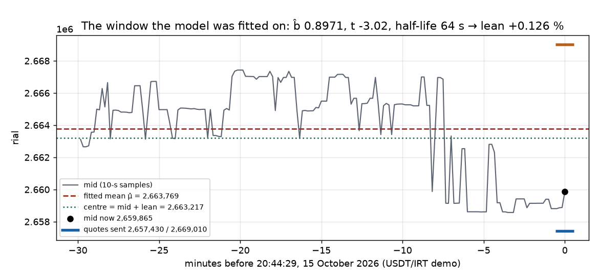
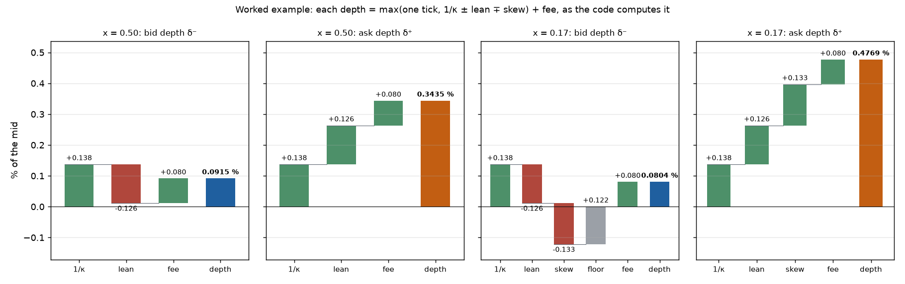
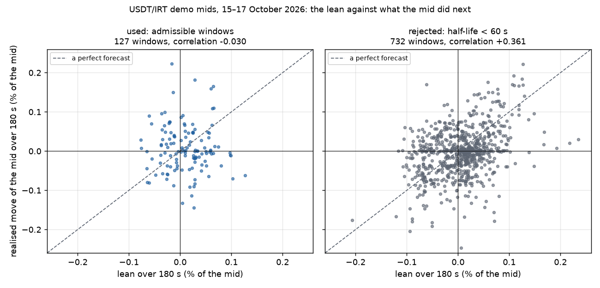

# MM_algo3: market making with a mean-reverting signal

MM_algo3 keeps one limit buy and one limit sell on a Nobitex rial market. Every round it fits an
Ornstein–Uhlenbeck model to the recent mid-prices. It uses the fitted mean reversion as a forecast only
when a unit-root test and a half-life bound admit it. It sets the distances of its two orders from the
first-order solution of an inventory-penalised optimal market-making problem (Avellaneda–Stoikov,
Cartea–Jaimungal), with the fill-intensity decay $`\kappa`$ fitted on the project's measured fill table.

The code is `market_maker/strategy/algo4.py` (`Algo4Strategy`). Its key in the configuration, on the
command line and in the recorded rounds is `algo4`, because this is the fourth algorithm designed for the
project. It is shown everywhere else as MM_algo3, the name of this branch. The supporting code is the shared
order-book arithmetic in `strategy/common.py`, the fill-table fit in `fill_model.py` and the round loop in
`engine.py`. This document follows one round from the first step to the last. The numbers of the examples,
simulations and measurements come from running this branch's code.

## Contents

1. [One round at a glance](#1-one-round-at-a-glance)
2. [Notation](#2-notation)
3. [The engine before the decision](#3-the-engine-before-the-decision)
4. [The price model and its estimation](#4-the-price-model-and-its-estimation)
5. [The optimal quotes](#5-the-optimal-quotes)
6. [From depths to prices](#6-from-depths-to-prices)
7. [The engine after the decision](#7-the-engine-after-the-decision)
8. [Records and no-quote reasons](#8-records-and-no-quote-reasons)
9. [Settings](#9-settings)
10. [Worked examples](#10-worked-examples)
11. [Measured forecast skill](#11-measured-forecast-skill)
12. [Limitations](#12-limitations)
13. [Appendix A. PnL attribution](#appendix-a-pnl-attribution)
14. [References](#references)

## 1. One round at a glance

A demo lane runs `engine.py::SimpleMarketMaker._run_demo`; a live worker runs `SimpleMarketMaker.run`
with the same decision and the same order rules. One round of a demo lane does these steps, in this order:

1. Reload the pair's settings (section 3.1).
2. Read the order book (3.2).
3. Fill the resting paper orders the market has reached (3.3).
4. Cancel the orders older than the order lifetime (3.4).
5. Take the account snapshot: inventory, cash, locked and available amounts (3.5).
6. Write the diagnostics document, which describes the decision without changing any state (8.3).
7. Decide with `Algo4Strategy.decide_order`:
   * take a mid sample and fit the model (4.1–4.5);
   * apply the volatility guard (4.6);
   * compute the lean (4.7), $`\kappa`$ (6.1) and the depths (6.2);
   * turn the depths into prices on the tick (6.3);
   * apply the fee bar (6.4) and the hysteresis (6.5).
8. Apply the trend pause and keep one order per side (7.1–7.2).
9. Size each side and apply the caps (7.3–7.4).
10. Send the orders (7.5).
11. Record the round (8).
12. Wait for the next round start, every `time_step` seconds.

## 2. Notation

| Symbol | Meaning | Setting or source |
|---|---|---|
| $`b_0,\ a_0`$ | best bid, best ask | the order book |
| $`S`$ | mid-price $`(b_0 + a_0)/2`$ | |
| $`\epsilon`$ | tick: 10 rial on the rial markets | `strategy/common.py::tick_size` |
| $`(t_k, S_k)`$, $`n`$ | the window's samples (time, mid) and their number | `algo4_sample_seconds`, `algo4_window_seconds` |
| $`\Delta t`$ | mean spacing of the samples | |
| $`a,\ b,\ s_\varepsilon`$ | AR(1) intercept, slope and residual standard deviation | |
| $`\theta,\ \mu,\ \sigma`$ | reversion speed (1/s), long-run mean (rial), volatility (rial per square-root second) | |
| $`t_{1/2}`$ | half-life $`\ln 2/\theta`$ | `algo4_halflife_min_seconds`, `algo4_halflife_max_seconds` |
| $`\tau`$ | horizon of the lean | `algo4_horizon_seconds`; 0 means `cancel_after_minutes` × 60 |
| $`m`$ | the lean: expected relative move of the mid over $`\tau`$ | clipped at `algo4_lean_clip` |
| $`\kappa,\ \lambda`$ | fill-intensity decay per unit of relative depth; fills per second at zero depth | fill table, fallback `algo4_kappa` |
| $`q`$ | inventory in coins, including coins locked in resting sells | the paper account or the exchange |
| $`x`$ | position of $`q`$ in the band $`[q_{\min}, q_{\max}]`$, clipped to $`[0, 1]`$ | `inv_min`, `inv_max` |
| $`\chi,\ s`$ | skew coefficient; inventory skew $`s = \chi\,(2x-1)`$ | `skew_perc` |
| $`\varrho`$ | risk widening of both depths | `algo4_risk_perc` |
| $`f,\ r,\ G`$ | fee per leg, required net round-trip return, gross bar | `commission_perc`, `exp_ret_min` |
| $`\delta^-,\ \delta^+`$ | bid depth and ask depth, as fractions of $`S`$ | |
| $`B,\ A`$ | bid price and ask price sent | |
| $`Q`$ | base order size, in coins | `order_size` |

Depths, the lean, the skew, $`\varrho`$, $`f`$ and $`r`$ are fractions of the price, so one setting serves
every market. The control problem of section 5 is written in price units first and then mapped onto these
fractions.

## 3. The engine before the decision

### 3.1 Round start and settings reload

A round starts every `time_step` seconds (profile defaults: BTC 60, USDT 10, ETH, XAUT and TRX 30). A round
that overruns skips the starts it missed. Each round first calls
`demo_config.py::RuntimeConfigSynchronizer.reload_at_round_boundary`, which reads the pair's Demo overlay
`demo_config_<pair>.json`:

* every field marked hot is applied to this round: all `algo4_*` settings, the sizes, the band, the engine
  rules and `exp_ret_min`;
* `commission_perc`, `cash_initial` and `demo_inv_initial` apply only to a new session;
* a lane's `algorithm` stays pinned to `algo4`.

The applied values are published in `runtime_config_<pair>_algo4.json`. A change of an `algo4_*` setting
takes effect at once, and the strategy's price window is kept.

### 3.2 Reading the book

`exchange/nobitex.py::NobitexExchangeClient.get_orderbook` sends `GET https://apiv2.nobitex.ir/v3/orderbook/<SYMBOL>`
(for example `USDTIRT`) with a 5-second timeout. The payload must carry `bids`, `asks` and
`lastTradePrice`; each side is a list of `[price, volume]` strings, best level first. The engine reads
$`b_0`$, $`a_0`$ and the last trade price. When the request fails or one of these is missing, the round is
skipped: nothing is decided, sent or recorded.

### 3.3 Paper fills (demo)

`paper.py::PaperLedger.process_market` checks every resting paper order: the buys from the highest price
down, the sells from the lowest price up, the older order first at equal prices. With the profile settings (`demo_level1_fast_fill_enabled`,
`demo_queue_enabled` and `demo_adverse_fill_enabled` all off) the rule is:

* a resting buy at $`B`$ is reached when $`a_0 \le B`$; a resting sell at $`A`$ when $`b_0 \ge A`$;
* a reached order fills at its own limit price;
* each side fills at most $`Q`$ × `demo_max_fill_per_observation_orders` (1) coins per round, shared by
  that side's reached orders in the order above, so a larger order fills over several rounds;
* the order-book payload carries no trade price or traded volume, so only this touch rule applies.

A fill of $`\Delta`$ coins at price $`P`$ moves the account as follows:

* buy: cash falls by $`\Delta P`$ and inventory rises by $`\Delta(1-f)`$ (the fee is taken in the coin);
* sell: inventory falls by $`\Delta`$ and cash rises by $`\Delta P (1-f)`$.

The fee in rial, $`f\Delta P`$, is added to the fee scopes.

### 3.4 Cancelling stale orders

`PaperLedger.cancel_stale` cancels every open order strictly older than `cancel_after_minutes` × 60 seconds
(180 s), with the reason `stale_timeout`, and releases its lock. A live worker does the same through the
exchange (`SimpleMarketMaker._cancel_owned_stale_orders`).

### 3.5 The account snapshot

`PaperLedger.snapshot`, valued at the last trade price $`P_{\text{last}}`$, gives these quantities:

* the inventory $`q`$, all coins held including the ones locked in resting sells;
* the cash $`C`$;
* the locked cash, the sum of remaining amount × limit price over the open buys;
* the locked inventory, the sum of remaining amounts over the open sells;
* the available cash $`\max(0, C - \text{locked cash})`$ and the available inventory
  $`\max(0, q - \text{locked inventory})`$;
* the wealth $`W = C + q P_{\text{last}}`$.

The strategy receives $`q`$.

Before deciding, the engine writes the diagnostics document (section 8.3). `Algo4Strategy.diagnostics`
evaluates the current book on the current window but takes no sample and does not touch the hysteresis
memory. It therefore describes the decision as it stands before this round's sample.

## 4. The price model and its estimation

### 4.1 The mid and the sample window

`decide_order` first computes $`S = (b_0 + a_0)/2`$. When a best price is missing or not positive, or
$`b_0 > a_0`$, there is no quote (`invalid_or_single_level_order_book`). The strategy also reads the first
`depth_max` + 1 levels of each side, for the level indices of section 6.3; a non-positive price there also
means no quote.

`Algo4Strategy.observe` then updates the window. It appends $`(t, S)`$ when at least
`algo4_sample_seconds` (10) have passed since the last sample, on the strategy's own monotonic clock. It
drops the samples older than `algo4_window_seconds` (1,800) and marks the fit for recomputation. Only
`decide_order` takes samples, so there is at most one per round and the spacing is the larger of
`algo4_sample_seconds` and `time_step`. With the profile defaults, a 30-minute window holds:

* 180 samples on USDT (10-s rounds);
* about 60 on ETH, XAUT and TRX (30-s rounds);
* 30 or 31 on BTC (60-s rounds), just at the minimum of 30.

The window lives in memory: a restarted lane starts empty.

### 4.2 The Ornstein–Uhlenbeck model

The mid is modelled as reverting to a level $`\mu`$ at speed $`\theta > 0`$:

```math
dS_t = \theta\,(\mu - S_t)\,dt + \sigma\,dW_t .
```

Multiply by $`e^{\theta t}`$ and apply Itô's product rule: $`d(e^{\theta t}S_t) = e^{\theta t}(dS_t + \theta S_t\,dt) = \theta\mu\,e^{\theta t}dt + \sigma e^{\theta t}dW_t`$.
Integrating from $`t`$ to $`t+h`$:

```math
S_{t+h} = \mu + (S_t - \mu)\,e^{-\theta h} + \sigma\int_t^{t+h} e^{-\theta(t+h-u)}\,dW_u .
```

The stochastic integral is Gaussian with mean 0. By the Itô isometry its variance is
$`\sigma^2\int_0^h e^{-2\theta v}dv = \sigma^2(1 - e^{-2\theta h})/(2\theta)`$. Hence

```math
\mathbb{E}[S_{t+h}\mid S_t] = \mu + (S_t-\mu)\,e^{-\theta h},\qquad
\mathbb{E}[S_{t+h}-S_t\mid S_t] = (\mu - S_t)\big(1-e^{-\theta h}\big),\qquad
\operatorname{Var}[S_{t+h}\mid S_t] = \frac{\sigma^2}{2\theta}\big(1-e^{-2\theta h}\big).
```

The expected distance to the mean halves after the half-life $`t_{1/2} = \ln 2/\theta`$.

### 4.3 Exact discretisation: the AR(1) model

With samples $`\Delta t`$ apart the solution above is exactly a first-order autoregression, with no
discretisation error:

```math
S_{k+1} = a + b\,S_k + \varepsilon_k,\qquad b = e^{-\theta\Delta t},\qquad a = \mu\,(1-b),\qquad
\varepsilon_k \sim \mathcal{N}\Big(0,\ \frac{\sigma^2}{2\theta}\big(1-b^2\big)\Big)\ \text{independent}.
```

Inverting these three relations gives the model's parameters from the regression's:

```math
\theta = -\frac{\ln b}{\Delta t},\qquad \mu = \frac{a}{1-b},\qquad \sigma^2 = \frac{2\theta}{1-b^2}\operatorname{Var}\varepsilon,\qquad
t_{1/2} = \frac{\ln 2}{\theta} = -\frac{\Delta t\,\ln 2}{\ln b},
```

which needs $`0 < b < 1`$. If $`b \ge 1`$ the process does not revert (unit root or explosive). If
$`b \le 0`$ consecutive samples alternate, which no Ornstein–Uhlenbeck path does.

### 4.4 Least-squares estimates

`strategy/algo4.py::ou_fit` takes the $`n`$ samples, forms the $`m = n-1`$ consecutive pairs
$`(S_k, S_{k+1})`$ and computes:

```math
\begin{aligned}
\bar x &= \frac1m\sum_{k=1}^{m} S_k,\qquad \bar y = \frac1m\sum_{k=1}^{m} S_{k+1},\qquad
S_{xx} = \sum_{k=1}^{m}(S_k-\bar x)^2,\qquad S_{xy} = \sum_{k=1}^{m}(S_k-\bar x)(S_{k+1}-\bar y),\\
\hat b &= \frac{S_{xy}}{S_{xx}},\qquad \hat a = \bar y - \hat b\,\bar x,\qquad
s_\varepsilon^2 = \frac{1}{m-2}\sum_{k=1}^{m}\big(S_{k+1}-\hat a-\hat b\,S_k\big)^2,\\
\operatorname{se}(\hat b) &= \sqrt{s_\varepsilon^2/S_{xx}},\qquad t = \frac{\hat b - 1}{\operatorname{se}(\hat b)},\qquad
\Delta t = \frac{t_n - t_1}{n-1},\\
\hat\theta &= -\frac{\ln\hat b}{\Delta t},\qquad \hat\mu = \frac{\hat a}{1-\hat b},\qquad
\hat t_{1/2} = \frac{\ln 2}{\hat\theta},\qquad \hat\sigma = s_\varepsilon\sqrt{\frac{2\hat\theta}{1-\hat b^2}} .
\end{aligned}
```

$`\Delta t`$ is the mean spacing of the window. Round starts jitter, so the spacing is not exactly constant;
the fit treats it as constant. When $`\operatorname{se}(\hat b) = 0`$ the code sets $`t = -\infty`$ if
$`\hat b < 1`$ and $`+\infty`$ otherwise.

The statistic $`t`$ is also the Dickey–Fuller statistic. The regression
$`\Delta S_k = a + \gamma S_k + \varepsilon_k`$ with $`\gamma = b - 1`$ has the same residuals and the same
standard error, so $`t = \hat\gamma/\operatorname{se}(\hat\gamma)`$.

The fit returns early in three cases:

* fewer than 30 samples (`MIN_POINTS`) gives `warming_up`;
* a non-positive spacing or price, or a flat window ($`S_{xx} = 0`$), gives `degenerate`;
* in both cases there are no estimates.

### 4.5 Admissibility: the unit-root test and the half-life bounds

`ou_fit` labels the fit in this order. Only the label `admissible` lets the forecast be used:

1. $`\hat b \ge 1`$: `unit_root`.
2. $`\hat b \le 0`$: `negative_autocorrelation`.
3. $`t > -2.86`$: `unit_root` (the unit root is not rejected).
4. $`\hat t_{1/2}`$ below `algo4_halflife_min_seconds` (60): `half_life_short`.
5. $`\hat t_{1/2}`$ above `algo4_halflife_max_seconds` (900): `half_life_long`.
6. Otherwise `admissible`.

From step 3 on, the estimates $`\hat\theta, \hat\mu, \hat\sigma, \hat t_{1/2}`$ exist and are reported
whatever the label.

**Why −2.86.** When the price is a random walk ($`b = 1`$), $`t`$ does not follow Student's distribution.
It follows the Dickey–Fuller distribution, which is shifted to the left, so ordinary critical values admit
far too many random walks. With a constant in the regression, the 5 % critical value is −2.86 for large
samples (−2.88 at 250 observations, −2.89 at 100; Fuller 1976). The code uses the large-sample value
`T_STAT_MAX` = −2.86. Measured on 200 simulated random walks (180 samples 10 s apart, Gaussian steps of
300 rial, half-life bounds 60 s to one day):

| Rule | Random walks admitted as mean-reverting |
|---|---:|
| $`t < -2`$ | 25.5 % |
| $`t < -2.86`$ | 4.5 % |

The unit test runs a smaller version of this check (60 walks, half-life of at least 30 s) and gets 22 and
3 of 60.

**Power.** The same estimator was run on simulated Ornstein–Uhlenbeck paths of 180 samples 10 s apart, with
a residual standard deviation of 300 rial and 200 paths per half-life, bounds 60–900 s:

| True half-life | Admitted | Median fitted half-life of the admitted fits | Median error of $`\hat\mu`$ |
|---:|---:|---:|---:|
| 60 s | 17.5 % | 66 s | 136 rial |
| 120 s | 14.5 % | 68 s | 357 rial |
| 300 s | 3.0 % | 69 s | 1,025 rial |

A 30-minute window of 10-second samples rejects random walks as intended, but it confirms even a true
one-minute reversion only about one time in six. What it admits is biased toward half-lives of about one
minute, whatever the true value.

### 4.6 The volatility guard

Whenever the regression ran (any label from step 1 on), the per-sample residual is compared with the
price. If `algo4_sigma_pause` > 0 and $`s_\varepsilon/S`$ exceeds it, there is no quote
(`volatility_pause`). The guard is off by default (0) and inactive during the warm-up, when there is no
residual. On a no-quote round the strategy forgets its resting pair (section 6.5). The engine sends
nothing and cancels nothing, so resting orders stay until they fill or reach the order lifetime.

### 4.7 The lean

The horizon is $`\tau`$ = `algo4_horizon_seconds` when positive, else the order lifetime
`cancel_after_minutes` × 60 = 180 s. The lean is used when the fit is admissible and `algo4_use_alpha` is
on; otherwise $`m = 0`$. With $`L`$ = `algo4_lean_clip` (0.005):

```math
m = \frac1S\,\operatorname{clip}\Big((\hat\mu - S)\big(1 - e^{-\hat\theta\tau}\big),\ -LS,\ LS\Big).
```

By section 4.2, $`m`$ is the model's expected relative move of the mid over $`\tau`$:
$`m = \mathbb{E}[S_{t+\tau} - S_t]/S_t`$ before the clip. Because $`0 < 1 - e^{-\hat\theta\tau} < 1`$, the
size of the lean is always below $`\lvert\hat\mu - S\rvert/S`$. A price below its mean gives $`m > 0`$, an
expected rise. During the warm-up, and whenever the fit is not admissible, the quotes are the plain
optimal ones of section 5 with no forecast.

## 5. The optimal quotes

### 5.1 The control problem

The quotes come from the market-making problem of Cartea, Jaimungal and Penalva (2015, chapter 10) with a
short-term signal. In this section all depths are in price units.

* **Mid.** $`dS_t = \alpha_t\,dt + \sigma\,dW_t`$, where $`\alpha_t`$ is a drift signal with
  $`d\alpha_t = -\zeta\alpha_t\,dt + \eta\,dB_t`$. The Ornstein–Uhlenbeck model of section 4 is the case
  $`\alpha_t = \theta(\mu - S_t)`$. Then $`d\alpha_t = -\theta\,dS_t = -\theta\alpha_t\,dt - \theta\sigma\,dW_t`$,
  that is $`\zeta = \theta`$ with a signal noise perfectly correlated with the price noise.
* **Fills.** The maker posts a sell at $`S + \delta^+`$ and a buy at $`S - \delta^-`$, one unit each.
  Executions arrive as Poisson processes $`N^\pm`$ with intensities $`\lambda e^{-\kappa\delta^\pm}`$: the
  deeper the order, the rarer its fills.
* **State.** Inventory $`q_t = N^-_t - N^+_t`$; cash $`dX_t = (S_t + \delta^+_t)\,dN^+_t - (S_t - \delta^-_t)\,dN^-_t`$.
* **Objective.** Choose the depths to maximise expected terminal wealth net of two inventory penalties,
  $`\ell \ge 0`$ at the end (a liquidation cost) and $`\phi \ge 0`$ per unit of time held (inventory risk):

```math
\sup_{\delta^\pm}\ \mathbb{E}\Big[\,X_T + q_T S_T - \ell\,q_T^2 - \phi\int_t^T q_u^2\,du\Big].
```

### 5.2 The Hamilton–Jacobi–Bellman equation and the optimal depths

Let $`H(t, X, S, \alpha, q)`$ be the value function. Dynamic programming gives

```math
\begin{aligned}
0 = {}& \partial_t H + \alpha\,\partial_S H + \tfrac12\sigma^2\partial_{SS}H - \zeta\alpha\,\partial_\alpha H + \tfrac12\eta^2\partial_{\alpha\alpha}H + c\,\sigma\eta\,\partial_{S\alpha}H - \phi q^2\\
&+ \sup_{\delta^+}\lambda e^{-\kappa\delta^+}\big[H(t, X + S + \delta^+, S, \alpha, q-1) - H\big]
 + \sup_{\delta^-}\lambda e^{-\kappa\delta^-}\big[H(t, X - S + \delta^-, S, \alpha, q+1) - H\big],
\end{aligned}
```

with $`c`$ the correlation of $`W`$ and $`B`$, and $`H(T,\cdot) = X + qS - \ell q^2`$. Try
$`H = X + qS + h(t, \alpha, q)`$. Then $`\partial_S H = q`$ and $`\partial_{SS}H = \partial_{S\alpha}H = 0`$,
so the correlation drops out. A sell changes $`X + qS`$ by $`(S + \delta^+) - S = \delta^+`$. Writing
$`\Delta^+ = h(q) - h(q-1)`$ and $`\Delta^- = h(q) - h(q+1)`$:

```math
0 = \partial_t h + \alpha q - \zeta\alpha\,\partial_\alpha h + \tfrac12\eta^2\partial_{\alpha\alpha}h - \phi q^2
+ \sup_{\delta^+}\lambda e^{-\kappa\delta^+}\big(\delta^+ - \Delta^+\big) + \sup_{\delta^-}\lambda e^{-\kappa\delta^-}\big(\delta^- - \Delta^-\big),
\qquad h(T,\alpha,q) = -\ell q^2 .
```

Each supremum has the form $`g(\delta) = e^{-\kappa\delta}(\delta - \Delta)`$, with

```math
g'(\delta) = e^{-\kappa\delta}\big(1 - \kappa(\delta - \Delta)\big),\qquad
g''(\delta) = -\kappa\,e^{-\kappa\delta}\big(2 - \kappa(\delta - \Delta)\big).
```

$`g'`$ is positive below $`\delta^* = 1/\kappa + \Delta`$ and negative above, and
$`g''(\delta^*) = -\kappa e^{-\kappa\delta^*} < 0`$, so $`\delta^*`$ is the global maximum. Its value is
$`\lambda e^{-\kappa\delta^*}/\kappa = \frac{\lambda}{e\kappa}e^{-\kappa\Delta}`$. Hence

```math
\delta^{+*} = \frac1\kappa + h(t,\alpha,q) - h(t,\alpha,q-1),\qquad
\delta^{-*} = \frac1\kappa + h(t,\alpha,q) - h(t,\alpha,q+1).
```

The term $`1/\kappa`$ depends on nothing but the fill decay. The signal, the inventory and the risk enter
only through the differences of $`h`$.

### 5.3 The first-order closed form

With the optimal depths the equation becomes

```math
0 = \partial_t h + \alpha q - \zeta\alpha\,\partial_\alpha h + \tfrac12\eta^2\partial_{\alpha\alpha}h - \phi q^2
+ \frac{\lambda}{e\kappa}\Big(e^{-\kappa\Delta^+} + e^{-\kappa\Delta^-}\Big).
```

Keep the exponentials to first order, $`e^{-\kappa\Delta} \approx 1 - \kappa\Delta`$, and try
$`h = h_0(t,\alpha) + q\,h_1(t,\alpha) + q^2 h_2(t)`$. Then
$`\Delta^+ = h_1 + (2q-1)h_2`$ and $`\Delta^- = -h_1 - (2q+1)h_2`$, so
$`\Delta^+ + \Delta^- = -2h_2`$. The jump terms become $`\frac{\lambda}{e\kappa}(2 + 2\kappa h_2)`$, with no
$`q`$ in them. Collecting the powers of $`q`$:

```math
\begin{aligned}
q^2:&\quad \partial_t h_2 - \phi = 0,\quad h_2(T) = -\ell &&\Longrightarrow\quad h_2(t) = -\ell - \phi\,(T-t),\\
q^1:&\quad \partial_t h_1 + \alpha - \zeta\alpha\,\partial_\alpha h_1 + \tfrac12\eta^2\partial_{\alpha\alpha}h_1 = 0,\quad h_1(T) = 0
&&\Longrightarrow\quad h_1(t,\alpha) = \alpha\,\frac{1 - e^{-\zeta(T-t)}}{\zeta}.
\end{aligned}
```

To check $`h_1`$, write $`h_1 = \alpha g(t)`$. Then $`\partial_{\alpha\alpha}h_1 = 0`$ and $`g' = \zeta g - 1`$
with $`g(T) = 0`$, whose solution is $`g(t) = (1 - e^{-\zeta(T-t)})/\zeta`$. By Feynman–Kac,
$`h_1 = \mathbb{E}_t\big[\int_t^T \alpha_u\,du\big]`$, the expected price change until $`T`$. The $`q^0`$
equation gives $`h_0`$, which does not enter the depths. Substituting, with $`\tau = T - t`$:

```math
\begin{aligned}
\delta^{+*} &= \frac1\kappa + \alpha\,\frac{1-e^{-\zeta\tau}}{\zeta} - 2(\ell+\phi\tau)\,q + (\ell+\phi\tau),\\
\delta^{-*} &= \frac1\kappa - \alpha\,\frac{1-e^{-\zeta\tau}}{\zeta} + 2(\ell+\phi\tau)\,q + (\ell+\phi\tau).
\end{aligned}
```

In the Ornstein–Uhlenbeck form, $`\alpha(1-e^{-\zeta\tau})/\zeta = (\mu - S)(1 - e^{-\theta\tau})`$, the
expected move of section 4.2. Each of the four terms has a role:

| Term | Role | Effect |
|---|---|---|
| $`1/\kappa`$ | optimal half-spread without risk or signal | the same on both sides |
| $`\pm`$ expected move | lean toward the forecast | price expected to rise: ask farther, bid closer |
| $`\mp 2(\ell+\phi\tau)q`$ | inventory skew | long inventory: ask closer, bid farther |
| $`+(\ell+\phi\tau)`$ | risk widening | both sides step back |

**What the first order drops.** The next term of the expansion, $`\frac{\lambda\kappa}{2e}\big((\Delta^+)^2 + (\Delta^-)^2\big)`$,
adds $`\frac{4\lambda\kappa}{e}h_2^2\,q^2`$ to the equation. The $`q^2`$ equation becomes the Riccati
equation $`\partial_t h_2 = \phi - \frac{4\lambda\kappa}{e}h_2^2`$, and the terms that couple $`h_1`$ and
$`h_2`$ change the lean. Without the signal the exact problem has the matrix-exponential solution of
Guéant, Lehalle and Fernandez-Tapia (2013). The first-order form keeps the four terms separate and linear in
$`\alpha`$ and $`q`$; it is what the code uses.

### 5.4 The Avellaneda–Stoikov limit: where 1/κ comes from

Avellaneda and Stoikov (2008) take a driftless mid $`dS = \sigma\,dW`$, the same exponential intensities,
and the exponential utility $`-\mathbb{E}\,e^{-\gamma(X_T + q_T S_T)}`$. Their approximate solution quotes
symmetrically around a reservation price:

```math
r_{\mathrm{AS}} = S - q\,\gamma\sigma^2(T-t),\qquad
\delta^{a} + \delta^{b} = \gamma\sigma^2(T-t) + \frac{2}{\gamma}\ln\Big(1 + \frac{\gamma}{\kappa}\Big).
```

As risk aversion vanishes, $`r_{\mathrm{AS}} \to S`$ and
$`\frac{2}{\gamma}\ln(1 + \gamma/\kappa) = \frac{2}{\gamma}\big(\frac{\gamma}{\kappa} - \frac{\gamma^2}{2\kappa^2} + O(\gamma^3)\big) \to \frac{2}{\kappa}`$,
so each side sits $`1/\kappa`$ from the mid. This is the depth that maximises the expected spread income
$`\delta\,\lambda e^{-\kappa\delta}`$ of one order. In the penalised problem of section 5.1 the
$`1/\kappa`$ is exact at every level of $`\ell`$ and $`\phi`$; the risk enters only through $`h`$. With the
signal switched off ($`m = 0`$), MM_algo3 quotes exactly this Avellaneda–Stoikov pair plus its inventory
terms.

### 5.5 From the theory to the code

The code measures depths as fractions of the price: $`d = \delta/S`$, and $`\kappa`$ per unit of relative
depth equals $`\kappa_{\text{price}}\,S`$. The terms map as follows:

| Theory (price units) | Code (fraction of the price) | Settings |
|---|---|---|
| $`1/\kappa`$ | $`1/\kappa`$ | the fill-table fit, else `algo4_kappa` |
| $`(\mu - S)(1-e^{-\theta\tau})`$ | $`m`$, clipped | `algo4_use_alpha`, `algo4_horizon_seconds`, `algo4_lean_clip` |
| $`2(\ell+\phi\tau)\,q`$ | $`s = \chi\,(2x-1)`$ | `skew_perc` |
| $`\ell+\phi\tau`$ | $`\varrho`$ | `algo4_risk_perc` |

Count the inventory in orders of size $`Q`$ from the band centre $`q_c = (q_{\min}+q_{\max})/2`$, with
$`N = (q_{\max}-q_{\min})/Q`$ orders in the band. Then
$`2x - 1 = 2(q - q_c)/(q_{\max}-q_{\min})`$. The skew matches the theory when
$`(\ell+\phi\tau)/S = \chi/N`$. The theory therefore ties the widening to the skew, $`\varrho = \chi/N`$:
0.004 % for the USDT profile ($`\chi`$ = 0.002, band 0–50 USDT, $`Q`$ = 1, $`N`$ = 50). The code sets the
two independently, and its default $`\varrho = 0`$ leaves out this small widening.

The code's neutral inventory is the middle of the band ($`x = \tfrac12`$), not zero inventory as in the
theory.

### 5.6 The fee: one-sided derivation of 1/κ + f

The model has no fee. With a proportional fee $`f`$ per leg, a sell filled at $`S(1+\delta)`$ brings
$`S(1+\delta)(1-f) = S(1 + \delta - f - f\delta)`$. To first order (dropping $`f\delta`$) its marked gain is
$`S(\delta - f)`$. For one order alone the expected gain per unit time is

```math
\Pi(\delta) = \lambda e^{-\kappa\delta}(\delta - f),\qquad
\Pi'(\delta) = \lambda e^{-\kappa\delta}\big(1 - \kappa(\delta - f)\big) = 0\ \Longrightarrow\ \delta^* = \frac1\kappa + f,
```

```math
\Pi''(\delta) = -\kappa\lambda e^{-\kappa\delta}\big(2 - \kappa(\delta - f)\big),\qquad
\Pi''(\delta^*) = -\kappa\lambda e^{-\kappa\delta^*} < 0 .
```

$`\Pi'`$ has the sign of $`1 - \kappa(\delta - f)`$, so $`\delta^*`$ is the global maximum. In the full
problem the jump term becomes $`e^{-\kappa\delta}(\delta - f - \Delta)`$ and gives
$`\delta^* = 1/\kappa + f + \Delta`$. The fee shifts each optimal depth by exactly $`f`$, to first order in
$`f\delta`$. The code adds $`f`$ to each depth (section 6.2).

## 6. From depths to prices

### 6.1 κ and λ from the fill table

`fill_table_<pair>.json` is built nightly by `tools/build_fill_table.py` from the recorded best-bid and
best-ask paths and the project's own orders. For each relative distance $`d`$ from the mid it gives, per
side, the observed probability $`\hat P(d)`$ that an order there fills within the table's horizon
$`\tau_T`$, and the number of observations $`n`$. The buckets are 0.10, 0.15, 0.20, 0.30, 0.40, 0.60,
0.80, 1.2, 1.6 and 2.4 %.

If fills arrive at intensity $`\lambda e^{-\kappa d}`$, then $`P(d) = 1 - \exp(-\lambda e^{-\kappa d}\tau_T)`$,
which becomes linear in $`d`$:

```math
y(d) = \ln\Big(-\frac{\ln\big(1 - P(d)\big)}{\tau_T}\Big) = \ln\lambda - \kappa\,d .
```

`fill_model.py::FillTable.fit_intensity` fits this by ordinary least squares. It uses every (side, bucket)
point with at least `fill_table_min_samples` (50) observations and $`0 < \hat P < 1`$:

```math
\hat\kappa = -\frac{\sum_i (d_i - \bar d)(y_i - \bar y)}{\sum_i (d_i - \bar d)^2},\qquad
\hat\lambda = \exp\big(\bar y + \hat\kappa\,\bar d\big).
```

The fit needs at least two distinct distances and a finite $`\hat\kappa > 0`$. `Algo4Strategy.kappa`
calls it every round through `FillModel.intensity`, which re-reads the file whenever it changes and uses it
only when three conditions hold:

* `fill_table_enabled` is on;
* the file exists in the results directory;
* the table is at most `fill_table_max_age_hours` (48) old by its `updated_at`.

When any of these fails, or the fit fails, $`\kappa`$ = `algo4_kappa` (400, so $`1/\kappa`$ = 0.25 %) and
the round records `kappa_source` = `config`. In the model $`\kappa`$ does not depend on $`\tau_T`$;
$`\lambda`$ is per second.

On the tables of 17 October 2026 (horizon 600 s, 10 buckets) the fit gives:

| Market | $`\hat\kappa`$ | $`1/\hat\kappa`$ | $`\hat\lambda`$ (per second) | points used |
|---|---:|---:|---:|---:|
| USDT/IRT | 727.1 | 0.1375 % | 4.24 × 10⁻⁴ | 14 |
| BTC/IRT | 626.5 | 0.1596 % | 4.25 × 10⁻⁴ | 16 |

For example, the USDT bid side reads $`\hat P`$ = 0.207 at 0.10 %, 0.134 at 0.15 %, 0.114 at 0.20 % and 0.023 at 0.30 %.

### 6.2 The depths and the one-tick floor

`Algo4Strategy.evaluate` sets, with $`s = \chi(2x-1)`$ and $`x = \operatorname{clip}\big((q - q_{\min})/(q_{\max} - q_{\min}), 0, 1\big)`$
($`x = \tfrac12`$ when the band is empty):

```math
\delta^{+} = \max\Big(\frac{\epsilon}{S},\ \frac1\kappa + m - s + \varrho\Big) + f,\qquad
\delta^{-} = \max\Big(\frac{\epsilon}{S},\ \frac1\kappa - m + s + \varrho\Big) + f .
```

The floor keeps each order at least one tick from the mid before the fee shift. Without it, a lean or a
skew larger than $`1/\kappa + \varrho`$ would push an order across the mid. $`\kappa \le 0`$ gives no
quote (`invalid_kappa`).

**Properties**, while neither depth is on its floor:

* with $`m = 0`$, $`x = \tfrac12`$ and $`\varrho = 0`$, both depths equal $`1/\kappa + f`$;
* $`\partial\delta^+/\partial m = -\partial\delta^-/\partial m = 1`$ and
  $`\partial\delta^+/\partial x = -\partial\delta^-/\partial x = -2\chi`$;
* the width $`\delta^+ + \delta^- = 2/\kappa + 2\varrho + 2f`$ depends on neither the lean nor the
  inventory: they move the centre, not the spread;
* the centre is $`C = (A_{\text{raw}} + B_{\text{raw}})/2 = S\,(1 + m - s)`$.

When a depth is on its floor the near order stays one tick plus the fee from the mid, and the width grows
(second case of section 10.1).

### 6.3 Prices, touch clip and rounding

```math
A_{\text{raw}} = S\,(1 + \delta^+),\qquad B_{\text{raw}} = S\,(1 - \delta^-),\qquad
B = \big\lfloor \min(B_{\text{raw}},\ a_0 - \epsilon) \big\rfloor_\epsilon,\qquad
A = \big\lceil \max(A_{\text{raw}},\ b_0 + \epsilon) \big\rceil_\epsilon .
```

$`\lfloor\cdot\rfloor_\epsilon`$ and $`\lceil\cdot\rceil_\epsilon`$ round down and up to the tick, so
rounding never narrows the pair. Each depth is at least $`\epsilon/S + f`$ with $`f \ge 0`$, so
$`B_{\text{raw}} \le S - \epsilon \le a_0 - \epsilon`$ and $`A_{\text{raw}} \ge S + \epsilon \ge b_0 + \epsilon`$.
The touch clip therefore never binds; it remains as a guard. The quotes never cross the book. They improve
on the touch when a depth is smaller than the half-spread.

The level indices recorded with the quote are the deepest index $`i \le`$ `depth_max` whose bid is at or
above $`B`$ (0 when $`B`$ is above the best bid), and likewise for the asks.

### 6.4 The fee bar and the widening w

A round trip bought at $`B`$ and sold at $`A`$, each leg paying $`f`$, returns

```math
R_{\mathrm{net}} = (1-f)^2\,\frac{A}{B} - 1,\qquad
R_{\mathrm{net}} > r\ \Longleftrightarrow\ \frac AB > 1 + G,\qquad G = \frac{1 + r}{(1-f)^2} - 1 \approx 2f + r,
```

where $`r`$ = `exp_ret_min` ($`f`$ when unset) and $`f \ge 1`$ gives no quote
(`half_spread_not_attainable`). If, after the rounding, $`A/B \le 1 + G`$, both prices move apart by the same
amount $`w`$, chosen so that the ratio reaches the bar:

```math
\frac{A + w}{B - w} = 1 + G\ \Longrightarrow\ w = \frac{(1+G)B - A}{2+G},\qquad
w \leftarrow \max(w, 0) + \epsilon,\qquad B \leftarrow \lfloor B - w\rfloor_\epsilon,\qquad A \leftarrow \lceil A + w\rceil_\epsilon .
```

The widening is symmetric, so it keeps the lean and the skew and only raises the width. The extra tick and
the outward rounding put $`A/B`$ strictly above $`1 + G`$. The code then checks once more: if $`B \ge A`$ or
$`R_{\mathrm{net}} \le r`$ there is no quote (`net_return_below_bar`).

To first order $`A/B \approx 1 + \delta^+ + \delta^-`$, so the bar binds only when
$`2/\kappa + 2\varrho \lesssim r`$. For $`r`$ = 0.02 % that means $`\kappa`$ above about 10,000, far
steeper than the fitted tables (600–730) or the fallback (400). The widening is a guard for an extreme
$`\kappa`$ (section 10.2).

### 6.5 Hysteresis

The strategy remembers the last pair it returned, $`(B_p, A_p)`$, and the time it was set. The requote band
at a price $`P`$ is $`\operatorname{band}(P) = \max(\text{hysteresis ticks}\cdot\epsilon,\ \text{band fraction}\cdot P)`$,
with `hysteresis_ticks` = 5 and `requote_band_perc` = 0.0003: 798 rial at a USDT price of 2,659,865. The
previous pair is returned again (`selection reason` ends in `_kept`) when all of these hold:

* $`\operatorname{band}(B_p) > 0`$;
* $`\lvert B - B_p\rvert \le \operatorname{band}(B_p)`$ and $`\lvert A - A_p\rvert \le \operatorname{band}(A_p)`$;
* the pair was set less than `refresh_seconds` (300) ago;
* it still clears the bar: $`R_{\mathrm{net}}(B_p, A_p) > r`$.

Otherwise the new pair is returned and remembered with the current time. A kept pair is not re-timed, so a
pair is kept for at most 300 s. A no-quote round clears the memory. The engine applies its own version of
this band to the orders actually resting (section 7.2).

## 7. The engine after the decision

### 7.1 Trend pause

`SimpleMarketMaker._trend_paused_sides` runs every round with a readable book, quote or not. It appends the
mid to a history and drops the entries older than `trend_window_seconds` (600). Once the oldest kept entry
is at least half a window old, it computes the drift $`D = S/S_{\text{oldest}} - 1`$:

* $`D \le -`$`trend_pause_perc` (−0.3 %): the buy side is paused;
* $`D \ge +`$`trend_pause_perc`: the sell side is paused.

On a quote round a paused side has its resting orders cancelled (`trend_pause`) and gets no new order.
Either setting at 0 switches the pause off. The strategy still computes and records its pair.

### 7.2 One order per side

On a quote round the engine handles the sell side first, then the buy side:

* a paused side has every resting order of that side cancelled;
* on an active side, every resting order whose limit price is farther than $`\operatorname{band}(P)`$ from
  the new price $`P`$ is cancelled (`replaced`);
* a resting order within the band is kept, and then no new order is placed on that side
  (`resting_order_kept`).

So at most one order of ours rests per side. On a no-quote round nothing is cancelled here; resting orders
age out under section 3.4.

### 7.3 Order sizes

`SimpleMarketMaker._inventory_sized_order_targets` uses $`k`$ = `inventory_sizing_strength` and
$`\nu`$ = `inventory_sizing_min_fraction`, both clamped to $`[0, 1]`$. Resting orders count before they
fill:

* the buy side uses $`x_b`$, the band position of $`q`$ plus the open buys;
* the sell side uses $`x_s`$, the band position of $`q`$ minus the locked sells.

```math
Q^{\mathrm{buy}} = Q\cdot\operatorname{clip}\big(1 - k(2x_b - 1),\ \nu,\ 1 + k\big),\qquad
Q^{\mathrm{sell}} = Q\cdot\operatorname{clip}\big(1 + k(2x_s - 1),\ \nu,\ 1 + k\big).
```

With the profile values $`k = 1`$ and $`\nu = 0`$, these are $`Q^{\mathrm{buy}} = 2Q(1 - x_b)`$ and
$`Q^{\mathrm{sell}} = 2Q\,x_s`$: buying fades to zero as the band fills, selling as it empties. With
`inventory_sizing_enabled` off (the bare `MMConfig` default) both sizes are $`Q`$.

In the demo loop the sell side is sized and capped with the snapshot of section 3.5, taken before this
round's cancellations. A sell replaced in this round is therefore still counted as locked, and its amount
becomes available to a new sell only from the next round. The buy side re-reads the snapshot after the
sell. The live loop re-reads its open-order totals after the cancellations.

### 7.4 Caps and the not-sent reasons

The smallest order sent is $`Q_{\min} = 0.1\,Q`$ (`MIN_ORDER_SIZE_FRACTION`).

**Sell.** The amount is $`\min\big(Q^{\mathrm{sell}},\ \text{available inventory} - q_{\min}\big)`$,
floored at 0. The checks run in this order:

1. The side is paused: `trend_pause`.
2. An order rests within the band: `resting_order_kept`.
3. The amount is at least $`Q_{\min}`$ but the locked-inventory guard refuses it: `locked_inventory_limit`.
   The guard is off by default.
4. The amount is at least $`Q_{\min}`$: the sell is sent at $`A`$.
5. $`Q^{\mathrm{sell}} < Q_{\min}`$ while free stock is at least $`Q_{\min}`$: `inventory_sizing`.
6. Stock is held but all of it is locked in resting sells: `inventory_locked_in_open_orders`.
7. Otherwise: `insufficient_inventory`.

**Buy.** The amount is $`\min\big(Q^{\mathrm{buy}},\ \text{available cash}/B\big)`$, floored at 0. The checks
run in this order:

1. The side is paused: `trend_pause`.
2. An order rests within the band: `resting_order_kept`.
3. $`Q^{\mathrm{buy}} < Q_{\min}`$: `inventory_sizing`.
4. The amount is below $`Q_{\min}`$: `insufficient_cash`.
5. Open buys + $`q`$ + amount $`> q_{\max}`$: `inventory_cap`.
6. The locked-cash guard refuses it: `locked_cash_limit`. The guard is off by default.
7. Otherwise the buy is sent at $`B`$.

The paper ledger itself rejects an order that needs more than the available cash or inventory (`rejected`).
A live worker applies the same sizes and caps, with its inventory and cash from the exchange.

### 7.5 Sending

**Demo.** `exchange/demo.py::DemoExchangeClient.send_order` calls `PaperLedger.submit_order`, with the
order id `<symbol>-<side>-<round>-<milliseconds>` (for example `usdtirt-buy-…`). A buy locks amount × $`B`$
of cash and a sell locks its amount of coin. The new order is first checked for fills at the next round's
step 3.3.

**Live.** `NobitexExchangeClient.send_order` sends `POST https://apiv2.nobitex.ir/market/orders/add` with a
compact JSON body and signed headers (`exchange/nobitex_auth.py::signed_headers`), timeout 20 s:

```json
{"type": "buy", "srcCurrency": "usdt", "dstCurrency": "rls", "amount": "<str(amount)>", "price": 2657430.0, "clientOrderId": "buy-<round>-<milliseconds>"}
```

The order is accepted when the response is HTTP 2xx with `"status": "ok"`. The sell is sent before the buy.
`amount` is Python's `str(amount)`, which is in scientific notation below 0.0001 (for example `1.5e-05`
for the BTC order size).

### 7.6 Demo lanes and the five markets

Running `run.py --profile <pair> --mode demo` without `--algorithm` starts `run.py::LaneRunner`. It runs one
engine thread per algorithm enabled in the pair's Demo overlay (`algo1_enabled`, `algo3_enabled`,
`algo4_enabled`), each with its own paper account and its own files, all under the pair's worker lease
`.worker_<symbol>.lock`. The runner re-reads the overlay every 10 s, starts and stops lanes to match it,
and restarts a failed lane after 60 s.

MM_algo3's lane writes these files:

* the round store `<pair>_track_demo_algo4.sqlite3` and its CSV export `<pair>_track_demo_algo4.csv`;
* the diagnostics `<pair>_track_demo_algo4_diagnostics.jsonl`;
* the paper ledger `paper_<session>_<symbol>_algo4.json` and its archive;
* the applied settings `runtime_config_<pair>_algo4.json`.

The fee scopes `paper_fee_scopes.json` are shared. The lanes see the same market at the same time with
separate accounts, so their results can be compared directly.

The demo runs on five rial markets, BTCIRT, USDTIRT, ETHIRT, XAUTIRT and TRXIRT (`config.py::TRADING_PROFILES`).

`run.py --profile <pair> --mode demo --algorithm algo4` runs MM_algo3 alone in the single-worker files.
`--mode real --algorithm algo4` runs it live with real money.

## 8. Records and no-quote reasons

### 8.1 The quote

`decide_order` returns these keys:

* the prices: `bid`, `ask`, `bid level`, `ask level`, `lastTradePrice`, `mid price`;
* the centre and the inventory: `centre` ($`C`$), `inventory position` ($`x`$);
* the returns: `relative quoted spread` $`(A-B)/S`$, `gross return` $`(A-B)/B`$, `net return`,
  `buy fee`, `sell fee`, `min required return`;
* the distances: `bid spread` $`S - B`$ and `ask spread` $`A - S`$ in rial, `bid distance` $`(C-B)/C`$,
  `ask distance` $`(A-C)/C`$;
* the mode: `quote mode` = `pair`, `selection reason` (`mean_reversion_pair` when the lean was used,
  `symmetric_pair` otherwise, `_kept` appended when the hysteresis kept the pair), `bid kept`, `ask kept`;
* MM_algo3's own: `lean` ($`m`$), `mu hat`, `theta hat`, `half life`, `forecast admissible`, `kappa`,
  `bid depth` ($`\delta^-`$), `ask depth` ($`\delta^+`$);
* the keys other algorithms fill, `None` here: `bid exec prob`, `ask exec prob`, `expected value`,
  `reference price`, `imbalance`, `microprice`.

### 8.2 The round row

Every round is appended to the lane's SQLite store, kept to the newest `demo_result_retain_rows`
(100,000) rows. A bounded CSV export of at most `demo_csv_export_max_rows` (10,000) rows is written at most
every 60 s. The row holds:

* `Strategy` = `algo4`, `Quote Status`, `No Quote Reason`;
* the book and the account: best bid and ask, last price, inventory, cash, locked and available amounts,
  wealth;
* `Bid Price`, `Ask Price`, `Mid Price`, `Relative Quoted Spread`, `Gross Return`, `Net Return`,
  `Min Required Return`, `Centre`, `Bid Distance`, `Ask Distance`, `Quote Mode`, `Selection Reason`;
* per side: order id, status, `Not Sent Reason` (section 7.4), amounts, fill reason and limit price;
* the round's fee and the fee scopes.

The columns `Bid Fill Prob`, `Ask Fill Prob`, `Expected Value`, `Reference Price`, `Imbalance` and
`Microprice` stay empty for MM_algo3.

### 8.3 The diagnostics document

`Algo4Strategy.diagnostics` is written when `algo1_diagnostics_enabled` is on (it is in the profiles). The
file is cut back to the newest 2,000 documents (`algo1_diagnostics_keep_rounds`) whenever it reaches
4,000. Each document holds:

* the book: `mid_price`, `spread`, the first five `levels`;
* the window: points, seconds, mean spacing, and up to about 60 samples for the chart;
* the estimate: `ok`, `reason`, `b`, `a`, `sigma_eps`, `t_stat`, `theta`, `mu`, `sigma`, `half_life`,
  the bounds, `t_stat_max`, `use_alpha`;
* the lean: `mu_shift`, `horizon_seconds`, `forecast_used`, `lean_raw` (rial), `lean`, `lean_clip`,
  `lean_clipped`;
* the guard: `sigma_rel`, `sigma_pause`;
* the depths: `skew`, `risk_perc`, `kappa`, `kappa_source` (`table` or `config`), `kappa_config`,
  `fill_lambda`, `base_depth` ($`1/\kappa`$), `depth_bid`, `depth_ask`;
* the prices: `centre`, `centre_shift`, `gross_bar` ($`G`$), `widening` ($`w/S`$), the raw and the final
  prices, `clipped_bid`, `clipped_ask`, `net_return`;
* `candidate_results`, the one evaluated pair, with the keys the engine, Telegram and the admin panel read;
* `quote_mode`, `selection_reason`, and the `hysteresis` state.

The dashboard's quote-decision tab draws the window with $`\hat\mu`$ and the step-by-step trace from
these documents.

### 8.4 No-quote reasons

| Reason | Where | Condition |
|---|---|---|
| `invalid_or_single_level_order_book` | 4.1 | missing, non-positive or crossed best prices, or an unusable level |
| `volatility_pause` | 4.6 | $`s_\varepsilon/S`$ above `algo4_sigma_pause` > 0 |
| `invalid_kappa` | 6.2 | $`\kappa \le 0`$ |
| `half_spread_not_attainable` | 6.4 | fee of 100 % or more |
| `net_return_below_bar` | 6.4 | $`B \ge A`$ or $`R_{\mathrm{net}} \le r`$ after the widening |

On a no-quote round the engine records `no_quote` for both sides and sends nothing. `no_quote.py::NoQuoteMonitor`
raises an alert after 30 consecutive no-quote rounds or 300 s of them, then waits 1,800 s before the next
alert. A Telegram message follows when Telegram is configured.

## 9. Settings

The defaults are the values in `config.py::TRADING_PROFILES`, the same for every market except the sizes.
Where the bare `MMConfig` dataclass default differs, it is given in parentheses. The demo values are edited
per pair on the admin panel's Demo configuration pages (the overlay `demo_config_<pair>.json`, applied at
the next round; the fee and the starting balances at the next session). The live values are on the Live
configuration pages, read when a live worker starts.

**MM_algo3.**

| Setting | Meaning | Default |
|---|---|---:|
| `algo4_enabled` | Demo: run MM_algo3 on this market in its own lane | on |
| `algo4_use_alpha` | use the forecast; off gives the plain optimal quotes | on |
| `algo4_window_seconds` | length of the mid window | 1800 |
| `algo4_sample_seconds` | minimum spacing of the samples, s | 10 |
| `algo4_horizon_seconds` | horizon $`\tau`$ of the lean; 0 = the order lifetime | 0 |
| `algo4_halflife_min_seconds` | shortest admissible half-life, s | 60 |
| `algo4_halflife_max_seconds` | longest admissible half-life, s | 900 |
| `algo4_kappa` | $`\kappa`$ when the fill table cannot be fitted | 400 |
| `algo4_risk_perc` | risk widening $`\varrho`$ of both depths | 0 |
| `algo4_lean_clip` | largest lean $`L`$, fraction of the price | 0.005 |
| `algo4_sigma_pause` | no quote while $`s_\varepsilon/S`$ exceeds it; 0 = off | 0 |

**Shared with the other algorithms.**

| Setting | Meaning | Default |
|---|---|---:|
| `skew_perc` | skew $`\chi`$ at the band edges, fraction of the price | 0.002 |
| `commission_perc` | fee $`f`$ per leg | 0.0010 (0.0025) |
| `exp_ret_min` | required net round-trip return $`r`$ | 0.0002 (unset = `commission_perc`) |
| `hysteresis_ticks` | requote band in ticks | 5 |
| `requote_band_perc` | requote band as a fraction of the price | 0.0003 |
| `refresh_seconds` | longest a pair is kept by the hysteresis | 300 |
| `fill_table_enabled` | fit $`\kappa`$ on the fill table when it is fresh | on |
| `fill_table_max_age_hours` | oldest usable table | 48 |
| `fill_table_min_samples` | observations a table point needs | 50 |

**The engine.**

| Setting | Meaning | Default |
|---|---|---:|
| `cancel_after_minutes` | order lifetime | 3 |
| `trend_window_seconds` | trend-pause window | 600 |
| `trend_pause_perc` | trend-pause threshold | 0.003 |
| `inventory_sizing_enabled` | inventory-scaled sizes | on (off) |
| `inventory_sizing_strength` | slope $`k`$ | 1.0 |
| `inventory_sizing_min_fraction` | floor $`\nu`$ of each side | 0.0 |
| `depth_max` | book levels read | 10 (15) |
| `buy_locked_cash_limit_enabled`, `sell_locked_inventory_limit_enabled` | locked-exposure guards (ratio 0.8) | off |
| `demo_max_fill_per_observation_orders` | paper fills per side per round, in orders | 1.0 |
| `demo_level1_fast_fill_enabled`, `demo_queue_enabled`, `demo_adverse_fill_enabled` | other paper fill models | off (fast fill on) |

**Per market.**

| Market | `time_step` (s) | `order_size` | `inv_min` – `inv_max` |
|---|---:|---:|---|
| BTCIRT | 60 | 0.000015 BTC | 0 – 0.000472 |
| USDTIRT | 10 | 1 USDT | 0 – 50 |
| ETHIRT | 30 | 0.0005 ETH | 0 – 0.016 |
| XAUTIRT | 30 | 0.0003 XAUT | 0 – 0.0094 |
| TRXIRT | 30 | 3.5 TRX | 0 – 118 |

**Constants** in `strategy/algo4.py`: `MIN_POINTS` = 30 samples, `T_STAT_MAX` = −2.86. In `engine.py`:
`MIN_ORDER_SIZE_FRACTION` = 0.1. The tick is 10 rial on every rial market.

## 10. Worked examples

Both examples run `Algo4Strategy` on recorded data, sample by sample through `decide_order`, as the engine
would. The data are the USDT/IRT demo's best bid and ask of 15 October 2026, the 30 minutes ending at
20:44:29 Tehran time (180 mids, 10 s apart). The settings are:

* $`f`$ = 0.08 %, $`r`$ = 0.02 %, $`\chi`$ = 0.002, $`\varrho`$ = 0, $`L`$ = 0.005;
* window 1,800 s, samples 10 s, $`\tau`$ = 180 s, half-life bounds 60–900 s;
* band 0–300 USDT;
* the requote band at 0, so that the hysteresis plays no part;
* $`\kappa`$ = 727.14, the fit of the USDT fill table of 17 October.



### 10.1 A real window, two inventories

**The fit.**

| Quantity | Value |
|---|---|
| samples, spacing | $`n`$ = 180, $`\Delta t`$ = 10.0 s |
| $`\hat b`$, $`\hat a`$ | 0.89705, 274,223 |
| $`s_\varepsilon`$ | 1,320 rial (0.0496 % of $`S`$) |
| $`t`$ | −3.018, below −2.86: unit root rejected |
| $`\hat\theta`$, $`\hat t_{1/2}`$ | 0.010864 per second, 63.8 s, inside 60–900 s |
| $`\hat\mu`$, $`\hat\sigma`$ | 2,663,769 rial, 440.3 rial per square-root second |
| label | `admissible`, so the forecast is used |

**The book.** $`b_0`$ = 2,659,730, $`a_0`$ = 2,660,000 (spread 270 rial, 0.0102 %),
$`S`$ = 2,659,865, $`\epsilon/S`$ = 0.000376 %.

**The lean.** $`\hat\mu - S`$ = 3,904 rial, $`\hat\theta\tau`$ = 1.9555,
$`1 - e^{-\hat\theta\tau}`$ = 0.85851. The expected move is $`m S`$ = 3,351.6 rial, under the clip of
$`LS`$ = 13,299 rial, so $`m`$ = +0.12601 %.

**The rest of the inputs.** $`1/\kappa`$ = 0.13753 % and the bar is $`G`$ = 0.18022 %.

| Step | 150 USDT held ($`x`$ = 0.50) | 50 USDT held ($`x`$ = 0.17) |
|---|---|---|
| skew $`s = \chi(2x-1)`$ | 0 | −0.13333 % |
| ask before the floor: $`1/\kappa + m - s`$ | 0.26353 % | 0.39686 % |
| bid before the floor: $`1/\kappa - m + s`$ | 0.01152 % | −0.12181 %, floored to one tick, 0.000376 % |
| $`\delta^+`$ / $`\delta^-`$ with the fee | 0.34353 % / 0.09152 % | 0.47686 % / 0.08038 % |
| width $`\delta^+ + \delta^-`$ | 0.43505 % ($`= 2/\kappa + 2f`$) | 0.55724 % (larger: the floor) |
| raw ask / raw bid | 2,669,002.45 / 2,657,430.71 | 2,672,548.94 / 2,657,727.11 |
| centre $`C`$ | 2,663,216.6 (+0.12601 %) | 2,665,138.0 (+0.19824 %) |
| **sent** $`B`$ / $`A`$ | **2,657,430 / 2,669,010** | **2,657,720 / 2,672,550** |
| $`A/B`$ against $`1 + G`$ = 1.0018022 | 1.0043576: no widening | 1.0055800: no widening |
| $`R_{\mathrm{net}}`$ | 0.27513 % | 0.39717 % |
| selection reason | `mean_reversion_pair` | `mean_reversion_pair` |
| without the forecast ($`m = 0`$) | 2,654,070 / 2,665,660, $`R_{\mathrm{net}}`$ 0.27605 % | 2,657,620 / 2,669,200, $`R_{\mathrm{net}}`$ 0.27510 % |



**Reading the example.**

* At $`x = \tfrac12`$ the lean moves the whole pair up by 0.126 %. The bid sits 0.0915 % below the mid
  instead of 0.2179 %, and the ask 0.3438 % above it instead of 0.2179 %. The width stays
  $`2/\kappa + 2f`$.
* With 50 USDT held, the skew adds to the lean on the bid side. The bid would cross the mid, so it is
  floored at one tick plus the fee, and the width grows by 0.122 %.
* Both quotes sit away from the touch: at $`x = \tfrac12`$ the bid is 2,300 rial below the best bid and the
  ask 9,010 rial above the best ask.
* In the 180 seconds that followed, the mid fell by 1,645 rial (−0.0618 %). The forecast of a rise was wrong
  in this window; section 11 measures how often.

### 10.2 The fee bar binds: κ = 20,000

Same book, the forecast off, $`x = \tfrac12`$, and $`\kappa`$ set to 20,000 ($`1/\kappa`$ = 0.005 %), far
steeper than any fitted table, so that the bar binds:

| Step | Value |
|---|---|
| depths $`1/\kappa + f`$ | 0.085 % each |
| raw bid / ask | 2,657,604.11 / 2,662,125.89 |
| on the tick | 2,657,600 / 2,662,130 |
| $`A/B`$ against $`1 + G`$ | 1.0017045 ≤ 1.0018022 ($`R_{\mathrm{net}}`$ would be 0.0102 %) |
| $`w = ((1+G)B - A)/(2+G)`$ | 129.70 rial, plus one tick: 139.70 rial (0.00525 % of $`S`$) |
| sent $`B`$ / $`A`$ | 2,657,460 / 2,662,270 |
| $`A/B`$, $`R_{\mathrm{net}}`$ | 1.0018100, 0.0208 % > 0.02 % |
| selection reason | `symmetric_pair` |

## 11. Measured forecast skill

The estimator was run on the recorded demo mids as the strategy would see them. A 30-minute window was
fitted every 60 s on USDT and every 300 s on BTC. The lean over $`\tau`$ = 180 s was compared with the mid's
actual move over the next 180 s; windows whose next 180 s were not covered (at least 144 s) were skipped.

| | USDT/IRT | BTC/IRT |
|---|---:|---:|
| series | 15 Oct 17:07 – 17 Oct 21:01, 10,000 rounds, 10 s apart | 12 Oct 00:00 – 17 Oct 22:40, 8,344 rounds, 60 s apart |
| windows / fitted | 1,637 / 1,627 | 1,662 / 1,638 |
| admissible | 127 (7.8 %) | 102 (6.1 %) |
| `half_life_short` | 732 | 164 |
| `unit_root` | 768 | 1,349 |
| `negative_autocorrelation`, `warming_up` | 0, 10 | 23, 24 |
| median $`\hat b`$, median $`t`$ | 0.908, −2.99 | 0.814, −1.85 |
| median half-life of the admissible fits | 69 s | 72 s |
| median $`s_\varepsilon/S`$ | 0.023 % | 0.049 % |
| median size of the lean, admissible | 0.028 % | 0.021 % |
| median size of the 180-s move, admissible | 0.037 % | 0.044 % |
| **correlation of the lean with the move, admissible** | **−0.030** | **−0.002** |
| sign agreement, admissible | 48.0 % | 49.0 % |
| correlation, `half_life_short` windows | +0.361 (sign 55.3 %) | +0.157 (sign 53.0 %) |
| correlation, `unit_root` windows with $`0 < \hat b < 1`$ | +0.015 (754 windows) | −0.009 (1,271 windows) |



* Where the forecast is used, it has no measured skill. The lean and the next move are uncorrelated, the
  sign agrees half the time, and the lean is small, a few hundredths of a percent against a $`1/\kappa`$ of
  0.14–0.16 %.
* The windows the lower half-life bound rejects do carry a positive correlation: +0.36 on USDT, +0.16 on
  BTC. These fits revert within seconds; they are transient moves of the touch that undo themselves. The
  windows overlap (a fit every 60 s with a 180-s horizon on USDT), so the observations are not independent,
  and the sample is two days in-sample. This is a measurement, not a validated signal.
* The forecast stays on by default (project decision ADR-017) so that the demo lane runs the whole
  algorithm and its estimates are visible. `algo4_use_alpha` off gives the plain optimal quotes, the
  standard fallback when a signal has no skill. The comparison of the lanes on the same market decides.

## 12. Limitations

| Limitation | Consequence |
|---|---|
| No measured skill where the forecast is used (section 11) | The lean adds a small random shift to the centre in about 7 % of the rounds; `algo4_use_alpha` off removes it. |
| A 30-minute window of 10-s samples confirms only fast reversion (section 4.5) | True half-lives of minutes are mostly rejected as unit roots; what is admitted is biased toward one minute. A longer window or coarser samples trade this against slower reaction to a regime change. |
| BTC rounds every 60 s give 30–31 samples, the minimum | A missed round sends the fit back to `warming_up`: no forecast and no volatility guard. |
| The window is in memory | A restarted lane quotes without the forecast for its first 30 samples (5 min on USDT, 15 on the 30-s markets, 30 on BTC). |
| $`\kappa`$ is fitted on the project's own fill table | The table comes from recorded price paths and demo or live orders; real queue effects would give another $`\kappa`$. The fallback is `algo4_kappa`. |
| The quotes are first-order (section 5.3) | The Riccati term $`\frac{4\lambda\kappa}{e}h_2^2`$ is dropped; an exact $`h`$ on an inventory grid could be substituted without changing the procedure. |
| The skew and the widening are set separately (section 5.5) | The theory ties $`\varrho`$ to the skew; the default $`\varrho = 0`$ omits it. |
| Paper fills by price touch, at most one order size per side per round, no queue | An order at the touch fills only when the opposite touch reaches it, so fills are fewer and more adverse than real ones. The fills that do happen take no queue into account. |
| Demo sell side sized from the pre-cancellation snapshot (section 7.3) | After a sell is replaced, the new sell is sent one round later. |
| The diagnostics document is written before the round's sample | Its fit can differ from the decision's by one sample. |
| The volatility guard is off by default | A burst is met by the skew, the lifetime and the trend pause, not by a pause of the strategy. |

## Appendix A. PnL attribution

The dashboard's PnL attribution tab (`dashboard.py::pnl_attribution`, `attribution_totals`) splits the
change in wealth of any track into what the quotes earned and what the price did. With MM_algo3 chosen on
the Algorithm tab, the sums run over MM_algo3's rounds only. The demo lane's track is
`<PAIR> — Demo MM_algo3`.

**What is recorded.** After round $`t`$:

* the mid $`m_t`$ (`Mid Price`, else the mean of `Best Bid` and `Best Ask`);
* the inventory $`q_t`$ (`inv_current`);
* the cash $`c_t`$ (`cash_current`);
* the fee $`f_t`$ paid in the round (`Round Fee` on demo rows; already inside $`c_t`$ on live rows).

The wealth is $`W_t = c_t + q_t m_t`$.

**One round.** Buying $`b_t`$ units at $`p^b_t`$ and selling $`s_t`$ at $`p^s_t`$ gives

```math
c_t = c_{t-1} - b_t\,p^b_t + s_t\,p^s_t - f_t,\qquad q_t = q_{t-1} + b_t - s_t .
```

**The split.** Substituting into $`W_t - W_{t-1}`$ and regrouping:

```math
W_t - W_{t-1} = \underbrace{q_{t-1}\,(m_t - m_{t-1})}_{P_t:\ \text{price PnL}}
+ \underbrace{b_t\,(m_t - p^b_t) + s_t\,(p^s_t - m_t) - f_t}_{T_t:\ \text{trading PnL}} .
```

* $`P_t`$ is the inventory already held times the move of the mid. A passive holder of the same inventory
  would have earned exactly this.
* $`T_t`$ is how far below the mid we bought plus how far above it we sold, minus the fee. It is what the
  quotes earned had the price not moved, the result of a maker who hedged every fill at the mid.

The identity is exact: there is no third term. Substituting the bookkeeping removes the fill prices:

```math
T_t = (c_t - c_{t-1}) + (q_t - q_{t-1})\,m_t,\qquad P_t = q_{t-1}\,(m_t - m_{t-1}),
```

so every recorded row is enough, for any session ever recorded. Over a session,
$`W_T - W_0 = \sum_t P_t + \sum_t T_t`$. The first round is the baseline ($`P_1 = T_1 = 0`$). In the "all
sessions" view the sums restart at each session.

**Verdict.** The result is "mainly trading" when $`\lvert\sum T_t\rvert \ge \lvert\sum P_t\rvert`$, else
"mainly price".

**Example** (pinned by `tests/test_dashboard_v2.py`). Start with $`q_0`$ = 10, $`c_0`$ = 1,000 at
$`m_0`$ = 100, so $`W_0`$ = 2,000.

| Round | Event | $`m_t`$ | $`q_t`$ | $`c_t`$ | $`W_t`$ | $`P_t`$ | $`T_t`$ | $`W_t - W_{t-1}`$ |
|---|---|---:|---:|---:|---:|---|---|---:|
| 1 | baseline | 100 | 10 | 1,000.0 | 2,000.0 | 0 | 0 | 0 |
| 2 | bought 2 at 98; mid slips to 99 | 99 | 12 | 804.0 | 1,992.0 | $`10\cdot(99-100) = -10`$ | $`-196 + 2\cdot 99 = +2`$ | −8 |
| 3 | sold 1 at 102, fee 0.5; mid back to 100 | 100 | 11 | 905.5 | 2,005.5 | $`12\cdot(100-99) = +12`$ | $`101.5 - 1\cdot 100 = +1.5`$ | +13.5 |

Over the session $`\sum P_t`$ = +2, $`\sum T_t`$ = +3.5 and $`W_3 - W_0`$ = +5.5: "mainly trading".

**The tab** shows four tiles (total PnL, trading PnL net of fees with the gross edge and the fees, price
PnL, verdict) and one chart of three running sums: $`\sum P`$ in orange, $`\sum T`$ in blue and
$`W_t - W_0`$ in black. Where black follows orange the market made the result; where it follows blue, the
quotes did. Deep link: `?tab=attribution&track=<track>&session=<session>`.

**Caveats.**

* Fills are marked at the mid of the round that processed them, so price drift within a round leaks into
  $`T_t`$.
* The `Portfolio Wealth` column values the inventory at the last trade price, not the mid. The difference
  moves a little between $`P_t`$ and $`T_t`$ but not their sum.
* A row without a mid, inventory or cash carries the previous values forward; rows before the first
  complete one are skipped.

## References

* Avellaneda, M. and Stoikov, S. (2008). High-frequency trading in a limit order book. *Quantitative
  Finance* 8(3), 217–224.
* Guéant, O., Lehalle, C.-A. and Fernandez-Tapia, J. (2013). Dealing with the inventory risk: a solution to
  the market making problem. *Mathematics and Financial Economics* 7(4), 477–507.
* Cartea, Á., Jaimungal, S. and Penalva, J. (2015). *Algorithmic and High-Frequency Trading*. Cambridge
  University Press, chapter 10 (market making, including short-term alpha).
* Dickey, D. A. and Fuller, W. A. (1979). Distribution of the estimators for autoregressive time series with
  a unit root. *Journal of the American Statistical Association* 74(366), 427–431.
* Fuller, W. A. (1976). *Introduction to Statistical Time Series*. Wiley (the critical values of the unit-root
  test).
