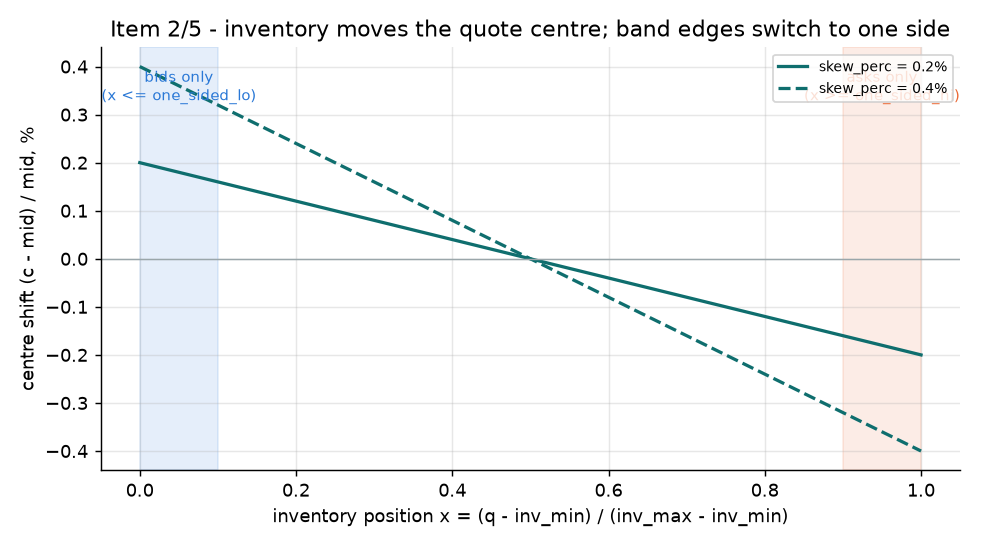
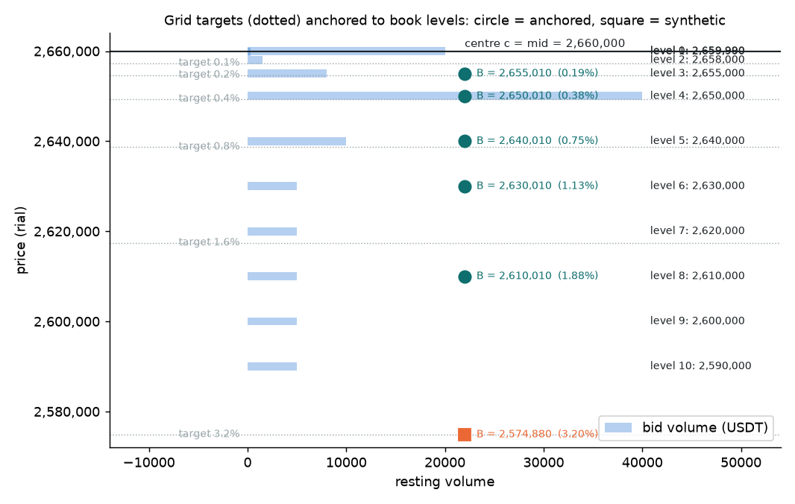
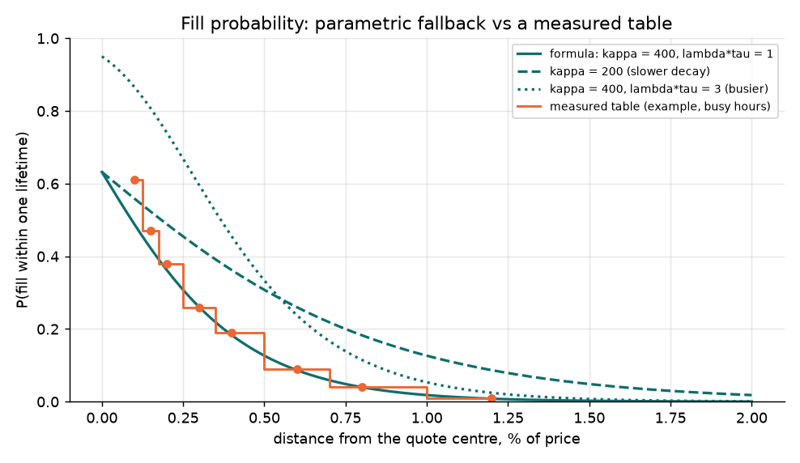
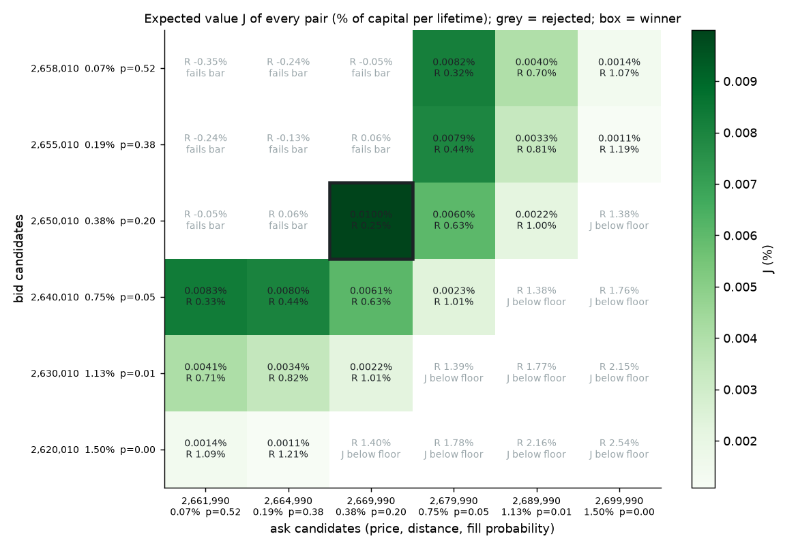
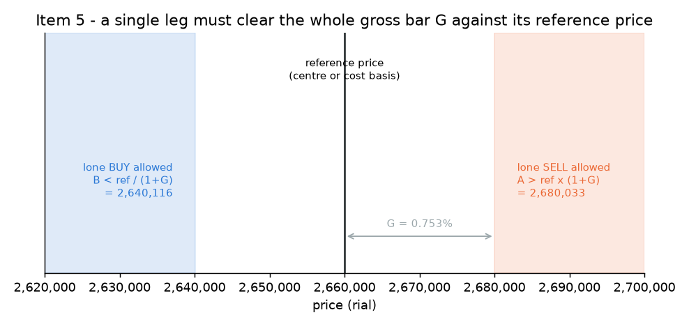

# Algorithm 1, version 2 — distance-anchored, expected-value quoting

**Code:** [`market_maker/strategy/algo1.py`](../../market_maker/strategy/algo1.py) (`Algo1Strategy`),
[`market_maker/fill_model.py`](../../market_maker/fill_model.py) (`FillModel`),
[`market_maker/tools/build_fill_table.py`](../../market_maker/tools/build_fill_table.py).
**Tests:** `market_maker/tests/test_strategy_algo1.py`, `test_algo1_*.py`, `test_fill_model.py`,
`test_build_fill_table.py`, `test_engine_one_sided.py`.
**Companion notes:** [FILL_MODEL.md](FILL_MODEL.md) (where the fill probabilities come from),
[CHANGES_V1_TO_V2.md](CHANGES_V1_TO_V2.md) (what changed and why).

Every number in this document is produced by the code on the example book in
section 3 and is pinned by the tests, so the text, the figures and the
implementation cannot drift apart.

---

## 0. What the algorithm does, in one paragraph

Once per round the engine hands the strategy the current Nobitex order book and
the inventory it holds. The strategy (1) moves a *quote centre* away from the
mid-price according to how full the inventory is, (2) builds a small set of
candidate bid and ask prices at fixed *distances* from that centre, each
anchored one tick inside a real book level, (3) attaches to each candidate the
probability that an order resting there is filled within one order lifetime,
(4) scores every bid/ask pair by its *expected value* — the chance that both
legs fill times the round-trip profit after fees, minus the expected cost of
only one leg filling — and keeps the best pair that clears the profit bar, (5)
falls back to a single side when the inventory sits at a band edge or when
only one leg is profitable on its own, and (6) keeps a resting price while the
new one is within a few ticks of it. The engine then sizes the orders with the
linear inventory rule, applies the cash and inventory caps, and sends them.

The profitability semantics of version 1 are unchanged: a pair is acceptable
only if the fee-adjusted round-trip return on the prices actually submitted
strictly exceeds `exp_ret_min`.

---

## 1. Notation

| Symbol | Meaning | Config field |
|---|---|---|
| $b_i, v^b_i$ | bid price and volume at book level $i$ ($i = 0$ is the best bid) | — |
| $a_j, v^a_j$ | ask price and volume at level $j$ | — |
| $m = (b_0 + a_0)/2$ | mid-price | — |
| $\epsilon$ | tick: 10 rial on `…IRT` pairs, 0.01 otherwise | — |
| $q$ | inventory in base units | — |
| $q_{\min}, q_{\max}$ | inventory band | `inv_min`, `inv_max` |
| $x$ | position inside the band, clamped to $[0, 1]$ | — |
| $\sigma_q$ | centre shift at the band edges, fraction of price | `skew_perc` |
| $c$ | quote centre | — |
| $\delta$ | relative distance of a price from $c$ | — |
| $\delta_{\min}, \rho, \delta_{\max}$ | candidate grid: start, ratio, end | `grid_min_perc`, `grid_ratio`, `grid_max_perc` |
| $f$ | fee per leg, fraction | `commission_perc` |
| $r_{\min}$ | required net return per round trip | `exp_ret_min` (defaults to $f$) |
| $G = (1+r_{\min})/(1-f)^2 - 1$ | gross bar: the sell/buy ratio minus one that clears $r_{\min}$ | — |
| $p_b(\delta), p_a(\delta)$ | P(fill within one lifetime) for a bid / ask at distance $\delta$ | fill model |
| $\eta$ | adverse-selection cost charged when only one leg fills | `adverse_selection_perc` |
| $J_{\min}$ | expected-value floor | `ev_min` |
| $x_{lo}, x_{hi}$ | band positions below/above which only one side is quoted | `one_sided_lo`, `one_sided_hi` |
| $\bar P$ | average cost of the inventory we bought ourselves | learned, see §2.5 |
| $\tau$ | order lifetime | `cancel_after_minutes × 60` |

Live settings at the time of writing: $f = 0.25\%$, $r_{\min} = 0.25\%$, hence
$G = 1.0025/0.9975^2 - 1 = 0.7532\%$.

---

## 2. The algorithm, step by step

### 2.1 Inventory position and quote centre

$$x = \mathrm{clamp}\!\left(\frac{q - q_{\min}}{q_{\max} - q_{\min}},\ 0,\ 1\right), \qquad
c = m\,\bigl(1 - \sigma_q\,(2x - 1)\bigr).$$

With $x > \tfrac12$ (too many coins) the centre sits below the mid: every ask
candidate is nearer to the market and every bid candidate farther, so selling
becomes more likely than buying. With $x < \tfrac12$ the opposite. $x = \tfrac12$
leaves $c = m$. Inventory outside the band saturates at $x = 0$ or $1$ instead
of producing an unusable shift (version 1's `inv_d` kept growing).



### 2.2 Candidate prices by distance (anchoring)

The grid of distances is geometric:

$$\delta_k = \delta_{\min}\,\rho^{\,k-1}, \qquad k = 1, 2, \dots \text{ while } \delta_k \le \delta_{\max}.$$

Defaults $\delta_{\min} = 0.05\%$, $\rho = 1.4$, $\delta_{\max} = 2\%$ give 11 points
(0.05, 0.07, 0.10, 0.14, 0.19, 0.27, 0.38, 0.53, 0.74, 1.03, 1.45 %). A
geometric grid spends its points near the touch, where the fill probability
changes fastest.

Each distance is turned into a real price exactly the way version 1 turned a
level into a price — find the first book level at or beyond the target and quote
one tick inside it:

$$i(\delta) = \min\{\, i : b_i \le c(1-\delta) \,\}, \quad B_\delta = b_{i(\delta)} + \epsilon,
\qquad
j(\delta) = \min\{\, j : a_j \ge c(1+\delta) \,\}, \quad A_\delta = a_{j(\delta)} - \epsilon.$$

When the book is shallower than the target the candidate is *synthetic*: the
tick-rounded target itself, with no book level behind it. Candidates are
clipped so they never cross the touch ($B \le a_0 - \epsilon$, $A \ge b_0 + \epsilon$),
and several grid points that land on the same level are kept once. The
*realised* distance $\hat\delta_b = (c - B)/c$, $\hat\delta_a = (A - c)/c$ is
what the fill model sees; the grid is only the search pattern. Only the first
`depth_max + 1` levels of the book are considered.



Each candidate also records the volume resting at better prices on its side
(`volume_ahead`), used by the optional queue correction.

### 2.3 Fill probability

For every candidate, $p = P(\text{filled within } \tau)$ at its realised
distance, from `FillModel.probability(distance, side)`:

* the measured table `fill_table_<pair>.json` when it is fresh and the bucket
  has enough samples (linear interpolation between bucket centres), else
* the parametric fallback, Poisson fills with an exponentially decaying
  intensity:

$$p(\delta) = 1 - \exp\!\bigl(-\lambda_\tau\, e^{-\kappa \delta}\bigr),
\qquad \kappa = \texttt{fill\_kappa},\ \lambda_\tau = \texttt{fill\_lambda\_tau}.$$

An optional queue correction multiplies $p$ by $e^{-V_{\text{ahead}}/V_{\text{ref}}}$
when `fill_queue_volume_ref` $> 0$. See [FILL_MODEL.md](FILL_MODEL.md) for the
table, its daily rebuild and its schema.



### 2.4 Pair scoring and selection

For a bid candidate $B$ with probability $p_b$ and an ask candidate $A$ with
$p_a$:

$$R_{\text{gross}} = \frac{A - B}{B}, \qquad
R_{\text{net}} = (1-f)^2\,\frac{A}{B} - 1, \qquad
J = p_b\,p_a\,R_{\text{net}} \;-\; \eta\,\bigl[p_b(1-p_a) + p_a(1-p_b)\bigr].$$

$J$ is the expected value per unit of capital over one lifetime: both legs fill
with probability $p_b p_a$ and earn the round trip; exactly one leg fills with
the bracketed probability and opens a position whose expected cost is $\eta$
(measured as the mean adverse mid move after fills; 0 until measured).

A pair is *feasible* iff $R_{\text{net}} > r_{\min}$ **and** $J > J_{\min}$. The
selection is

$$(B^*, A^*) = \arg\max_{\text{feasible pairs}} J, \qquad \text{ties} \to \text{smaller } \hat\delta_b + \hat\delta_a .$$

All $|\mathcal B| \times |\mathcal A|$ pairs are scored (at most $11 \times 11$),
so one non-monotone level cannot hide a better pair as it could with version
1's "stop at the first failure" scan.



### 2.5 One-sided quotes

A single leg is judged against a *reference price* $P_{\text{ref}}$, the price
the position is expected to be closed at:

$$\text{lone ask: } (1-f)^2\frac{A}{P_{\text{ref}}} - 1 > r_{\min} \iff A > P_{\text{ref}}(1+G),
\qquad
\text{lone bid: } (1-f)^2\frac{P_{\text{ref}}}{B} - 1 > r_{\min} \iff B < \frac{P_{\text{ref}}}{1+G},$$

with the single-leg expected value $J = p\,R_{\text{net}} - \eta\,p$ and the same
floor $J_{\min}$. The reference is the centre $c$, or — for a lone ask when
`cost_basis_reference` is on and inventory with a known cost is held — the
average cost $\bar P$ of the units we bought ourselves. $\bar P$ is learned
inside the strategy: an inventory increase between two rounds is taken as a
fill of the resting bid at its price (the engine has no fill hook), a decrease
consumes known-cost units.

When it is used:

| Situation | Decision |
|---|---|
| $x \ge x_{hi}$ | asks only: best lone ask by $J$ |
| $x \le x_{lo}$ | bids only: best lone bid by $J$ |
| otherwise, a feasible pair exists | the pair |
| otherwise | best lone leg on either side; none → no quote |



### 2.6 Hysteresis

The strategy remembers the price it last issued on each side with its time.
A new price within the requote band of the resting one, while the resting
quote is younger than `refresh_seconds`, is replaced by the resting price (and
reported with `"bid kept": True`). The band is $w(p) = \max(n\epsilon, \omega p)$
with $n$ = `hysteresis_ticks` (5 ticks) and $\omega$ = `requote_band_perc`
(0.03 % of the price), whichever is wider (`requote_band(price)` in
`strategy/algo1.py`); until 20 October 2026 it was the ticks alone, 50 rial,
which on BTC is nothing. The engine completes the rule with the same band: if
an order of ours already rests within the band of the quoted price, the side is
**not re-posted** this round (`resting_order_kept`), and a resting order of ours
that the new price has left *outside* the band is cancelled first (`replaced`),
so at most one order rests per side (section 2.8). Together they stop the
cancel/re-post churn and the accumulation of near-identical orders (the 2026-08
batch-fill incident; up to 11 of ours open at once on the BTC demo of October
2026).

If the kept price no longer clears the bar with the new partner leg, both
sides are re-quoted at the new prices.

### 2.7 Sizes (engine, unchanged)

The strategy returns prices only. [`engine.py`](../../market_maker/engine.py)
sizes them with the linear inventory rule
(`_inventory_sized_order_targets`: $\text{buy} = 2S(1-x_{\text{buy}})$,
$\text{sell} = 2Sx_{\text{sell}}$ with resting orders counted), caps them by cash,
inventory and `inv_max`, applies the locked-exposure guards, drops anything
below 1 % of `order_size`, and sends — unless the trend pause of section 2.8
blocks the side. A side the strategy left out (`None`) is skipped and recorded
as `one_sided_quote`.

### 2.8 Engine rules of 20 October 2026

The demo of 15–17 October 2026 (fee 0.08 %, target 0.01 %, both pairs) lost 20 million rial on 1 billion
per pair. The analysis (`Report_investor/demo_analysis/`, every number from the recorded rounds and paper
ledgers) found that every fill was a `price_touch` of an order that had rested for minutes while new ones
were added each round — the requote band was 5 ticks, 50 rial, which on BTC is nothing, so a new order was
added almost every round and up to 11 of ours were open at once on BTC, 26 on USDT — and that 62–88 % of the
fills were of orders at least seven rounds old. Four engine rules answer this; they are the engine's, so they
apply to MM_algo1v2 exactly as to any other strategy the engine runs:

| Rule | Setting | What the engine does |
|---|---|---|
| requote band in percent, one order per side | `requote_band_perc` = 0.0003 | the band of section 2.6 is $\max(5\epsilon, 0.03\,\%\,p)$; a resting order of ours outside the band of the new price is cancelled (`replaced`) before the new order is sent, one inside it keeps the new order from being sent (`resting_order_kept`) |
| orders live 3 minutes | `cancel_after_minutes` = 3 (10 before) | a resting order older than 3 minutes is cancelled at the start of the round (`stale_timeout`); the fill probabilities of section 2.3 refer to this lifetime, so the nightly fill table is built with `--horizon-seconds 180` (`FILL_MODEL.md`) |
| target | `exp_ret_min` = 0.0002 since 22 October (0.002 on 20–22 October, 0.001 before) | the bar $r_{\min}$ of section 2.4; 0.20 % was the operator's requirement of 20 October, lowered to 0.02 % on 22 October because at 0.20 % the demo lanes placed almost no order (this algorithm sent a buy in 1 of 27 BTC rounds and 0 of 161 USDT rounds in their first 25 minutes) |
| trend pause | `trend_window_seconds` = 600, `trend_pause_perc` = 0.003 | after the mid fell by more than 0.3 % within the last 10 minutes no buy is placed and resting buys are cancelled (`trend_pause`); after such a rise, the same for sells. The bot stops adding coins in a falling market and stops selling them off in a rising one. 0 switches it off. |

**What the replay says for this algorithm.** `demo_analysis/simulator.py` replays the recorded market
with the demo's touch fill rule (an order fills when the opposite best price reaches it) and this
algorithm's own re-selection over the logged candidates; fee 0.08 %, 1 billion rial per pair, BTC over
45.8 h and USDT over 10.7 h of MM_algo1v2 rounds (`results/t18_new_rules.csv`):

| Rule | BTC: result, fills, time at the best price | USDT |
|---|---|---|
| demo settings (target 0.01 %, 10-minute orders, stacking) | −0.91 %, 327 fills, 48 % | −0.21 %, 128 fills, 17 % |
| requote band 0.03 % with replacement | −0.01 %, 1 fill, 0 % | −0.11 %, 3 fills, 0 % |
| + orders live 3 minutes | the same | the same |
| + target 0.20 % | 0.00 %, no fill | −0.11 %, 3 fills |
| + trend pause 0.3 % over 10 min | 0.00 %, no fill (58 buy rounds and 67 sell rounds paused) | −0.11 %, 3 fills (none paused) |

With replacement on, MM_algo1v2 barely trades under the demo's touch rule: its candidates sit at the first
book level beyond each grid distance and jump between levels as the book moves, so an order rarely survives
long enough to be run through. That says more about the demo's fill model than about the algorithm — the
demo never sees a taker trading into a resting order — and it is why the fill probabilities of section 2.3
need a real account, or the exchange's trades, to be measured. The remaining USDT loss is the coins losing
value in a falling market (−1.5 % over 15–17 October), not trading.

Tests: `tests/test_requote_rules.py`.

---

## 3. Worked example

USDT/IRT, fee $0.25\%$, $r_{\min} = 0.25\%$ ($G = 0.7532\%$), lifetime 10 min (the example's own settings; since 20 October 2026 the profiles use a 3-minute lifetime and $r_{\min} = 0.20\%$),
25 of 50 USDT held ($x = 0.5$, so $c = m = 2{,}660{,}000$), fallback fill
formula ($\kappa = 400$, $\lambda_\tau = 1$). Book (prices in rial, volumes in
USDT):

| level | bid | volume | ask | volume |
|---|---|---|---|---|
| 0 | 2,659,990 | 20,000 | 2,660,010 | 5,000 |
| 1 | 2,659,900 | 300 | 2,660,100 | 400 |
| 2 | 2,658,000 | 1,500 | 2,662,000 | 2,000 |
| 3 | 2,655,000 | 8,000 | 2,665,000 | 6,000 |
| 4 | 2,650,000 | 40,000 | 2,670,000 | 30,000 |
| 5 | 2,640,000 | 10,000 | 2,680,000 | 12,000 |
| 6–10 | 2,630,000 … 2,590,000 | 5,000 each | 2,690,000 … 2,730,000 | 5,000 each |

**Candidates (default grid).** Bids: 2,658,010 (level 2, 0.075 %), 2,655,010
(level 3, 0.188 %), 2,650,010 (level 4, 0.376 %), 2,640,010 (5, 0.752 %),
2,630,010 (6, 1.13 %), 2,620,010 (7, 1.50 %). Asks: 2,661,990, 2,664,990,
2,669,990, 2,679,990, 2,689,990, 2,699,990 at the same distances. Fill
probabilities from the formula: 0.52, 0.38, 0.20, 0.05, 0.011, 0.0025.

**Pairs.** 36 pairs are scored (the heat map above). The touch pairs fail the
bar ($R_{\text{net}} < 0.25\%$); the far pairs clear it but their $J$ is below
the floor. Winner:

$$B^* = 2{,}650{,}010,\ A^* = 2{,}669{,}990:\quad
\frac{A}{B} = 1.007539,\ R_{\text{net}} = 0.9975^2 \times 1.007539 - 1 = 0.2508\%,\
J = 0.1996 \times 0.1996 \times 0.2508\% = 0.0100\%.$$

It is neither the most profitable pair per fill nor the most likely to fill;
it is the best balance. The number $J = 10^{-4}$ says what quoting is worth:
about 100 rial per 1,000,000 rial of capital per 10-minute lifetime if the
fill table is right.

**One-sided.** With 48 of 50 USDT held ($x = 0.96 \ge x_{hi}$) only asks are
scored. Against the market reference ($c$) the lone ask must exceed
$c(1+G) = 2{,}680{,}030$; against a cost basis of $\bar P = 2{,}640{,}000$ it must
exceed $2{,}659{,}880$, and 2,664,990 wins with $R_{\text{net}} = 0.44\%$,
$J = 0.38 \times 0.44\% = 0.17\%$. Version 1 posted nothing in this situation.

**Sizes.** The engine then applies the linear rule: at 25/50 USDT both sides
get `order_size` (1 USDT); at 48/50 the sell gets $2 \times 1 \times 0.96 = 1.92$
USDT.

---

## 4. Pseudocode

```text
function decide_order(book, q):                                  # Algo1Strategy.decide_order
    update_cost_basis(q)                                         # §2.5: inventory delta → P̄
    E = evaluate(book, q)
    if not E.ok:  forget resting prices;  return None            # reason in no_quote_reason()
    bid, ask = E.chosen_bid.price, E.chosen_ask.price            # either may be None
    bid, ask, kept = apply_hysteresis(bid, ask)                  # §2.6
    if kept and not still_clears_bar(bid, ask, E):  re-quote at the new prices
    return {bid, ask, bid level, ask level, mid price, centre, inventory position,
            gross/net return, expected value, fill probs, quote mode, selection reason, ...}

function evaluate(book, q):                                      # pure; shared with diagnostics()
    if depth_cap(book) == 0 or mid(book) is None:  return fail("invalid_or_single_level_order_book")
    x = clamp((q − inv_min) / (inv_max − inv_min), 0, 1)
    c = mid · (1 − skew_perc · (2x − 1))
    bids, asks = build_candidates(book, c)                       # §2.2, with p attached (§2.3)
    if x ≥ one_sided_hi:  return best_single(asks, ref = P̄ or c)  or fail("no_side_clears_bar")
    if x ≤ one_sided_lo:  return best_single(bids, ref = c)       or fail("no_side_clears_bar")
    best = None
    for B in bids, A in asks:                                    # §2.4
        R = (1 − f)² · A/B − 1
        J = pB·pA·R − η·(pB(1 − pA) + pA(1 − pB))
        if R > r_min and J > ev_min and (best is None or J > best.J):  best = (B, A)
    if best:  return pair(best)
    single = best_single(asks, ref = P̄ or c) ∪ best_single(bids, ref = c)   # §2.5 fallback
    if single:  return single
    return fail("expected_value_below_floor" if any pair cleared the bar else "no_side_clears_bar")

function build_candidates(book, c):                              # §2.2
    for δ in grid:
        target = c(1 − δ);  i = first level with b_i ≤ target
        B = b_i + ε  if i exists  else round_down(target)       # synthetic when the book ends
        B = min(B, a_0 − ε);  keep once;  distance = (c − B)/c;  volume_ahead = Σ v_k for k < i
        (asks symmetric with ≥ and a_j − ε, max(A, b_0 + ε))
```

Complexity per round: $O(n \cdot L)$ to build candidates and $O(n^2)$ to score
pairs with $n \le 11$ grid points and $L \le$ `depth_max + 1` levels.

---

## 5. Outputs

### 5.1 The quote dictionary (read by the engine)

| Key | Used for |
|---|---|
| `bid`, `ask` | limit prices; **either may be `None`** (one-sided quote) |
| `bid level`, `ask level` | anchored level index or `None` (synthetic / absent side); logged, and passed to the paper matcher as `selected_level` |
| `mid price`, `centre`, `inventory position` | CSV / Telegram |
| `gross return`, `net return`, `relative quoted spread`, `min required return` | CSV / Telegram economics (single-leg: return against the reference price) |
| `bid distance`, `ask distance`, `bid exec prob`, `ask exec prob`, `expected value` | the decision's own numbers |
| `quote mode` | `pair`, `bid_only`, `ask_only` |
| `selection reason` | `pair_selected`, `ask_only_inventory_edge`, `bid_only_inventory_edge`, `ask_only_fallback`, `bid_only_fallback` |
| `reference price` | the lone leg's reference ($c$ or $\bar P$) |
| `bid kept`, `ask kept` | hysteresis kept the resting price |

### 5.2 No-quote reasons (`no_quote_reason`, CSV column *No Quote Reason*)

`invalid_or_single_level_order_book`, `no_candidates`, `no_side_clears_bar`,
`expected_value_below_floor`; `quote_available` when a quote exists.

### 5.3 Diagnostics (`diagnostics`, JSONL when `algo1_diagnostics_enabled`)

Keeps every version-1 key the engine, Telegram and admin views read
(`candidate_results[*].bid_level/ask_level/submitted_*_price/spread_ratio/net_return/passed`,
`required_threshold`, `selection_reason`, `fallback_detected = False`, a
legacy `inv_d = int(10x) − 5`) and adds `inventory_position`, `centre`,
`distance_grid`, `candidate_bids`/`candidate_asks` (price, distance, level,
anchored, volume ahead, fill probability), `p_bid`/`p_ask`/`expected_value`
per pair, `single_results`, `quote_mode`, `selected_*_price`,
`selected_expected_value`, `reference_price`, `cost_basis`, `gross_bar`, and
the fill model's status (`fill_model`). `diagnostics()` is pure: it never
touches the hysteresis memory or the cost basis.

### 5.4 Engine-side records

Demo CSV: a missing side is `not_sent_one_sided_quote`; a side skipped by the
resting-order guard is `not_sent_resting_order_kept`. Live CSV: `not_sent` as
before. Telegram round summaries show `Bid: —` / `Ask: —` for an absent side.

---

## 6. Configuration

All fields are per pair in `TRADING_PROFILES` (`config.py`), hot-reloadable in
Demo (`demo_config.FIELD_DEFINITIONS`) and saved for live from the admin
Live Config page (`forward_config.FORWARD_FIELDS`).

| Field | Default | Meaning |
|---|---|---|
| `grid_min_perc`, `grid_ratio`, `grid_max_perc` | 0.0005, 1.4, 0.02 | candidate distance grid |
| `depth_max` | 10 | book levels considered when anchoring |
| `skew_perc` | 0.002 | centre shift at the band edges |
| `one_sided_lo`, `one_sided_hi` | 0.1, 0.9 | one-sided thresholds on $x$ |
| `cost_basis_reference` | True | lone sells judged against $\bar P$ when known |
| `ev_min` | 1e-5 | expected-value floor (fraction of capital per lifetime) |
| `adverse_selection_perc` | 0.0 | $\eta$ |
| `hysteresis_ticks`, `refresh_seconds`, `requote_band_perc` | 5, 300, 0.0003 | keep a resting price within the requote band (5 ticks or 0.03 % of the price, whichever is wider) for up to 5 minutes; the engine replaces a resting order outside the band (sections 2.6, 2.8) |
| `trend_window_seconds`, `trend_pause_perc` | 600, 0.003 | engine: no buy after the mid fell 0.3 % within 10 minutes, no sell after such a rise (section 2.8); 0 switches it off |
| `fill_table_enabled`, `fill_table_max_age_hours`, `fill_table_min_samples` | True, 48, 50 | when the measured table is used |
| `fill_kappa`, `fill_lambda_tau` | 400, 1.0 | fallback formula |
| `fill_queue_volume_ref` | 0 (off) | queue correction |
| `commission_perc`, `exp_ret_min`, `inv_min`, `inv_max`, `cancel_after_minutes` | 0.0025, 0.0002, per pair, per pair, 3 | fee, bar, band, lifetime; `exp_ret_min` 0.0002 since 22 October 2026 (0.002 on 20–22 October, 0.001 before) and `cancel_after_minutes` 3 since 20 October (10 before), section 2.8 |

`demo_level1_fast_fill_enabled` is now **off** in both profiles: version 1's
level-1 quote sat next to the touch, version 2's level index says nothing about
distance, so paper fills come from the price path only (`price_touch`),
consistent with the fill model.

The live validator (`forward_config.py`) still forces `commission_perc` to at
least 0.25 % (the target `exp_ret_min` may be any non-negative value) and the exposure guards on, and additionally
requires `grid_min_perc ≤ grid_max_perc` and `one_sided_lo < one_sided_hi`.

---

## 7. Validation gate (demo → real)

Computed from the demo CSVs over at least five days before the same code is
allowed to trade with money:

| Metric | Gate |
|---|---|
| rounds with a quote (pair + one-sided) | ≥ 50 % |
| fills per hour | ≥ 1 |
| completed round trips | ≥ 30 |
| realised net spread per round trip | ≥ computed at placement − 0.05 % |
| adverse selection 60 s after fills | ≥ −0.10 % |
| predicted vs realised fill rate, per bucket | within ±30 % |
| time at the band edges ($x < 0.1$ or $> 0.9$) | ≤ 10 % |
| net PnL after fees | > 0 |
| mark-to-market drawdown | ≤ 1 % |

The strategy writes the fill probability and expected value it used into every
row, so predicted and realised fill rates can be compared bucket by bucket.

The dashboard's **Validation** tab computes every row of this table from the
selected track and session (value, threshold, pass / fail / not measurable
yet) and places it above the performance metrics; the **Overview** tab shows
the same quote rate, fills per hour, realised vs computed spread and
adverse-selection numbers as headline tiles (usage.md §3).

---

## 8. What is deliberately *not* in version 2

* Sizes are not scaled by the fill probability or the expected value (the
  linear inventory rule is unchanged); a possible version 3 step once the
  fill table is validated.
* No volume (microprice/imbalance) or volatility input; see
  `Suggested Algorithm/` for the designs of Algorithms 3 and 4.
* No time-of-day regimes in the strategy itself; the fill table may be built
  per regime by the tool.

---

## 9. Test map

| Behaviour | Test |
|---|---|
| grid, anchoring, no-cross, de-duplication | `test_strategy_algo1.py::test_distance_grid_*`, `test_candidates_*` |
| inventory position, centre | `test_inventory_position_*`, `test_quote_centre_*` |
| EV selection on the example book, non-monotone book, EV floor, $\eta$ | `test_pair_selection_matches_the_specification_example`, `test_one_non_monotone_level_*`, `test_expected_value_floor_*`, `test_adverse_selection_*` |
| every returned pair clears the bar (property test over random books) | `test_every_returned_pair_clears_the_fee_bar` |
| one-sided at band edges and as fallback, cost basis | `test_full_inventory_*`, `test_empty_inventory_*`, `test_lone_leg_*`, `test_cost_basis_*` |
| hysteresis | `test_resting_price_is_kept_*`, `test_hysteresis_is_off_*` |
| requote band, one order per side, 3-minute life, trend pause (section 2.8) | `test_requote_rules.py` |
| diagnostics schema, purity, reasons | `test_algo1_diagnostics.py` |
| engine: missing side, resting-order guard, both loops | `test_engine_one_sided.py`, `test_algo1_baseline.py` |
| fill model: table, freshness, samples, fallback, reload | `test_fill_model.py` |
| fill-table builder on synthetic paths | `test_build_fill_table.py` |
| incident regression (no untested fallback, no accumulation) | `test_algo1_fallback_regression.py` |
