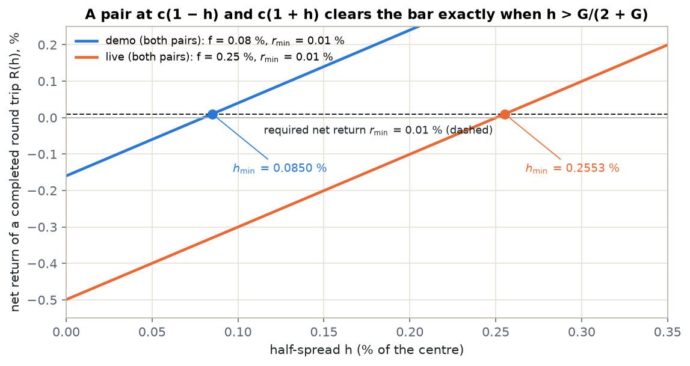
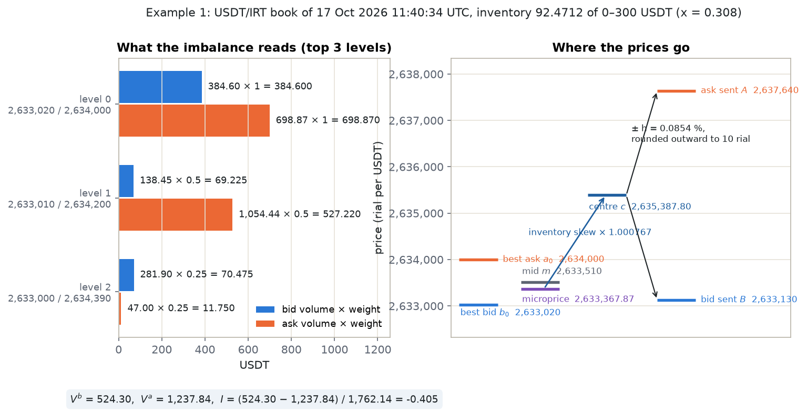
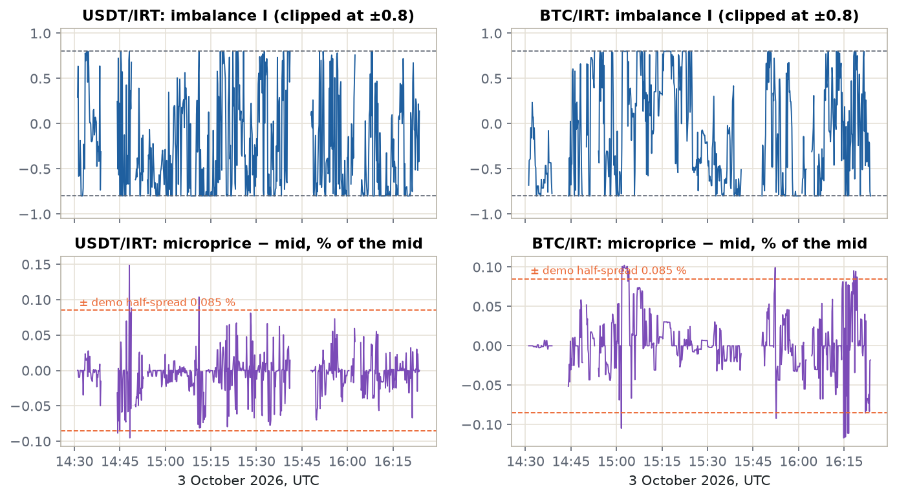
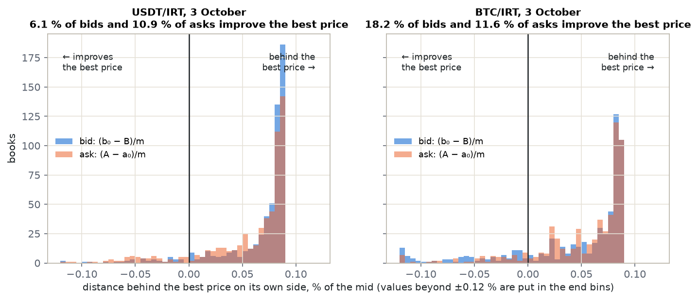
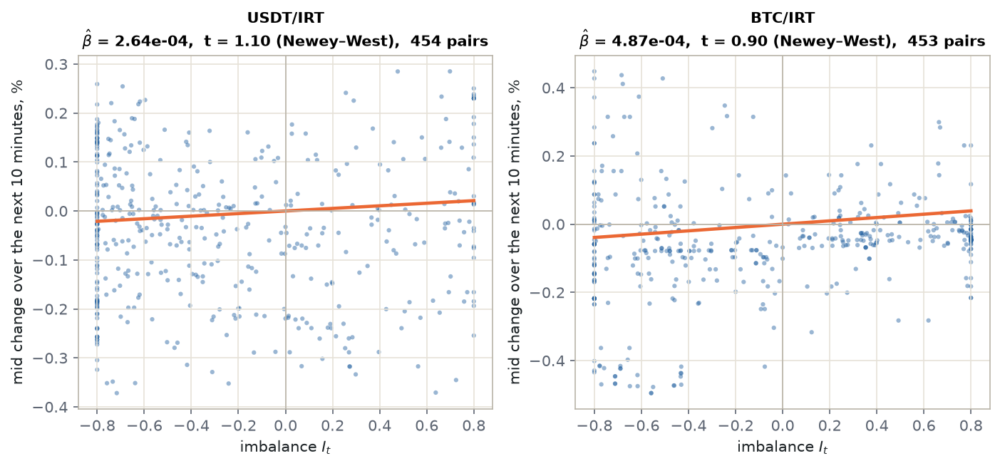

# MM_algo2 — order-book imbalance and microprice market maker

**MM_algo2** is the quoting algorithm of the git branch `MM_algo2`. The dashboard, the admin panel,
Telegram and this documentation call it by that name. In the code and in the saved settings it has the
short key `algo3`: the class is `Algo3Strategy` in
[`market_maker/strategy/algo3.py`](../../market_maker/strategy/algo3.py), and the setting is
`algorithm = algo3`. The key says "3" because MM_algo2 is the third algorithm designed for this project
(design note *"Algorithm 3 — Order-Book Imbalance and Microprice Market Maker"*, 10 October 2026,
`Server_project/Suggested Algorithm/`). The file `strategy/algo2.py` is unrelated: it is an empty
placeholder for the Avellaneda–Stoikov model.

This document is the implemented rule, exactly as the code runs it. Section 5.4 corrects one statement of
the design note.

**Where every number comes from.** Every number below is produced by
[`data/make_mm_algo2_doc_data.py`](data/make_mm_algo2_doc_data.py). That script runs the real code of
this branch (`strategy/algo3.py`, the engine's sizing rule, the configuration modules) on real Nobitex
order books stored next to it, and writes [`data/mm_algo2_doc_numbers.json`](data/mm_algo2_doc_numbers.json).
The only exception is the design note's example in section 10, which is pinned by the test
`test_spec_worked_example_reproduces_every_number`. Nothing is computed by hand.

| Data file (`docs/algorithms/data/`) | What it is |
|---|---|
| `orderbooks_20261003.jsonl.gz` | 578 snapshots per pair (BTC/IRT, USDT/IRT), 3 Oct 2026 14:31–16:23 UTC, 10 s apart at the median with a few minutes-long gaps where the collector recorded nothing, 24 levels per side with volumes |
| `orderbooks_20261017_usdtirt.jsonl.gz`, `orderbooks_20261017_btcirt.jsonl.gz` | 60 books per pair captured from the server on 17 Oct 2026 (USDT 11:36–11:46 UTC, BTC 11:25–11:35 UTC) |
| `demo_settings_20261017.json`, `live_settings_20261017.json` | the settings the two demo workers had applied, and the saved live settings, on 17 Oct 2026 |
| `btc_demo_mm_algo2_rounds.json` | the BTC demo's MM_algo2 rounds: each round's diagnostics document and its result row |
| `dashboard_metrics_mm_algo2_20261017.json` | the dashboard's own metrics for MM_algo2's first rounds on the BTC demo (used in part 6 of the guide), from `dashboard_metrics_mm_algo2.py` run on the server |

## Contents

1. [What MM_algo2 does](#1-what-mm_algo2-does)
2. [When it runs and what it receives](#2-when-it-runs-and-what-it-receives)
3. [Notation](#3-notation)
4. [The book signal](#4-the-book-signal)
5. [The quote](#5-the-quote)
6. [What the engine does with the quote](#6-what-the-engine-does-with-the-quote)
7. [What MM_algo2 hands back and records](#7-what-mm_algo2-hands-back-and-records)
8. [Worked example 1: a USDT/IRT book of 17 October](#8-worked-example-1-a-usdtirt-book-of-17-october)
9. [Worked example 2: a real round of the BTC demo](#9-worked-example-2-a-real-round-of-the-btc-demo)
10. [Worked example 3: the design note's book](#10-worked-example-3-the-design-notes-book)
11. [Behaviour on real books](#11-behaviour-on-real-books)
12. [Calibrating β: does the imbalance predict the next move?](#12-calibrating-β-does-the-imbalance-predict-the-next-move)
13. [What MM_algo2 would send with the live settings](#13-what-mm_algo2-would-send-with-the-live-settings)
14. [Properties and the tests that pin them](#14-properties-and-the-tests-that-pin-them)
15. [Settings](#15-settings)
16. [Choosing MM_algo2 and reading its results](#16-choosing-mm_algo2-and-reading-its-results)
17. [The demo-to-real gate](#17-the-demo-to-real-gate)
18. [Limitations and failure modes](#18-limitations-and-failure-modes)
19. [Changes of 20 October 2026: one order per side, shorter orders, higher target, lanes](#19-changes-of-20-october-2026-one-order-per-side-shorter-orders-higher-target-lanes)

---

## 1. What MM_algo2 does

Once per round the engine hands MM_algo2 the order book and the inventory. MM_algo2:

1. measures how much volume rests on each side of the top $k$ levels (the **imbalance**);
2. starts its quote centre at the **microprice**, the mid pulled toward the side with less resting volume;
3. **leans** the centre in the direction of the imbalance (by $\beta$, which is 0 until it is estimated) and
   **skews** it against the inventory;
4. quotes **one symmetric half-spread** $h$ around the centre: the smallest whose round trip clears the fee
   bar, plus one tick;
5. rounds the bid down and the ask up to the tick, never crossing the best price on the other side, and
   checks the fee bar again on the prices actually sent;
6. keeps the previous pair while both prices are within a few ticks of it.

The engine then sizes the two orders, applies its caps and sends them. MM_algo2 never estimates a fill
probability. The lean and the skew move the **centre** only, so the ratio of the two prices, and therefore
the profit of a completed round trip, depends on $h$ alone.

---

## 2. When it runs and what it receives

* **When:** once per round of a worker (`engine.py`): every `time_step` seconds, 10 s for USDT and 60 s for
  BTC in demo; 30 s and 60 s in the live settings.
* **The order book:** the reply of `GET /v3/orderbook/<PAIR>` on Nobitex. `bids` and `asks` are lists of
  `[price, volume]` as text, best first; `lastTradePrice` is also read. Prices are in rial, volumes in BTC or USDT.
* **The inventory $q$:** in demo, the paper ledger's total holding, including coins locked in open sells
  (`snapshot.inventory`); in live, the holding the engine tracks from fills. The real round of section 9
  shows it: inventory 0.0025009 BTC, of which 0.0006381 BTC was locked in open sells at the end of that round.
* **The settings:** the worker's configuration (section 15). In demo they are re-read at every round
  boundary, so a change applies at the next round.
* **Output:** a quote (section 7.1) or "no quote" with a reason (section 7.4). The decision is a pure
  function of the book, the inventory and the settings. The one exception is the hysteresis memory of
  section 5.7.

---

## 3. Notation

| Symbol | Meaning | Setting (default) |
|---|---|---|
| $b_i,\ v^b_i$ | bid price and volume at level $i$ ($i = 0$ is the best bid) | — |
| $a_i,\ v^a_i$ | ask price and volume at level $i$ | — |
| $m = (b_0 + a_0)/2$ | mid-price | — |
| $s = a_0 - b_0$ | market spread | — |
| $\epsilon$ | tick: 10 rial on both pairs (`…IRT`) | — |
| $k$ | levels per side in the imbalance | `algo3_depth_k` (3) |
| $\rho$ | weight of each deeper level: level $i$ counts $\rho^{\,i}$ | `algo3_decay_rho` (0.5) |
| $V^b,\ V^a$ | weighted volume of the top $k$ levels, bid and ask | — |
| $I_{\text{raw}},\ I$ | imbalance; $I$ is $I_{\text{raw}}$ clipped to $[-I_{\max}, I_{\max}]$ | `algo3_imbalance_clip` $= I_{\max}$ (0.8) |
| $I_0$ | imbalance of level 0 alone | — |
| $V_{\min}$ | thin-book threshold, $V_{\min} = n_V \cdot S$ | `algo3_min_volume_orders` $= n_V$ (20) |
| $S$ | order size | `order_size` |
| $p_{\text{micro}}$ | microprice | — |
| $\beta$ | lean of the centre per unit of imbalance, a fraction of price | `algo3_beta` (0) |
| $q,\ x$ | inventory; its position in the band, $0 \le x \le 1$ | `inv_min` $= q_{\min}$, `inv_max` $= q_{\max}$ |
| $\sigma_q$ | largest inventory shift of the centre, a fraction of price | `skew_perc` (0.002) |
| $c$ | quote centre | — |
| $f$ | fee per filled order | `commission_perc` |
| $r_{\min}$ | required net return of a round trip | `exp_ret_min` |
| $G = (1+r_{\min})/(1-f)^2 - 1$ | gross bar: how much the sell price must exceed the buy price | — |
| $h_{\min} = G/(2+G)$ | smallest half-spread that clears the bar | — |
| $h_{\text{cfg}},\ h$ | configured and used half-spread, fractions of $c$ | `algo3_half_spread` $= h_{\text{cfg}}$ (0 = automatic) |
| $B,\ A$ | bid and ask sent | — |
| $n,\ T$ | hysteresis ticks and refresh time | `hysteresis_ticks` (5), `refresh_seconds` (300) |

---

## 4. The book signal

### 4.1 Is the book usable?

MM_algo2 returns no quote, with a reason, when:

| Condition | Reason |
|---|---|
| no best bid or ask, a price $\le 0$, or a crossed top ($b_0 > a_0$) | `invalid_or_single_level_order_book` |
| fewer than $k$ levels on either side | `book_shallower_than_depth_k` |
| a level that cannot be read as numbers, or a non-positive price in the levels read | `invalid_or_single_level_order_book` |

### 4.2 Imbalance

$$
V^b = \sum_{i=0}^{k-1} \rho^{\,i}\, v^b_i, \qquad
V^a = \sum_{i=0}^{k-1} \rho^{\,i}\, v^a_i, \qquad
I_{\text{raw}} = \frac{V^b - V^a}{V^b + V^a}.
$$

$I_{\text{raw}} > 0$ means more volume waits to buy than to sell near the top: the ask side is the one
likely to be consumed, and the next move of the mid is more likely up. With $\rho = 0.5$, level 1 counts
half and level 2 a quarter as much as level 0.

**Claim 1.** $-1 \le I_{\text{raw}} \le 1$, with $I_{\text{raw}} = \pm 1$ only when one side's weighted
volume is zero.

*Proof.* Volumes and weights are non-negative, so $V^b, V^a \ge 0$, and
$\lvert V^b - V^a\rvert \le V^b + V^a$. Equality holds exactly when $V^b = 0$ or $V^a = 0$. ∎
(The code returns $I_{\text{raw}} = 0$ when $V^b + V^a = 0$.)

Two guards then turn $I_{\text{raw}}$ into the $I$ the rule uses:

* **Thin book.** If $V^b + V^a < V_{\min}$, the top of the book is too thin to carry information: $I = 0$, and
  the centre starts at the mid instead of the microprice. With the demo settings,
  $V_{\min} = 20 \times 5 = 100$ USDT and $20 \times 0.000062 = 0.00124$ BTC.
* **Clip.** Otherwise $I = \max(-I_{\max}, \min(I_{\max}, I_{\text{raw}}))$, so one large level, possibly
  placed only to be pulled again, cannot push the lean to its maximum.

**Claim 2 (with $\beta = 0$, the setting in force).** The quote does not depend on $I$, $k$ or $\rho$, except
through the thin-book test.

*Proof.* $I$ enters the rule only through the lean factor $1 + \beta I$ (section 5.2), which is 1 when
$\beta = 0$. $V^b + V^a$, and so $k$ and $\rho$, enter only through the test $V^b + V^a < V_{\min}$. ∎
Example 1's variant "$k = 1$, $\rho = 1$" (section 8.3) shows it numerically: $I$ changes from $-0.405$ to
$-0.290$ and the quote stays the same. So, until $\beta$ is switched on, the book moves MM_algo2's prices
through three things only: the best level (via the microprice), the touch (section 5.4) and the thin-book
guard. $I$ is still computed every round, recorded, and shown on the dashboard.

### 4.3 Microprice

$$
p_{\text{micro}} = \frac{a_0\, v^b_0 + b_0\, v^a_0}{v^b_0 + v^a_0}
\qquad (\text{the mid when } v^b_0 + v^a_0 = 0).
$$

**Proposition 1.** $p_{\text{micro}} = m + \dfrac{s}{2}\, I_0$, where $I_0 = \dfrac{v^b_0 - v^a_0}{v^b_0 + v^a_0}$.

*Proof.*

$$
p_{\text{micro}} - m
= \frac{2a_0 v^b_0 + 2b_0 v^a_0 - (a_0+b_0)(v^b_0+v^a_0)}{2\,(v^b_0+v^a_0)}
= \frac{a_0 v^b_0 - a_0 v^a_0 - b_0 v^b_0 + b_0 v^a_0}{2\,(v^b_0+v^a_0)}
= \frac{(a_0-b_0)(v^b_0 - v^a_0)}{2\,(v^b_0+v^a_0)}
= \frac{s}{2}\, I_0. \quad ∎
$$

**Corollary.** $b_0 \le p_{\text{micro}} \le a_0$, because $\lvert I_0\rvert \le 1$ gives
$\lvert p_{\text{micro}} - m\rvert \le s/2$. More volume on the bid side ($I_0 > 0$) puts the microprice
nearer the ask. In example 1 the identity holds to $5 \times 10^{-11}$ rial: $p_{\text{micro}} - m$ =
$-142.12880836567$ and $(s/2)\,I_0$ = $-142.12880836571$. The test
`test_microprice_is_the_mid_shifted_by_half_spread_times_level0_imbalance` checks it on random books.

---

## 5. The quote

### 5.1 Inventory position

$$
x = \operatorname{clamp}\!\left(\frac{q - q_{\min}}{q_{\max} - q_{\min}},\ 0,\ 1\right),
\qquad x = \tfrac12 \text{ if } q_{\max} \le q_{\min}.
$$

$x = 0$ is an empty band, $x = 1$ a full one. An inventory outside the band counts as the nearest edge.

### 5.2 Centre

$$
c = p_{\text{micro}}\ \underbrace{\bigl(1 + \beta I\bigr)}_{\text{lean}}\ \underbrace{\bigl(1 - \sigma_q\,(2x - 1)\bigr)}_{\text{skew}}
\qquad (p_{\text{micro}} \text{ is replaced by } m \text{ when the book is thin}).
$$

* **Lean:** buying pressure ($I > 0$, with $\beta > 0$) raises the centre, so both prices rise.
* **Skew:** an inventory above the middle of the band ($x > \tfrac12$) lowers the centre, so selling becomes
  more likely and buying less. A half-full band leaves the centre unchanged; a full band moves it
  $\sigma_q$ = 0.2 % down, and an empty band 0.2 % up.

**Claim 3.** For $\beta \ge 0$:
$(1 - \beta I_{\max})(1 - \sigma_q) \le c/p_{\text{micro}} \le (1 + \beta I_{\max})(1 + \sigma_q)$.

*Proof.* $\lvert I\rvert \le I_{\max}$ and $\lvert 2x - 1\rvert \le 1$, and both factors are positive for the
allowed settings ($\beta \le 0.05$, $I_{\max} \le 1$, $\sigma_q \le 0.1$). ∎ With $\beta = 0$ and
$\sigma_q = 0.002$, the centre is always within 0.2 % of the microprice. A centre $\le 0$ gives no quote
(`invalid_centre`); it cannot happen with valid settings and a valid book.

### 5.3 Half-spread from the fee bar

Buying at $B$ and selling the coins received at $A$ returns, per rial spent (the fee is taken from what is
received, so the buy leaves $1-f$ coins, and the sell leaves $1-f$ of the rial):

$$
R(B, A) = (1-f)^2\,\frac{A}{B} - 1 .
$$

The pair is profitable enough when $R(B, A) > r_{\min}$, that is when $A/B > 1 + G$ with
$G = (1 + r_{\min})/(1-f)^2 - 1$. MM_algo2 puts the two prices symmetrically around the centre,
$B = c(1-h)$ and $A = c(1+h)$, so

$$
R(h) = (1-f)^2\,\frac{1+h}{1-h} - 1 ,
$$

which depends on $h$ alone: the centre, and with it the signal and the inventory, cancels out.

**Proposition 2.** For $0 \le h < 1$, $R(h) > r_{\min} \iff h > h_{\min} = \dfrac{G}{2+G}$.

*Proof.* $R(h) > r_{\min} \iff \dfrac{1+h}{1-h} > 1 + G \iff 1 + h > (1 + G)(1 - h) \iff h\,(2 + G) > G$,
using $1 - h > 0$. Moreover, $(1+h)/(1-h)$ is strictly increasing on $[0, 1)$, so every $h$ above $h_{\min}$
clears the bar, and nothing below it does. ∎

MM_algo2 uses

$$
h = \max\bigl(h_{\text{cfg}},\ h_{\min} + \epsilon / c\bigr),
$$

which is one tick of margin above the bar when `algo3_half_spread` is 0 (the default). If $h \ge 1$ there is
no quote (`half_spread_not_attainable`). The bar for the settings in use:

| Settings | $f$ | $r_{\min}$ | $G$ | $h_{\min}$ | $R$ at $h_{\min}$ |
|---|---:|---:|---:|---:|---:|
| live (both pairs) | 0.25 % | 0.01 % | 0.5119 % | 0.2553 % | 0.010000 % |
| demo (both pairs) | 0.08 % | 0.01 % | 0.1702 % | 0.0850 % | 0.010000 % |
| profile defaults (`config.py`) | 0.10 % | 0.10 % | 0.3005 % | 0.1500 % | 0.100000 % |
| design-note example | 0.25 % | 0.25 % | 0.7531 % | 0.3752 % | 0.250000 % |

So in demo MM_algo2 quotes about ±0.085 % around its centre, and with the live settings about ±0.255 %.
The tick margin is $\epsilon/c$: 0.00038 % of price for USDT (about 2,630,000 rial) and $4.7 \times 10^{-11}$
for BTC (about $2.14 \times 10^{11}$ rial). On BTC the net return of a quote is therefore $r_{\min}$ to
six significant figures.

### 5.4 Prices on the tick, never crossing

$$
B = \epsilon \left\lfloor \frac{\min\bigl(c(1-h),\ a_0 - \epsilon\bigr)}{\epsilon} \right\rfloor, \qquad
A = \epsilon \left\lceil \frac{\max\bigl(c(1+h),\ b_0 + \epsilon\bigr)}{\epsilon} \right\rceil .
$$

**Proposition 3.** Every pair MM_algo2 computes satisfies:

1. $B \le a_0 - \epsilon$ and $A \ge b_0 + \epsilon$: the bid never reaches the ask side and the ask never
   reaches the bid side, so neither order trades at once as a taker;
2. $B$ and $A$ are multiples of $\epsilon$;
3. $A/B \ge (1+h)/(1-h) > 1 + G$, so $R(B, A) > r_{\min}$ on the prices actually sent.

*Proof.* (1) Taking the minimum with $a_0 - \epsilon$ and rounding down can only lower the bid, so
$B \le a_0 - \epsilon$. Likewise for the ask, with $b_0 + \epsilon$ and rounding up. (2) By construction.
(3) The minimum and the rounding down give $B \le c(1-h)$; the maximum and the rounding up give
$A \ge c(1+h)$. Hence $A/B \ge c(1+h)/\bigl(c(1-h)\bigr)$, and Proposition 2 with $h > h_{\min}$ gives the
rest. ∎

**Correction of the design note.** The note says the clip to the touch "can narrow" the quote and that
the final check guards against that. It cannot narrow it: the clip and the rounding only ever *lower* the
bid and *raise* the ask, so they can only widen the quote. Example 1's inventory-edge variants
(section 8.3) are real cases: at a full band the ask is lifted from 2,630,345.86 to 2,633,030, and the net
return of the pair rises from about 0.011 % to 0.1131 %.

### 5.5 The final check

The code re-checks the prices actually sent: if $B \le 0$, $B \ge A$, or $R(B, A) \le r_{\min}$, there is no
quote (`net_return_below_bar`). By Proposition 3 this cannot happen when $h > h_{\min}$. It is a safety net,
kept in case the arithmetic or the settings change. `test_the_final_check_on_the_sent_prices_rejects_an_unprofitable_quote`
forces it to fire.

### 5.6 Book levels, for the record only

The round row records a bid level and an ask level:
$i^* = \max\{i : b_i \ge B\}$ and $j^* = \max\{j : a_j \le A\}$, over the levels read (`depth_max` + 1).
When no book bid is at or above $B$, so that $B$ sits inside the spread above the best bid, the bid level
is 0 as well. The levels play no part in the decision.

### 5.7 Keeping a pair that barely moved (hysteresis)

MM_algo2 remembers the last pair it issued, $(B^\circ, A^\circ)$, and when it issued it. A new pair
$(B, A)$ is replaced by $(B^\circ, A^\circ)$ when all four hold:

* $\lvert B - B^\circ\rvert \le w(B^\circ)$ and $\lvert A - A^\circ\rvert \le w(A^\circ)$, where the **requote
  band** $w(p) = \max(n\epsilon,\ \omega p)$ is the wider of $n$ = `hysteresis_ticks` (5) ticks and
  $\omega$ = `requote_band_perc` (0.0003, i.e. 0.03 %) of the price (`strategy/common.py`,
  `requote_band`);
* $(B^\circ, A^\circ)$ was issued less than $T$ = 300 s ago. The age runs from the first issue: keeping a
  pair does not restart its clock, so after 300 s a new pair is always issued;
* $(B^\circ, A^\circ)$ still clears the fee bar.

The quote then says `microprice_pair_kept` instead of `microprice_pair`. A round with no quote forgets the
remembered pair, and so does a newly built strategy: a demo switch of algorithm, or a worker restart.

Until 20 October 2026 the band was the ticks alone, 50 rial: about 0.0019 % of the USDT price and
$2.3 \times 10^{-10}$ of the BTC price, so a BTC pair was kept only when the book had not moved at all (in
the real round of section 9 the new prices differed from the remembered pair by about 1,040,000 rial). With
$\omega$ = 0.03 % the band is about 790 rial on USDT (79 ticks) and about 64,000,000 rial on BTC, the same
fraction of the price on both pairs.

The engine uses the same band twice (section 6): it does not send an order when one of its own orders
already rests within the band of the price, and it cancels a resting order of ours that the new price has
left outside the band, so that at most one order rests per side.

---

## 6. What the engine does with the quote

Sizes, caps and sending are the engine's (`engine.py`); they are the same for every algorithm. The demo
engine checks the sell side first, then the buy side; a live worker applies the same caps.

**Target sizes.** With $k_s$ = `inventory_sizing_strength` (1), floor $\phi$ =
`inventory_sizing_min_fraction` (0), $o_b$ and $o_s$ the amounts still resting in the worker's open buys
and sells, and $\pi(e) = 2\operatorname{clamp}\bigl((e - q_{\min})/(q_{\max} - q_{\min}), 0, 1\bigr) - 1$:

$$
\text{buy} = S \cdot \operatorname{clamp}\bigl(1 - k_s\,\pi(q + o_b),\ \phi,\ 1 + k_s\bigr), \qquad
\text{sell} = S \cdot \operatorname{clamp}\bigl(1 + k_s\,\pi(q - o_s),\ \phi,\ 1 + k_s\bigr).
$$

With no open orders and the settings in force, this is buy $= 2S(1 - x)$ and sell $= 2Sx$. The two always add
up to $2S$; the buy is 0 at a full band and the sell is 0 at an empty one.

**Caps, per side.** A side is not sent, and the round row records why, when:

| Order | Sell side | Buy side | Reason |
|---|---|---|---|
| 1 | an own sell already rests within the requote band $w(A)$ of $A$ | an own buy rests within $w(B)$ of $B$ | `resting_order_kept` |
| 1b | the trend pause (below) blocks sells this round | it blocks buys this round | `trend_pause` |
| 2 | live only: locked coins + this sell > 25 % of the coins | target $< 0.1S$ | `locked_inventory_limit` / `inventory_sizing` |
| 3 | size $= \min(\text{target},\ \text{free coins} - q_{\min}) < 0.1S$ | $\min(\text{target},\ \text{free cash}/B) < 0.1S$ | `inventory_sizing`, `inventory_locked_in_open_orders`, `insufficient_inventory` / `insufficient_cash` |
| 4 | — | open buys + coins + this buy $> q_{\max}$ | — / `inventory_cap` |
| 5 | — | live only: locked cash + size × $B$ > 25 % of the cash | — / `locked_cash_limit` |

The smallest order sent is $0.1S$ (`MIN_ORDER_SIZE_FRACTION`). The 25 % exposure guards are on in live and
off in demo. A live worker records only "not sent", without the reason.

**Two differences from what the engine allows.** MM_algo2 always returns both prices, so the engine's
"one-sided quote" skip never happens for it. At the band edges it is the sizing rule, not the strategy,
that leaves one side out: at $x = 0$ the sell target is 0, and at $x = 1$ the buy target is 0.

**One order per side (since 20 October 2026).** Before the caps, the engine cancels every resting order
of ours on a side whose price lies outside the requote band of the new price for that side (`replaced` in
the order's record); an order within the band is kept and the new one is not sent (cap 1). So a side has at
most one resting order, which follows the quote in steps of at least the band. Until 20 October a new order
was added whenever the price had moved by more than 5 ticks, while the old ones rested for 10 minutes: on the
demo up to 11 (BTC) and 26 (USDT) of our orders were open at once, and most fills were of old orders that
the market had run through (section 19).

**Orders live 3 minutes.** Every resting order older than `cancel_after_minutes` (3, until 20 October 10) is
cancelled at the start of a round; in demo, "older" means strictly more than 180 s.

**Trend pause.** The engine keeps the mid of the last `trend_window_seconds` (600); once the samples cover
at least half the window, a fall of the mid by more than `trend_pause_perc` (0.003 = 0.3 %) over the window
blocks buys this round (no buy is sent, resting buys are cancelled with `trend_pause`), and a rise by as much
blocks sells: in a falling market the bot stops adding coins, in a rising one it stops selling them off. On
by default since 20 October 2026 at the operator's request; replayed on the demo's market of 11–17 October
it changed the result by at most 0.06 of a point (section 19). `trend_pause_perc` = 0 switches it off.

---

## 7. What MM_algo2 hands back and records

### 7.1 The quote

| Key | Value |
|---|---|
| `bid`, `ask` | $B$, $A$ (after hysteresis) |
| `bid level`, `ask level` | $i^*$, $j^*$ (section 5.6) |
| `mid price`, `lastTradePrice` | $m$; the last trade price (logged, not used) |
| `centre` | $c$ |
| `inventory position` | $x$ |
| `gross return`, `net return` | $A/B - 1$; $R(B, A)$ |
| `buy fee`, `sell fee`, `min required return` | $f$, $f$, $r_{\min}$ |
| `relative quoted spread` | $(A - B)/m$ |
| `bid spread`, `ask spread` | $m - B$, $A - m$ (rial) |
| `bid distance`, `ask distance` | $(c - B)/c$, $(A - c)/c$ |
| `imbalance`, `microprice` | $I$, $p_{\text{micro}}$ |
| `quote mode` | always `pair` |
| `selection reason` | `microprice_pair` or `microprice_pair_kept` |
| `bid kept`, `ask kept` | whether the hysteresis kept the pair |
| `bid exec prob`, `ask exec prob`, `expected value`, `reference price` | empty: these belong to MM_algo1v2 |

### 7.2 The round row

A demo round row has 72 columns and a live row 32. Both end with the same 11 decision columns: `Quote Mode`,
`Selection Reason`, `Centre`, `Bid Distance`, `Ask Distance`, `Bid Fill Prob`, `Ask Fill Prob`,
`Expected Value`, `Reference Price`, `Imbalance` and `Microprice`. For MM_algo2 the four fill-probability,
expected-value and reference columns are empty. Every row carries `Strategy` = `algo3`; rows written
before this column existed count as MM_algo1v2.

### 7.3 The diagnostics document

While `algo1_diagnostics_enabled` is on (it is, on the server), every round appends the strategy's whole
evaluation to a JSONL file in the results folder: a demo lane writes `<pair>_track_demo_<lane>_diagnostics.jsonl`
next to its own results (`btc_track_demo_algo3_diagnostics.jsonl` for MM_algo2 on BTC); a live worker and
the single-worker demo of before 20 October write `<pair>irt_algo1_diagnostics.jsonl`, a historical name
shared by both algorithms. Each document says which algorithm wrote it (`"algorithm": "algo3"`). The file is
cut back to its newest rounds when it grows past twice `algo1_diagnostics_keep_rounds`. The dashboard's
Quote decision tab reads it. MM_algo2's document holds:

| Keys | Content |
|---|---|
| `symbol`, `session_id`, `round`, `algorithm`, `algorithm_version` | identity (`algo3`, version 3) |
| `inventory`, `inv_min`, `inv_max`, `inventory_position` | $q$, the band, $x$ |
| `mid_price`, `spread`, `last_price` | $m$, $s$, last trade |
| `depth_k`, `decay_rho`, `levels` | $k$, $\rho$, and the top $k$ levels with their volumes and weights |
| `volume_bid`, `volume_ask`, `min_volume`, `thin_book` | $V^b$, $V^a$, $V_{\min}$, the thin-book test |
| `imbalance_raw`, `imbalance`, `imbalance_level0`, `imbalance_clip` | $I_{\text{raw}}$, $I$, $I_0$, $I_{\max}$ |
| `microprice`, `microprice_shift` | $p_{\text{micro}}$, $p_{\text{micro}}/m - 1$ |
| `beta`, `lean_factor`, `skew_perc`, `skew_factor`, `centre`, `centre_shift` | $\beta$, $1 + \beta I$, $\sigma_q$, $1 - \sigma_q(2x - 1)$, $c$, $c/m - 1$ |
| `commission_perc`, `exp_ret_min`, `gross_bar`, `h_min`, `h_config`, `tick_fraction`, `h` | $f$, $r_{\min}$, $G$, $h_{\min}$, $h_{\text{cfg}}$, $\epsilon/c$, $h$ |
| `raw_bid`, `raw_ask`, `clipped_bid`, `clipped_ask` | $c(1-h)$, $c(1+h)$, whether the touch clipped them |
| `selected_bid_price`, `selected_ask_price`, `selected_bid_level`, `selected_ask_level` | $B$, $A$ before hysteresis, $i^*$, $j^*$ |
| `gross_return`, `net_return`, `relative_quoted_spread` | of $B$, $A$ |
| `selection_reason`, `quote_mode` | `microprice_pair` or a no-quote reason; `pair` or `none` |
| `hysteresis` | $n$, $T$, and the remembered pair with its age |
| `candidate_results` | the one evaluated pair, in the shape the Telegram and admin readers expect |

### 7.4 No-quote reasons

| Reason | When |
|---|---|
| `invalid_or_single_level_order_book` | no usable best bid or ask, a crossed top, unreadable or non-positive levels (4.1) |
| `book_shallower_than_depth_k` | fewer than $k$ levels on a side (4.1) |
| `invalid_centre` | $c \le 0$ (5.2) |
| `half_spread_not_attainable` | $h \ge 1$ (5.3) |
| `net_return_below_bar` | the final check failed (5.5); impossible while $h > h_{\min}$ |

---

## 8. Worked example 1: a USDT/IRT book of 17 October

### 8.1 The book and the settings

A real USDT/IRT book captured from the server on 17 October 2026 at 11:40:34 UTC (15:10:34 Tehran time;
book 27 of the 60 in `orderbooks_20261017_usdtirt.jsonl.gz`). The script picked it as the typical book: not
thin, imbalance not clipped, spread of at least two ticks, and $\lvert I_{\text{raw}}\rvert$ nearest the
median. The settings are the USDT demo's on that day: $f$ = 0.08 %, $r_{\min}$ = 0.01 %, band 0–300 USDT,
$S$ = 5 USDT, $\sigma_q$ = 0.2 %, $k$ = 3, $\rho$ = 0.5, $\beta$ = 0, $V_{\min}$ = 100 USDT, $I_{\max}$ = 0.8,
$n$ = 5 ticks. The inventory is the USDT demo's holding that afternoon, $q$ = 92.4712 USDT. The USDT demo
itself was running MM_algo1v2; this is what MM_algo2 would quote for the same book, settings and holding.

| Level | Bid price | Bid volume (USDT) | Ask price | Ask volume (USDT) |
|---:|---:|---:|---:|---:|
| 0 | 2,633,020 | 384.6 | 2,634,000 | 698.87 |
| 1 | 2,633,010 | 138.45 | 2,634,200 | 1,054.44 |
| 2 | 2,633,000 | 281.9 | 2,634,390 | 47 |
| 3 | 2,632,000 | 34.15 | 2,634,400 | 878.24 |
| 4 | 2,631,990 | 26.58 | 2,634,500 | 10 |
| 5 | 2,631,270 | 5 | 2,634,870 | 4 |

### 8.2 Step by step

| Step | Computation | Value |
|---|---|---|
| mid, spread | $(2{,}633{,}020 + 2{,}634{,}000)/2$; $2{,}634{,}000 - 2{,}633{,}020$ | $m$ = 2,633,510; $s$ = 980 rial (98 ticks) |
| weighted volumes | $384.6 + 0.5 \cdot 138.45 + 0.25 \cdot 281.9$; $698.87 + 0.5 \cdot 1{,}054.44 + 0.25 \cdot 47$ | $V^b$ = 524.3; $V^a$ = 1,237.84 USDT |
| thin-book test | $V^b + V^a$ = 1,762.14 against $V_{\min}$ = 100 | not thin |
| imbalance | $(524.3 - 1{,}237.84)/1{,}762.14$ | $I_{\text{raw}} = I$ = −0.40493 (inside ±0.8, not clipped) |
| level-0 imbalance | $(384.6 - 698.87)/(384.6 + 698.87)$ | $I_0$ = −0.29006 |
| microprice | $(2{,}634{,}000 \cdot 384.6 + 2{,}633{,}020 \cdot 698.87)/1{,}083.47$ $= m + 490 \cdot I_0$ | $p_{\text{micro}}$ = 2,633,367.87 (142.13 rial below the mid) |
| inventory position | $92.4712 / 300$ | $x$ = 0.30824 |
| lean, skew | $1 + 0 \cdot I$; $1 - 0.002\,(2 \cdot 0.30824 - 1)$ | 1; 1.00076705 |
| centre | $2{,}633{,}367.87 \times 1.00076705$ | $c$ = 2,635,387.80 (0.0713 % above the mid) |
| half-spread | $h_{\min}$ = 0.0850317 %; $\epsilon/c$ = 0.0003795 % | $h$ = 0.0854112 % |
| raw prices | $c\,(1 - h)$; $c\,(1 + h)$ | 2,633,136.88; 2,637,638.71 |
| touch | $a_0 - \epsilon$ = 2,633,990; $b_0 + \epsilon$ = 2,633,030 | neither price is clipped |
| rounding | bid down, ask up, to 10 rial | **$B$ = 2,633,130; $A$ = 2,637,640** |
| final check | $0.9992^2 \times 2{,}637{,}640/2{,}633{,}130 - 1$ | $R$ = 0.011069 % > 0.01 %: quote sent |
| record | $i^*$, $j^*$ | bid level 0, ask level 10 |

**Reading it.** The book leans to the sell side ($I = -0.405$): there is more volume waiting to sell. That
puts the microprice 142 rial below the mid. The inventory is low ($x = 0.31$), which pushes the centre
0.077 % up. The skew wins, and the centre ends 0.071 % above the mid. The bid, 380 rial below the mid, sits
110 rial **above** the best bid. It becomes the new best bid, which is how a low inventory asks to buy
first. The ask, 4,130 rial above the mid, sits 3,640 rial behind the best ask.

**Sizes** (section 6, no open orders): buy $2 \cdot 5 \cdot (1 - 0.30824)$ = 6.9176 USDT, sell
$2 \cdot 5 \cdot 0.30824$ = 3.0824 USDT, both above the minimum of 0.5 USDT.

### 8.3 Variants on the same book

Each line changes one thing and reruns the strategy:

| Variant | Centre | Raw $B$ / raw $A$ | $B$ / $A$ sent | Net return |
|---|---:|---:|---:|---:|
| as above ($x$ = 0.308) | 2,635,387.80 | 2,633,136.88 / 2,637,638.71 | 2,633,130 / 2,637,640 | 0.0111 % |
| half-full band, $x$ = 0.5 | 2,633,367.87 | 2,631,118.67 / 2,635,617.07 | 2,631,110 / 2,635,620 | 0.0112 % |
| full band, $x$ = 1 | 2,628,101.14 | 2,625,856.42 / 2,630,345.86 | 2,625,850 / **2,633,030** (clipped to $b_0 + \epsilon$) | 0.1131 % |
| empty band, $x$ = 0 | 2,638,634.61 | 2,636,380.93 / 2,640,888.28 | **2,633,990** (clipped to $a_0 - \epsilon$) / 2,640,890 | 0.1016 % |
| $\beta$ = 0.001 (lean 0.99959507) | 2,634,320.66 | 2,632,070.65 / 2,636,570.66 | 2,632,070 / 2,636,580 | 0.0111 % |
| $k$ = 1, $\rho$ = 1 ($I$ = −0.29006) | 2,635,387.80 | 2,633,136.88 / 2,637,638.71 | 2,633,130 / 2,637,640 | 0.0111 % |
| $h_{\text{cfg}}$ = 0.2 % | 2,635,387.80 | 2,630,117.02 / 2,640,658.57 | 2,630,110 / 2,640,660 | 0.2405 % |

* At the band edges the skew pushes the centre 0.2 % away from the microprice, more than the half-spread
  of 0.085 %. One raw price then lands across the touch, and the clip moves it back to one tick inside.
  The pair gets wider than needed (Proposition 3), and the net return rises to about 0.1 %.
* The $\beta$ line shows what the lean would do: with $I = -0.405$ it lowers the centre by 0.04 %, toward the
  expected fall.
* The $k = 1$ line is Claim 2: a different imbalance, the same quote.

---

## 9. Worked example 2: a real round of the BTC demo

The BTC demo has run MM_algo2 since 17 October 2026, 11:15 UTC (14:45 Tehran time). It switched inside the
running session `demo-20261015T131629Z-2f38f0a407fa`, as the admin panel allows. Round 2761, at 14:58:04
Tehran time, as recorded in the diagnostics file and the round row:

| Level | Bid price | Bid volume (BTC) | Ask price | Ask volume (BTC) | Weight |
|---:|---:|---:|---:|---:|---:|
| 0 | 213,870,000,000 | 0.04582 | 214,189,998,500 | 0.00088 | 1 |
| 1 | 213,797,307,160 | 0.000046 | 214,189,999,320 | 0.000598 | 0.5 |
| 2 | 213,769,696,940 | 0.00088 | 214,190,000,000 | 0.00171 | 0.25 |

| Step | Recorded value |
|---|---|
| inventory, position | $q$ = 0.0025009 BTC (0.0018628 free + 0.0006381 locked in sells); $x$ = 0.0025009/0.0037 = 0.67591 |
| mid, spread | $m$ = 214,029,999,250; $s$ = 319,998,500 rial (0.1495 % of the mid) |
| weighted volumes | $V^b$ = 0.046063; $V^a$ = 0.0016065 BTC; $V_{\min}$ = 0.00124: not thin |
| imbalance | $I_{\text{raw}}$ = 0.93260, **clipped** to $I$ = 0.8; $I_0$ = 0.96231 |
| microprice | 214,183,968,549.68: 0.0719 % above the mid, near the ask, because 52 times more BTC waits at the best bid than at the best ask |
| skew | $1 - 0.002\,(2 \cdot 0.67591 - 1)$ = 0.99929635 (above half-full, so the centre is lowered) |
| centre | $c$ = 214,033,258,711.29 (0.0015 % above the mid) |
| half-spread | $h$ = 0.0850318 % ($h_{\min}$ = 0.0850317 %, plus $\epsilon/c$ = $4.7 \times 10^{-11}$) |
| raw prices | 213,851,262,483.11 / 214,215,254,939.48 |
| prices sent | **$B$ = 213,851,262,480** (18,737,520 rial below the best bid); **$A$ = 214,215,254,940** (25,256,440 above the best ask) |
| net return | 0.0100000 % (the bar $r_{\min}$ plus the negligible tick margin) |
| hysteresis | the remembered pair (213,852,301,030 / 214,216,295,260, issued 63.9 s earlier) differs by about 1,040,000 rial ≫ 50: replaced |
| orders | buy 0.00003018 BTC at $B$ and sell 0.00006459 BTC at $A$, both sent and open |

**Recomputed.** Running `Algo3Strategy` with the BTC demo settings on the three recorded levels and the
recorded inventory gives the same two prices. The same holds for every one of the 15 MM_algo2 rounds
recorded at the time of writing (rounds 2748–2762). Of the orders placed in those rounds, the ones from the first five rounds ended unfilled and cancelled,
the sell of round 2753 filled, the sell of round 2756 filled partly, and the rest were still open.

**The sizes.** At the start of this round the worker already had orders resting from earlier rounds. The
sizing rule counted them (section 6), which is why the sell (0.0000646 BTC) is larger than the buy
(0.0000302 BTC) and neither is the plain $2S(1-x)$ / $2Sx$.

---

## 10. Worked example 3: the design note's book

The design note's own example, a made-up USDT/IRT book, run through `Algo3Strategy` and pinned number for
number by `test_spec_worked_example_reproduces_every_number`:

* **Book:** best bid 2,658,990 (20,000 USDT), best ask 2,659,010 (5,000 USDT); top three levels 20,000 /
  8,000 / 6,000 against 5,000 / 4,000 / 3,000.
* **Settings:** $k = 3$, $\rho = 1$, $\beta = 0.001$, $\sigma_q = 0.002$, $h_{\text{cfg}} = 0.38\%$,
  $f = r_{\min} = 0.25\%$; inventory 10 of $[0, 50]$.

| Step | Value |
|---|---|
| $V^b,\ V^a$ | 34,000 and 12,000 |
| $I$ | $22{,}000 / 46{,}000 = 0.478$ |
| $p_{\text{micro}}$ | $(2{,}659{,}010 \cdot 20{,}000 + 2{,}658{,}990 \cdot 5{,}000)/25{,}000 = 2{,}659{,}006$ $(= m + 10 \times 0.6)$ |
| $x$; skew | 0.2; $1 - 0.002\,(0.4 - 1) = 1.0012$ |
| lean | $1 + 0.001 \times 0.478 = 1.000478$ |
| $c$ | 2,663,470 |
| $h_{\min}$; $h$ | 0.3752 %; $\max(0.38\%,\ 0.3752\% + 0.0004\%) = 0.38\%$ |
| $B$, $A$ | 2,653,348.8 → **2,653,340**; 2,673,591.2 → **2,673,600** |
| $R$ | $0.9975^2 \times 2{,}673{,}600/2{,}653{,}340 - 1 = 0.2604\% > 0.25\%$ |

---

## 11. Behaviour on real books

The strategy was run with the demo settings on every book of the four samples. The inventory was held at
the middle of the band ($x = \tfrac12$, so the skew is 1 and only the book moves the quote). Each book was
fed in order, at its real time, so that the hysteresis acts as it would in a worker polling every 10 s.

| | USDT, 3 Oct | BTC, 3 Oct | USDT, 17 Oct | BTC, 17 Oct |
|---|---:|---:|---:|---:|
| books (10 s apart) | 578 | 578 | 60 | 60 |
| books quoted | 578 | 578 | 60 | 60 |
| thin books | 0.52 % | 0.52 % | 0 % | 0 % |
| mean $I_{\text{raw}}$ | −0.275 | −0.077 | −0.350 | +0.502 |
| median $\lvert I_{\text{raw}}\rvert$ | 0.592 | 0.515 | 0.566 | 0.784 |
| books with $\lvert I_{\text{raw}}\rvert > 0.8$ (clipped) | 25.4 % | 22.7 % | 23.3 % | 45.0 % |
| market spread, median (90th percentile) | 0.0294 % (0.1384 %) | 0.0616 % (0.1899 %) | 0.0258 % (0.0675 %) | 0.1495 % (0.1495 %) |
| books with a one-tick spread | 15.7 % | 11.6 % | 6.7 % | 11.7 % |
| microprice offset $\lvert p_{\text{micro}}/m - 1\rvert$, median (90th pct.) | 0.0080 % (0.0528 %) | 0.0130 % (0.0664 %) | 0.0043 % (0.0300 %) | 0.0455 % (0.0724 %) |
| half-spread $h$, median | 0.0854 % | 0.0850 % | 0.0854 % | 0.0850 % |
| bid / ask distance from the mid, median | 0.0859 % / 0.0853 % | 0.0850 % / 0.0850 % | 0.0861 % / 0.0851 % | 0.0849 % / 0.0852 % |
| bid above the best bid (improves it) | 6.1 % | 18.2 % | 0 % | 40.0 % |
| ask below the best ask (improves it) | 10.9 % | 11.6 % | 0 % | 15.0 % |
| pairs clipped at the touch | 0 % | 0 % | 0 % | 0 % |
| pairs kept by the hysteresis | 27.9 % | 18.2 % | 35.0 % | 40.0 % |
| smallest net return | 0.01078 % | 0.01000 % | 0.01077 % | 0.01000 % |

**What it shows.**

* **Quotes usually sit behind the best prices.** MM_algo2 asks for at least $2h \approx 0.17\%$ between its
  two prices, and the market spread was smaller in most books (median 0.026 %–0.15 %). So most of the time
  its bid is below the best bid and its ask above the best ask: it waits deeper in the book, and a fill needs
  the price to come to it. It improves a side only when the microprice (or, in a worker, the skew) shifts
  its centre far enough. With the live fee of 0.25 % this is stronger: $2h \approx 0.51\%$.
* **The microprice moves the centre by less than the half-spread.** Its median offset is 0.004 %–0.046 % of
  the price, against $h$ = 0.085 %.
* **Every quote clears the bar:** the smallest net return equals $r_{\min}$ = 0.01 % for BTC, and is 0.0108 %
  for USDT, where the tick margin is larger.
* **The imbalance is often extreme:** about a quarter of the books (45 % of today's BTC books) are clipped
  at ±0.8, which is why the clip matters once $\beta$ is switched on.
* **Hysteresis:** at a 10 s cadence 18 %–40 % of the pairs were kept. For BTC that means the book did not
  move between two polls; the BTC demo polls every 60 s, so it keeps fewer.

---

## 12. Calibrating β: does the imbalance predict the next move?

The lean $\beta I$ is worth switching on only if the imbalance predicts where the mid goes over an order's
lifetime. The design note's procedure: for each book at time $t$, the forward return of the mid over
$\tau$ seconds, $r_{t,\tau} = m_{t+\tau}/m_t - 1$, is regressed on $I_t$ with no constant,

$$
r_{t,\tau} = \beta\, I_t + e_t, \qquad \hat\beta = \frac{\sum_t I_t\, r_{t,\tau}}{\sum_t I_t^2},
$$

and $\hat\beta$ is used only if its $t$-statistic exceeds 3. The windows of neighbouring books overlap (at
$\tau$ = 600 s, 60 consecutive books share most of their window), so the standard error must allow for
autocorrelation: the script uses the Newey–West estimator with $L = \lceil \tau / 10\,\text{s} \rceil$ lags,

$$
\widehat{\operatorname{Var}}(\hat\beta) = \frac{\sum_t u_t^2 + 2\sum_{l=1}^{L} \bigl(1 - \tfrac{l}{L+1}\bigr) \sum_t u_t\, u_{t-l}}{\bigl(\sum_t I_t^2\bigr)^2},
\qquad u_t = I_t\, e_t .
$$

$I_t$ is the imbalance the strategy computes with the demo settings ($k = 3$, $\rho = 0.5$, clipped,
thin-book guard), and $m_{t+\tau}$ is the mid of the first book at or after $t + \tau$, at most 30 s late. On
the 3 October sample:

| Pair | $\tau$ | Pairs $(I_t, r_t)$ | $\hat\beta$ | $t$ (Newey–West) | $t$ (ignoring overlap) | Independent windows | $\hat\beta \times$ median $\lvert I\rvert$ |
|---|---:|---:|---:|---:|---:|---:|---:|
| USDT | 60 s | 543 | $9.08 \times 10^{-5}$ | 1.40 | 2.23 | 112.6 | 0.0055 % |
| USDT | 300 s | 471 | $1.65 \times 10^{-4}$ | 0.79 | 2.04 | 22.5 | 0.0098 % |
| USDT | 600 s | 454 | $2.64 \times 10^{-4}$ | 1.10 | 2.22 | 11.3 | 0.0162 % |
| BTC | 60 s | 543 | $1.73 \times 10^{-4}$ | 2.70 | 4.66 | 112.6 | 0.0089 % |
| BTC | 300 s | 471 | $7.94 \times 10^{-5}$ | 0.68 | 1.26 | 22.5 | 0.0040 % |
| BTC | 600 s | 453 | $4.87 \times 10^{-4}$ | 0.90 | 3.68 | 11.3 | 0.0278 % |

**Decision: $\beta$ stays 0.** No estimate passes $t > 3$. The strongest, BTC at 60 s ($t$ = 2.70), would
lean the centre by about 0.009 % for a typical book, a tenth of the demo half-spread. The column "ignoring
overlap" shows why the correction matters: it would have passed two estimates that the honest standard
error rejects. Two hours of books give only about 11 independent 10-minute windows. Days of books with
volumes are needed: the demo's diagnostics file records the top-$k$ levels of every round, and
`orderbooks_*.jsonl.gz` can be extended by the capture script used here. With the raw (unclipped)
imbalance the results are the same to within 0.2 in $t$.

---

## 13. What MM_algo2 would send with the live settings

On 17 October 2026 the saved live settings (*Live Config BTC*) select **MM_algo2** for BTC; *Live Config
USDT* has no algorithm saved, which means MM_algo1v2. The live BTC worker has been stopped since
16 October, so nothing is being sent. **If it is started, it runs MM_algo2 with real money.** What it would
do, computed with the live BTC settings ($f$ = 0.25 %, $r_{\min}$ = 0.01 %, band 0–0.0001527 BTC,
$S$ = 0.00001189 BTC, exposure guards 25 %). The wallet is the one the worker found at its last start:
0 BTC and 57,637,520 rial. The book is the last BTC book captured on 17 October (11:35:20 UTC), whose spread
was one tick (best bid 214,243,836,800, best ask 214,243,836,810).

| Step | Value |
|---|---|
| position, skew | $x$ = 0 (no BTC); skew 1.002 |
| centre | 214,672,324,481.54 (0.2 % above the mid) |
| half-spread | $h$ = 0.2553 % |
| prices | **$B$ = 214,124,239,800** (0.0558 % below the best bid); $A$ = 215,220,409,170 |
| net return | 0.0100 % |
| buy size | target $2S$ = 0.00002378 BTC; affordable, within the band; costs 5,091,874 rial = 8.83 % of the cash: **sent** |
| sell size | target $2S \cdot 0$ = 0: **no sell** (the wallet holds no BTC) |

So, unlike MM_algo1v2, which sent no order at all in 30 hours with the same settings (its expected value
never reached `ev_min`), MM_algo2 places a real buy in the first round.

**Check before starting it.** The live client sends the amount as Python text (`str(amount)` in
`exchange/nobitex.py`), which for this size is `2.378e-05`: scientific notation. The test suite does not
check that format against Nobitex; the preflight notebook `market_maker/test_nobitex_api.ipynb` is the place to
check that Nobitex accepts it.

**If none of the buys fills:** each new buy is placed at a price more than 5 ticks from the others. The
resting buys count in its size, and the 25 % guard caps them:

| Buy | Size (BTC) | Rial | Rial locked afterwards | Result |
|---:|---:|---:|---:|---|
| 1 | 0.00002378 | 5,091,874 | 8.83 % | sent |
| 2 | 0.00002008 | 4,298,916 | 16.29 % | sent |
| 3 | 0.00001695 | 3,629,445 | 22.59 % | sent |
| 4 | 0.00001431 | 3,064,231 | 27.91 % | refused: `locked_cash_limit` |

At most 13,020,235 rial (22.59 % of the wallet) rests in buys at a time. Each buy is cancelled after
10 minutes if it has not filled. Once a buy fills, the worker holds BTC and starts sending sells as well.
For USDT the same computation (if MM_algo2 were selected; wallet 0.9975 USDT) gives a buy of 1.867 USDT and a
sell of 0.133 USDT in the first round.

---

## 14. Properties and the tests that pin them

| Property | Section | Test (`market_maker/tests/`) |
|---|---|---|
| The design note's example, number for number | 10 | `test_strategy_algo3.py::test_spec_worked_example_reproduces_every_number` |
| $h_{\min} = G/(2+G)$; the default $h$ is $h_{\min}$ plus a tick | 5.3 | `test_minimum_half_spread_is_g_over_two_plus_g`, `test_half_spread_defaults_to_the_minimum_plus_one_tick` |
| Microprice identity (Proposition 1) | 4.3 | `test_microprice_is_the_mid_shifted_by_half_spread_times_level0_imbalance` |
| Imbalance weights $\rho^i$; clip; thin book | 4.2 | `test_imbalance_weights_deeper_levels_by_rho_to_the_i`, `test_imbalance_is_clipped_so_one_large_level_cannot_dominate`, `test_a_thin_book_carries_no_signal_and_centres_on_the_mid` |
| Reduces to a fixed spread around the mid | 5.2 | `test_reduces_to_a_fixed_spread_around_the_mid` |
| Monotonicity in the imbalance and the inventory | 5.2 | `test_buying_pressure_moves_both_quotes_up`, `test_more_inventory_moves_both_quotes_down` |
| $A/B$ before rounding does not depend on $I$ or $x$ | 5.3 | `test_spread_ratio_does_not_depend_on_the_signal_or_the_inventory` |
| Proposition 3 on 2,000 random books and settings | 5.4 | `test_every_quote_clears_the_fee_bar_never_crosses_and_sits_on_the_tick` |
| The touch clip only widens | 5.4 | `test_clipping_at_the_touch_only_widens_the_quote` |
| The final check fires when forced | 5.5 | `test_the_final_check_on_the_sent_prices_rejects_an_unprofitable_quote` |
| No-quote reasons | 7.4 | `test_unusable_books_give_no_quote_with_a_reason` |
| Hysteresis keeps, refreshes, forgets | 5.7 | `test_a_pair_that_barely_moved_is_kept_until_it_is_refreshed`, `test_no_quote_forgets_the_resting_pair` |
| Diagnostics leave the memory alone; the quote keys the engine needs | 7 | `test_diagnostics_describe_the_decision_without_touching_the_memory`, `test_engine_facing_quote_keys_are_complete` |
| Selection: catalog, config field, CLI, demo switch at a round boundary, live start | 16 | `test_strategy_catalog.py` (all), `test_forward_control_agent.py::test_live_start_uses_the_algorithm_of_the_saved_live_configuration`, `test_demo_config.py::test_algorithm_field_accepts_only_the_catalog_keys` |
| Round rows carry `Strategy`, `Imbalance`, `Microprice` | 7.2 | `test_engine_quote_fields.py::test_quote_extra_fields_carry_algorithm_3_numbers`, `test_strategy_catalog.py::test_a_demo_round_with_algorithm_3_records_its_signals_and_its_name` |
| Dashboard: Algorithm tab, MM_algo2 panels, decision trace, no fill forecast | 16 | `test_dashboard_algorithms.py` (all) |

---

## 15. Settings

All MM_algo2 settings are fields of both trading profiles in `config.py`. They are editable in the admin
panel on *Config BTC/USDT* (demo: applied at the next round, except `commission_perc`, `cash_initial` and
`demo_inv_initial`, which wait for the next demo session) and *Live Config BTC/USDT* (live: read when the
worker is started). Which algorithms run is set on the admin **Algorithm** page (section 16): on the demo,
every algorithm switched on runs at the same time in its own lane.

| Setting | Admin label | Type, range | Default | Meaning |
|---|---|---|---:|---|
| `algorithm` | Algorithm | `algo1` (MM_algo1v2) or `algo3` (MM_algo2) | `algo1` | which algorithm runs |
| `algo3_depth_k` | Algo3 Depth K | integer 1–50 | 3 | $k$, levels per side in the imbalance |
| `algo3_decay_rho` | Algo3 Decay Rho | 0.05–1 | 0.5 | $\rho$, weight of each deeper level |
| `algo3_beta` | Algo3 Beta | 0–0.05 | 0 | $\beta$, lean per unit of imbalance (0 until estimated, section 12) |
| `algo3_half_spread` | Algo3 Half Spread | 0–0.5 | 0 | $h_{\text{cfg}}$; 0 = the smallest that clears the bar, plus a tick |
| `algo3_min_volume_orders` | Algo3 Min Volume Orders | ≥ 0 | 20 | $n_V$: a top thinner than $n_V \cdot S$ carries no signal; 0 = always trust the book |
| `algo3_imbalance_clip` | Algo3 Imbalance Clip | 0–1 | 0.8 | $I_{\max}$ |
| `skew_perc` | Skew Perc | | 0.002 | $\sigma_q$, shared with MM_algo1v2 |
| `commission_perc`, `exp_ret_min` | Commission Perc, Exp Ret Min | | | $f$, $r_{\min}$: the fee bar (live forces $f \ge 0.25\%$) |
| `inv_min`, `inv_max`, `order_size` | | | | the band and $S$ (sizing, the thin-book threshold) |
| `hysteresis_ticks`, `refresh_seconds` | | | 5, 300 | $n$, $T$ (section 5.7; also the engine's resting-order guard) |
| `requote_band_perc` | Requote Band Perc | 0–0.1 | 0.0003 | $\omega$: the requote band $w(p) = \max(n\epsilon, \omega p)$ (sections 5.7 and 6); a resting order outside it is replaced |
| `cancel_after_minutes` | | ≥ 0 | 3 | the life of a resting order (section 6; 10 until 20 October 2026) |
| `trend_window_seconds`, `trend_pause_perc` | | ≥ 0; 0–0.5 | 600, 0.003 (0.3 %) | the trend pause (section 6): a fall of the mid by more than the fraction over the window blocks buys, a rise blocks sells; 0 switches it off |
| `algo1_enabled`, `algo3_enabled` | | | on, on | demo lanes: run MM_algo1v2 / MM_algo2 on this pair, each in its own lane (section 16); a live worker ignores them |
| `depth_max` | | | 10 | levels read for the recorded bid and ask level |

The other MM_algo1v2 settings (`grid_*`, `one_sided_*`, `ev_min`, `adverse_selection_perc`, `fill_*`,
`cost_basis_reference`) are not read by MM_algo2.

---

## 16. Choosing MM_algo2 and reading its results

* **Admin panel** (`https://37.32.31.162/admin/`): open **Algorithm** and choose "MM_algo2 — …" in the
  drop-down. Two tables follow, each with its active session ID.
  * **Demo (lanes, since 20 October 2026):** a pair's demo worker runs every algorithm switched on at the
    same time, each in its own *lane* with its own paper account (`paper_<session>_<pair>irt_<lane>.json`)
    and its own results (`<pair>_track_demo_<lane>.csv` / `.sqlite3`). The table shows, per pair, the state
    of the MM_algo2 lane (Running, Starting, Off, or On with the worker stopped), its session as
    `MM_algo2 · <session id>`, the other lanes that are on, and *Activate* / *Switch off*, which flip
    `algo3_enabled` in the pair's configuration (`apply_config`, like the Config page): the worker starts or
    stops the lane within seconds and the other lanes are untouched. A lane that is switched off cancels its
    open paper orders; its results stay. All lanes and both pairs share the one demo session; *Start a new
    demo session* gives every lane a fresh paper account from `cash_initial` and `demo_inv_initial`.
  * **Live:** *Activate* saves `algorithm` in the pair's live configuration, and it is used when the worker is
    next started: the forward agent starts `run.py --algorithm <saved value>`. Nothing is started there; a
    running live worker keeps the algorithm it started with. A live worker runs one algorithm: two on one
    real wallet would trade against each other.
  * On *Config BTC/USDT* the lanes are the fields `algo1_enabled` and `algo3_enabled`; the **Algorithm** field
    there is read by live workers only.
* **Command line:** `python run.py --profile btc --mode demo` runs the lanes the configuration enables;
  `--algorithm algo3` runs MM_algo2 alone in the single-worker files (`btc_track_demo.csv`).
* **Results dashboard** (`http://37.32.31.162/`): per pair the tracks are *Live Forward Test*, *Demo
  MM_algo1v2*, *Demo MM_algo2* (one per lane), *Demo, MM_algo1v2 and MM_algo2 side by side* (both lanes
  together) and *Demo history* (the single worker until 20 October). The first tab, **Algorithm**, lists
  **MM_algo1v2**, **MM_algo2** and **All algorithms — side by side**.
  * Choosing MM_algo2 shows its description, the settings in force, its headline numbers and two charts of
    its own (the imbalance over time, and where the centre sat relative to the mid). Every other tab then
    shows MM_algo2's rounds only.
  * The Quote decision tab draws an MM_algo2 round as its book levels, a price ladder and the steps of
    sections 4–5. The Fill model tab says that MM_algo2 makes no fill forecast.
  * *All algorithms* shows a comparison table, bars and the running net PnL of each algorithm.
  * Deep link: `?tab=algorithm&algo=algo3`. Each session in the session list starts with the algorithms it
    ran, in the order they ran, for example `MM_algo1v2 → MM_algo2 · demo-…` for a session that switched.
  * Where MM_algo2 has no rounds in the chosen view, the page names the tracks and sessions where it has run.

---

## 17. The demo-to-real gate

The dashboard's Validation tab (`gate_rows()` in `dashboard.py`) scores the demo against nine conditions
before the same settings may be trusted with real money. The rule: run MM_algo2 in demo for at least five
days; then every measurable condition must pass. The tab computes them on the chosen algorithm's rounds:

| Condition | Pass if | For MM_algo2 |
|---|---:|---|
| rounds with a quote | ≥ 50 % | measured (MM_algo2 quotes every round with a usable book) |
| fills per hour | ≥ 1 | measured |
| completed round trips (first-in, first-out) | ≥ 30 | measured |
| realised − computed net spread | ≥ −0.05 % | measured |
| adverse selection 60 s after fills | ≥ −0.10 % | measured |
| fill forecast error | within ±30 % | **not measurable**: MM_algo2 makes no fill forecast; the row shows "—" |
| time at band edges ($x < 0.1$ or $x > 0.9$) | ≤ 10 % | measured |
| net PnL after fees | > 0 | measured |
| mark-to-market drawdown | ≤ 1 % | measured |

---

## 18. Limitations and failure modes

| Limitation | Effect |
|---|---|
| $\beta = 0$ until estimated (section 12) | The imbalance does not move the quotes yet (Claim 2); MM_algo2 is a microprice-centred, inventory-skewed, fixed-spread quoter. |
| The half-spread is the fee bar, not a choice | Every completed round trip earns about $r_{\min}$ (0.01 %) and nothing more. Nothing in the rule weighs the chance of a fill, or the cost of only one side filling. |
| Quotes usually sit behind the touch (section 11) | Fewer fills than a quote at the best price. At the live fee ($2h \approx 0.51\%$) the orders wait far from the market. |
| One side filling is not priced | When only the buy fills and the price keeps falling, the coins lose value: the inventory skew and the sizing only slow the accumulation; the band and `inv_max` cap it. |
| The requote band is one fraction for both pairs | 0.03 % of the price is 79 ticks on USDT and about 64 million rial on BTC (section 5.7); a narrower band means more replacing, a wider one a staler order. |
| Spoofing (large volume placed and pulled) | Limited by the clip $I_{\max}$ and by $\rho < 1$; harmless while $\beta = 0$, because only level 0 moves the microprice. |
| A one-sided book over a long period | A lasting imbalance would make one side fill repeatedly once $\beta > 0$; the skew, the sizing and the band bound the position. |
| No order book (for example HTTP 403) | No round is recorded; resting orders are cancelled by the 3-minute rule. |
| Live BTC amounts are sent as `str(amount)`, e.g. `2.378e-05` | Not checked against Nobitex by the test suite; MM_algo2 sends such orders from its first live BTC round (section 13). |
| The live diagnostics file keeps the name `…_algo1_diagnostics.jsonl` | Historical name, shared by both algorithms; a demo lane writes its own file (section 7.3); each document carries `algorithm`. |
| A fall of the price over hours is not caught by anything | The inventory skew (0.2 % at the band edges) and the sizing slow the accumulation of coins but do not stop it; the trend pause of section 6 (on since 20 October) did not help on the recorded market (section 19). |

---

## 19. Changes of 20 October 2026: one order per side, shorter orders, higher target, lanes

The demo of 15–17 October (fee 0.08 %, target 0.01 %) lost 20 million rial on 1 billion per pair. The
analysis in `Report_investor/demo_analysis/` (every number from the recorded rounds and the paper ledgers)
found three causes, and the engine rules below answer the first two. The third, the price falling while coins
are held, is the inventory risk of any symmetric quoter; see section 18.

**What the ledgers showed.**

* Every one of the 958 demo fills was a `price_touch`: the demo fills an order only when the opposite best
  price reaches it, so each fill came at a moment the market had run through our price. The planned edge of
  a BTC order was +0.16 % against the mid; the realised edge at the fill was −0.08 %.
* The engine's "resting order kept" rule used 5 ticks (50 rial), nothing on BTC. A new order was added almost
  every round while the old ones rested for 10 minutes: on average 7 buys and 6 sells of ours were open at
  once on BTC (up to 11), 12 and 8 on USDT (up to 26). 62 % of the BTC fills and 88 % of the USDT fills were
  of orders at least seven rounds old; the fills of fresh orders (first round) had a positive edge.
* Of the round trips, 60–74 % sold below the price paid, because the sell follows the market, not the cost.

**The rules, and what the replay says.** `demo_analysis/simulator.py` replays each algorithm's own code on
the recorded market (fills by the demo's touch rule; it reproduces the demo's result within 2–8 %). Fee
0.08 %, 1 billion rial per pair; BTC MM_algo2 over 53.8 h, USDT MM_algo2 over 28.1 h of the 15–17 October
market (`results/t18_new_rules.csv`, `t19_trend_variants.csv`):

| Rule | BTC MM_algo2: result, fills, time at the best price | USDT MM_algo2 |
|---|---|---|
| demo settings (target 0.01 %, 10-minute orders, stacking) | −1.90 %, 1,015 fills, 81 % | −2.15 %, 1,806 fills, 57 % |
| requote band 0.03 % with replacement (one order per side) | **−0.69 %**, 183 fills, 50 % | **−0.72 %**, 132 fills, 7 % |
| + orders live 3 minutes | −0.69 %, 182, 50 % | −0.71 %, 128, 7 % |
| + target 0.20 % | −0.56 %, 39, 9 % | −0.48 %, 31, 1 % |
| + trend pause 0.3 % over 10 min, both sides | −0.62 %, 37, 11 % | −0.47 %, 30, 1 % |
| the same, fee 0 and fills also at trades through our price | **+0.04 %**, 730, 38 % | −0.46 %, 322, 2 % |

* **Requote band in percent, with replacement** (`requote_band_perc` = 0.0003; sections 5.7 and 6) is the
  change that matters: it removes the stacking and cuts the loss by about two thirds. The trading loss
  (fills against the mid) falls from −19.9 M to −3.5 M rial on BTC; what remains is mostly the coins losing
  value in a falling market (BTC fell 1.9 % over the six days of the replay, USDT 1.5 % over 15–17 October).
* **Orders live 3 minutes** (`cancel_after_minutes` = 3): little effect once replacement is on; kept because
  an order that no longer follows the quote should not rest for ten minutes.
* **Target 0.20 %** (`exp_ret_min` = 0.002, the operator's requirement until real fills are measured): it
  widens MM_algo2's half-spread to 0.18 %, above the BTC market spread (0.125 %) and far above USDT's
  (0.05 %), so the quotes sit at the best price 9 % (BTC) and 1 % (USDT) of the time instead of 50 % and
  7 %. Less loss, far less liquidity: the trade-off to revisit once fills are measured on a real account.
* **Trend pause** (`trend_window_seconds`, `trend_pause_perc`): tested at 0.2 % / 5 min, 0.3 % / 10 min and
  0.5 % / 15 min, on buys only and on both sides. None improved the replay (BTC −0.56 % → −0.57 % to −0.64 %;
  USDT unchanged). The falls that cost money last hours, not minutes. On by default all the same (0.3 % over
  10 minutes), because the operator wants the bot to stop buying into a fall; `trend_pause_perc` = 0 on the
  Config pages switches it off.
* These are engine rules: they apply to whichever algorithm the engine runs, on the demo and live. (The demo
  never sees a taker trading into a resting order, only the touch of the opposite best price, so a real
  account, or trades from the exchange, is needed to measure fills.)

**Lanes.** The same day the demo worker gained lanes (section 16): one engine per enabled algorithm, in a
thread of the pair's worker, with its own paper account, result files and runtime snapshot
(`runtime_config_<pair>_<lane>.json`), so both algorithms run on the same market at the same time and can
be compared on the dashboard without switching. The server has 2 GB of memory, which is why they are
threads of one process per pair rather than more containers.

