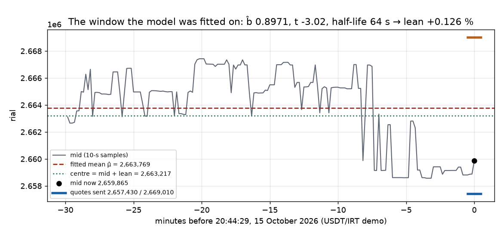
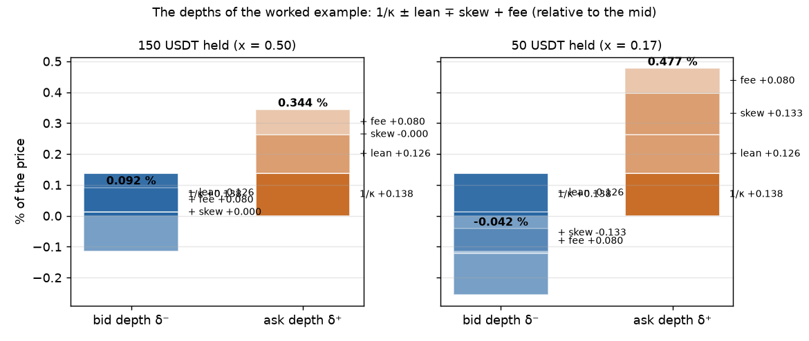
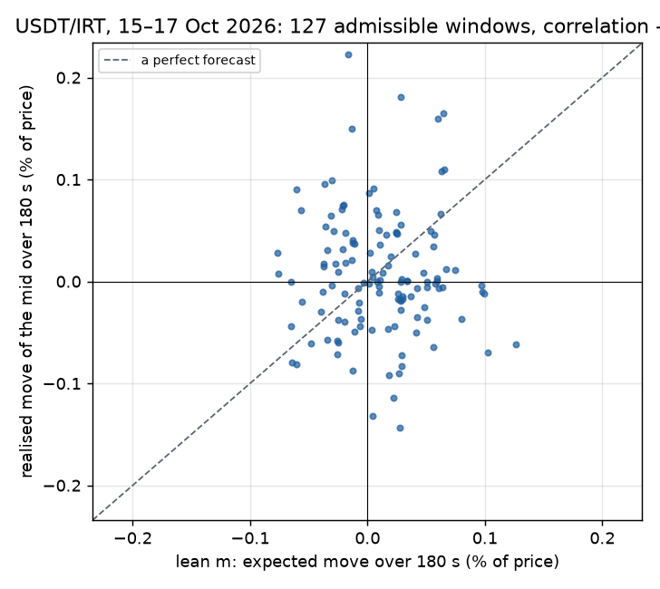

# MM_algo3 — market making with a mean-reverting signal (stochastic control)

**Branch:** `MM_algo3`. **Code:** `market_maker/strategy/algo4.py` (`Algo4Strategy`, catalog key `algo4`),
the shared arithmetic in `strategy/common.py`, the fill-intensity fit in `fill_model.py::FillTable.fit_intensity`.
**Tests:** `market_maker/tests/test_strategy_algo4.py` (36). **Numbers:** every figure in this document comes
from `docs/algorithms/data/mm_algo3_doc_numbers.json`, computed by `make_mm_algo3_doc_data.py` from the
recorded demo mids of 12–17 October 2026, the fill tables of 17 October and this branch's own code; the
figures from `figures/make_mm_algo3_figures.py`.

**Design note:** *"Algorithm 4 — Market Making with a Mean-Reverting Signal (Stochastic Control)"*,
10 October 2026 (`Server_project\Suggested Algorithm\Algorithm_4_MeanReverting_Control.pdf`). It is the fourth
algorithm designed for this project, hence the key `algo4`; it is shown everywhere as **MM_algo3**, the name
of this branch. Section 16 lists where this implementation departs from the note and why.

## Contents

1. [What MM_algo3 does](#1-what-mm_algo3-does)
2. [When it runs and what it receives](#2-when-it-runs-and-what-it-receives)
3. [Notation](#3-notation)
4. [The model](#4-the-model)
5. [The quotes](#5-the-quotes)
6. [Fee correction and the round-trip bar](#6-fee-correction-and-the-round-trip-bar)
7. [Estimation](#7-estimation)
8. [The procedure, round by round](#8-the-procedure-round-by-round)
9. [Worked example: a real USDT/IRT window](#9-worked-example-a-real-usdtirt-window)
10. [Behaviour on the recorded demo series](#10-behaviour-on-the-recorded-demo-series)
11. [Settings](#11-settings)
12. [What MM_algo3 hands back and records](#12-what-mm_algo3-hands-back-and-records)
13. [Choosing MM_algo3 and reading its results](#13-choosing-mm_algo3-and-reading-its-results)
14. [Properties and the tests that pin them](#14-properties-and-the-tests-that-pin-them)
15. [Limitations and failure modes](#15-limitations-and-failure-modes)
16. [Departures from the design note](#16-departures-from-the-design-note)
17. [References](#17-references)

---

## 1. What MM_algo3 does

MM_algo1v2 and MM_algo2 are heuristics: a fixed rule maps the book and the inventory to two prices. MM_algo3
derives its prices from a model of how the price, the fills and the inventory evolve, by maximising the
expected terminal wealth net of an inventory penalty (the Avellaneda–Stoikov / Cartea–Jaimungal family). Its
distinguishing input is a **mean-reverting forecast of the price**: it fits an Ornstein–Uhlenbeck model to the
last 30 minutes of mids and, when the fit is trustworthy, leans its quotes toward the estimated mean — price
below the mean: bid closer, ask farther; above: the reverse. Once per round it:

* appends the mid to its price window (one sample every 10 s, 30 minutes long) and fits
  $S_{k+1} = a + b\,S_k + \varepsilon$ by least squares: $\theta = -\ln b/\Delta t$, $\mu = a/(1-b)$,
  half-life $\ln 2/\theta$;
* uses the forecast only when it is **admissible**: $0 < b < 1$, the unit root rejected (t-statistic of
  $b - 1$ below $-2.86$) and the half-life between 60 s and 15 min; otherwise the lean is zero and the quotes
  are the plain Avellaneda–Stoikov ones;
* leans the quotes by the expected reversion over the order lifetime,
  $m = (\mu - S)(1 - e^{-\theta\tau})$, capped at 0.5 % of the price;
* sets the **depths** from the first-order solution of the control problem:
  $\delta^{\pm} = 1/\kappa \pm m \mp \text{skew} + \text{risk}$, where $1/\kappa$ is the fee-free optimal
  half-spread ($\kappa$ = how fast fills decay with depth, fitted on the fill table), the skew is the inventory
  skew of the other algorithms and the risk term widens both sides; then adds the fee on each side;
* sends $A = S(1 + \delta^+)$ and $B = S(1 - \delta^-)$ on the tick, never crossing the touch, widened
  symmetrically if the round trip would not clear the fee bar $R_{\text{net}} > r_{\min}$;
* keeps the resting pair inside the requote band (hysteresis) and pauses in a volatility burst.

Unlike the other two it is **stateful**: it keeps the window and reads its own clock, because the engine
passes neither history nor time.

## 2. When it runs and what it receives

The engine (`engine.py::SimpleMarketMaker`) calls `decide_order(ob, q)` once per round with the order book as
Nobitex returns it (`bids`, `asks` as `[price, volume]` strings, `lastTradePrice`) and the inventory $q$ in
base units (coins held, including coins locked in resting sells). It returns the two prices or `None`;
sizes, caps, cancellation and submission stay in the engine (`PROJECT_GUIDE.md` §7). On the demo it runs in
its own **lane** of the pair's worker (`algo4_enabled`), with its own paper account and result files, next to
the other algorithms' lanes; a live worker runs it when the pair's live configuration says `algorithm = algo4`.

## 3. Notation

| Symbol | Meaning | Setting |
|---|---|---|
| $S$, $b_0$, $a_0$, $\epsilon$ | mid, best bid, best ask, tick (10 rial) | |
| $\Delta t$, $W$ | spacing of the mid samples and length of the window | `algo4_sample_seconds` (10), `algo4_window_seconds` (1800) |
| $b$, $a$, $s_\varepsilon$ | AR(1) slope, intercept, residual sd of the window | |
| $\theta$, $\mu$, $\sigma$ | OU reversion speed (1/s), long-run mean, volatility | |
| $t_{1/2} = \ln 2/\theta$ | half-life of the reversion | `algo4_halflife_min_seconds` (60), `algo4_halflife_max_seconds` (900) |
| $\tau$ | horizon of the forecast and of the lean | `algo4_horizon_seconds` (0 = the order lifetime, `cancel_after_minutes` × 60) |
| $m$ | the lean: expected reversion over $\tau$, relative to $S$ | capped by `algo4_lean_clip` (0.005) |
| $\kappa$, $\lambda$ | fill-intensity decay per unit of relative depth, fills per second at zero depth | fitted on the fill table; fallback `algo4_kappa` (400) |
| $x$ | inventory position in the band $[q_{\min}, q_{\max}]$, in $[0,1]$ | `inv_min`, `inv_max` |
| skew | $\sigma_q (2x - 1)$: the inventory skew of the centre | `skew_perc` (0.002) |
| risk | the $(\ell + \phi\tau)$ widening, relative to $S$ | `algo4_risk_perc` (0) |
| $f$, $r_{\min}$, $G$ | fee per leg, required net return, $G = (1 + r_{\min})/(1-f)^2 - 1$ | `commission_perc`, `exp_ret_min` |
| $\delta^-$, $\delta^+$ | bid depth and ask depth, relative to $S$: $B = S(1-\delta^-)$, $A = S(1+\delta^+)$ | |

## 4. The model

**Price.** The mid reverts to a level $\mu$ at speed $\theta$:

```math
dS_t = \theta\,(\mu - S_t)\,dt + \sigma\,dW_t ,
```

so after a horizon $\tau$ the expected price is $\mu + (S_t - \mu)e^{-\theta\tau}$ and the expected move is
$(\mu - S_t)(1 - e^{-\theta\tau})$. This is the "OU-price form" of the design note; its "signal form"
$dS = \alpha\,dt + \sigma\,dW$, $d\alpha = -\zeta\alpha\,dt + \eta\,dB$ is the same model with
$\alpha_t = \theta(\mu - S_t)$.

**Fills.** The maker rests one unit at $S + \delta^+$ and one at $S - \delta^-$; each fills at a rate that
decays with its depth, $\lambda^{\pm} = \lambda\,e^{-\kappa\delta^{\pm}}$. A fill at the ask adds
$S + \delta^+$ to cash and one unit of inventory leaves; a fill at the bid the reverse.

**Objective.** Choose the depths to maximise

```math
\mathbb{E}\Big[\,X_T + q_T S_T - \ell\,q_T^2 - \phi\int_0^T q_u^2\,du\Big],
```

cash plus the marked inventory at the end, minus a terminal penalty $\ell$ on the position and a running
penalty $\phi$ on carrying it. $\ell$ and $\phi$ are risk choices, not market parameters.

## 5. The quotes

Dynamic programming turns the objective into the Hamilton–Jacobi–Bellman equation of the value function
$H(t, x, S, \alpha, q)$; the ansatz $H = x + qS + h(t, \alpha, q)$ removes cash and price, the first-order
conditions of the two suprema give

```math
\delta^{+*} = \frac{1}{\kappa} + h(q) - h(q-1), \qquad \delta^{-*} = \frac{1}{\kappa} + h(q) - h(q+1),
```

and a quadratic expansion of $h$ in $q$ (first order in $\alpha q$) gives the closed form of the design note,
equation (12):

```math
\delta^{+*} = \frac{1}{\kappa} + \alpha\,\frac{1 - e^{-\zeta\tau}}{\zeta} - 2(\ell + \phi\tau)\,q + (\ell + \phi\tau), \qquad
\delta^{-*} = \frac{1}{\kappa} - \alpha\,\frac{1 - e^{-\zeta\tau}}{\zeta} + 2(\ell + \phi\tau)\,q + (\ell + \phi\tau).
```

In the OU-price form the lean term is the expected reversion, $(\mu - S)(1 - e^{-\theta\tau})$. Four terms,
each with a meaning:

| Term | Role | Sign |
|---|---|---|
| $1/\kappa$ | the fee-free optimal half-spread: tighter when fills decay slowly with depth | same on both sides |
| $\pm\,m$ | the mean-reversion lean: the expected price move over the horizon | $m > 0$ (price below its mean): ask farther, bid closer |
| $\mp\,2(\ell + \phi\tau)\,q$ | the inventory skew | $q > 0$: ask closer, bid farther |
| $+(\ell + \phi\tau)$ | risk widening: both sides step back as the penalty grows | same on both sides |

**How the code writes it.** Everything is relative to the price and pair-independent: with
$x$ the inventory position in the band and the skew of the other algorithms,

```math
\delta^{+} = \tfrac{1}{\kappa} + m - \sigma_q(2x-1) + \rho, \qquad
\delta^{-} = \tfrac{1}{\kappa} - m + \sigma_q(2x-1) + \rho, \qquad
\rho = \texttt{algo4\_risk\_perc},
```

each floored at one tick, then the fee shift of section 6. The centre $(A_{\text{raw}} + B_{\text{raw}})/2 =
S\,(1 + m - \sigma_q(2x-1))$ is what the dashboard records as *Centre*; the quotes are symmetric around it
at $\pm(1/\kappa + \rho + f)$.

**Properties** (section 9 of the note; tests in section 14):

* with the forecast off ($m = 0$) the quotes are the Avellaneda–Stoikov / Cartea–Jaimungal ones; with $x = \tfrac12$ and
  $\rho = 0$ too, both depths equal $1/\kappa + f$;
* $\partial\delta^+/\partial m = -\partial\delta^-/\partial m = 1$, $\partial\delta^+/\partial x = -\partial\delta^-/\partial x = -2\sigma_q$;
* the width $\delta^+ + \delta^- = 2/\kappa + 2\rho + 2f$ depends on neither the lean nor the inventory — they
  move the centre, not the spread — until a depth hits its one-tick floor (a lean larger than $1/\kappa$) or the
  fee bar widens both sides;
* $|m| \le |\mu - S|$, and the clip bounds it further.

## 6. Fee correction and the round-trip bar

The model has no fee. With a proportional fee $f$, a fill at the ask yields $(1-f)(S + \delta^+) \approx
S + \delta^+ - fS$: replacing $\delta^{\pm}$ by $\delta^{\pm} - fS$ in the problem shifts each optimum by
exactly $fS$, so the code adds $f$ to each relative depth (note's (15)).

Independently of the model, the project's bar must hold on the prices actually sent:

```math
\frac{A}{B} > 1 + G, \qquad G = \frac{1 + r_{\min}}{(1-f)^2} - 1 \quad(\text{about } 2f + r_{\min}).
```

After the touch clip and the rounding, if $A/B \le 1 + G$ both prices are moved apart by the same amount
$w = \big((1+G)B - A\big)/(2+G)$ plus one tick and re-rounded (note's (16)): symmetric widening keeps the lean
and the skew and only raises the spread to the bar. The code then re-checks
$R_{\text{net}} = (1-f)^2 A/B - 1 > r_{\min}$ on the final prices; a pair that still fails, or crosses, is
not sent (`net_return_below_bar`). With the demo's $f = 0.08\,\%$ and $r_{\min} = 0.02\,\%$ the bar is
$G = 0.180\,\%$; a fitted $1/\kappa$ of 0.14 % plus the fee shift clears it without widening.

## 7. Estimation

### 7.1 The price parameters

The window holds $(t, S)$ samples taken at most every `algo4_sample_seconds` and no older than
`algo4_window_seconds`; the regression is refitted when a sample is added (`Algo4Strategy.observe`,
`estimate`; the function `ou_fit` is pure). The exact discretisation of the OU model is the AR(1) regression

```math
S_{k+1} = a + b\,S_k + \varepsilon_k, \qquad b = e^{-\theta\Delta t},\quad a = \mu(1-b),\quad
\mathrm{Var}\,\varepsilon = \frac{\sigma^2}{2\theta}(1 - b^2),
```

solved by ordinary least squares over consecutive samples ($\Delta t$ = the mean spacing of the window):

```math
\hat\theta = -\frac{\ln \hat b}{\Delta t}, \qquad \hat\mu = \frac{\hat a}{1 - \hat b}, \qquad
\hat\sigma^2 = s_\varepsilon^2\,\frac{2\hat\theta}{1 - \hat b^2}, \qquad \hat t_{1/2} = \frac{\ln 2}{\hat\theta},
\qquad t = \frac{\hat b - 1}{\text{se}(\hat b)}.
```

### 7.2 Admissibility

The forecast is used only when

* $0 < \hat b < 1$ (the fit reverts; $\hat b \ge 1$ is a unit root or a trend, $\hat b \le 0$ alternation);
* $t < -2.86$: the unit root is rejected at the 5 % level of the Dickey–Fuller test with a constant. The design
  note wrote $-2$; measured on 200 simulated random walks of 180 samples that rule admits **25.5 %** of them
  as mean-reverting, $-2.86$ admits **4.5 %** (`simulation` in the numbers file);
* $60\,\text{s} \le \hat t_{1/2} \le 900\,\text{s}$: shorter is noise at this sampling, longer is a trend the
  window cannot tell from a random walk.

Otherwise the lean is zero and the round is quoted as the Avellaneda–Stoikov pair (`selection reason`
`symmetric_pair`); the estimate is still reported. The rule's **power** on simulated Ornstein–Uhlenbeck paths
of 180 samples (residual sd 300 rial, 200 paths each): a true half-life of 60 s is admitted 17.5 % of the time,
120 s 14.5 %, 300 s 3.0 %; the fitted half-life of the admitted windows sits near 66–69 s whatever the truth,
and the median error of $\hat\mu$ is 136, 357 and 1,025 rial. A 30-minute window of 10-second samples can
confirm fast reversion and little else — the reason the series of section 10 are read the way they are.

### 7.3 The fill parameters

With $P(\text{fill within }\tau) = 1 - \exp(-\lambda e^{-\kappa d}\tau)$ at relative distance $d$, the fill
table of `FILL_MODEL`-style buckets gives the regression (note's (19))

```math
\ln\!\Big(-\tfrac{1}{\tau}\ln\big(1 - \hat P(d)\big)\Big) = \ln\lambda - \kappa\,d ,
```

fitted by least squares over every side and bucket with at least `fill_table_min_samples` observations and
$0 < \hat P < 1$ (`FillTable.fit_intensity`); $\kappa$ is minus the slope. The strategy reads the pair's table
through the project's `FillModel` whenever it is fresh, and falls back to `algo4_kappa` (400, i.e.
$1/\kappa$ = 0.25 % of the price) otherwise. On the tables of 17 October 2026 (horizon 600 s, 10 buckets):

| Pair | $\hat\kappa$ (per unit of relative depth) | $1/\hat\kappa$ | $\hat\lambda$ (fills/s at zero depth) | points |
|---|---:|---:|---:|---:|
| USDT/IRT | 727.1 | 0.1375 % | 4.2 × 10⁻⁴ | 14 |
| BTC/IRT | 626.5 | 0.1596 % | 4.2 × 10⁻⁴ | 16 |

(For example the USDT buckets read $\hat P$ = 0.207 at 0.10 %, 0.134 at 0.15 %, 0.114 at 0.20 %, 0.023 at
0.30 %.) Since 20 October the nightly tables are built with a 180-second horizon; $\kappa$, the decay with
distance, is what the fit uses and does not depend on the horizon.

### 7.4 The risk parameters

$\phi$ and $\ell$ are chosen, not estimated. The note suggests $\ell = 0$ with a rolling horizon equal to the
order lifetime, and $\phi$ such that the skew at the band edge is a chosen fraction of the half-spread. The code
takes the skew directly as `skew_perc` × (2x − 1) — the same inventory skew as MM_algo1v2 and MM_algo2, 0.2 %
at the band edges — and the widening $(\ell + \phi\tau)$ directly as `algo4_risk_perc` (0 by default). In the
note's units, $2(\ell + \phi\tau)\,q$ with $q$ counted in orders from the band centre equals
`skew_perc` × (2x − 1) × S when $(\ell + \phi\tau) = $ `skew_perc` × S / (band width in orders).

## 8. The procedure, round by round

1. **Validate the book:** $0 < b_0 \le a_0$, positive prices; else no quote (`invalid_or_single_level_order_book`).
   $S = (b_0 + a_0)/2$.
2. **Update the window** (in `decide_order` only; `diagnostics` never changes the memory): append $(t, S)$ when
   `algo4_sample_seconds` have passed since the last sample, drop samples older than `algo4_window_seconds`,
   refit.
3. **Estimate** $\hat b, \hat a, s_\varepsilon, \hat\theta, \hat\mu, \hat t_{1/2}, t$ (section 7.1). Fewer than
   30 samples: *warming up* — the round is quoted without the forecast (section 16).
4. **Volatility guard:** if `algo4_sigma_pause` > 0 and $s_\varepsilon / S$ exceeds it, no quote
   (`volatility_pause`; the resting orders are cancelled by the engine's usual rules).
5. **Lean:** admissible and `algo4_use_alpha` → $m = (\hat\mu - S)(1 - e^{-\hat\theta\tau})/S$ clipped to
   ±`algo4_lean_clip`; else $m = 0$.
6. **Depths** by the boxed formula of section 5, each floored at one tick, then $+ f$ each.
7. **Prices:** $A = S(1 + \delta^+)$, $B = S(1 - \delta^-)$; clip $B \le a_0 - \epsilon$, $A \ge b_0 + \epsilon$;
   round $B$ down and $A$ up to the tick.
8. **Fee bar** (section 6): widen symmetrically if needed; re-check; a failing or crossed pair is not sent.
9. **Hysteresis** (as MM_algo2): the previous pair is sent again while both prices are within the requote band
   of it (`hysteresis_ticks` = 5 ticks or `requote_band_perc` = 0.03 %, whichever is wider), it is younger than
   `refresh_seconds` (300) and it still clears the bar.
10. **Return** the quote (section 12).

Cost per round: $O(N)$ for the regression when a sample was added ($N \le 180$), $O(1)$ otherwise.

## 9. Worked example: a real USDT/IRT window

The USDT demo's recorded mids of 15 October 2026, the 30 minutes ending **20:44:29** (Tehran), with the demo's
settings since 22 October (fee 0.08 %, target 0.02 %, band 0–300 USDT, order size 5, `skew_perc` 0.002,
lifetime 3 min) and $\kappa$ as the strategy takes it from the USDT fill table, 727.1. Output of the code
(`make_mm_algo3_doc_data.py`, `example`):

| Step | Value |
|---|---|
| window | 180 mids, 10 s apart |
| fit | $\hat b$ = 0.8971, $t(\hat b - 1)$ = −3.02, $\hat\mu$ = 2,663,769, half-life 64 s → **admissible** |
| book | best bid 2,659,730, best ask 2,660,000, mid 2,659,865 (3,904 rial below $\hat\mu$) |
| lean | $m = 3{,}904 \times (1 - e^{-180\ln 2/64}) / S$ = **+0.1260 %** (not clipped) |
| $1/\kappa$ | 0.1375 % |

Two holdings:

| | 150 USDT ($x$ = 0.50, no skew) | 50 USDT ($x$ = 0.17) |
|---|---|---|
| skew $\sigma_q(2x-1)$ | 0 | −0.1333 % |
| depths bid / ask (with the fee 0.08 %) | 0.0915 % / 0.3435 % | 0.0804 % / 0.4769 % |
| centre | 2,663,217 | 2,665,138 |
| raw bid / ask | 2,657,431 / 2,669,002 | 2,657,727 / 2,672,549 |
| **sent** | **2,657,430 / 2,669,010** | **2,657,720 / 2,672,550** |
| net return of the pair | 0.275 % | 0.397 % |
| without the forecast | 2,654,070 / 2,665,660 | 2,657,620 / 2,669,200 |





The lean pulls both quotes up by 0.126 % of the price: the bid sits 0.09 % below the mid instead of 0.22 %, the
ask 0.34 % above instead of 0.22 %. The algorithm was leaning to buy, and in the next 180 seconds the mid
fell by 1,645 rial — this forecast was wrong, which is what section 10 finds on average.

## 10. Behaviour on the recorded demo series

The estimator, run on a 30-minute window every 60 s (USDT) or 5 min (BTC) over the recorded demo mids, with
the lean's horizon $\tau$ = 180 s compared with the mid's actual move over the next 180 s:

| | USDT/IRT (10-s rounds) | BTC/IRT (60-s rounds) |
|---|---:|---:|
| series | 15 Oct 17:07 – 17 Oct 21:01, 10,000 rounds | 12 Oct 00:00 – 17 Oct 22:40, 8,344 rounds |
| windows fitted / admissible | 1,627 / **127 (7.8 %)** | 1,638 / **102 (6.1 %)** |
| why the rest were not | half-life < 60 s: 732; unit root not rejected: 768 | unit root not rejected: 1,349; half-life < 60 s: 164; alternating: 23 |
| median $\hat b$, median $t$ | 0.908, −2.99 | 0.814, −1.85 |
| median half-life of admissible windows | 69 s | 72 s |
| median residual $s_\varepsilon / S$ | 0.023 % | 0.049 % |
| median \|lean\| over admissible windows | 0.028 % of the price | 0.021 % |
| median \|realised move\| over 180 s | 0.037 % | 0.044 % |
| **correlation of the lean with the realised move** | **−0.030** | **−0.002** |
| sign agreement | 48.0 % | 49.0 % |



Reading it:

* The forecast is admissible in about 7 % of the windows, and those are fits with half-lives of about a minute —
  at 10-second sampling that is mostly the mid bouncing between the bid and the ask, not a price that reverts
  to a level.
* Where the forecast is used, it has **no measured skill**: the lean and the next move are uncorrelated and the
  sign is a coin flip. Its size is also small, a few hundredths of a percent, against a $1/\kappa$ of 0.14 %.
* The design note's own rule for this case (its section 11): run the algorithm with the forecast off — the
  Avellaneda–Stoikov quotes — and revisit the signal with an imbalance-based alpha. The forecast stays on by
  default so the demo lane exercises the whole algorithm and its estimates are visible on the dashboard; the
  switch is `algo4_use_alpha`, and the demo comparison with the other lanes (same market, same time) is the
  test that decides it.

## 11. Settings

All per pair, hot (applied at the lane's next round) on the Demo config pages and saved for live on the Live
Config pages.

| Setting | Default | Meaning |
|---|---:|---|
| `algo4_enabled` | on | Demo only: run MM_algo3 on this pair in its own lane |
| `algo4_use_alpha` | on | use the forecast; off = the Avellaneda–Stoikov quotes alone |
| `algo4_window_seconds` | 1800 | length of the mid window the model is fitted on |
| `algo4_sample_seconds` | 10 | spacing of the samples; at most one per round |
| `algo4_horizon_seconds` | 0 | horizon $\tau$ of the lean; 0 = the order lifetime (`cancel_after_minutes` × 60 = 180 s) |
| `algo4_halflife_min_seconds`, `algo4_halflife_max_seconds` | 60, 900 | admissible half-lives |
| `algo4_kappa` | 400 | $\kappa$ when the fill table cannot be fitted ($1/\kappa$ = 0.25 %) |
| `algo4_risk_perc` | 0 | the $(\ell + \phi\tau)$ widening of both depths, relative to the price |
| `algo4_lean_clip` | 0.005 | largest lean, relative to the price |
| `algo4_sigma_pause` | 0 (off) | no quote while $s_\varepsilon/S$ exceeds it |
| `skew_perc` | 0.002 | inventory skew at the band edges (shared) |
| `commission_perc`, `exp_ret_min` | 0.0025, 0.0002 (demo overlay 0.0008, 0.0002) | the fee shift and the bar |
| `hysteresis_ticks`, `requote_band_perc`, `refresh_seconds` | 5, 0.0003, 300 | the requote band and the pair's age (shared) |
| `fill_table_enabled`, `fill_table_max_age_hours`, `fill_table_min_samples` | on, 48, 50 | when the table may be fitted for $\kappa$ (shared with MM_algo1v2) |
| `cancel_after_minutes`, `trend_window_seconds`, `trend_pause_perc`, `inv_min`, `inv_max`, `order_size` | engine rules and the band (shared) | |

The unit-root threshold (−2.86) and the warm-up length (30 samples) are constants of `strategy/algo4.py`.

## 12. What MM_algo3 hands back and records

**The quote** (`decide_order`): the keys every algorithm returns — `bid`, `ask`, `bid level`, `ask level`,
`mid price`, `centre`, `inventory position`, `relative quoted spread`, `gross return`, `net return`,
`buy fee`, `sell fee`, `min required return`, `bid distance`, `ask distance`, `quote mode` (`pair`),
`selection reason` (`mean_reversion_pair`, `symmetric_pair`, with `_kept` when the hysteresis kept the pair),
`bid kept`, `ask kept`; `imbalance`, `microprice`, `bid exec prob`, `ask exec prob`, `expected value`,
`reference price` are `None` — and its own: `lean`, `mu hat`, `theta hat`, `half life`,
`forecast admissible`, `kappa`, `bid depth`, `ask depth`.

**The round row** (CSV / SQLite, dashboard): `Strategy` = `algo4`; `Centre` = the leaned and skewed centre;
`Bid Distance`, `Ask Distance` from it; `Imbalance`, `Microprice`, `Bid Fill Prob`, `Ask Fill Prob`,
`Expected Value` empty.

**The diagnostics document** (`<pair>_track_demo_algo4_diagnostics.jsonl` per round): `algorithm` = `algo4`,
`algorithm_version` 4, the book (`mid_price`, `spread`, `levels`), `window` (points, seconds, spacing, up to 61
samples for the chart), `estimate` (`ok`, `reason`, `b`, `a`, `sigma_eps`, `t_stat`, `theta`, `mu`,
`sigma`, `half_life`, the bounds), `mu_shift`, `horizon_seconds`, `forecast_used`, `lean_raw`, `lean`,
`lean_clip`, `lean_clipped`, `sigma_rel`, `sigma_pause`, `skew`, `risk_perc`, `kappa`, `kappa_source`
(`table` / `config`), `fill_lambda`, `base_depth`, `depth_bid`, `depth_ask`, `centre`, `centre_shift`,
`widening`, the raw and final prices, `net_return`, `candidate_results` (the one pair, with the keys the
engine, Telegram and the admin panel read), `quote_mode`, `selection_reason`, `hysteresis`.

**No-quote reasons:** `invalid_or_single_level_order_book`, `volatility_pause`, `invalid_kappa`,
`half_spread_not_attainable` (fee ≥ 100 %), `net_return_below_bar`.

## 13. Choosing MM_algo3 and reading its results

* **Admin → Algorithm:** choose "MM_algo3 — mean-reverting signal and optimal quotes"; the Demo table shows
  the lane per pair (Running / Starting / Off) with its session as `MM_algo3 · <session id>`; *Activate* /
  *Switch off* flip `algo4_enabled` without touching the other lanes. The Live table saves `algorithm = algo4`
  for the next start of a live worker; nothing is started there.
* **Config BTC / USDT, Live Config:** the `algo4_*` settings of section 11.
* **Dashboard → Algorithm → MM_algo3:** its description, the settings in force, the headline numbers and two
  charts of its own: where the centre sat relative to the mid (the lean plus the skew), and the quoted spread
  with the net return of the pair. The Track list then offers *BTC — Demo MM_algo3* and *USDT — Demo MM_algo3*
  (and *Demo, all algorithms (compare)* under *All algorithms*).
* **Quote decision tab:** an MM_algo3 round shows the mid window with $\hat\mu$, the price ladder (touch, mid,
  centre, quote) and the step-by-step trace (fit, admissibility, lean, skew, depths, bar).
* **Command line:** `python run.py --profile usdt --mode demo --algorithm algo4` runs it alone in the
  single-worker files.

## 14. Properties and the tests that pin them

| Property | Test (`tests/test_strategy_algo4.py`) |
|---|---|
| the OLS fit recovers $\mu$, the half-life and $\sigma$ of a simulated path; $\sigma$ and $s_\varepsilon$ agree | `test_ou_fit_recovers_the_parameters_of_a_simulated_path` |
| random walks are rarely admitted (and less often at −2.86 than at −2) | `test_a_random_walk_is_rarely_admissible` |
| warm-up and flat windows are reported, not fitted | `test_warm_up_and_degenerate_windows` |
| half-lives outside the bounds are rejected | `test_half_life_bounds_reject_too_fast_and_too_slow_reversion` |
| the warm-up quotes the Avellaneda–Stoikov pair | `test_warm_up_quotes_the_avellaneda_stoikov_pair` |
| with no forecast and $x = \tfrac12$ both depths are $1/\kappa + f$ | `test_reduces_to_symmetric_quotes_at_depth_one_over_kappa_plus_the_fee` |
| more inventory moves both quotes down and keeps the width; the skew at the edges is `skew_perc` | `test_more_inventory_moves_both_quotes_down_and_keeps_the_width` |
| an admissible fit leans both quotes toward the mean, keeps the width, and the lean is $(\hat\mu - S)(1 - e^{-\hat\theta\tau})$; beyond $1/\kappa$ the near depth floors at one tick | `test_the_forecast_leans_the_quotes_toward_the_mean_when_admissible` |
| the lean is clipped | `test_the_lean_is_clipped` |
| `algo4_use_alpha` off removes the lean | `test_the_forecast_can_be_switched_off` |
| the volatility guard stops quoting | `test_the_volatility_guard_stops_quoting` |
| every quote clears the bar, never crosses, sits on the tick (random books × fees × $\kappa$) | `test_every_quote_clears_the_fee_bar_never_crosses_and_sits_on_the_tick` |
| a $\kappa$ too large for the bar is widened symmetrically | `test_a_kappa_too_large_for_the_bar_is_widened_symmetrically` |
| $\kappa$ and $\lambda$ come back from a fill table built from them | `test_kappa_comes_from_the_fill_table_when_it_can_be_fitted` |
| hysteresis keeps a pair inside the requote band | `test_a_pair_that_barely_moved_is_kept_until_it_is_refreshed` |
| diagnostics change nothing | `test_diagnostics_describe_the_decision_without_touching_the_memory` |
| unusable books, the catalog key, the quote keys | the remaining tests |

The engine rules (one order per side, 3-minute life, trend pause, lanes) are pinned by
`tests/test_requote_lanes.py`; the catalog, the dashboard and the admin page by `test_strategy_catalog.py`,
`test_dashboard_algorithms.py`, `test_admin_html_views.py`.

## 15. Limitations and failure modes

| Limitation | Consequence |
|---|---|
| The forecast has no measured skill on the recorded data (section 10) | The lean adds a small random shift to the centre in about 7 % of the rounds; `algo4_use_alpha = false` removes it. The demo comparison decides. |
| A 30-minute window of 10-second samples detects only fast reversion (section 7.2) | Half-lives of minutes are rejected as unit roots; a longer window or coarser samples (`algo4_window_seconds`, `algo4_sample_seconds`) trade this against regime lag. |
| Regime change: $\mu$ moves, the regression lags | The half-life bounds, the clip and the refit every sample limit the damage; the inventory skew and the engine's caps bound the position. |
| $\kappa$ from the fill table rests on the demo's touch-only fills | Real fills (a real account or the exchange's trades) would give a different $\kappa$; the table is rebuilt nightly and the fallback is `algo4_kappa`. |
| The first-order quotes drop the $\lambda\kappa h_2^2$ term of the HJB expansion | The depths are approximate; the exact $h$ can be computed on a grid and substituted without changing the procedure. |
| The demo fills by price touch only | Fill counts are a lower bound; adverse selection an upper bound (as for the other algorithms). |
| The volatility guard is off by default | A burst is met by the inventory skew and the engine's rules; set `algo4_sigma_pause` to pause instead. |

## 16. Departures from the design note

| Note | Here | Why |
|---|---|---|
| warm-up returns no quote until the window is full | the warm-up quotes without the forecast | a restarted worker would otherwise sit out 30 minutes; the Avellaneda–Stoikov pair needs no forecast |
| unit root rejected at $t < -2$ | $t < -2.86$ (Dickey–Fuller, 5 %, with a constant) | −2 admits a quarter of random walks (section 7.2) |
| $\phi$, $\ell$, $\kappa$ in price units per pair | relative to the price: `skew_perc`, `algo4_risk_perc`, $\kappa$ per unit of relative depth | one setting serves both pairs; the skew is the one the other algorithms use |
| $\kappa$ from a fill history or a book-shape prior | $\kappa$ fitted on the nightly fill table through `FillModel`, `algo4_kappa` as the fallback | the table is the project's measured fill evidence |
| re-estimate every $K$ rounds | refit whenever a sample is added | $O(180)$ per round is negligible |
| horizon $T$ = end of day or rolling | rolling, $\tau$ = the order lifetime (`algo4_horizon_seconds` = 0) | the note's simpler choice for a continuous bot |
| `algo2` served by the same class with the alpha off | the `algo2` stub stays; `algo4_use_alpha = false` is the Avellaneda–Stoikov reduction | history and settings keep their keys |
| key `algo4`, name "Algorithm 4" | key `algo4`, shown as **MM_algo3** | the project names algorithms after their branches |

## 17. References

* Avellaneda, M. & Stoikov, S. (2008). High-frequency trading in a limit order book. *Quantitative Finance* 8(3).
* Cartea, Á., Jaimungal, S. & Penalva, J. (2015). *Algorithmic and High-Frequency Trading*, chapter 10 (§10.4: market making with short-term alpha).
* Guéant, O., Lehalle, C.-A. & Fernandez-Tapia, J. (2013). Dealing with the inventory risk. *Mathematics and Financial Economics* 7(4).
* Chan, E. (2013). *Algorithmic Trading*, chapters 2–3 (OU estimation, half-life, stationarity tests).
* Dickey, D. A. & Fuller, W. A. (1979). Distribution of the estimators for autoregressive time series with a unit root. *JASA* 74.
