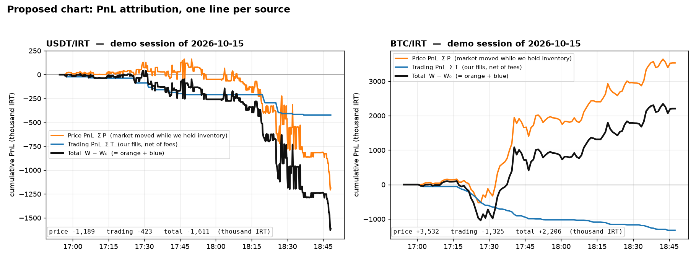

# PnL attribution: did the result come from our quotes or from the price?

A market maker's wealth changes for two reasons that look identical in a
single PnL number: its own fills (buying a little below the market, selling a
little above it, paying fees) and the market moving while it holds inventory.
This note derives the exact split used by the dashboard's **PnL attribution**
tab (`market_maker/dashboard.py`, helpers `pnl_attribution` and
`attribution_totals`) and shows a worked round. The same split applies to the
demo tracks and the live tracks of both pairs.

## 1. What is recorded every round

For one pair and one session, after round $t$ the engine writes:

| Symbol | Meaning | Column |
|---|---|---|
| $m_t$ | mid price, IRT per unit of the asset | `Mid Price`, else $\tfrac12(\text{Best Bid} + \text{Best Ask})$ |
| $q_t$ | inventory held after the round (USDT or BTC) | `inv_current` |
| $c_t$ | cash held after the round (IRT) | `cash_current` |
| $f_t$ | fees paid during the round (IRT) | `Round Fee` (demo rows); already inside $c_t$ for live rows |

## 2. Wealth

$$
W_t = c_t + q_t\, m_t
$$

The quantity to explain is the change of wealth over a session, $W_T - W_0$.

## 3. Bookkeeping of one round

Suppose in round $t$ we bought $b_t$ units at price $p^{\,b}_t$ and sold $s_t$
units at price $p^{\,s}_t$. Cash and inventory move only through those fills
and the fee:

$$
c_t = c_{t-1} - b_t\,p^{\,b}_t + s_t\,p^{\,s}_t - f_t ,
\qquad
q_t = q_{t-1} + b_t - s_t .
$$

## 4. The split

Write $W_t - W_{t-1}$ with the two lines above and regroup:

$$
W_t - W_{t-1}
= \underbrace{q_{t-1}\,(m_t - m_{t-1})}_{P_t\ \text{price PnL}}
\;+\;
\underbrace{b_t\,(m_t - p^{\,b}_t) + s_t\,(p^{\,s}_t - m_t) - f_t}_{T_t\ \text{trading PnL}} .
$$

* **Price PnL $P_t$**: the inventory we were already holding, times how much
  the mid moved. We did nothing in this term; a passive holder of the same
  inventory would have earned exactly this.
* **Trading PnL $T_t$**: how far below the mid we bought, how far above the
  mid we sold, minus the fee. It is what our quotes earned *if the price had
  not moved at all*, equivalently the result of a market maker that hedged
  every fill at the mid immediately.

The identity is exact. There is no third term and nothing left over.

## 5. The same split from the ledger alone

Substituting the bookkeeping lines of section 3 into $T_t$ removes the fill
prices and amounts:

$$
T_t = (c_t - c_{t-1}) + (q_t - q_{t-1})\, m_t ,
\qquad
P_t = q_{t-1}\,(m_t - m_{t-1}) .
$$

So each round needs only $c_t$, $q_t$ and $m_t$, which every demo and live
row already carries. No engine change is needed, and the split can be
computed for any session ever recorded.

Fees are inside $T_t$. Demo rows record $f_t$ separately, so the gross edge
$T_t + f_t$ can be shown next to the net number; live rows do not, so the
live tab shows trading PnL net of fees only.

## 6. Over a session

$$
W_T - W_0 = \sum_{t=1}^{T} P_t + \sum_{t=1}^{T} T_t .
$$

The first round of a session is the baseline ($P_1 = T_1 = 0$). In the
dashboard's "All sessions (compare)" view the sums restart at every session
and the tiles add the per-session sums.

**Verdict rule.** Compare the two sums: if $\lvert\sum T_t\rvert \ge
\lvert\sum P_t\rvert$ the result is mainly our own trading, otherwise it is
mainly the price moving while we held inventory.

## 7. A worked example (pinned by `tests/test_dashboard_v2.py`)

Start with $q_0 = 10$ units and $c_0 = 1{,}000$ at mid $m_0 = 100$, so
$W_0 = 2{,}000$.

| Round | Event | $m_t$ | $q_t$ | $c_t$ | $W_t$ | $P_t$ | $T_t$ | $W_t - W_{t-1}$ |
|---|---|---|---|---|---|---|---|---|
| 1 | baseline | 100 | 10 | 1,000.0 | 2,000.0 | 0 | 0 | 0 |
| 2 | bought 2 at 98; mid slips to 99 | 99 | 12 | 804.0 | 1,992.0 | $10\cdot(99-100) = -10$ | $-196 + 2\cdot 99 = +2$ | $-8$ |
| 3 | sold 1 at 102, fee 0.5; mid back to 100 | 100 | 11 | 905.5 | 2,005.5 | $12\cdot(100-99) = +12$ | $+101.5 - 1\cdot 100 = +1.5$ | $+13.5$ |

Round 2: we bought 1 below the mid on 2 units ($+2$), but the market took
$10$ off the inventory we were carrying. Round 3: we sold 2 above the mid on
1 unit minus the 0.5 fee ($+1.5$), and the market gave $12$ back. Session:
$\sum P_t = +2$, $\sum T_t = +3.5$, $W_3 - W_0 = +5.5$; verdict "mainly
trading".

A realistic round in IRT: mid $2{,}662{,}000$, we buy 10 USDT at
$2{,}660{,}000$ with a 0.25 % fee. Edge $10 \times 2{,}000 = +20{,}000$, fee
$0.0025 \times 26{,}600{,}000 = 66{,}500$, so $T_t = -46{,}500$: the edge was
smaller than the fee. If the mid then falls by $5{,}000$ while we hold the 10
USDT, $P_{t+1} = -50{,}000$.

## 8. What the tab shows

Four tiles (Total PnL, Trading PnL net of fees with the gross edge and fees,
Price PnL, Verdict) and one chart: time on the x axis and three running sums,
**orange** $\sum_{s\le t} P_s$, **blue** $\sum_{s\le t} T_s$ and **black**
$W_t - W_0$, which is always orange plus blue. Where the black line hugs the
orange one the market made the result; where it hugs the blue one, we did.
Deep link: `?tab=attribution&track=<track>&session=<session>`.

The demo session of 2026-10-15 (both pairs started with 1,000,000,000 IRT):

| | USDT/IRT | BTC/IRT |
|---|---|---|
| $\sum P_t$ price | −1,188,567 | +3,531,539 |
| $\sum T_t$ trading, net of fees | −422,761 | −1,325,475 |
| of which fees $\sum f_t$ | −338,076 | −442,346 |
| $W_T - W_0$ total | **−1,611,328** | **+2,206,064** |

Both pairs: the result was mainly price movement on the inventory we had
accumulated; the quoting itself lost after fees.

## 9. Caveats

* Fills are marked at the mid of the round in which they were processed, not
  at the instant of the fill, so a few seconds of price drift inside a round
  leaks into $T_t$. Logging the mid at fill time would remove it.
* The mid is the book midpoint, while the engine values wealth at its own
  valuation price for the `Portfolio Wealth` column; the two can differ by a
  fraction of a spread, which shifts a little between $P_t$ and $T_t$ but not
  their sum.
* A round whose row lacks a mid, inventory or cash value carries the previous
  round's values forward; rows before the first complete one are skipped.
