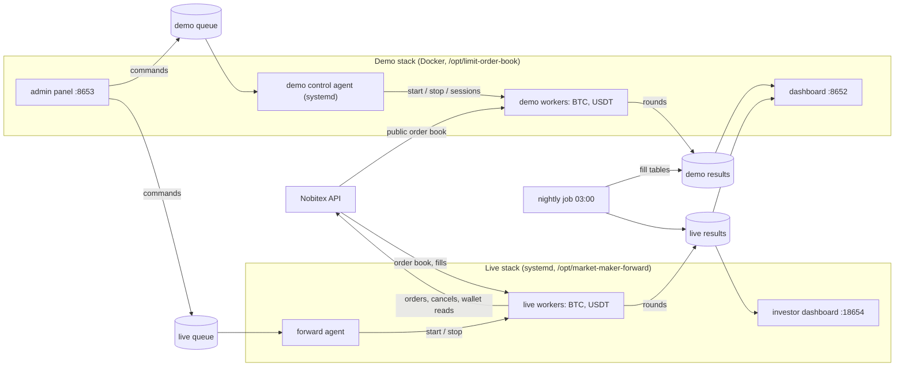
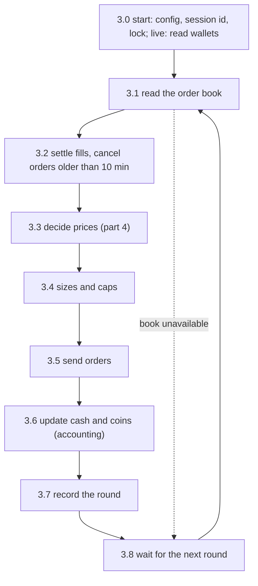
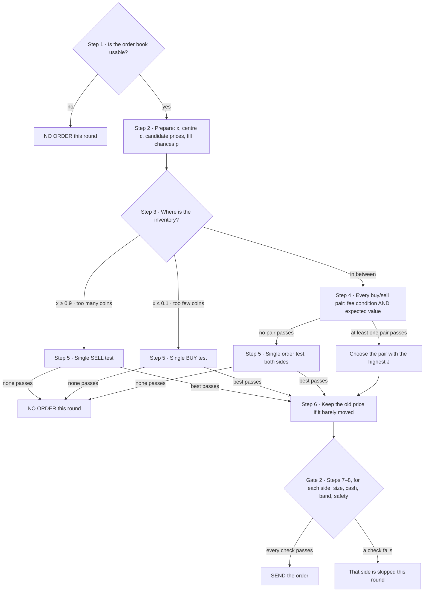
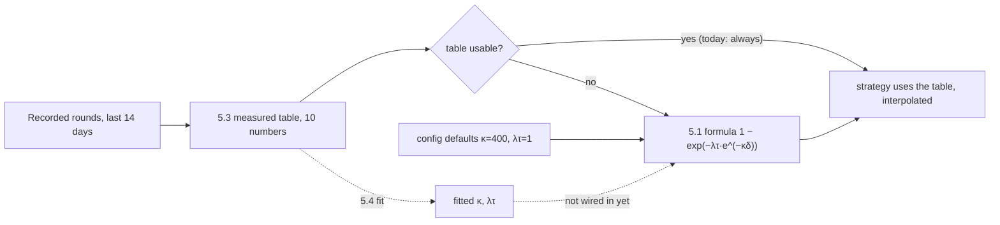
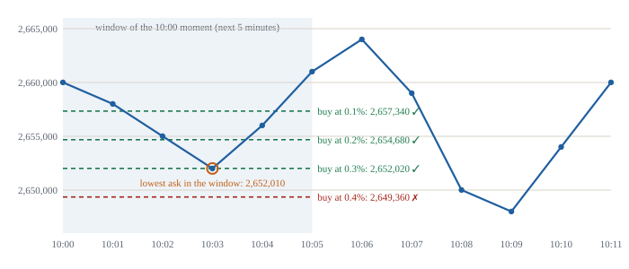
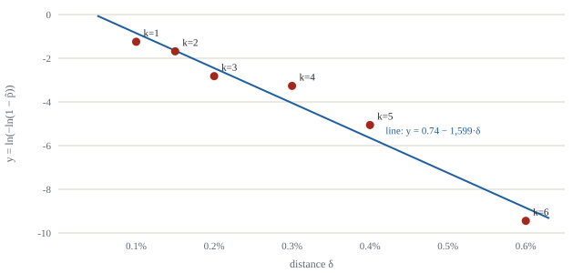

# The market maker, explained from the ground up

How the Nobitex market-making bot works, end to end: what it trades and why, one round of a worker step by step, the decision rule (Algorithm 1, version 2), how fill chances are estimated, how results are measured, and how the system is run. Every formula is taken from the code and every worked example was produced by running the bot's own code or read from its real data on the server (code at commit 0ce09b3, data as of 16 October 2026).

> This guide is also available as a standalone page, [MARKET_MAKER_EXPLAINED.html](MARKET_MAKER_EXPLAINED.html) (open it in a browser; it uses MathJax and mermaid from public CDNs), with coloured tables and typeset pseudocode.

1. [The idea: what a market maker does](#1-the-idea-what-a-market-maker-does)
2. [The system: processes, modes, files](#2-the-system-processes-modes-files)
3. [One round of a worker, step by step](#3-one-round-of-a-worker-step-by-step)
4. [The decision: Algorithm 1, version 2](#4-the-decision-algorithm-1-version-2)
5. [The fill probability: formula and estimation](#5-the-fill-probability-formula-and-estimation)
6. [Measuring results: dashboard, PnL attribution, validation gate](#6-measuring-results-dashboard-pnl-attribution-validation-gate)
7. [Running the system: sessions, configuration, admin, deployment](#7-running-the-system-sessions-configuration-admin-deployment)
8. [The live forward test today](#8-the-live-forward-test-today)
9. [Known limitations](#9-known-limitations)
10. [Glossary of symbols and settings](#10-glossary-of-symbols-and-settings)
11. [The whole bot as pseudocode](#11-the-whole-bot-as-pseudocode)

**Where does the bot decide whether to place an order?** In [**4.0, "The order decision, step by step"**](#40-the-order-decision-step-by-step): every condition in the order the code checks it (gate 1: is a price worth quoting; gate 2: is the order sent), what happens after each check, and three real cases showing where each one stopped.

**The whole bot as pseudocode:** [**part 11**](#11-the-whole-bot-as-pseudocode), three listings: one round of a worker, how the prices are chosen, and how the fill probability is measured.

## 1. The idea: what a market maker does

An exchange keeps two lists: people who want to **buy** and the price they offer (bids), and people who want to **sell** and the price they ask (asks). A market maker places its own orders in both lists: a buy a little *below* the market price and a sell a little *above* it, and waits for other traders to trade against them. When both fill, it has bought low and sold high. The difference, minus the exchange fee on each trade, is its profit. It does not try to predict where the price goes; it earns a small margin for always offering a price to others.

This bot does that on the Nobitex exchange for two pairs, **BTC/IRT** (bitcoin against Iranian rial) and **USDT/IRT** (tether against rial).

### 1.1 The order book

The order book is the two lists, sorted best price first. Level 0 is the best price on each side, level 1 the next, and so on. A real-shaped USDT/IRT example (prices in rial per USDT, volumes in USDT), used throughout this page:

| Level | Bid price $`b_i`$ | Bid volume | Ask price $`a_i`$ | Ask volume |
| ---: | ---: | ---: | ---: | ---: |
| 0 | 2,659,990 | 20,000 | 2,660,010 | 5,000 |
| 1 | 2,659,900 | 300 | 2,660,100 | 400 |
| 2 | 2,658,000 | 1,500 | 2,662,000 | 2,000 |
| 3 | 2,655,000 | 8,000 | 2,665,000 | 6,000 |
| 4 | 2,650,000 | 40,000 | 2,670,000 | 30,000 |
| 5 | 2,640,000 | 10,000 | 2,680,000 | 12,000 |
| 6–10 | 2,630,000 … 2,590,000 | 5,000 each | 2,690,000 … 2,730,000 | 5,000 each |

- **Best bid** $`b_0`$ and **best ask** $`a_0`$: the top of each list (2,659,990 and 2,660,010).
- **Mid price** $`m = (b_0 + a_0)/2`$ = 2,660,000: "the market price".
- **Spread** $`a_0 - b_0`$ = 20 rial; relative spread $`(a_0 - b_0)/m`$ = 0.00075 %.
- **Tick** $`\epsilon`$: the smallest price step allowed, 10 rial on rial pairs.
- **Distance** of a price $`P`$ from a reference $`c`$: $`\delta = |P - c|/c`$, a fraction of the price (0.002 = 0.2 %).

### 1.2 Orders, fills and the fee

The bot uses **limit orders**: "buy up to 5 USDT at 2,650,010 or better". The order rests in the book until someone trades against it (a **fill**; a **partial fill** if only part of it trades), or until the bot cancels it. Each bot order lives at most $`\tau`$ = `cancel_after_minutes` = 10 minutes.

The fee $`f`$ (`commission_perc`) is taken from what you *receive*: on a buy you receive $`(1-f)`$ of the coins you paid for; on a sell you receive $`(1-f)`$ of the rials. A **round trip** is a buy followed by a sell of the same coins.

**Proposition 1 (return of a round trip).** Buying at price $`B`$ and later selling the coins received at price $`A`$ returns, per rial spent,

```math
R(B, A) = (1-f)^2\,\frac{A}{B} - 1 .
```

*Proof.* Spend $`B`$ rial on one nominal coin at price $`B`$. The fee leaves $`1-f`$ coins. Selling them at $`A`$ gives $`(1-f)A`$ rial before the fee and $`(1-f)\cdot(1-f)A`$ after it. The return on the $`B`$ rial spent is $`\big((1-f)^2 A - B\big)/B`$. ∎

**Example.**

Run through the bot's own paper ledger (`PaperLedger`) with 100,000,000 rial of cash, no coins, and $`f = 0.25\%`$:

| Step | Cash (rial) | Coins (USDT) | What happened |
| --- | ---: | ---: | --- |
| start | 100,000,000.00 | 0 |   |
| buy 5 at 2,650,010 fills | 86,749,950.00 | 4.9875 | paid $`5 \times 2{,}650{,}010 = 13{,}250{,}050`$; the fee $`0.0025 \times 5 = 0.0125`$ USDT (33,125 rial) came out of the coins |
| sell 4.9875 at 2,669,990 fills | 100,033,233.69 | 0 | received $`4.9875 \times 2{,}669{,}990 = 13{,}316{,}575.13`$, minus the fee 33,291.44 rial |

Profit 33,233.69 rial on 13,250,050 spent, which is $`0.25082\%`$. Proposition 1 gives $`0.99500625 \times 2{,}669{,}990/2{,}650{,}010 - 1 = 0.25082\%`$: the same number to 16 decimal places.

### 1.3 Inventory, cash and wealth

At any moment the bot holds $`q`$ coins (its **inventory**) and $`c`$ rial of **cash**. Its **wealth** is the cash plus the coins valued at a market price $`v`$:

```math
W = c + q\,v
```

Each pair has an inventory band $`[q_{\min}, q_{\max}]`$ (`inv_min`, `inv_max`): the least and the most coins the bot is willing to hold. It tries to stay near the middle.

### 1.4 Where profit and loss come from

- **Completed round trips.** If both the buy and the sell fill, the profit is $`R(B,A)`$ times the amount, fixed by the two prices. The bot only quotes pairs where this is above a required return (part 4).
- **One leg only.** If only the buy fills, the bot holds coins whose value moves with the market until it sells them. That is gain or loss from the price, not from the bot's quoting. Part 6 splits every result into these two pieces exactly.
- **Adverse selection.** Orders tend to get filled exactly when the price is about to move through them: a buy fills because sellers are pushing the price down. This makes one-leg fills worse than random on average.

So every round the bot must choose prices that (a) earn more than the fees if both sides fill, (b) are likely enough to fill, and (c) keep the inventory near the middle of its band. Part 4 shows how Algorithm 1 v2 does all three.

### 1.5 Two modes

- **Demo** (paper trading): reads the real Nobitex order book every round, but orders go into a simulated ledger with simulated money. A simulated order fills when the real market price touches it.
- **Live** (the forward test): the same code sends real orders with real money to Nobitex.

Both modes run the same strategy and the same engine; only the "exchange" underneath differs.

## 2. The system: processes, modes, files

The project runs as a handful of separate processes on one server (37.32.31.162). Each does one job and they talk only through files: the workers trade and write results, the dashboard reads the results, the admin panel writes commands that two small "agents" carry out.



### 2.1 The processes

| Process | What it runs | How and as whom | Address |
| --- | --- | --- | --- |
| demo workers `lob-btc-demo`, `lob-usdt-demo` | `run.py --profile btc\|usdt --mode demo --continuous` | Docker containers, user 1000, read-only file system, 256 MB each | — |
| `lob-session-init` | creates or reuses the shared demo session id at start | Docker, runs once | — |
| dashboard `lob-dashboard` | `dashboard.py` (part 6) | Docker, results mounted read-only, 384 MB | `http(s)://37.32.31.162/` → port 8652 |
| admin panel `lob-admin` | `admin_app.py` (part 7.4) | Docker, 384 MB; may write only the two command queues and the live config | `/admin/` → port 8653 |
| demo control agent | `deploy/control_agent.py` | systemd unit `lob-control-agent`, as root (it runs `docker compose`) | — |
| forward agent | `deploy/forward_control_agent.py` | systemd unit `market-maker-forward-agent`, user `marketmaker-forward`, holds the Nobitex keys; `KillMode=process` so a restart leaves live workers running | — |
| live workers | `run.py --profile btc\|usdt --algorithm algo1\|algo3 --exchange nobitex --mode real --continuous` | started by the forward agent as its child processes, with the algorithm saved on the pair's Live Config page | — |
| investor dashboard | live tracks only | systemd unit `market-maker-forward-investor-dashboard` | `/forward/` → port 18654, with a password |

The forward stack also has its own admin (port 18653) and dashboard (port 18652) units, used only internally; nginx sends `/admin/` to the Docker admin, which drives both stacks. The repository's sample unit for the demo agent (user `ubuntu`, `/home/ubuntu/limit-order-book`) differs from the server, where it runs as root in `/opt/limit-order-book`.

### 2.2 The files

| File | Holds | Written by | Read by |
| --- | --- | --- | --- |
| `<pair>_track_demo.sqlite3` (+ `.csv` copy) | one row per demo round, all demo sessions | demo worker | dashboard, admin, nightly job |
| `<pair>_track.csv` | one row per live round, all live sessions | live worker | dashboards, admin, nightly job |
| `<pair>irt_algo1_diagnostics.jsonl` | the strategy's full evaluation of the newest rounds | workers | dashboard (Quote decision) |
| `fill_table_<pair>irt.json` | measured fill probabilities (part 5) | nightly job | strategy |
| `stack_session.json` | the current demo session id | session init, demo agent | demo workers, admin |
| `paper_<session>_<pair>.json`, `paper_fee_scopes.json` | paper ledger state; fee totals | demo worker | demo worker on restart, admin |
| `demo_config_<pair>.json`, `runtime_config_<pair>.json` | admin overrides; what the worker actually applied | demo agent; demo worker | demo worker; admin, dashboard |
| `forward_config_<pair>.json` | live settings | forward agent | live worker at start, admin |
| `control/commands/*.json`, `results/*.json`, `audit.log` | the command queue (part 7.3) | admin; agents | agents; admin |

Demo files live in `/opt/limit-order-book/runtime/{results,state,backups,control}`; live files in `/var/lib/market-maker-forward/{results,config,locks,control}`, with worker logs in `/var/log/market-maker-forward`.

### 2.3 The code, file by file

| File (in `market_maker/` unless noted) | Role | Part |
| --- | --- | --- |
| `run.py` | starts a worker: builds the configuration, session id, exchange, lock | 3.0 |
| `engine.py` | the round loop, sizing, caps, sending, accounting, recording | 3 |
| `strategy/algo1.py` | Algorithm 1 v2: chooses the prices | 4 |
| `fill_model.py`, `tools/build_fill_table.py` | reads and builds the fill-probability table | 5 |
| `paper.py`, `exchange/demo.py` | the simulated exchange for demo mode | 3.2, 3.6 |
| `exchange/nobitex.py`, `order_status.py` | the Nobitex API: order book, wallets, orders, cancels | 3 |
| `result_store.py` | the SQLite store of demo rounds and its CSV copy | 3.7 |
| `config.py` | all settings and the two pair profiles | 10 |
| `session.py`, `demo_config.py`, `forward_config.py` | demo sessions; demo and live settings with validation | 7.1, 7.2 |
| `control_queue.py`, `deploy/control_agent.py`, `deploy/forward_control_agent.py` | the command queue and the two agents | 7.3 |
| `admin_app.py`, `templates/admin/` | the admin panel | 7.4 |
| `dashboard.py`, `validation/` | the results dashboard and its metrics | 6 |
| `deploy/docker-compose.production.yml`, `deploy/*.service` | how the processes are deployed | 2.1, 7.6 |

## 3. One round of a worker, step by step

A **worker** is one running process for one pair in one mode (for example "USDT, demo"). It repeats a **round** forever: read the market, settle what happened to its orders, decide new prices, size them, send them, record everything, wait. Code: `market_maker/run.py` starts it; `market_maker/engine.py` runs the rounds (`_run_demo` for demo, `run` for live).



### 3.0 Starting a run

The command is `python run.py --profile usdt|btc --mode demo|real --continuous` (the live agent adds `--algorithm <algo1|algo3> --exchange nobitex`, the algorithm saved on the pair's Live Config page; demo workers take it from the `algorithm` setting, which they can switch at a round boundary). This guide explains Algorithm 1; Algorithm 3 is specified in `docs/algorithms/ALGORITHM_3.md`. It builds the configuration from the pair's profile in `config.py`, then applies the saved overrides:

- **Demo**: the admin overrides in `demo_config_<pair>.json`, re-read at every round boundary so most changes apply at once (part 7.2). The session id comes from the shared stack session file and looks like `demo-20261015T131629Z-2f38f0a407fa` (start time and a random suffix). The worker takes a lock file so only one worker per pair can run.
- **Live**: the saved live settings in `forward_config_<pair>.json`, applied once at start (a change needs a restart). The fee is forced to at least 0.25 % and both exposure guards are forced on with at most 25 %. The session id is the start time as a Unix timestamp, for example `1792069104.17595`.

**Live wallet snapshot.** Before the first round a live worker reads two balances from Nobitex (a signed request to `/users/wallets/balance`): the coin (BTC or USDT) and the rial wallet. They become its starting inventory and cash. If either read fails, is not a number, or is negative, the worker refuses to start and never trades.

### 3.1 Reading the market

Every round both modes read the public order book, `GET /v3/orderbook/<PAIR>`, with a 5-second timeout. The bot uses the price levels (price and volume, best first), the best bid and ask, and the last trade price. If the reply is not HTTP 200 or a field is missing, the read counts as failed: a demo worker waits for the next round; a live worker rewrites its history file without adding a row and waits. No round is recorded either way. (This is what happens to USDT during the outage in part 8.3.)

### 3.2 Settling fills and cancelling old orders

Before deciding anything, the worker brings its view of its own orders up to date.

#### Demo: the paper ledger decides the fills

The simulated exchange (`PaperLedger.process_market` in `paper.py`) checks every resting paper order against the real book of this round:

```math
\text{buy at } B \text{ fills if } a_0 \le B, \qquad \text{sell at } A \text{ fills if } b_0 \ge A, \qquad \text{fill price} = \text{the order's own limit price}
```

At most $`S`$ (one `order_size`) per side fills per round, so a larger order fills over several rounds. Queue position, random fill misses and the old "level-1 fast fill" are all switched off in both profiles; a fill by actual trades would need trade data the bot does not receive, so in practice every demo fill is a "price touch".

Then every paper order whose age exceeds the lifetime is cancelled: age $`\gt \tau \times 60`$ seconds, measured from the round that submitted it (strictly greater: an order is still alive at exactly 600 s). Fills of the same round are applied first.

#### Live: the exchange decides, the worker reads

The worker asks Nobitex for its recently closed orders and keeps only those with a `clientOrderId` it created on this pair. For each, the newly matched amount since the last round (the "cumulative delta") is booked into cash and coins (3.6). Then every owned open order older than 10 minutes is cancelled with a signed request to `/market/orders/update-status`. Live inventory and cash are tracked from these fills; the wallet is read only once, at start.

### 3.3 Deciding prices

The strategy receives the book and the current inventory and returns a buy price, a sell price, both, or nothing. **Every condition that decides whether an order is placed, in the order the code checks it, is in [4.0, "The order decision, step by step"](#40-the-order-decision-step-by-step)**; the rest of part 4 explains each step in full.

### 3.4 Sizes and caps

**This is gate 2 of the order decision (steps 7 and 8 of [4.0](#40-the-order-decision-step-by-step)).**

**Target sizes.** With $`S`$ = `order_size`, slope $`k_s`$ = `inventory_sizing_strength` (1 in both profiles) and floor $`\phi`$ = `inventory_sizing_min_fraction` (0):

```math
\pi(e) = 2\,\operatorname{clamp}\!\Big(\frac{e - q_{\min}}{q_{\max} - q_{\min}}, 0, 1\Big) - 1, \qquad \text{buy} = S\cdot\operatorname{clamp}\big(1 - k_s\,\pi(q + o_b),\ \phi,\ 1+k_s\big), \qquad \text{sell} = S\cdot\operatorname{clamp}\big(1 + k_s\,\pi(q - o_s),\ \phi,\ 1+k_s\big)
```

$`o_b`$ is the amount still resting in the bot's open buys and $`o_s`$ in its open sells, so orders already placed count as if filled. With $`k_s = 1`$, $`\phi = 0`$ and no open orders this is simply

```math
\text{buy} = 2S\,(1 - x), \qquad \text{sell} = 2S\,x
```

**Claim.** With no open orders the two targets always add up to $`2S`$; the buy is 0 at a full band and the sell is 0 at an empty band. *Proof:* $`2S(1-x) + 2Sx = 2S`$; at $`x = 1`$ the buy is $`2S \cdot 0`$, at $`x = 0`$ the sell is $`2S \cdot 0`$. ∎

**Caps, in the exact order the demo engine checks them** (the sell side is handled first, then the buy side). The smallest order worth sending is $`0.1\,S`$ (`MIN_ORDER_SIZE_FRACTION` = 0.1).

| # | Sell side: skip if … | Buy side: skip if … | Reason recorded |
| --- | --- | --- | --- |
| 1 | the strategy gave no sell price | no buy price | `one_sided_quote` |
| 2 | an own order rests within 5 ticks of the price (4.9) | same | `resting_order_kept` |
| 3 | exposure guard (below) | target $`\lt 0.1S`$ | `locked_inventory_limit` / `inventory_sizing` |
| 4 | — (send if size $`\ge 0.1S`$) | $`\min(\text{target},\ \text{free cash}/B) \lt 0.1S`$ | — / `insufficient_cash` |
| 5 | target $`\lt 0.1S`$ though coins are free | open buys $`+ q +`$ this buy $`\gt q_{\max}`$ | `inventory_sizing` / `inventory_cap` |
| 6 | all coins already locked in sells | exposure guard (below) | `inventory_locked_in_open_orders` / `locked_cash_limit` |
| 7 | no coins | — otherwise send | `insufficient_inventory` / — |

The sell size is $`\min(\text{sell target},\ \text{free coins} - q_{\min})`$; the buy size is $`\min(\text{buy target},\ \text{free cash}/B)`$. A live worker applies the same caps but records only "not_sent" instead of a reason.

**Exposure guards** (off in demo; on in live at 25 %). Before a new order, the worker computes how much of its resource would be locked in resting orders afterwards:

```math
\text{buy: } \frac{\text{cash locked in buys} + \text{size} \times B}{\text{total cash}} \;\gt\; 0.25 \ \Rightarrow\ \text{skip}, \qquad \text{sell: } \frac{\text{coins locked in sells} + \text{size}}{\text{total coins}} \;\gt\; 0.25 \ \Rightarrow\ \text{skip}
```

**Example.**

Demo, part 4's example: $`S = 5`$, $`x = 0.5`$, no open orders: buy target $`2 \cdot 5 \cdot 0.5 = 5`$, sell target 5. With 100,000,000 rial free: affordable $`100{,}000{,}000/2{,}650{,}010 = 37.7 \ge 5`$; band check $`0 + 25 + 5 = 30 \le 50`$. **Send buy 5 at 2,650,010 and sell 5 at 2,669,990.** With a buy of 5 already resting at a different price: $`\pi(25 + 5) = 2 \times 0.6 - 1 = 0.2`$, buy target $`5 \times (1 - 0.2) = 4`$. Live USDT: a buy of 1 USDT at 2,650,000 locks $`2{,}650{,}000/57{,}637{,}520 = 4.6\% \le 25\%`$ of the rial wallet, so the guard allows it.

*Code: _inventory_sized_order_targets(), _min_tradable_size(), _locked_exposure_guard_reason()*

### 3.5 Sending orders

- **Demo**: `PaperLedger.submit_order` rejects a buy if size $`\times B`$ exceeds the free cash, and a sell if size exceeds the free coins. Nothing moves at submission: "locked" cash and coins are computed from the open orders whenever a snapshot is taken. Order ids look like `usdtirt-buy-10118-1792170000000` (pair, side, round, milliseconds).
- **Live**: a signed request to `/market/orders/add` with type, the two currencies, the amount as text, the price and a `clientOrderId` such as `buy-12-1792170000000`. The order counts as placed only if Nobitex answers "ok" and echoes the same client id. The worker then tracks it by that id.

### 3.6 Accounting: cash, coins and fees

The fee rule of part 1.2, applied to a fill of $`F`$ coins at price $`P`$:

```math
\text{buy fill: } \ c \leftarrow c - F\,P, \quad q \leftarrow q + F - fF \qquad\qquad \text{sell fill: } \ q \leftarrow q - F, \quad c \leftarrow c + F\,P - fFP
```

The buy fee $`fF`$ is paid in coins, the sell fee $`fFP`$ in rial. The demo ledger applies exactly this (`apply_cumulative_fill`); a live worker applies the same shape with the fee Nobitex reports for each fill.

**Claim.** Buying $`F`$ coins at $`B`$ and then selling everything received at $`A`$ changes cash by exactly $`F B \cdot R(B, A)`$, with $`R`$ from Proposition 1. *Proof:* after the buy, cash fell by $`FB`$ and coins rose by $`F(1-f)`$. Selling $`F(1-f)`$ coins at $`A`$ adds $`F(1-f)A - fF(1-f)A = F(1-f)^2A`$. Net change: $`F(1-f)^2A - FB = FB\big((1-f)^2A/B - 1\big)`$. ∎ (Part 1.2's ledger run shows it numerically: +33,233.69 rial on 13,250,050.)

The ledger's **snapshot** gives locked cash $`= \sum_{\text{open buys}} (\text{remaining} \times \text{limit})`$, locked coins $`= \sum_{\text{open sells}} \text{remaining}`$, free cash and free coins (the totals minus the locked parts), and wealth $`W = c + q \times`$ the last trade price.

### 3.7 Recording the round

- **Demo**: one row of 69 columns per round: identity (session, round, time), book (best bid and ask, levels), portfolio (cash, coins, locked and free amounts, wealth), the quote's economics (prices, mid, net return, required return), twelve fields per side (order id, status, why not sent, amounts, fill reason, limit price, locked amount), the fee totals, and the strategy's nine decision fields (mode, reason, centre, both distances, both fill chances, expected value, reference price). Rows go into a SQLite store (one row per session and round) and a CSV copy of the newest 10,000 rows is rewritten every 60 seconds.
- **Live**: one row of 29 columns appended to `<pair>_track.csv` (all live sessions share the file), rewritten every round.
- **Decision diagnostics**: every round the strategy's full evaluation (all candidates, probabilities, every pair's $`J`$) is appended to `<pair>irt_algo1_diagnostics.jsonl`, cut back to the newest 2,000 rounds when it passes 4,000. The dashboard's Quote decision tab reads it.
- **Telegram**: a message at start, one per round in live mode, and in demo order notifications plus an alert after 30 rounds or 300 seconds without a quote.

### 3.8 Waiting, and stopping

A demo worker keeps a fixed rhythm: the next round is due at the previous due time plus `time_step` (10 s for USDT, 60 s for BTC); if it falls behind, missed slots are skipped rather than run late. A live worker sleeps `time_step` after finishing its work, so its period is `time_step` plus the work time.

Stopping is a `SIGTERM` (the Stop button). A live worker then cancels every open order it owns on its pair (and only those), books any last fills, and exits. A demo worker cancels all its paper orders when its session ends. Inside the live round loop only a failed order-book read is handled; any other error from Nobitex (order status, cancel, open orders) ends the worker the same way, after cancelling its own orders.

## 4. The decision: Algorithm 1, version 2

Once per round the engine gives the strategy the order book and the current inventory $`q`$. The strategy answers with at most two prices: a buy price $`B`$ and a sell price $`A`$; either may be missing. It returns *prices only*; the engine decides the sizes (part 3.3). Code: `market_maker/strategy/algo1.py`, class `Algo1Strategy`.

### 4.0 The order decision, step by step

**Every round, a price must pass two gates before an order is placed.**

- **Gate 1, the strategy (steps 1–6): is any price worth quoting, and which one?** This is where profit is decided: the fee condition and the expected-value floor.
- **Gate 2, the engine (steps 7–8): is the order actually sent?** This is about size, cash, the inventory band and safety, not profit.

An order is placed only if it passes both gates. Each step below says what is checked, the exact condition, and what happens next: **continue** to the next step, **skip** one side this round, **no order** this round, or **SEND**.



#### Gate 1 · the strategy (`strategy/algo1.py`)

##### Step 1 · Is the order book usable?

**Check:** at least two levels on each side, and $`0 \lt b_0 \le a_0`$.

**No →** **no order** (reason `invalid_or_single_level_order_book`). **Yes →** **continue**

##### Step 2 · Prepare the candidates (nothing is decided yet)

Compute the inventory position $`x`$ (4.1), the centre $`c`$ (4.2), up to eleven candidate buy prices and eleven sell prices (4.3), and the fill chance $`p`$ of each (4.4 and part 5).

**No candidates at all →** **no order** (`no_candidates`). **Otherwise →** **continue**

##### Step 3 · Which kind of order is allowed? (inventory position $`x`$, 4.5)

- **$`x \ge 0.9`$** (`one_sided_hi`, too many coins): only a **single sell** may be placed → step 5, sell test.
- **$`x \le 0.1`$** (`one_sided_lo`, too few coins): only a **single buy** → step 5, buy test.
- **Otherwise:** a **pair** (one buy and one sell) → step 4.

##### Step 4 · Test every buy/sell pair: the main condition

Each pair $`(B, A)`$ of a candidate buy and a candidate sell must pass **both**:

**Condition A · fee condition (4.6)**

```math
R(B,A) = (1-f)^2\,\frac{A}{B} - 1 \;\gt\; r_{\min} \quad\Longleftrightarrow\quad A \gt B\,(1+G), \qquad G = \frac{1+r_{\min}}{(1-f)^2} - 1
```

Meaning: **if both orders fill, the round trip earns more than `exp_ret_min` after both fees**, whatever the market does in between (Proposition 2).

**Condition B · expected value (4.7)**

```math
J(B,A) = p_B\,p_A\,R(B,A) - \eta\,\big[p_B(1-p_A) + p_A(1-p_B)\big] \;\gt\; J_{\min}
```

Meaning: **profit times the chance that both orders fill is worth the effort** (`ev_min`). This removes pairs that would be profitable but almost never fill.

**At least one pair passes both →** choose the one with the **highest $`J`$** (on a tie, the one closer to the centre) → **step 6**

**No pair passes →** step 5, single orders on either side.

##### Step 5 · Test single orders (only at an inventory edge, or when no pair passed; 4.8)

**Single sell passes if**

```math
R = (1-f)^2\,\frac{A}{P_{\text{ref}}} - 1 \gt r_{\min} \quad\text{and}\quad J = p\,R - \eta\,p \gt J_{\min}, \qquad P_{\text{ref}} = \begin{cases}\bar P & \text{average purchase price, if known} \\ c & \text{otherwise}\end{cases}
```

**Single buy passes if**

```math
R = (1-f)^2\,\frac{c}{B} - 1 \gt r_{\min} \quad\text{and}\quad J = p\,R - \eta\,p \gt J_{\min}
```

**The best passing order (highest $`J`$) →** **step 6**

**None passes →** **no order**. At an inventory edge the reason is `no_side_clears_bar`. After step 4 it is `expected_value_below_floor` if some pair passed condition A but not B, otherwise `no_side_clears_bar`.

Only a single sell judged against $`\bar P`$ keeps the profit guarantee (Proposition 4). A single buy, or a single sell against $`c`$, does not.

##### Step 6 · Keep or replace the price (4.9)

**Check:** is the new price within 5 ticks (50 rial) of the price issued last time on that side, and is that one younger than 300 seconds?

**Yes →** keep the old price, then re-check condition A with it; if it no longer passes, use the new prices. **No →** use the new price.

**End of gate 1:** a buy price, a sell price, or both, handed to the engine (4.10). **continue**

#### Gate 2 · the engine, for each side that has a price (`engine.py`, 3.4)

##### Step 7 · Sell side (checked first)

1. **No sell price** from gate 1 → **skip** `one_sided_quote`
2. **An own sell already rests within 5 ticks** of this price → **not re-sent** `resting_order_kept` (the resting order stays)
3. **Size** $`= \min(\text{sell target } 2S\,x_s,\ \text{free coins} - q_{\min})`$. **Live only:** if coins locked in sells $`+`$ size $`\gt 25\%`$ of all coins → **skip** `locked_inventory_limit`
4. **Size $`\ge 0.1\,S`$** → **SEND**
5. **Otherwise** → **skip** `inventory_sizing`, `inventory_locked_in_open_orders` or `insufficient_inventory`

##### Step 8 · Buy side

1. **No buy price** → **skip** `one_sided_quote`
2. **An own buy already rests within 5 ticks** → **not re-sent** `resting_order_kept`
3. **Buy target** $`2S\,(1 - x_b) \lt 0.1\,S`$ → **skip** `inventory_sizing`
4. **Affordable size** $`\min(\text{target},\ \text{free cash}/B) \lt 0.1\,S`$ → **skip** `insufficient_cash`
5. **Open buys $`+`$ coins $`+`$ this buy $`\gt q_{\max}`$** → **skip** `inventory_cap`
6. **Live only:** cash locked in buys $`+`$ size $`\times B \gt 25\%`$ of cash → **skip** `locked_cash_limit`
7. **Otherwise** → **SEND**

$`x_s`$ and $`x_b`$ are the inventory position counting the bot's resting sells and buys as if already filled. The demo records every skip reason in the round row; the live CSV records only "not_sent".

#### Three real cases: where each one stopped

| Case | Gate 1 | Gate 2 | Result |
| --- | --- | --- | --- |
| **Part 4's example**<br>25 of 50 USDT, fee 0.25 %, target 0.25 % | Step 3: $`x = 0.5`$, pairs. Step 4: 28 of 36 pairs pass condition A, 18 pass both; highest $`J`$: 2,650,010 / 2,669,990 ($`R = 0.2508\%`$, $`J = 9.99 \times 10^{-5}`$) | Step 7: sell 5. Step 8: buy 5; cash and band fine | **SEND** buy 5 at 2,650,010 and sell 5 at 2,669,990 |
| **Demo USDT**, 16 Oct 21:00:59<br>97.1 of 300 USDT, fee 0.08 %, target 0.01 % | Step 3: $`x = 0.32`$, pairs. Step 4: 2,647,990 / 2,655,280 has $`R = 0.115\% \gt 0.01\%`$ and $`J = 3.76 \times 10^{-5} \gt 10^{-5}`$: chosen | Steps 7.2 and 8.2: the bot's orders at these prices are already resting | **nothing new sent**; the resting orders stay (logged `not_sent_resting_order_kept`) |
| **Live BTC**, 16 Oct about 22:20<br>0 BTC, fee 0.25 %, target 0.01 % | Step 3: $`x = 0`$, buys only. Step 5: best single buy has $`J = 5.8 \times 10^{-6} \lt 10^{-5}`$ | not reached | **no order** (`no_side_clears_bar`) |

Sections 4.1 to 4.10 below explain each step in full, with proofs and the complete tables.

**Settings used in this part's example** (chosen to keep the arithmetic readable; the settings actually running are in part 8): the book of 1.1, $`q = 25`$ USDT in a band of 0 to 50, fee $`f = 0.25\%`$, required return $`r_{\min} = 0.25\%`$, lifetime 10 minutes, `skew_perc` 0.002, distance grid 0.05 % × 1.4 up to 2 %, `ev_min` $`J_{\min} = 10^{-5}`$, adverse-selection cost $`\eta = 0`$, and fill chances from the formula $`p = 1 - e^{-e^{-400\delta}}`$ instead of the table (part 5 explains both). Every number below comes from running `Algo1Strategy` with exactly these settings.

### 4.1 Inventory position $`x`$

```math
x = \min\!\Big(1,\ \max\!\Big(0,\ \frac{q - q_{\min}}{q_{\max} - q_{\min}}\Big)\Big)
```

The fraction says how far along the band the inventory is: 0 at the bottom, 1 at the top, 0.5 in the middle. The $`\min/\max`$ ("clamp") keeps it between 0 and 1 even when the inventory leaves the band.

**Claim.** $`x \in [0,1]`$ for every $`q`$; $`x`$ never decreases when $`q`$ grows; $`x = \tfrac12`$ exactly in the middle of the band.

*Proof.* The fraction is an increasing straight line in $`q`$ because $`q_{\max} - q_{\min} \gt 0`$. $`\max(0,\cdot)`$ and $`\min(1,\cdot)`$ never decrease and cut the value to $`[0,1]`$; a chain of non-decreasing functions is non-decreasing. At $`q = (q_{\min}+q_{\max})/2`$ the fraction is $`\tfrac12`$. ∎

**Example.**

$`q = 25`$: $`x = 25/50 = 0.5`$. $`q = 48`$: $`x = 0.96`$. $`q = 2`$: $`x = 0.04`$. $`q = 65`$ (outside the band): $`1.3`$, clamped to $`x = 1`$. If the band is misconfigured ($`q_{\max} \le q_{\min}`$) the code uses $`x = 0.5`$.

*Code: inventory_position()*

### 4.2 Centre price $`c`$

Every candidate price is measured from a **centre** $`c`$, not from the mid. The centre moves away from the mid in the direction that pushes the inventory back to the middle:

```math
c = m\,\big(1 - \sigma_q\,(2x - 1)\big), \qquad \sigma_q = \texttt{skew\_perc} = 0.002
```

**Claim.** (a) $`m(1-\sigma_q) \le c \le m(1+\sigma_q)`$: never more than 0.2 % from the mid. (b) $`c`$ falls as $`x`$ rises. (c) $`c = m`$ exactly when $`x = \tfrac12`$.

*Proof.* By 4.1, $`2x - 1 \in [-1, 1]`$, so $`1 - \sigma_q(2x-1) \in [1-\sigma_q, 1+\sigma_q]`$; multiply by $`m \gt 0`$ for (a). The factor is a straight line in $`x`$ with slope $`-2\sigma_q \lt 0`$, giving (b). It equals 1 exactly when $`2x - 1 = 0`$, giving (c). ∎

**Why this pushes the inventory back.** With too many coins, $`c \lt m`$. Sell candidates are placed above $`c`$, so they end up nearer the market and fill more easily; buy candidates are placed below $`c`$, further from the market, and fill less easily. Too few coins: the mirror image.

| $`q`$ | $`x`$ | $`2x - 1`$ | $`c`$ | $`c - m`$ |
| ---: | ---: | ---: | ---: | ---: |
| **25** | **0.50** | **0** | **2,660,000.0** | **0** |
| 48 | 0.96 | +0.92 | 2,655,105.6 | −4,894.4 (−0.184 %) |
| 2 | 0.04 | −0.92 | 2,664,894.4 | +4,894.4 (+0.184 %) |

*Code: quote_centre()*

### 4.3 Candidate prices

#### The distance grid

```math
\delta_j = \delta_{\min}\,\rho^{\,j-1}, \quad j = 1, \dots, J_{\text{grid}}, \qquad J_{\text{grid}} = \Big\lfloor \frac{\ln(\delta_{\max}/\delta_{\min})}{\ln\rho} \Big\rfloor + 1 = \Big\lfloor \frac{\ln 40}{\ln 1.4} \Big\rfloor + 1 = 11
```

With $`\delta_{\min} = 0.0005`$ (`grid_min_perc`), $`\rho = 1.4`$ (`grid_ratio`) and $`\delta_{\max} = 0.02`$ (`grid_max_perc`): 0.0500, 0.0700, 0.0980, 0.1372, 0.1921, 0.2689, 0.3765, 0.5271, 0.7379, 1.0331, 1.4463 %. The points are close together near the market, where the chance of a fill changes fastest.

#### From a distance to a real price ("anchoring")

```math
\text{buy: } i^* = \min\{\, i : b_i \le c(1-\delta) \,\},\quad B = \min\big(b_{i^*} + \epsilon,\ a_0 - \epsilon\big) \qquad \text{sell: } i^* = \min\{\, i : a_i \ge c(1+\delta) \,\},\quad A = \max\big(a_{i^*} - \epsilon,\ b_0 + \epsilon\big)
```

In words: find the first book level at least that far from the centre and quote one tick in front of it. If the book (its first `depth_max` + 1 = 11 levels) is not that deep, the candidate is "synthetic": the target rounded to a tick (buys down, sells up). Duplicates are dropped. From here on the **realised** distance is used: $`\hat\delta_B = (c - B)/c`$, $`\hat\delta_A = (A - c)/c`$.

**Claim.** For an anchored buy candidate: (a) it never crosses the market, $`B \lt a_0`$; (b) it is at least the grid distance away, up to one tick: $`B \le c(1-\delta) + \epsilon`$; (c) it is first in line in front of level $`i^*`$: a seller reaching that level's price reaches ours first.

*Proof.* (a) by the $`\min(\cdot, a_0 - \epsilon)`$. (b) $`b_{i^*} \le c(1-\delta)`$ by the choice of $`i^*`$, so $`B \le b_{i^*} + \epsilon \le c(1-\delta) + \epsilon`$. (c) $`B = b_{i^*} + \epsilon \gt b_{i^*}`$, and a sell order walking down the book meets $`B`$ before the volume resting at $`b_{i^*}`$. The sell side is symmetric. ∎

| $`\delta`$ | buy target $`c(1-\delta)`$ | first bid ≤ target | $`B`$ | sell target $`c(1+\delta)`$ | first ask ≥ target | $`A`$ |
| ---: | ---: | ---: | ---: | ---: | ---: | ---: |
| 0.0500% | 2,658,670 | 2,658,000 | 2,658,010 | 2,661,330 | 2,662,000 | 2,661,990 |
| 0.0700% | 2,658,138 | 2,658,000 | duplicate | 2,661,862 | 2,662,000 | duplicate |
| 0.0980% | 2,657,393 | 2,655,000 | 2,655,010 | 2,662,607 | 2,665,000 | 2,664,990 |
| 0.1372% | 2,656,351 | 2,655,000 | duplicate | 2,663,650 | 2,665,000 | duplicate |
| 0.1921% | 2,654,891 | 2,650,000 | 2,650,010 | 2,665,109 | 2,670,000 | 2,669,990 |
| 0.2689% | 2,652,847 | 2,650,000 | duplicate | 2,667,153 | 2,670,000 | duplicate |
| 0.3765% | 2,649,986 | 2,640,000 | 2,640,010 | 2,670,014 | 2,680,000 | 2,679,990 |
| 0.5271% | 2,645,980 | 2,640,000 | duplicate | 2,674,020 | 2,680,000 | duplicate |
| 0.7379% | 2,640,372 | 2,640,000 | duplicate | 2,679,628 | 2,680,000 | duplicate |
| 1.0331% | 2,632,521 | 2,630,000 | 2,630,010 | 2,687,479 | 2,690,000 | 2,689,990 |
| 1.4463% | 2,621,529 | 2,620,000 | 2,620,010 | 2,698,471 | 2,700,000 | 2,699,990 |

**Example.**

Six buy candidates 2,658,010 · 2,655,010 · 2,650,010 · 2,640,010 · 2,630,010 · 2,620,010 at realised distances 0.0748 · 0.1876 · 0.3756 · 0.7515 · 1.1274 · 1.5034 %, and six sell candidates 2,661,990 · 2,664,990 · 2,669,990 · 2,679,990 · 2,689,990 · 2,699,990 at the same distances. The realised distance is usually larger than the grid distance (0.05 % became 0.0748 %) because the price snaps outward to the next real level; grid points between two levels collapse into one candidate.

*Code: distance_grid(), build_candidates()*

### 4.4 Fill chance of each candidate

Each candidate gets $`p`$, the probability that an order resting at its realised distance is filled before it is cancelled. In production $`p`$ comes from the measured fill table; part 5 explains exactly how that table is built and read. In this example the formula is used:

```math
p(\hat\delta) = 1 - \exp\!\big(-1 \cdot e^{-400\,\hat\delta}\big): \quad 0.5235,\ 0.3764,\ 0.1996,\ 0.0483,\ 0.0109,\ 0.0024 \ \text{ at the six distances.}
```

*Code: fill_probability() → FillModel.probability()*

### 4.5 Which branch

```math
\text{branch}(x) = \begin{cases} \text{sell only (4.8)} & x \ge x_{hi} = 0.9 \ (\texttt{one\_sided\_hi}) \\ \text{buy only (4.8)} & x \le x_{lo} = 0.1 \ (\texttt{one\_sided\_lo}) \\ \text{pair (4.6, 4.7), single order as fallback} & \text{otherwise} \end{cases}
```

**Example.**

$`x = 0.5`$: look for a pair.

### 4.6 The fee condition on every pair

Every buy candidate is combined with every sell candidate (here $`6 \times 6 = 36`$ pairs). A pair is kept only if its round trip (Proposition 1) beats the required return $`r_{\min}`$ (`exp_ret_min`).

**Proposition 2 (the profit guarantee, unchanged since version 1).** Let $`G = \dfrac{1+r_{\min}}{(1-f)^2} - 1`$. A pair passes iff $`A \gt B(1+G)`$; and if both its orders fill, the round trip earns more than $`r_{\min}`$ after both fees, whatever the market did between the two fills.

*Proof.* $`R \gt r_{\min} \iff (1-f)^2 A/B \gt 1 + r_{\min} \iff A/B \gt (1+r_{\min})/(1-f)^2 = 1 + G`$. By Proposition 1 the realised return of the two fills is $`R(B,A)`$, which depends only on $`B`$, $`A`$ and $`f`$, not on any later price. ∎

**Example.**

$`G = 1.0025/0.9975^2 - 1 = 0.75314\%`$: the sell must be more than 0.753 % above the buy. The best pair below: $`2{,}669{,}990/2{,}650{,}010 = 1.007540`$, $`R = 0.995006 \times 1.007540 - 1 = +0.2508\%`$, passing by 0.0008 %.

*In the HTML version the cells are coloured. Here: ✓ passes the fee condition, ✗ fails it, ↓ passes it but J ≤ 10⁻⁵, ★ the chosen pair.*

| Buy \ Sell | 2,661,990<br> (p=0.524) | 2,664,990<br> (p=0.376) | 2,669,990<br> (p=0.200) | 2,679,990<br> (p=0.048) | 2,689,990<br> (p=0.011) | 2,699,990<br> (p=0.002) |
| --- | ---: | ---: | ---: | ---: | ---: | ---: |
| 2,658,010<br> (p=0.524) | ✗ -0.350% | ✗ -0.238% | ✗ -0.051% | ✓ +0.323% | ✓ +0.698% | ✓ +1.072% |
| 2,655,010<br> (p=0.376) | ✗ -0.238% | ✗ -0.125% | ✗ +0.062% | ✓ +0.437% | ✓ +0.812% | ✓ +1.186% |
| 2,650,010<br> (p=0.200) | ✗ -0.050% | ✗ +0.063% | **★ +0.251%** | ✓ +0.626% | ✓ +1.002% | ✓ +1.377% |
| 2,640,010<br> (p=0.048) | ✓ +0.329% | ✓ +0.442% | ✓ +0.631% | ✓ +1.007% | ✓ +1.384% | ✓ +1.761% |
| 2,630,010<br> (p=0.011) | ✓ +0.711% | ✓ +0.824% | ✓ +1.013% | ✓ +1.392% | ✓ +1.770% | ✓ +2.148% |
| 2,620,010<br> (p=0.002) | ✓ +1.095% | ✓ +1.209% | ✓ +1.399% | ✓ +1.778% | ✓ +2.158% | ✓ +2.538% |

**8 pairs fail and 28 pass.** A pair fails when its two prices are too close. Mixed pairs (one leg near, one far) also pass; version 1 only ever tested pairs at the same level on both sides.

*Code: net_return(), pair_value(), gross_bar()*

### 4.7 Expected value $`J`$, and the choice

All passing pairs guarantee a profit if both orders fill. They differ in how likely that is. The strategy scores each pair by its expected profit over one lifetime:

```math
J(B,A) = p_B\,p_A\,R(B,A) \;-\; \eta\,\big[p_B(1-p_A) + p_A(1-p_B)\big]
```

```math
(B^*, A^*) = \arg\max\big\{\, J(B,A) \;:\; R(B,A) \gt r_{\min},\ J(B,A) \gt J_{\min} \,\big\}, \qquad \text{ties} \to \text{smaller } \hat\delta_B + \hat\delta_A
```

**Proposition 3.** Let the profit of a pair over one lifetime be $`\Pi = R`$ if both orders fill, $`-\eta`$ if exactly one fills (the average cost of being left with a one-sided position), and $`0`$ if neither fills. If the two fills are independent with probabilities $`p_B, p_A`$, then $`J = \mathbb E[\Pi]`$: the chosen pair is the passing pair with the highest expected profit.

*Proof.* $`\mathbb E[\Pi] = p_Bp_A\cdot R + [p_B(1-p_A) + p_A(1-p_B)]\cdot(-\eta) + (1-p_B)(1-p_A)\cdot 0`$, which is $`J`$. ∎

$`J`$ is why the far pair 2,620,010 / 2,699,990 is not chosen even though it earns $`R = 2.54\%`$: both legs fill together with probability $`0.0024^2 \approx 6\times 10^{-6}`$.

*In the HTML version the cells are coloured. Here: ✓ passes the fee condition, ✗ fails it, ↓ passes it but J ≤ 10⁻⁵, ★ the chosen pair.*

| Buy \ Sell | 2,661,990<br> (p=0.524) | 2,664,990<br> (p=0.376) | 2,669,990<br> (p=0.200) | 2,679,990<br> (p=0.048) | 2,689,990<br> (p=0.011) | 2,699,990<br> (p=0.002) |
| --- | ---: | ---: | ---: | ---: | ---: | ---: |
| 2,658,010<br> (p=0.524) | ✗ — | ✗ — | ✗ — | ✓ 8.18e-05 | ✓ 4.00e-05 | ✓ 1.37e-05 |
| 2,655,010<br> (p=0.376) | ✗ — | ✗ — | ✗ — | ✓ 7.94e-05 | ✓ 3.34e-05 | ✓ 1.09e-05 |
| 2,650,010<br> (p=0.200) | ✗ — | ✗ — | **★ 9.99e-05** | ✓ 6.04e-05 | ✓ 2.19e-05 | ↓ 6.71e-06 |
| 2,640,010<br> (p=0.048) | ✓ 8.32e-05 | ✓ 8.03e-05 | ✓ 6.08e-05 | ✓ 2.35e-05 | ↓ 7.31e-06 | ↓ 2.08e-06 |
| 2,630,010<br> (p=0.011) | ✓ 4.07e-05 | ✓ 3.39e-05 | ✓ 2.21e-05 | ↓ 7.35e-06 | ↓ 2.12e-06 | ↓ 5.74e-07 |
| 2,620,010<br> (p=0.002) | ✓ 1.40e-05 | ✓ 1.11e-05 | ↓ 6.82e-06 | ↓ 2.10e-06 | ↓ 5.77e-07 | ↓ 1.51e-07 |

| Rank | Buy | Sell | $`p_B \times p_A`$ | $`R`$ | $`J`$ |
| ---: | ---: | ---: | ---: | ---: | ---: |
| **1** | **2,650,010** | **2,669,990** | **0.1996 × 0.1996** | **0.2508%** | **9.9914e-05** |
| 2 | 2,640,010 | 2,661,990 | 0.0483 × 0.5235 | 0.3290% | 8.3177e-05 |
| 3 | 2,658,010 | 2,679,990 | 0.5235 × 0.0483 | 0.3234% | 8.1759e-05 |
| 4 | 2,640,010 | 2,664,990 | 0.0483 × 0.3764 | 0.4421% | 8.0341e-05 |

**Example.**

Chosen: buy 2,650,010, sell 2,669,990, $`J = 9.99\times10^{-5}`$, about 100 rial of expected profit per 1,000,000 rial of capital per 10-minute lifetime. The next three are mixed pairs within 20 % of it. Version 1 picks the same pair on this book (it walks the diagonal from the widest pair inward and stops at 2,655,010 / 2,664,990, which fails), but it could never have picked one of the runners-up.

With $`\eta = 0`$ (the current setting) the second term vanishes and a one-sided fill is treated as free. It is not; part 6 measures what it really costs.

*Code: pair_value(), evaluate()*

### 4.8 Single orders

When the inventory is near an edge, or when no pair passes, the strategy may place a single order. A single order has no partner price, so it is judged against a **reference price** $`P_{\text{ref}}`$:

```math
\text{sell: } R = (1-f)^2\,\frac{A}{P_{\text{ref}}} - 1, \qquad \text{buy: } R = (1-f)^2\,\frac{P_{\text{ref}}}{B} - 1, \qquad J = p\,R - \eta\,p, \qquad \text{passes iff } R \gt r_{\min} \text{ and } J \gt J_{\min}
```

For a sell, $`P_{\text{ref}}`$ is the average price the bot paid for its coins, $`\bar P`$, when it knows it (`cost_basis_reference`), otherwise the centre $`c`$. For a buy, $`P_{\text{ref}} = c`$.

#### How $`\bar P`$ is learned

Between two rounds, an inventory increase $`\Delta q \gt 0`$ is taken to be a fill of the bot's resting buy at its price $`B_{\text{rest}}`$; a decrease uses up known-cost coins:

```math
\bar P \leftarrow \frac{\bar P\,n + B_{\text{rest}}\,\Delta q}{n + \Delta q}, \quad n \leftarrow n + \Delta q \quad (\Delta q \gt 0); \qquad n \leftarrow \max(0,\ n + \Delta q) \quad (\Delta q \lt 0)
```

$`n`$ is the number of coins whose cost is known. Coins that arrive while no buy of the bot is resting (a transfer, for instance) get no cost.

**Example.**

Running the code: round 1 rests a buy at 2,650,010; the inventory then goes 25 → 30, so $`\bar P = 2{,}650{,}010`$ and $`n = 5`$; then 30 → 28 (2 coins sold), so $`n = 3`$ and $`\bar P`$ stays 2,650,010.

**Proposition 4.** A single sell judged against $`\bar P`$ carries the same guarantee as a pair: together with the earlier buy at $`\bar P`$ it earns more than $`r_{\min}`$ after both fees.

*Proof.* The buy already happened at $`\bar P`$. The sell passes iff $`(1-f)^2 A/\bar P - 1 \gt r_{\min}`$, which is Proposition 2's condition with $`B = \bar P`$. (Exact when $`\bar P`$ is the true purchase price; approximate if an inventory increase came from an older order at another price.) ∎

A single **buy**, and a single sell judged against the centre, have **no** such guarantee: $`c`$ is today's market price, and the profit only appears if the position is later closed near it.

**Example.**

**Case A.** $`q = 48`$ ($`x = 0.96`$: sells only), $`\bar P = 2{,}640{,}000`$, $`c = 2{,}655{,}105.6`$. A sell must exceed $`2{,}640{,}000 \times 1.0075314 = 2{,}659{,}883`$.

| Sell price A | distance from c | p | R = (1−f)²A/Pref − 1 | J = p·R | Result |
| ---: | ---: | ---: | ---: | ---: | --- |
| 2,660,000 | 0.1843% | 0.3802 | +0.2544% | 9.673e-04 | passes |
| **2,661,990** | **0.2593%** | **0.2984** | **+0.3294%** | **9.831e-04** | **passes ← chosen** |
| 2,664,990 | 0.3723% | 0.2019 | +0.4425% | 8.936e-04 | passes |
| 2,669,990 | 0.5606% | 0.1008 | +0.6309% | 6.357e-04 | passes |
| 2,679,990 | 0.9372% | 0.0233 | +1.0078% | 2.345e-04 | passes |
| 2,689,990 | 1.3139% | 0.0052 | +1.3847% | 7.208e-05 | passes |
| 2,699,990 | 1.6905% | 0.0012 | +1.7616% | 2.037e-05 | passes |

**Example.**

**Case B.** The same, but the purchase price is unknown, so $`P_{\text{ref}} = c`$: a sell must exceed $`2{,}655{,}105.6 \times 1.0075314 = 2{,}675{,}102`$.

| Sell price A | distance from c | p | R = (1−f)²A/Pref − 1 | J = p·R | Result |
| ---: | ---: | ---: | ---: | ---: | --- |
| 2,660,000 | 0.1843% | 0.3802 | -0.3160% | -1.201e-03 | fails the bar |
| 2,661,990 | 0.2593% | 0.2984 | -0.2414% | -7.204e-04 | fails the bar |
| 2,664,990 | 0.3723% | 0.2019 | -0.1290% | -2.604e-04 | fails the bar |
| 2,669,990 | 0.5606% | 0.1008 | +0.0584% | 5.886e-05 | fails the bar |
| **2,679,990** | **0.9372%** | **0.0233** | **+0.4332%** | **1.008e-04** | **passes ← chosen** |
| 2,689,990 | 1.3139% | 0.0052 | +0.8079% | 4.206e-05 | passes |
| 2,699,990 | 1.6905% | 0.0012 | +1.1827% | 1.367e-05 | passes |

**Example.**

**Case C.** $`q = 2`$ ($`x = 0.04`$: buys only), $`P_{\text{ref}} = c = 2{,}664{,}894.4`$: a buy must be below $`2{,}664{,}894.4 / 1.0075314 = 2{,}644{,}974`$.

| Buy price B | distance from c | p | R = (1−f)²Pref/B − 1 | J = p·R | Result |
| ---: | ---: | ---: | ---: | ---: | --- |
| 2,660,000 | 0.1837% | 0.3810 | -0.3163% | -1.205e-03 | fails the bar |
| 2,658,010 | 0.2583% | 0.2994 | -0.2417% | -7.235e-04 | fails the bar |
| 2,655,010 | 0.3709% | 0.2029 | -0.1289% | -2.617e-04 | fails the bar |
| 2,650,010 | 0.5585% | 0.1015 | +0.0595% | 6.042e-05 | fails the bar |
| **2,640,010** | **0.9338%** | **0.0236** | **+0.4385%** | **1.034e-04** | **passes ← chosen** |
| 2,630,010 | 1.3090% | 0.0053 | +0.8204% | 4.354e-05 | passes |
| 2,620,010 | 1.6843% | 0.0012 | +1.2052% | 1.429e-05 | passes |

*Code: single_value(), _update_cost_basis(), _best_single()*

### 4.9 Not replacing an order that barely moved

```math
\text{keep the old price } P_{\text{old}} \text{ if }\ |P_{\text{new}} - P_{\text{old}}| \le h\,\epsilon \ \text{ and }\ t - t_{\text{old}} \lt T_{\text{refresh}}, \qquad h = 5\ (\texttt{hysteresis\_ticks}),\ T_{\text{refresh}} = 300\text{ s}\ (\texttt{refresh\_seconds})
```

After keeping a price, the strategy checks the pair again with it; if it no longer passes the fee condition, both sides are re-quoted at the new prices. The engine adds a second guard: if one of the bot's orders already rests within $`h\epsilon`$ of the price, nothing new is sent for that side (part 3.3). Together they stop the cancel-and-repost churn and the pile-up of near-identical orders behind the August 2026 batch-fill incident.

**Example.**

Running the code: round 1 buys at 2,650,010. Two minutes later the level moves to 2,650,020, so the new candidate is 2,650,030 (2 ticks away): the buy stays at 2,650,010. After 400 seconds (older than 300) it is re-quoted at 2,650,030.

**Claim (with a bound).** The pair actually resting on the exchange satisfies $`R \gt r_{\min} - 2h\epsilon/B`$ approximately; with these settings at most **0.0038 %** below the bar.

*Proof.* The strategy's own re-check guarantees its two prices pass. The engine guard can leave an older order resting up to $`h\epsilon`$ away from the evaluated price, so the resting pair is $`B' \le B + h\epsilon`$, $`A' \ge A - h\epsilon`$. Then $`A'/B' \ge (A - h\epsilon)/(B + h\epsilon) \approx (A/B)(1 - h\epsilon/A - h\epsilon/B)`$, so $`R`$ drops by at most about $`(1-f)^2 (A/B)(2h\epsilon/B) \approx 2 \times 50/2{,}650{,}010 = 0.0038\%`$. ∎

Concretely: if a buy from an earlier round rests at 2,650,060 (5 ticks above 2,650,010), the engine keeps it, and the resting pair 2,650,060 / 2,669,990 has $`R = 0.2489\%`$, just under 0.25 %.

*Code: _apply_hysteresis(), _hysteresis_preserves_bar(), engine _resting_order_blocks()*

### 4.10 What the strategy hands back

A dictionary the engine reads: `bid` and `ask` (either may be `None`), their book levels, the mid, centre and inventory position, the gross and net return, both distances and fill chances, the expected value, the mode (`pair`, `bid_only`, `ask_only`), the reason (`pair_selected`, `ask_only_inventory_edge`, `bid_only_inventory_edge`, `ask_only_fallback`, `bid_only_fallback`), the reference price of a single order, and whether hysteresis kept a price. When nothing passes it returns no quote, with the reason `no_side_clears_bar` or `expected_value_below_floor`. All of these are written into the round row (part 3.7) and shown on the dashboard.

## 5. The fill probability: formula and estimation

**Two different things carry the name "fill probability" in this project.**

- **The measured table** (5.3): ten numbers, one per distance, counted every night from the bot's own history. **This is what the strategy uses**, every round.
- **The formula** (5.1) with its two parameters $`\kappa`$ and $`\lambda_\tau`$ (5.4). The strategy uses it only as a **fallback** when the table cannot be used (missing, older than 48 hours, or fewer than 50 samples at a distance). Today the table is always usable. If the fallback ever kicked in, it would use the hand-set $`\kappa = 400`$, $`\lambda_\tau = 1`$, which part 5.4 shows are far too optimistic.



### 5.1 The formula

A buy order rests a distance $`\delta`$ below the mid for a lifetime $`\tau`$ (10 minutes). Let $`N(\delta)`$ be the number of sell trades during that lifetime that reach down to the order's price; the order fills if at least one does.

```math
p(\delta) = P\big(N(\delta) \ge 1\big) = 1 - \exp\!\big(-\lambda_\tau\, e^{-\kappa\delta}\big)
```

$`\lambda_\tau`$: expected number of trades reaching the touch (distance 0) during one lifetime. $`\kappa`$: how fast that number falls with distance; it drops by a factor $`e \approx 2.72`$ every $`1/\kappa`$ of distance ($`\kappa = 1{,}000`$: every 0.1 %).

**Assumptions.** (A1) Trades reaching the touch arrive at random times, a Poisson process with $`\lambda_\tau`$ expected per lifetime. (A2) Each independently reaches at least a further distance $`\delta`$ with probability $`e^{-\kappa\delta}`$. This is the Avellaneda–Stoikov intensity $`\lambda(\delta) = A e^{-\kappa\delta}`$ with $`\lambda_\tau = A\tau`$.

*Proof.* Let $`N_0 \sim \text{Poisson}(\lambda_\tau)`$ count the trades reaching the touch, and keep each independently with probability $`q = e^{-\kappa\delta}`$. The kept count has generating function $`\mathbb E[s^{N(\delta)}] = \mathbb E[(1-q+qs)^{N_0}] = e^{\lambda_\tau(qs - q)}`$, the generating function of $`\text{Poisson}(\lambda_\tau q)`$. So $`P(N(\delta) = 0) = e^{-\lambda_\tau e^{-\kappa\delta}}`$ and $`p(\delta) = 1 - P(N(\delta) = 0)`$. ∎

A sell $`\delta`$ above the mid has the same formula, with its own $`\kappa`$ and $`\lambda_\tau`$.

### 5.2 Buckets, and the index $`k`$

$`\delta`$ can be any number, and history cannot be counted at every possible distance. So the code fixes ten distances, measures the probability only at those, and draws straight lines between neighbours. Each of the ten distances is a **bucket** (`DEFAULT_BUCKETS` in `tools/build_fill_table.py`):

```math
\delta_1 = 0.0010,\ \delta_2 = 0.0015,\ \delta_3 = 0.0020,\ \delta_4 = 0.0030,\ \delta_5 = 0.0040,\ \delta_6 = 0.0060,\ \delta_7 = 0.0080,\ \delta_8 = 0.0120,\ \delta_9 = 0.0160,\ \delta_{10} = 0.0240
```

**The index $`k`$** is the position in that list: $`k = 1`$ is the nearest bucket (0.10 %), $`k = K = 10`$ the farthest (2.40 %). Everything with a subscript $`k`$ belongs to bucket $`k`$:

- $`\hat p_k`$: the measured probability at distance $`\delta_k`$;
- $`N_k`$: the (weighted) number of samples at bucket $`k`$; $`H_k`$: how many of them were fills;
- $`\sum_k`$: add over $`k = 1, \dots, K`$.

Last night's real USDT table (built 2026-10-16 03:00 UTC from 10,483 price rows and 566 own orders):

| $`k`$ | $`\delta_k`$ | as % | $`\hat p_k`$ buy | $`N_k`$ buy | $`\hat p_k`$ sell | $`N_k`$ sell |
| ---: | ---: | ---: | ---: | ---: | ---: | ---: |
| 1 | 0.0010 | 0.10% | 0.2504 | 8,059 | 0.2569 | 8,004 |
| 2 | 0.0015 | 0.15% | 0.1696 | 8,047 | 0.1440 | 8,049 |
| 3 | 0.0020 | 0.20% | 0.0579 | 8,018 | 0.0694 | 8,012 |
| 4 | 0.0030 | 0.30% | 0.0375 | 7,941 | 0.0613 | 7,956 |
| 5 | 0.0040 | 0.40% | 0.0063 | 7,940 | 0.0203 | 7,940 |
| 6 | 0.0060 | 0.60% | 0.0001 | 7,940 | 0.0068 | 7,940 |
| 7 | 0.0080 | 0.80% | 0.0000 | 7,940 | 0.0015 | 7,940 |
| 8 | 0.0120 | 1.20% | 0.0000 | 7,940 | 0.0002 | 7,940 |
| 9 | 0.0160 | 1.60% | 0.0000 | 7,940 | 0.0000 | 7,940 |
| 10 | 0.0240 | 2.40% | 0.0000 | 7,940 | 0.0000 | 7,940 |

Row $`k = 1`$: a buy placed 0.10 % below the mid was filled within 10 minutes about 25 % of the time. At 0.40 % it was under 1 %. $`N_k`$ is not a whole number because recent days are weighted more.

### 5.3 The measured table: how $`\hat p_k`$ is estimated (used by the strategy)

#### The event

A buy at price $`P`$ fills when a seller comes down to $`P`$, that is, when the best ask reaches $`P`$. Take a past moment $`t_i`$ with mid $`m_i`$. A buy at distance $`\delta_k`$ would have rested at $`m_i(1-\delta_k)`$, and would have been filled within the lifetime if

```math
x_{i,k} = \mathbb 1\Big[\min_{t_i \lt u \le t_i + \tau} a_0(u) \;\le\; m_i(1-\delta_k)\Big] \in \{0, 1\}
```

($`\mathbb 1[\cdot]`$ is 1 when the condition holds, 0 otherwise.) For a sell: $`\max_{t_i \lt u \le t_i+\tau} b_0(u) \ge m_i(1+\delta_k)`$. The engine writes the best bid and ask every round, so this can be replayed for every recorded round of the last 14 days. A moment is skipped if its window has fewer than 2 rows, covers less than 80 % of $`\tau`$ (the data ends), or contains a gap longer than $`\max(3 \times \text{typical step}, 30\text{ s})`$ (the worker was down).

#### The replay, on a small example

Twelve rows one minute apart, a 5-minute lifetime and four buckets (the bot uses 10 minutes and ten buckets), computed with the builder's own function `price_path_counts`:



*Blue: best ask. Dashed: where a buy placed at 10:00 would rest for each bucket. Within the next 5 minutes the ask came down to 2,652,010: the 0.1 %, 0.2 % and 0.3 % orders would have filled (the last by 10 rial), the 0.4 % order not.*

| Time | Mid | Lowest ask L | buy 0.1% | buy 0.2% | buy 0.3% | buy 0.4% | Highest bid H | sell 0.1% | sell 0.2% | sell 0.3% | sell 0.4% |
| ---: | ---: | ---: | ---: | ---: | ---: | ---: | ---: | ---: | ---: | ---: | ---: |
| 10:00 | 2,660,000 | 2,652,010 | **1** | **1** | **1** | 0 | 2,660,990 | 0 | 0 | 0 | 0 |
| 10:01 | 2,658,000 | 2,652,010 | **1** | **1** | 0 | 0 | 2,663,990 | **1** | **1** | 0 | 0 |
| 10:02 | 2,655,000 | 2,652,010 | **1** | 0 | 0 | 0 | 2,663,990 | **1** | **1** | **1** | 0 |
| 10:03 | 2,652,000 | 2,650,010 | 0 | 0 | 0 | 0 | 2,663,990 | **1** | **1** | **1** | **1** |
| 10:04 | 2,656,000 | 2,648,010 | **1** | **1** | **1** | 0 | 2,663,990 | **1** | **1** | **1** | 0 |
| 10:05 | 2,661,000 | 2,648,010 | **1** | **1** | **1** | **1** | 2,663,990 | **1** | 0 | 0 | 0 |
| 10:06 | 2,664,000 | 2,648,010 | **1** | **1** | **1** | **1** | 2,659,990 | 0 | 0 | 0 | 0 |
| 10:07 | 2,659,000 | 2,648,010 | **1** | **1** | **1** | **1** | 2,659,990 | 0 | 0 | 0 | 0 |
| *10:08* | *2,650,000* | *skipped: window covers only 180 s of 300 s (needs 80 % = 240 s)* |   |   |   |   |   |   |   |   |   |
| *10:09* | *2,648,000* | *skipped: window covers only 120 s of 300 s (needs 80 % = 240 s)* |   |   |   |   |   |   |   |   |   |
| *10:10* | *2,654,000* | *skipped: window covers only 60 s of 300 s (needs 80 % = 240 s)* |   |   |   |   |   |   |   |   |   |
| *10:11* | *2,660,000* | *skipped: window covers only 0 s of 300 s (needs 80 % = 240 s)* |   |   |   |   |   |   |   |   |   |
| hits / usable moments |   |   | **7/8** | **6/8** | **5/8** | **3/8** |   | **5/8** | **4/8** | **3/8** | **1/8** |
| $`\hat p`$ (replay) |   |   | **0.875** | **0.750** | **0.625** | **0.375** |   | **0.625** | **0.500** | **0.375** | **0.125** |

#### The estimate

```math
\hat p_k = \frac{H_k}{N_k} = \frac{\sum_i w_i\, x_{i,k}}{\sum_i w_i}, \qquad w_i = 0.5^{\,\text{age}_i / 3\text{ days}}
```

With equal weights this is "moments that would have filled / moments". The weights make a 3-day-old moment count half as much as one from today.

**Why this is the right estimate:** it is the maximum-likelihood estimate, and it is unbiased.

*Proof.* Treat each $`x_{i,k}`$ as a coin flip that comes up 1 with probability $`p_k`$. The probability of the observed flips is $`L(p_k) = p_k^{H_k}(1-p_k)^{N_k-H_k}`$, so $`\ell = \ln L = H_k\ln p_k + (N_k-H_k)\ln(1-p_k)`$. Setting $`\ell' = \frac{H_k}{p_k} - \frac{N_k-H_k}{1-p_k} = 0`$ gives $`p_k = H_k/N_k`$; $`\ell'' \lt 0`$ makes it a maximum. With weights the same steps give $`\sum w_i x_{i,k}/\sum w_i`$. Unbiased: $`\mathbb E[\hat p_k] = \sum w_i\,\mathbb E[x_{i,k}]/\sum w_i = p_k`$, by linearity of expectation alone. ∎

**Why it always falls with distance:** if a moment is a hit at $`\delta_2`$, then $`L_i \le m_i(1-\delta_2) \lt m_i(1-\delta_1)`$ for any nearer $`\delta_1 \lt \delta_2`$, so it is also a hit at $`\delta_1`$. The price must pass the nearer price to reach the farther one.

#### Adding the bot's own orders

Every finished order of the bot gives a direct outcome: its distance at placement, $`(m - P)/m`$ for a buy, and whether it filled. Orders are put in the bucket nearest on a log scale, $`\arg\min_k |\ln d - \ln\delta_k|`$. If $`n_k`$ of them fall in bucket $`k`$ and $`h_k`$ filled, the table stores

```math
\hat p_k = \frac{n_k}{n_k+100}\cdot\frac{h_k}{n_k} \;+\; \frac{100}{n_k+100}\cdot \hat p_k^{\,\text{replay}}
```

*Proof.* This is the Bayesian posterior mean when the replay is used as a prior worth 100 observations. Prior $`p_k \sim \text{Beta}(100\,\hat p_k^{\,\text{replay}},\ 100(1-\hat p_k^{\,\text{replay}}))`$, mean $`\hat p_k^{\,\text{replay}}`$. After $`h_k`$ fills in $`n_k`$ orders the posterior is $`\text{Beta}(100\,\hat p_k^{\,\text{replay}} + h_k,\ 100(1-\hat p_k^{\,\text{replay}}) + n_k - h_k)`$, with mean $`\frac{100\,\hat p_k^{\,\text{replay}} + h_k}{100 + n_k}`$, which splits into the formula. ∎

Finally, any bucket that came out higher than a nearer one is averaged with it, weighted by sample counts (the "pool adjacent violators" rule), so the curve falls with distance. Last night's real BTC table did this twice: its sell buckets 0.15 % and 0.20 % both show 0.1315.

#### How the strategy reads the table

The running worker reloads the file whenever it changes. It uses the table only if it is at most 48 hours old (`fill_table_max_age_hours`) and ignores buckets with fewer than 50 samples (`fill_table_min_samples`). For a candidate at distance $`\delta`$ between buckets $`k`$ and $`k+1`$:

```math
p(\delta) = \hat p_k + \frac{\delta - \delta_k}{\delta_{k+1} - \delta_k}\,\big(\hat p_{k+1} - \hat p_k\big), \qquad \delta_k \le \delta \le \delta_{k+1}; \qquad p = \hat p_1 \text{ below } \delta_1, \quad p = \hat p_K \text{ beyond } \delta_K
```

**Example.**

A real demo round, 16 Oct 21:00:59: buy at 2,647,990 with the centre at 2,651,637.4. Distance $`= (2{,}651{,}637.4 - 2{,}647{,}990)/2{,}651{,}637.4 = 0.1376\%`$, between $`k = 1`$ (0.2504) and $`k = 2`$ (0.1696): $`p = 0.2504 + \frac{0.1376 - 0.10}{0.05}(0.1696 - 0.2504) = 0.2504 - 0.751 \times 0.0808 = 0.1897`$, exactly the `Bid Fill Prob` logged in that row.

### 5.4 The fitted formula: how $`\kappa`$ and $`\lambda_\tau`$ are estimated (fallback only)

**Why fit it.** The fallback should match the market instead of using unestimated defaults; two numbers summarise the whole curve at any distance; and Algorithm 2 (Avellaneda–Stoikov) needs exactly this $`\kappa`$ in its spread term $`\frac{2}{\gamma}\ln(1 + \gamma/\kappa)`$.

**The task.** Find $`\lambda_\tau, \kappa \gt 0`$ with $`1 - \exp(-\lambda_\tau e^{-\kappa\delta_k}) \approx \hat p_k`$ for $`k = 1, \dots, K`$: ten equations, two unknowns, so we need a rule for "as close as possible".

#### (a) Turning the curve into a straight line

Write $`\Lambda = \lambda_\tau e^{-\kappa\delta}`$, so $`p = 1 - e^{-\Lambda}`$. Step by step:

```math
\begin{aligned}
    1 - p &= e^{-\Lambda} && \text{move } e^{-\Lambda} \text{ to one side} \\
    \ln(1 - p) &= -\Lambda && \text{natural log of both sides} \\
    -\ln(1 - p) &= \lambda_\tau\, e^{-\kappa\delta} && \text{multiply by } -1 \\
    \ln\!\big(-\ln(1 - p)\big) &= \ln\lambda_\tau - \kappa\,\delta && \text{log again; } \ln(ab) = \ln a + \ln b
  \end{aligned}
```

With $`y_k = \ln(-\ln(1 - \hat p_k))`$, $`a = \ln\lambda_\tau`$, $`b = -\kappa`$, the formula says $`y_k \approx a + b\,\delta_k`$: a straight line. Only buckets with $`0 \lt \hat p_k \lt 1`$ can be used (the logs need it); on the USDT buy side that leaves $`M = 6`$ buckets.



*The points $`(\delta_k, y_k)`$ of the USDT buy side and the least-squares line.*

#### (b) The least-squares line

Choose $`a, b`$ to make $`S(a, b) = \sum_k (y_k - a - b\,\delta_k)^2`$ as small as possible. With averages $`\bar\delta`$, $`\bar y`$ over the usable buckets:

```math
\hat b = \frac{\sum_k (\delta_k - \bar\delta)(y_k - \bar y)}{\sum_k (\delta_k - \bar\delta)^2}, \qquad \hat a = \bar y - \hat b\,\bar\delta, \qquad \hat\kappa = -\hat b, \quad \hat\lambda_\tau = e^{\hat a}
```

*Proof.* $`\partial S/\partial a = -2\sum_k (y_k - a - b\delta_k) = 0`$ gives $`a = \bar y - b\bar\delta`$. Substituting into $`\partial S/\partial b = -2\sum_k \delta_k (y_k - a - b\delta_k) = 0`$ gives $`\sum_k \delta_k[(y_k - \bar y) - b(\delta_k - \bar\delta)] = 0`$; since $`\sum_k (y_k - \bar y) = 0`$ and $`\sum_k (\delta_k - \bar\delta) = 0`$, $`\delta_k`$ may be replaced by $`\delta_k - \bar\delta`$, giving $`\hat b`$. $`S`$ is a convex sum of squares, so this is its minimum. ∎

| $`k`$ | $`\delta_k`$ | $`\hat p_k`$ | $`-\ln(1-\hat p_k)`$ | $`y_k`$ | $`\delta_k - \bar\delta`$ | $`y_k - \bar y`$ | product | $`(\delta_k-\bar\delta)^2`$ |
| ---: | ---: | ---: | ---: | ---: | ---: | ---: | ---: | ---: |
| 1 | 0.0010 | 0.250358 | 0.288159 | -1.2442 | -0.00192 | +2.6747 | -5.127 × 10⁻³ | 3.674 × 10⁻⁶ |
| 2 | 0.0015 | 0.169574 | 0.185816 | -1.6830 | -0.00142 | +2.2360 | -3.168 × 10⁻³ | 2.007 × 10⁻⁶ |
| 3 | 0.0020 | 0.057850 | 0.059591 | -2.8203 | -0.00092 | +1.0987 | -1.007 × 10⁻³ | 8.403 × 10⁻⁷ |
| 4 | 0.0030 | 0.037470 | 0.038190 | -3.2652 | +0.00008 | +0.6538 | 5.448 × 10⁻⁵ | 6.944 × 10⁻⁹ |
| 5 | 0.0040 | 0.006343 | 0.006363 | -5.0572 | +0.00108 | -1.1382 | -1.233 × 10⁻³ | 1.174 × 10⁻⁶ |
| 6 | 0.0060 | 0.000079 | 0.000079 | -9.4440 | +0.00308 | -5.5250 | -1.704 × 10⁻² | 9.507 × 10⁻⁶ |
| means / sums |   |   |   | $`\bar y`$ = -3.9190 | $`\bar\delta`$ = 0.00292 |   | **-2.752 × 10⁻²** | **1.721 × 10⁻⁵** |

```math
\hat b = \frac{ -2.752 \times 10^{-2} }{ 1.721 \times 10^{-5} } = -1{,}599.0 \;\Rightarrow\; \hat\kappa = 1{,}599, \qquad \hat a = -3.9190 - (-1{,}599.0)(0.00292) = 0.7446 \;\Rightarrow\; \hat\lambda_\tau = e^{ 0.7446 } = 2.106
```

**Why the line is not the final answer.** The double log stretches tiny values: $`\hat p_6 = 0.000079`$ becomes $`y_6 = -9.4`$ and pulls the line; leaving that one bucket out changes $`\hat\kappa`$ from 1{,}599 to 1,219. The line also ignores how many samples each bucket has, and drops the zero buckets, although "never reached in 7,940 tries" is information.

#### (c) Maximum likelihood: the proper fit

Use the counts directly: bucket $`k`$ had $`H_k = \hat p_k N_k`$ fills in $`N_k`$ samples. If the formula is true, each sample at bucket $`k`$ fills with probability $`p_k(\lambda_\tau, \kappa) = 1 - e^{-\lambda_\tau e^{-\kappa\delta_k}}`$, and the log-probability of all the counts is

```math
\ell(\lambda_\tau, \kappa) = \sum_{k=1}^{K} \Big[ H_k \ln p_k + (N_k - H_k)\ln(1 - p_k) \Big], \qquad (\hat\lambda_\tau, \hat\kappa) = \arg\max \ell
```

All ten buckets count, zeros included, each in proportion to its samples. With $`\Lambda_k = \lambda_\tau e^{-\kappa\delta_k}`$, setting the two derivatives to zero gives

```math
\sum_k \frac{H_k - N_k p_k}{p_k(1-p_k)}\; e^{-\kappa\delta_k - \Lambda_k} = 0, \qquad \sum_k \frac{H_k - N_k p_k}{p_k(1-p_k)}\; \delta_k\, e^{-\kappa\delta_k - \Lambda_k} = 0
```

("observed minus expected fills", weighted). There is no closed form, so they are solved numerically: a grid search over $`\ln\lambda_\tau`$ and $`\ln\kappa`$ around the line's values, shrunk around the best point six times.

|   | $`\hat\kappa`$ (max. likelihood) | $`1/\hat\kappa`$ | $`\hat\lambda_\tau`$ | $`p(0)`$ | $`\hat\kappa`$ (line) | $`\hat\lambda_\tau`$ (line) |
| --- | ---: | ---: | ---: | ---: | ---: | ---: |
| USDT buy | 1,211 | 0.083% | 0.99 | 0.63 | 1,599 | 2.11 |
| USDT sell | 826 | 0.121% | 0.59 | 0.44 | 644 | 0.36 |
| BTC buy | 765 | 0.131% | 0.38 | 0.31 | 618 | 0.25 |
| BTC sell | 516 | 0.194% | 0.33 | 0.28 | 591 | 0.37 |
| current default | 400 | 0.250% | 1.00 | 0.63 | — | — |

| $`k`$ | $`\delta_k`$ | measured $`\hat p_k`$ | fitted formula | default formula (400, 1) |
| ---: | ---: | ---: | ---: | ---: |
| 1 | 0.10% | 0.2504 | 0.2550 | 0.4885 |
| 2 | 0.15% | 0.1696 | 0.1484 | 0.4224 |
| 3 | 0.20% | 0.0579 | 0.0840 | 0.3619 |
| 4 | 0.30% | 0.0375 | 0.0258 | 0.2601 |
| 5 | 0.40% | 0.0063 | 0.0078 | 0.1828 |
| 6 | 0.60% | 0.0001 | 0.0007 | 0.0867 |
| 7 | 0.80% | 0.0000 | 0.0001 | 0.0399 |
| 8 | 1.20% | 0.0000 | 0.0000 | 0.0082 |

**Reading it.** For a USDT buy, the number of trades reaching the order falls by a factor 2.72 every 0.083% of distance, three times faster than the default assumes. At the touch the chance of a fill within 10 minutes is about 0.63. The fitted curve follows the table closely; the default curve overstates the chance about 2 times at 0.10 % and about 30 times at 0.40 %.

### 5.5 What the estimate assumes, and where it is off

1. **Touching the price counts as a fill.** On the real exchange other orders may rest at the same price and be filled first, so the replay is optimistic near the touch. Only the bot's live fills can correct this; the builder also has a `--queue-factor` (now 1.0).
2. **Demo orders are not independent evidence.** The demo ledger fills an order exactly when the price touches it (part 3.5), the same rule as the replay; blending demo orders in mostly repeats the replay.
3. **Moves between snapshots are invisible.** A dip that recovers between two rows (10 to 60 s apart) is missed, which makes the replay pessimistic.
4. **Overlapping windows.** Moments 10 s apart share almost all of their 10-minute window, so thousands of samples are worth far fewer independent observations.
5. **The table is read at the wrong distance when the inventory is off-centre.** It is built from distances to the mid, but the strategy looks it up with distances to the centre. In the real round above, the sell's chance was taken as 0.17 when the table, read correctly, gives about 0.07. The fix is to look up with the distance to the mid.

## 6. Measuring results: dashboard, PnL attribution, validation gate

The dashboard (`dashboard.py`, at `https://37.32.31.162/`) reads the result files and shows four tracks: BTC and USDT, demo and live. You pick a track and a session ("All sessions" overlays them). Every view loads at most the newest 2,000 rounds (`LOB_DASHBOARD_MAX_ROWS`), so long sessions are measured on their last hours only. Three facts underlie every formula below:

- the mid is always the book midpoint $`(b_0 + a_0)/2`$ of the row;
- a fill is dated at the round that *placed* the order, because its final status is written back onto that row;
- wealth is $`W = c + q \times`$ the last trade price, with fees already deducted from cash.

The current demo session (demo-20261015T131629Z-2f38f0a407fa) is used as the example throughout, computed with the dashboard's own functions on the server.

### 6.1 The tabs and their formulas

**Tabs.** Overview (the tiles below and the price chart with our quotes and fills); Quote decision (one round's candidates, the $`J`$ heat map of every pair and the decision trace, from the diagnostics file of 3.7); Fill model (the table against the formula, and calibration: predicted against realised fill rate per distance band); Order book (levels and spreads); Validation (the gate of 6.3 and performance metrics); Rounds (every round as a table); PnL attribution (6.2).

#### Quote rate

```math
\text{quote rate} = \frac{\#\text{rounds with mode pair, bid only or ask only}}{\#\text{rounds}}
```

**Example.**

USDT: 1,999 pairs + 1 ask-only out of 2,000 rounds = 100 %. BTC: 1,740 pairs + 26 bid-only out of 1,766 = 100 %.

#### Fills per hour

A fill event is a row side whose order ended filled or partly filled with a matched amount above 0. Hours = time from the first to the last row shown.

**Example.**

USDT: 105 fills in 5.55 h = 18.9 per hour. BTC: 212 fills in 29.4 h = 7.2 per hour.

#### Round trips, and realised against computed spread

Fill events are sorted by time; each sell is matched first-in-first-out against the oldest unmatched earlier buys, and each matched piece is a **round trip** with return $`r = (1-f)^2 \cdot \text{sell price}/\text{buy price} - 1`$.

```math
\text{realised} = \frac{\sum_{\text{trips}} r \cdot \text{amount}}{\sum_{\text{trips}} \text{amount}}, \qquad \text{computed} = \text{average of the strategy's } R(B, A) \text{ over all rounds that quoted a pair}
```

**Example.**

USDT: 89 trips, realised $`-0.057\%`$, computed $`+0.103\%`$. BTC: 123 trips, realised $`-0.282\%`$, computed $`+0.180\%`$.

**Important.**

**Why a "round trip" can lose although every quoted pair passed the fee bar.** Proposition 2 guarantees the profit of the buy and the sell *of the same quote*. In practice the buy of one round is usually sold by the sell of a later quote, placed after the market moved, because both legs rarely fill together. When the price falls, the bot buys at one level and later sells lower; the dashboard's first-in-first-out pairing records exactly that. A negative realised spread is the one-leg risk of part 1.4 made visible, and it matches the negative trading PnL in 6.2.

#### Adverse selection

For a fill at price $`P`$ placed at time $`t`$, take the mid $`m_{t+h}`$ of the first row at or after $`t + h`$:

```math
\text{buy: } \frac{m_{t+h} - P}{P}, \qquad \text{sell: } \frac{P - m_{t+h}}{P}, \qquad \text{averaged over fills; negative means the market moved against the fill}
```

**Example.**

USDT at $`h = 60`$ s: $`+0.092\%`$ (105 fills); at 300 s: $`+0.048\%`$. BTC: $`+0.111\%`$ at 60 s, $`-0.016\%`$ at 300 s.

Caveat: the clock starts when the order was *placed* (it may fill up to 10 minutes later) and the reference is the bot's own limit price, not the mid at the fill. A buy placed below the mid scores positive even if the market never moves. So this number is not yet the true post-fill price move the strategy's $`\eta`$ is meant to be.

#### Net PnL and inventory position

Net PnL $`= W_{\text{last}} - W_{\text{first}}`$ over the rows shown; the inventory position tile is $`x`$ of 4.1 for the last row.

**Example.**

USDT: +316,601 rial (+0.03 %). BTC: −6,323,771 rial (−0.63 %).

### 6.2 PnL attribution: did the result come from the quotes or from the price?

A single profit number mixes two causes: the bot's own fills (part 1.4) and the market moving while it holds coins. The **PnL attribution** tab separates them exactly, round by round. Code: `pnl_attribution()` and `attribution_totals()` in `dashboard.py`; full derivation in `docs/algorithms/PNL_ATTRIBUTION.md`.

Every round $`t`$ records cash $`c_t`$, inventory $`q_t`$ and the mid $`m_t`$, so wealth is $`W_t = c_t + q_t m_t`$. Its change from one round to the next splits into

```math
W_t - W_{t-1} \;=\; \underbrace{q_{t-1}\,(m_t - m_{t-1})}_{P_t\ \text{price PnL}} \;+\; \underbrace{(c_t - c_{t-1}) + (q_t - q_{t-1})\,m_t}_{T_t\ \text{trading PnL}}
```

$`P_t`$: the coins already held, times how much the mid moved: what a passive holder of the same coins would have made. $`T_t`$: what the bot's fills earned measured against the mid, after fees: what its quotes earned if the price had not moved.

*Proof.* Expand the right side:

```math
\begin{aligned} P_t + T_t &= q_{t-1}m_t - q_{t-1}m_{t-1} + c_t - c_{t-1} + q_t m_t - q_{t-1}m_t \\ &= (c_t + q_t m_t) - (c_{t-1} + q_{t-1}m_{t-1}) = W_t - W_{t-1}. \end{aligned}
```

The identity is exact; nothing is estimated and nothing is left over. Writing the fills out ($`b_t`$ bought at $`p^b_t`$, $`s_t`$ sold at $`p^s_t`$, fee $`f_t`$) gives $`T_t = b_t(m_t - p^b_t) + s_t(p^s_t - m_t) - f_t`$: the edge of the fills against the mid, minus fees. ∎

Over a session, $`W_T - W_0 = \sum_t P_t + \sum_t T_t`$. The tab shows both running sums and their total, and a verdict: "Mainly trading" if $`|\sum T_t| \ge |\sum P_t|`$, otherwise "Mainly price".

**Example.**

Three rounds (the example pinned by the tests): start with 10 coins and 1,000 cash at mid 100, so $`W_0 = 2{,}000`$.

| Round | Event | mid | $`q`$ | cash | $`P_t`$ | $`T_t`$ | $`W_t - W_{t-1}`$ |
| --- | --- | ---: | ---: | ---: | ---: | ---: | ---: |
| 1 | start | 100 | 10 | 1,000.0 | 0 | 0 | 0 |
| 2 | buy 2 at 98; mid slips to 99 | 99 | 12 | 804.0 | $`10 \times (-1) = -10`$ | $`-196 + 2 \times 99 = +2`$ | −8 |
| 3 | sell 1 at 102, fee 0.5; mid back to 100 | 100 | 11 | 905.5 | $`12 \times (+1) = +12`$ | $`+101.5 - 100 = +1.5`$ | +13.5 |

Totals: price +2, trading +3.5, wealth +5.5: "Mainly trading".

**Example.**

The current demo session (demo-20261015T131629Z-2f38f0a407fa), from the dashboard's own functions on the server, in rial:

|   | USDT (newest 2,000 rounds, 5.5 h) | BTC (1,766 rounds, 29.4 h) |
| --- | ---: | ---: |
| price PnL $`\sum P_t`$ | +1,573,509 | −2,188,928 |
| trading PnL $`\sum T_t`$ (after fees) | −1,278,547 | −4,709,699 |
| of which fees | 870,315 | 1,985,424 |
| **total** | **+294,962** | **−6,898,627** |
| verdict | Mainly price | Mainly trading |

In both pairs the quoting itself lost money after fees (negative trading PnL). The USDT total is positive only because the price moved in favour of the coins it held. The "Net PnL" tile (6.1) shows slightly different totals because it values coins at the last trade price instead of the mid.

### 6.3 The validation gate: when may the demo strategy trade real money?

The specification (`docs/algorithms/ALGORITHM_1_V2.md` §7) sets nine conditions the demo must meet, over at least five days, before the same code is trusted with real money. The Validation tab computes each one (`gate_rows()`). Current values:

| Condition | How it is computed | Pass if | USDT | BTC |
| --- | --- | ---: | ---: | ---: |
| rounds with a quote | 6.1 | ≥ 50 % | 100 % | 100 % |
| fills per hour | 6.1 | ≥ 1 | 18.9 | 7.2 |
| completed round trips | 6.1 | ≥ 30 | 89 | 123 |
| realised − computed spread | 6.1 | ≥ −0.05 % | −0.160 % | −0.462 % |
| adverse selection, 60 s | 6.1 | ≥ −0.10 % | +0.092 % | +0.111 % |
| fill forecast error | $`\sum`$ predicted fill chances of all placed orders $`/`$ number of fills $`- 1`$ | within ±30 % | +34 % | +63 % |
| time at band edges | share of rounds with $`x \lt 0.1`$ or $`x \gt 0.9`$ | ≤ 10 % | 0 % | 1.5 % |
| net PnL after fees | 6.1 | > 0 | +316,601 | −6,323,771 |
| drawdown | $`\max_t (\text{peak}_t - W_t)/\text{peak}_t`$, peak = highest $`W`$ so far | ≤ 1 % | 0.30 % | 1.24 % |

**Reading it.** Neither pair passes. Both fail on realised spread (completed round trips lose, 6.1) and on the forecast (the predicted fill chances are 34 % and 63 % too high, consistent with limitation 1 of part 9 and the "touch counts as fill" optimism of 5.5). BTC also fails on profit and drawdown. The five-day requirement is not checked by the tab, and the USDT figures cover only the last 5.5 hours (2,000 rounds).

### 6.4 Performance metrics (lower part of the Validation tab)

Computed on the wealth series, one value per round, with round-to-round returns $`r_t = W_t/W_{t-1} - 1`$ and an annualisation factor $`K = 252 \times 24 \times 60 = 362{,}880`$:

```math
\text{total return} = \frac{W_T - W_0}{W_0}, \qquad \text{Sharpe} = \frac{\overline{r - r_f}}{\operatorname{sd}(r - r_f)}\sqrt K, \qquad \text{max drawdown} = \max_t \frac{\text{peak}_t - W_t}{\text{peak}_t}, \qquad \text{Calmar} = \frac{\text{annual return}}{\text{max drawdown}}
```

with $`r_f`$ the risk-free rate entered on the tab, converted per round. Sortino uses only the returns below the target in its denominator. Win rate, profit factor and the trade statistics score each filled order by its *planned* return at placement.

Caveats: $`K`$ assumes one round per minute on 252 days, while USDT runs every 10 s and BTC every 60 s every day, so Sharpe and Sortino come out about 3 times (USDT) and 1.2 times (BTC) too small; the planned returns are positive by construction, so win rate is near 100 % and profit factor infinite, which says nothing about real results; in the "All sessions" view these metrics run across session boundaries. The PnL attribution tab (6.2) is the reliable profit measure.

## 7. Running the system: sessions, configuration, admin, deployment

### 7.1 Sessions

**Demo.** A session is one run of the demo with one set of starting values. Both demo workers share one session id, kept in `stack_session.json`, of the form `demo-<UTC start time>-<12 random hex digits>`. Each session has its own paper ledger file per pair; its rounds are tagged with the id in the result store, so old sessions stay available on the dashboard and the Sessions page.

- **New session** (admin → demo agent): check which workers run; stop them; write a new session id; start again the workers that were running. A worker that finds no ledger for the new id builds a fresh one from `cash_initial`, `demo_inv_initial` and `commission_perc`, so pending "new session" settings take effect here.
- **Delete session**: refused for the active session; requires `confirm=DELETE`. The agent first copies the stores to `runtime/backups/delete-session-<stamp>`, then removes that session's ledger files, its rows from both stores and its fee totals, and re-exports the CSVs. Every writing action ends by handing the files back to the stack user, so the workers can keep writing.

**Live.** Every start of a live worker is a new session; its id is the start time as a Unix timestamp. The Sessions page lists all live sessions with the running one marked active; a closed one can be deleted (backup first) only while no live worker runs.

### 7.2 Configuration

**Demo.** 34 settings can be edited per pair. 31 apply at once ("hot"); 3 apply only at the next session: `cash_initial`, `demo_inv_initial` and `commission_perc`. The admin validates a change and enqueues it; the demo agent validates again and writes `demo_config_<pair>.json` (keeping the previous file for Revert). At the start of every round the worker compares a fingerprint of the desired settings with what it applied; if they differ it applies the hot fields and publishes `runtime_config_<pair>.json` (applied values, pending new-session values, status), which the admin and dashboard show. Rules checked: each value within its bounds, `inv_min` < `inv_max`, `order_size` > 0, `grid_min_perc` ≤ `grid_max_perc`, `one_sided_lo` < `one_sided_hi`.

**Live.** 32 settings (the demo ones minus the two starting values), saved by the forward agent to `forward_config_<pair>.json`. The value used is built in this order: the profile, the saved file, then three enforced rules: `commission_perc` at least 0.25 %, both exposure guards on, each guard ratio at most 25 %. A live worker reads its settings once at start; after a change it must be stopped and started.

### 7.3 The control plane

The admin panel never touches workers or files directly. It writes a **command file** `commands/<id>.json` (action, pair, who, when, payload), waits up to 40 seconds for `results/<id>.json` (ok, detail), and appends both to `audit.log`. A lock allows one operation at a time per stack: a second request gets "operation in progress" (HTTP 409), a timeout HTTP 504.

| Demo agent action (polls every 2 s) | What it does |
| --- | --- |
| `start_worker`, `stop_worker`, `restart_worker` | `docker compose … up -d / stop / restart` for `btc-demo` or `usdt-demo` |
| `apply_config`, `rollback_config` | validate and write the overlay; restore the previous one |
| `new_session`, `delete_session` | 7.1 |
| `cancel_orders` | stop and start the worker (its shutdown cancels the paper orders) |
| `create_backup`, `restore_backup` (typed RESTORE) | snapshot of stores and state; copy one back, after a safety backup |
| `reset_demo` (typed RESET) | backup, delete the demo stores and ledgers, new session, restart |
| `recover_demo` | remove lock files no worker holds; report broken ledgers; never resets |

| Forward agent action (polls every 0.25 s) | What it does |
| --- | --- |
| `start_forward_worker` | requires the typed confirmation, a valid config, `FORWARD_TRADING_ENABLED=1` in the agent's own environment and the API keys; refuses a second worker; launches the fixed command of 2.1 and waits up to 12 s for its lock |
| `stop_forward_worker` | `SIGTERM` to the process holding the pair's lock (after checking its command line); waits up to 35 s; never kills by force |
| `apply_forward_config` | validate and save the live settings |
| `read_wallet_balances` | read the rial, BTC and USDT balances with a client that cannot trade (for the Live Config page) |
| `delete_forward_session` | 7.1 |

### 7.4 The admin panel

Reached at `https://37.32.31.162/admin/`. On the server it opens on the live forward page. Pages: Overview (session, workers, recent audit); Config BTC / USDT (demo settings, desired versus applied); Workers (start, stop, restart, new session, cancel orders); Live Forward Test (start with typed confirmation, stop); Live Config BTC / USDT (live settings and fresh wallet balances); Sessions (demo and live, delete); Backups (create, restore, download); Reset; Recovery; Export; Orders; Balances; Logs; Audit. Access needs a login (username and password hash), then a signed session cookie that expires after 30 idle minutes, and every action carries a per-session anti-forgery token.

### 7.5 The nightly fill-table job

At 03:00 every night a cron job on the server (`/etc/cron.d/market-maker-fill-table`) runs `tools/build_fill_table.py` for each pair over the live history file, the old forward demo file and the Docker demo store's CSV, writes `fill_table_<pair>irt.json` in the live results folder and copies it into the demo results folder. Running workers pick the new file up by itself (part 5.3).

### 7.6 Deploying a code change

Code lives on GitHub (`Alireza77n/Limit-Order-Book`, branch `MM_algo1v2`). A deploy (`/root/deploy_dashboard.sh <commit>` on the server):

1. checks the uploaded archive (gzip test and sha256);
2. runs the full test suite on a scratch copy and stops if fewer than 500 tests pass or any unexpected test fails;
3. backs up both code trees to `/root/backups/<stamp>/`;
4. stops the services (never the live workers: the forward agent's `KillMode=process` keeps them running);
5. swaps in the new code for both stacks, keeping data, settings and secrets;
6. rebuilds the Docker image and recreates the dashboard and admin containers (the demo workers keep running unless explicitly recreated);
7. starts the services and checks every port, the public pages and that the live workers are still alive.

## 8. The live forward test today

Two live workers (USDT and BTC) have been running with real money since 15 October 2026, 12:58 UTC (16:28 Tehran time). This part applies everything above to them, with the settings saved on the server.

### 8.1 Settings in force

| Setting | Live USDT | Live BTC | Demo (both, for comparison) |
| --- | ---: | ---: | ---: |
| fee $`f`$ (`commission_perc`) | 0.25 % | 0.25 % | 0.08 % |
| required return $`r_{\min}`$ (`exp_ret_min`) | 0.01 % | 0.01 % | 0.01 % |
| gross bar $`G = (1+r_{\min})/(1-f)^2 - 1`$ | 0.5119 % | 0.5119 % | 0.1702 % |
| expected-value floor $`J_{\min}`$ (`ev_min`) | $`10^{-5}`$ | $`10^{-5}`$ | $`10^{-5}`$ |
| band $`[q_{\min}, q_{\max}]`$ | 0 – 15 USDT | 0 – 0.0001527 BTC | 0 – 300 USDT / 0 – 0.0037 BTC |
| order size $`S`$ | 1 USDT | 0.00001189 BTC | 5 USDT / 0.000062 BTC |
| exposure guards | on, 25 % | on, 25 % | off |
| round interval | 30 s | 60 s | 10 s / 60 s |

At start each live worker read its wallets (8.4): the USDT worker found 0.9975 USDT and 57,637,520 rial; the BTC worker found 0 BTC and the same 57,637,520 rial.

### 8.2 What happened: no orders in 30 hours

By 16 October 22:20 Tehran time the BTC worker had run 1,783 rounds and the USDT worker 1,923, and **neither had sent a single order**: every round ended with no quote. Nothing is wrong with the workers; the decision rule of part 4 found nothing worth placing.

**Example.**

The strategy run with the saved live BTC settings on the real BTC book of 16 Oct, about 22:20 Tehran time (best bid 214,520,093,710, best ask 214,995,699,530 rial):

1. Inventory 0 BTC, so $`x = 0 \le 0.1`$: **buys only** (4.5). With no coins the bot may not sell, and with $`x`$ at the edge it may not quote a pair either.
2. A lone buy must satisfy $`B \lt c/(1+G)`$ with $`G = 0.5119\%`$ (4.8), and $`c`$ sits 0.2 % above the mid because the inventory is empty (4.2). So the buy must be well below the market.
3. At those distances the measured fill chance (part 5) is about 0.1 % to 0.2 % per 10 minutes. The two best lone buys:

| Buy price | fill chance $`p`$ | $`R`$ against the centre | $`J = pR`$ | Result |
| ---: | ---: | ---: | ---: | --- |
| 212,964,413,810 | 0.0011 | 0.539 % | $`5.8 \times 10^{-6}`$ | below $`J_{\min} = 10^{-5}`$ |
| 213,599,556,270 | 0.0023 | 0.240 % | $`5.5 \times 10^{-6}`$ | below $`J_{\min}`$ |

No candidate reaches the floor, so the strategy returns no quote (`no_side_clears_bar`). The USDT worker is in the same position: $`x = 0.9975/15 = 0.067 \le 0.1`$, buys only, and the same arithmetic applies.

**What would change it.** Three settings decide this, and each has a cost:

- **`ev_min`**: a lower floor lets orders with a smaller expected value through, which means orders that rarely fill or earn little when they do.
- **Holding coins in the middle of the band** ($`0.1 \lt x \lt 0.9`$) allows pairs and sells; it also exposes the coins to price moves (part 6.2).
- **The fee level**: at the demo's 0.08 % the gross bar is 0.17 % and the demo places a quote in every round (a pair in 97 % to 99 % of them); at 0.25 % the bar is 0.51 % and the measured fill chances at that width are small.

### 8.3 USDT data outage since 21:00 Tehran time, 16 October

Since about 21:00 Tehran time on 16 October, Nobitex answers **HTTP 403** (refused) to every USDT/IRT order-book request from the server, about 90 per 15 minutes from the demo worker alone, while BTC/IRT requests succeed. A direct request from the server confirms it. Both USDT workers keep running but record no rounds while it lasts. The live USDT worker had sent no orders before it either, so no money is affected.

### 8.4 Safety mechanisms around real money

- **Two switches.** `FORWARD_TRADING_ENABLED=1` must be set for the admin (shows the Start button) and again for the forward agent (accepts the start). With either at 0, no live worker can start.
- **Typed confirmation.** Starting a pair requires typing exactly `START BTCIRT LIVE` or `START USDTIRT LIVE`.
- **Wallet check at start.** The worker refuses to start if either balance cannot be read or is not a valid non-negative number (3.0).
- **Enforced settings.** Fee at least 0.25 %, both exposure guards on at no more than 25 % (3.4, 7.2).
- **Own orders only.** Every status read and every cancel is limited to orders whose `clientOrderId` this worker created on its own pair.
- **Clean stop.** Stop sends `SIGTERM`; the worker cancels its own open orders before exiting. The agent never kills it by force.
- **Keys stay with the agent.** Only the forward agent's environment holds the Nobitex keys; the admin panel never sees them.

## 9. Known limitations

Everything below was found while writing this page, by reading the code and running it. None of it is hidden by the results shown above; each item says where it matters.

| # | Limitation | Effect | Where |
| --- | --- | --- | --- |
| 1 | The fill table is built from distances to the mid, but the strategy looks it up with distances to the centre. | Fill chances and $`J`$ are biased whenever the inventory is off-centre (a real round: 0.17 used instead of about 0.07). | 5.5 |
| 2 | $`\eta = 0`$: a one-sided fill costs nothing in $`J`$. | The choice ignores the main source of loss measured in part 6. | 4.7, 6 |
| 3 | Touching the price counts as a fill, in the replay and in the demo ledger; the demo also fills at the limit price. | Demo results and the table are optimistic near the touch; demo own orders are not independent evidence. | 3.5, 5.5 |
| 4 | A single buy, or a single sell judged against the centre, has no profit guarantee. | Losses if the price keeps moving before the position is closed. | 4.8 |
| 5 | The engine keeps an older resting order within 5 ticks of the new price. | The pair actually resting can be up to 0.0038 % below the required return. | 4.9 |
| 6 | The fallback formula uses hand-set $`\kappa = 400`$, $`\lambda_\tau = 1`$, never fitted. | If the table is ever unusable, fill chances are overstated 2 to 30 times. | 5.4 |
| 7 | $`J`$ is an expectation over one lifetime, assuming the two legs fill independently. | No penalty for risk, no look-ahead beyond 10 minutes, and correlated fills are not modelled. | 4.7 |
| 8 | The dashboard computes every metric on the newest 2,000 rounds of the chosen view. | For a long USDT session the metrics cover only the last few hours (5.5 h in part 6). | 6.1 |
| 9 | Each live worker reads the whole rial wallet as its own starting cash. | The USDT and BTC workers each believe they own the same 57,637,520 rial; only the 25 % exposure guards keep their combined orders below the real balance. | 3.0, 8.1 |
| 10 | In the live round loop only a failed order-book read is handled. | Any other error from Nobitex (order status, cancel, open orders) ends the worker after it cancels its own orders. The forward agent does not restart it; it stays stopped until it is started again from the panel. | 3.8 |
| 11 | Two timing gaps in live accounting: a fill landing between reading order statuses and booking cash, or between booking cash and cancelling stale orders. | The first leaves a stale status cell; the second is never booked into cash and coins. | 3.2 |
| 12 | The live order amount is sent as Python text, which for small BTC sizes is scientific notation (`1.189e-05`). | Not verified against Nobitex; no live order has been sent in this session to test it. | 3.5 |
| 13 | The learned purchase price $`\bar P`$ uses the strategy's remembered buy price, not the actual fill price, and that memory is cleared on rounds with no quote or with a sell only. | A fill that arrives after such a round gets no known cost, so the next lone sell falls back to the centre as reference (no guarantee, 4.8). | 4.8 |
| 14 | The adverse-selection metric starts its clock at placement and measures against the bot's own limit price. | It is not the post-fill price move that $`\eta`$ needs; a buy placed below the mid scores positive with no market move at all. | 6.1 |
| 15 | The fill-forecast check is one total over all orders (including ones still open), not per distance band as the specification asks. | A good total can hide bad bands. | 6.3 |
| 16 | "Realised" and "computed" spread describe different orders (matched trips against all quoted pairs). | The gap mixes the strategy's prediction error with the one-leg effect. | 6.1 |
| 17 | Sharpe and Sortino are annualised as if one round ran per minute on 252 days. | About 3 times too small for USDT and 1.2 times for BTC. | 6.4 |
| 18 | Win rate, profit factor and trade statistics score the planned return at placement. | Near 100 % and infinite by construction; they say nothing about results. | 6.4 |
| 19 | In the "All sessions" view, profit, drawdown and returns run across session boundaries. | Mixes the end of one session with the start of another; use one session or the attribution tab. | 6.1 |
| 20 | Session deletes are confirmed only by a browser dialog; the typed confirmation applies to Reset and Restore. | An accidental click on Delete is protected by one dialog (a backup is always taken first). | 7.1 |
| 21 | The repository's sample deployment files (demo agent user and paths, nginx) differ from the server. | Follow part 2 and 7.6 for the server as it is. | 2.1 |

## 10. Glossary of symbols and settings

### 10.1 Settings (name in the admin panel and in `config.py`)

| Symbol | Setting | Meaning | Code default | Demo now (USDT / BTC) | Live now (USDT / BTC) |
| --- | --- | --- | ---: | ---: | ---: |
| $`f`$ | `commission_perc` | fee per filled order | 0.10 % | 0.08 % | 0.25 % |
| $`r_{\min}`$ | `exp_ret_min` | required net return of a round trip | 0.10 % | 0.01 % | 0.01 % |
| $`J_{\min}`$ | `ev_min` | expected-value floor per lifetime | $`10^{-5}`$ | $`10^{-5}`$ | $`10^{-5}`$ |
| $`\eta`$ | `adverse_selection_perc` | cost charged in $`J`$ when only one leg fills | 0 | 0 | 0 |
| $`q_{\min}, q_{\max}`$ | `inv_min`, `inv_max` | inventory band | 0 – 50 USDT / 0 – 0.000472 BTC | 0 – 300 / 0 – 0.0037 | 0 – 15 / 0 – 0.0001527 |
| $`S`$ | `order_size` | base order size | 1 USDT / 0.000015 BTC | 5 / 0.000062 | 1 / 0.00001189 |
| $`\tau`$ | `cancel_after_minutes` | order lifetime | 10 min | 10 min | 10 min |
| $`\sigma_q`$ | `skew_perc` | largest centre shift | 0.2 % | 0.2 % | 0.2 % |
| $`\delta_{\min}, \rho, \delta_{\max}`$ | `grid_min_perc`, `grid_ratio`, `grid_max_perc` | candidate distance grid | 0.05 %, 1.4, 2 % | same | same |
|   | `depth_max` | book levels used for anchoring (+1) | 10 | 10 | 10 |
| $`x_{lo}, x_{hi}`$ | `one_sided_lo`, `one_sided_hi` | edges where only one side is quoted | 0.1, 0.9 | same | same |
|   | `cost_basis_reference` | judge a lone sell against $`\bar P`$ when known | on | on | on |
| $`h, T_{\text{refresh}}`$ | `hysteresis_ticks`, `refresh_seconds` | keep a price within $`h`$ ticks for up to $`T`$ | 5, 300 s | same | same |
| $`\kappa, \lambda_\tau`$ | `fill_kappa`, `fill_lambda_tau` | fallback fill formula | 400, 1 | 400, 1 | 400, 1 |
|   | `fill_table_enabled`, `fill_table_max_age_hours`, `fill_table_min_samples` | when the measured table is used | on, 48 h, 50 | same | same |
| $`k_s`$ | `inventory_sizing_strength` | slope of the size rule (3.3) | 1 | 1 | 1 |
|   | `buy_locked_cash_limit_*`, `sell_locked_inventory_limit_*` | exposure guards (3.3) | off, 80 % | off, 80 % | on, 25 % |
|   | `time_step` | seconds between rounds | 10 / 60 | 10 / 60 | 30 / 60 |
|   | `cash_initial`, `demo_inv_initial` | demo starting cash and coins | 30,000,000 rial, 0 | 1,000,000,000, 0 | read from the wallet |

### 10.2 Symbols

| Symbol | Meaning | Where |
| --- | --- | --- |
| $`b_i, a_i`$ | bid and ask price at book level $`i`$ ($`i = 0`$ is the best) | 1.1 |
| $`m`$ | mid price $`(b_0 + a_0)/2`$ | 1.1 |
| $`\epsilon`$ | tick, 10 rial | 1.1 |
| $`R(B,A)`$ | net return of a round trip, $`(1-f)^2 A/B - 1`$ | 1.2, 4.6 |
| $`q, c, W`$ | inventory, cash, wealth $`c + qv`$ | 1.3 |
| $`x`$ | inventory position in the band, 0 to 1 | 4.1 |
| $`c`$ | quote centre $`m(1 - \sigma_q(2x - 1))`$ | 4.2 |
| $`\delta, \hat\delta`$ | distance from the centre (grid / realised) | 4.3 |
| $`B, A`$ | buy and sell price of a candidate | 4.3 |
| $`G`$ | gross bar $`(1+r_{\min})/(1-f)^2 - 1`$ | 4.6 |
| $`p, p_B, p_A`$ | fill probability within one lifetime | 4.4, 5 |
| $`J`$ | expected value of a quote over one lifetime | 4.7 |
| $`P_{\text{ref}}, \bar P, n`$ | reference price of a single order; learned average purchase price; coins with a known cost | 4.8 |
| $`\delta_k, k, K`$ | fill-table buckets, their index, their number (10) | 5.2 |
| $`\hat p_k, N_k, H_k, w_i`$ | measured probability, samples, fills, time weight | 5.3 |
| $`P_t, T_t`$ | price and trading part of the wealth change in round $`t`$ | 6.2 |

## 11. The whole bot as pseudocode

Three listings cover everything the bot does. [Listing 1](#listing-1) is one round of a worker; at line 8 it calls [Listing 2](#listing-2), which chooses the prices (Algorithm 1 v2); at line 10 that one reads each candidate's fill chance from [Listing 3](#listing-3). Every line does one thing. The small number on the right names the section that explains the line, and the notes under each listing hold the details.

Notation: $`\gets`$ means "becomes"; $`S`$ is the order size, $`f`$ the fee, $`[q_{\min}, q_{\max}]`$ the coin band, and $`\operatorname{pos}(v) = \operatorname{clamp}\big((v - q_{\min})/(q_{\max} - q_{\min}),\ 0,\ 1\big)`$ the position of an amount $`v`$ in that band. Every other symbol is in part 10.

<a id="listing-1"></a>

**Listing 1 · One round of a worker**

```text
Input:  the pair (BTC or USDT) and the mode (demo or live); coins q, rial cash c, the worker's open orders
Output: the orders sent in this round, and one recorded row

 1  if mode = demo then re-read the admin settings that changed      [7.2]
 2  book ← the pair's order book from Nobitex                        [3.1]
 3  if book is unavailable then wait for the next round

    Settle what happened since the last round
 4  for each own order o that filled F coins at its price P_o do     [3.2]
 5      if o is a buy then (q, c) ← (q + (1 - f)F, c - F P_o)        [3.6]
 6      else (q, c) ← (q - F, c + (1 - f)F P_o)                      [3.6]
 7  cancel own orders older than 10 minutes                          [3.2]

    Gate 1 · choose the prices
 8  (B, A) ← ChoosePrices(book, q)                                   [Listing 2]

    Gate 2 · size and send each side
 9  x_s ← pos(q - o_s) and x_b ← pos(q + o_b)                        [3.4]
10  if A exists and no own sell rests within 5 ticks of A then
11      size ← min(2S x_s, free coins - q_min)
12      if size ≥ 0.1 S and the exposure guard allows then
13          send a sell of size at A                                 [3.5]
14  if B exists and no own buy rests within 5 ticks of B then
15      size ← min(2S (1 - x_b), free cash/B)
16      if size ≥ 0.1 S and q + o_b + size ≤ q_max and the guard allows then
17          send a buy of size at B                                  [3.5]

    Record
18  write the round's row; wait for the next round                   [3.7]
```

*Notes*

1. $`o_s`$ and $`o_b`$ are the coins still in the worker's open sells and buys, so a resting order counts as if it had filled.
2. Demo fills an order when the best price on the other side reaches its limit, at the limit price, at most $`S`$ per side per round. Live books what Nobitex reports as matched, with the fee Nobitex reports.
3. The exposure guard: the coins locked in open sells plus the new sell stay within 25 % of the coins held (for a buy, the same with cash). Always on in live; in demo only if the admin turns it on.
4. Before the first round the worker loads its settings and balances (demo: the shared demo session; live: the Nobitex wallet, and it refuses to start if a balance cannot be read). When stopped, it cancels its open orders ([3.0](#30-starting-a-run), [3.8](#38-waiting-and-stopping)).
5. A side that is not sent records its reason ([4.0](#40-the-order-decision-step-by-step), steps 7 and 8).

<a id="listing-2"></a>

**Listing 2 · Choosing the prices (Algorithm 1 v2)**

```text
Input:  the order book, bids b_0 > b_1 > … and asks a_0 < a_1 < …; coins q
Output: a buy price B, a sell price A, both, or no order

 1  update P̄, the average cost of the coins held                    [4.8]

    Step 1 · Is the book usable?
 2  if a side has fewer than two levels or b_0 > a_0 then return no order   [4.0]

    Step 2 · The candidate prices
 3  m ← (b_0 + a_0)/2                                                [4.1]
 4  x ← pos(q)                                                       [4.1]
 5  c ← m (1 - σ_q (2x - 1))                                         [4.2]
 6  for δ = δ_min, δ_min ρ, δ_min ρ^2, … while δ ≤ δ_max do          [4.3]
 7      B ← one tick above the first bid ≤ c (1 - δ), but below a_0
 8      A ← one tick below the first ask ≥ c (1 + δ), but above b_0
 9      add B and A to the candidates, each price once
10  p_K ← FillChance of every candidate K                            [Listing 3]

    Step 3 · Which sides are allowed?
11  if x ≥ 0.9 then sides ← {sell}                                   [4.5]
12  else if x ≤ 0.1 then sides ← {buy}
13  else sides ← {buy, sell}

    Step 4 · The best buy/sell pair
14  choice ← none
15  if sides = {buy, sell} then
16      for each candidate buy B and candidate sell A do
17          R ← (1 - f)^2 A/B - 1                                    [4.6]
18          π_1 ← p_B(1 - p_A) + p_A(1 - p_B), the chance that only one side fills   [4.7]
19          J ← p_B p_A R - η π_1
20          keep (B, A) if R > r_min and J > J_min
21      choice ← the kept pair with the largest J, if any

    Step 5 · Otherwise, the best single order
22  if choice = none then
23      for each candidate K on an allowed side do                   [4.8]
24          P_ref ← c for a buy; P̄ (or c while unknown) for a sell
25          R ← (1 - f)^2 K/P_ref - 1 for a sell, (1 - f)^2 P_ref/K - 1 for a buy
26          keep K if R > r_min and J = p_K (R - η) > J_min
27      choice ← the kept order with the largest J, if any
28  if choice = none then return no order

    Step 6 · Keep a price that barely moved
29  for each side of choice do                                       [4.9]
30      if its previous price is within 5 ticks and under 300 s old then keep the previous price
31  if a kept price makes R ≤ r_min then use the new prices
32  return choice
```

*Notes*

1. A candidate's fill chance is read at its distance from the centre, $`\hat\delta = |K - c|/c`$.
2. If the book shows no level beyond a target, the target itself, rounded to a tick, is the candidate.
3. On a tie in $`J`$, the candidate closer to the centre wins.
4. $`\bar P`$: if $`q`$ rose by $`\Delta`$ since the last round while a buy at $`B`$ was resting, $`\bar P \gets (\bar P\,n + B\,\Delta)/(n + \Delta)`$ and $`n \gets n + \Delta`$; if $`q`$ fell, $`n \gets \max(0,\ n + \Delta)`$. $`\bar P`$ is known while $`n \gt 0`$.
5. 0.1, 0.9, 5 ticks and 300 s are the current settings of both pairs (part 10). A side without a price forgets its previous price; “no order” forgets both and records its reason ([4.0](#40-the-order-decision-step-by-step)).

<a id="listing-3"></a>

**Listing 3 · The fill probability**

```text
Input:  the best bid and ask of every recorded round of the last 14 days; the bot's finished orders
Output: the table p̂_k for each side and bucket; the fill chance p(δ) of a candidate

    Every night at 03:00 UTC · Build the table
 1  for each recorded round i, with mid m_i do                       [5.3]
 2      if the next 10 minutes are not fully recorded then skip round i
 3      lo ← the lowest best ask in the next 10 minutes
 4      hi ← the highest best bid in the next 10 minutes
 5      w ← 0.5^(a/3), where a is the round's age in days
 6      for each bucket k = 1, …, 10 do                              [5.2]
 7          N_k ← N_k + w on both sides
 8          if lo ≤ m_i (1 - δ_k) then H_k ← H_k + w on the buy side
 9          if hi ≥ m_i (1 + δ_k) then H_k ← H_k + w on the sell side
10  for each side and each bucket k do
11      ω_k ← n_k/(n_k + 100)                                        [5.3]
12      p̂_k ← ω_k h_k/n_k + (1 - ω_k) H_k/N_k
13  make p̂ non-increasing in k; save the table                      [7.5]

    Every round · The fill chance at distance δ
14  if the table is at most 48 hours old then                        [5.3]
15      return the straight line between the two buckets around δ
16  else
17      return 1 - exp(-λ_τ e^(-κδ))                                 [5.1]
```

*Notes*

1. Buckets: $`\delta_k`$ = 0.10, 0.15, 0.20, 0.30, 0.40, 0.60, 0.80, 1.20, 1.60, 2.40 %. $`N_k`$ counts the rounds and $`H_k`$ those in which the price reached the order; a day-old round weighs $`0.5^{1/3} \approx 0.79`$.
2. Fully recorded: the next 10 minutes reach at least 80 % of the window and have no gap longer than $`\max(3 \times \text{median step},\ 30\text{ s})`$.
3. $`n_k`$ counts the bot's own finished orders whose distance is nearest to $`\delta_k`$ on a log scale, and $`h_k`$ how many of them filled; with no own orders, $`\hat p_k = H_k/N_k`$.
4. Only buckets with at least 50 samples are used, and before the first or after the last of them the end value. The formula's $`\kappa = 400`$ and $`\lambda_\tau = 1`$ are hand-set, not fitted ([5.4](#54-the-fitted-formula-how-kappa-and-lambda_tau-are-estimated-fallback-only)).
