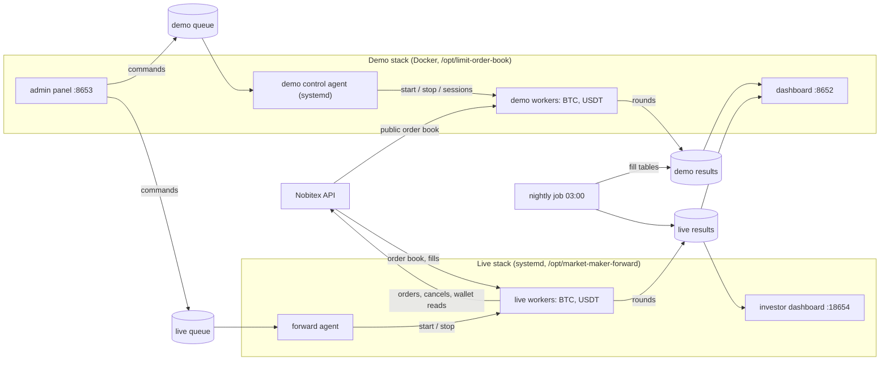
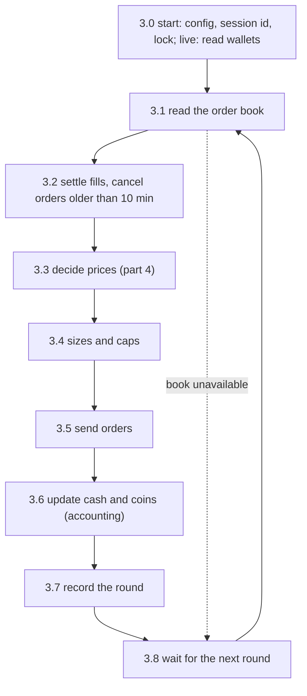
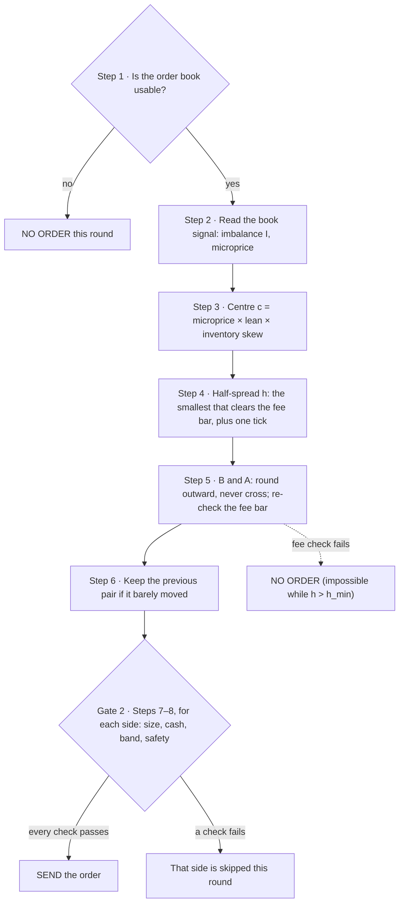
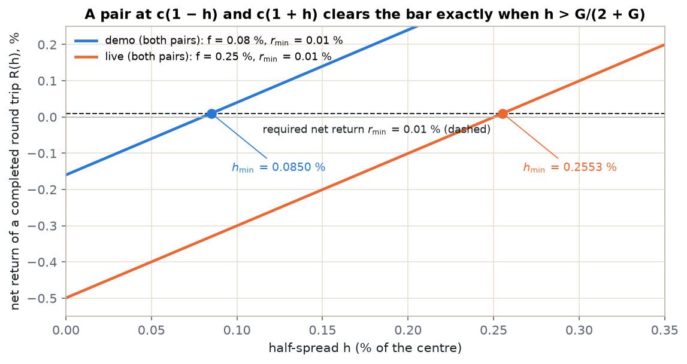
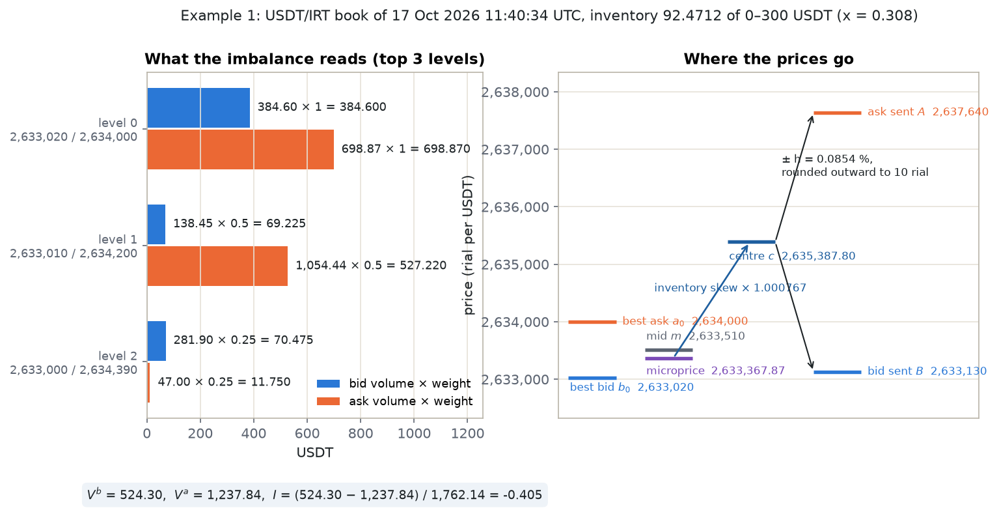
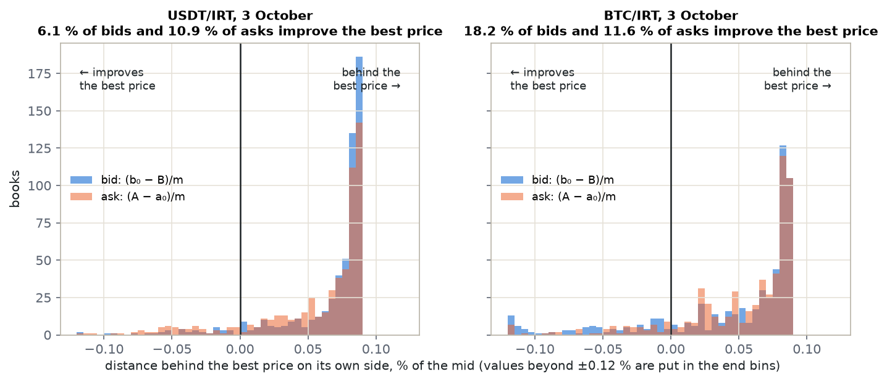

# The market maker and MM_algo2, explained from the ground up

How the Nobitex market-making bot works on the branch `MM_algo2`, end to end: what it trades and why, one round of a worker step by step, the decision rule MM_algo2 with every formula proved, what its order-book signal looks like on real books, how results are measured, and how the system is run. Every worked example was produced by running this branch's own code on real Nobitex order books, or read from the bot's real data on the server (code at commit 8fb83aa, data as of 17 October 2026).

> This guide is also available as a standalone page, [MARKET_MAKER_EXPLAINED.html](MARKET_MAKER_EXPLAINED.html) (open it in a browser; it uses MathJax and mermaid from public CDNs), with coloured tables and typeset pseudocode.

1. [The idea: what a market maker does](#1-the-idea-what-a-market-maker-does)
2. [The system: processes, modes, files](#2-the-system-processes-modes-files)
3. [One round of a worker, step by step](#3-one-round-of-a-worker-step-by-step)
4. [The decision: MM_algo2](#4-the-decision-mm_algo2)
5. [The book signal on real data](#5-the-book-signal-on-real-data)
6. [Measuring results: dashboard, PnL attribution, validation gate](#6-measuring-results-dashboard-pnl-attribution-validation-gate)
7. [Running the system: sessions, configuration, admin, deployment](#7-running-the-system-sessions-configuration-admin-deployment)
8. [The live forward test today](#8-the-live-forward-test-today)
9. [Known limitations](#9-known-limitations)
10. [Glossary of symbols and settings](#10-glossary-of-symbols-and-settings)
11. [The whole bot as pseudocode](#11-the-whole-bot-as-pseudocode)

**The name.** MM_algo2 is the name of this branch and of its algorithm. In the code and the settings it has the key `algo3` (class `Algo3Strategy` in `strategy/algo3.py`), because it is the third algorithm designed for the project. `strategy/algo2.py` is an unrelated, empty placeholder.

**Where does the bot decide whether to place an order?** In [**4.0, "The order decision, step by step"**](#40-the-order-decision-step-by-step): every condition in the order the code checks it (gate 1: which prices MM_algo2 quotes; gate 2: whether the engine sends them), what happens after each check, and three real cases.

**The whole bot as pseudocode:** [**part 11**](#11-the-whole-bot-as-pseudocode), three listings: one round of a worker, how MM_algo2 chooses the prices, and how it reads the book signal.

## 1. The idea: what a market maker does

An exchange keeps two lists: people who want to **buy** and the price they offer (bids), and people who want to **sell** and the price they ask (asks). A market maker places its own orders in both lists: a buy a little *below* the market price and a sell a little *above* it, and waits for other traders to trade against them. When both fill, it has bought low and sold high. The difference, minus the exchange fee on each trade, is its profit. It earns a small margin for always offering a price to others.

This bot does that on the Nobitex exchange for two pairs, **BTC/IRT** (bitcoin against Iranian rial) and **USDT/IRT** (tether against rial). On this branch the prices are chosen by **MM_algo2**, which also reads how much volume waits at each price (part 4).

### 1.1 The order book

The order book is the two lists, sorted best price first. Level 0 is the best price on each side, level 1 the next, and so on. This page uses one real USDT/IRT book as its running example, captured from the server on 17 October 2026 at 11:40:34 UTC (prices in rial per USDT, volumes in USDT):

| Level | Bid price $`b_i`$ | Bid volume $`v^b_i`$ | Ask price $`a_i`$ | Ask volume $`v^a_i`$ |
| ---: | ---: | ---: | ---: | ---: |
| 0 | 2,633,020 | 384.6 | 2,634,000 | 698.87 |
| 1 | 2,633,010 | 138.45 | 2,634,200 | 1,054.44 |
| 2 | 2,633,000 | 281.9 | 2,634,390 | 47 |
| 3 | 2,632,000 | 34.15 | 2,634,400 | 878.24 |
| 4 | 2,631,990 | 26.58 | 2,634,500 | 10 |
| 5 | 2,631,270 | 5 | 2,634,870 | 4 |
| 6 | 2,631,260 | 8.26 | 2,634,880 | 237.09 |
| 7 | 2,631,250 | 58.34 | 2,635,000 | 425.06 |

- **Best bid** $`b_0`$ and **best ask** $`a_0`$: the top of each list (2,633,020 and 2,634,000).
- **Mid price** $`m = (b_0 + a_0)/2`$ = 2,633,510: "the market price".
- **Spread** $`s = a_0 - b_0`$ = 980 rial; relative spread $`s/m`$ = 0.0372 %.
- **Tick** $`\epsilon`$: the smallest price step allowed, 10 rial on rial pairs.
- **Volume at a level**: how much is waiting there. Here 1,762.14 USDT waits in the top three levels (weighted, part 4.1), most of it to sell.

### 1.2 Orders, fills and the fee

The bot uses **limit orders**: "buy up to 5 USDT at 2,633,130 or better". The order rests in the book until someone trades against it (a **fill**; a **partial fill** if only part of it trades), or until the bot cancels it. Each bot order lives at most $`\tau`$ = `cancel_after_minutes` = 10 minutes.

The fee $`f`$ (`commission_perc`) is taken from what you *receive*: on a buy you receive $`(1-f)`$ of the coins you paid for; on a sell you receive $`(1-f)`$ of the rials. A **round trip** is a buy followed by a sell of the same coins.

**Proposition 1 (return of a round trip).** Buying at price $`B`$ and later selling the coins received at price $`A`$ returns, per rial spent,

```math
R(B, A) = (1-f)^2\,\frac{A}{B} - 1 .
```

*Proof.* Spend $`B`$ rial on one nominal coin at price $`B`$. The fee leaves $`1-f`$ coins. Selling them at $`A`$ gives $`(1-f)A`$ rial before the fee and $`(1-f)\cdot(1-f)A`$ after it. The return on the $`B`$ rial spent is $`\big((1-f)^2 A - B\big)/B`$. ∎

**Example.**

Run through the bot's own paper ledger (`PaperLedger`) with 100,000,000 rial of cash, no coins, the demo fee $`f = 0.08\%`$, and the two prices MM_algo2 quotes for the book of 1.1 (part 4):

| Step | Cash (rial) | Coins (USDT) | What happened |
| --- | ---: | ---: | --- |
| start | 100,000,000.00 | 0 |   |
| buy 5 at 2,633,130 fills | 86,834,350.00 | 4.996 | paid $`5 \times 2{,}633{,}130 = 13{,}165{,}650`$; the fee $`0.0008 \times 5 = 0.004`$ USDT (10,532.52 rial) came out of the coins |
| sell 4.996 at 2,637,640 fills | 100,001,457.32 | 0 | received $`4.996 \times 2{,}637{,}640 = 13{,}177{,}649.44`$, minus the fee 10,542.12 rial |

Profit 1,457.32 rial on 13,165,650 spent, which is $`0.011069\%`$. Proposition 1 gives $`0.99840064 \times 2{,}637{,}640/2{,}633{,}130 - 1 = 0.011069\%`$: the same number to eleven significant figures.

### 1.3 Inventory, cash and wealth

At any moment the bot holds $`q`$ coins (its **inventory**) and some rial of **cash**. Its **wealth** is the cash plus the coins valued at a market price $`v`$:

```math
W = \text{cash} + q\,v
```

Each pair has an inventory band $`[q_{\min}, q_{\max}]`$ (`inv_min`, `inv_max`): the least and the most coins the bot is willing to hold. It tries to stay near the middle.

### 1.4 Where profit and loss come from

- **Completed round trips.** If both the buy and the sell fill, the profit is $`R(B,A)`$ times the amount, fixed by the two prices. MM_algo2 only quotes pairs where this is above a required return, and it proves that every pair it sends is (part 4.6).
- **One leg only.** If only the buy fills, the bot holds coins whose value moves with the market until it sells them. That is gain or loss from the price, not from the bot's quoting. Part 6 splits every result into these two pieces exactly.
- **Adverse selection.** Orders tend to get filled exactly when the price is about to move through them: a buy fills because sellers are pushing the price down. This makes one-leg fills worse than random on average.

So every round the bot must choose prices that (a) earn more than the fees if both sides fill, (b) sit where the next move of the price is more likely to bring trades, and (c) keep the inventory near the middle of its band. MM_algo2's answers (part 4): (a) a half-spread derived from the fee bar; (b) a centre at the microprice, leaned with the imbalance once that lean is estimated; (c) a centre skewed against the inventory, with the engine sizing each side by the inventory.

### 1.5 Two modes

- **Demo** (paper trading): reads the real Nobitex order book every round, but orders go into a simulated ledger with simulated money. A simulated order fills when the real market price reaches it.
- **Live** (the forward test): the same code sends real orders with real money to Nobitex.

Both modes run the same strategy and the same engine; only the "exchange" underneath differs.

## 2. The system: processes, modes, files

The project runs as a handful of separate processes on one server (37.32.31.162). Each does one job and they talk only through files: the workers trade and write results, the dashboard reads the results, the admin panel writes commands that two small "agents" carry out.



### 2.1 The processes

| Process | What it runs | How and as whom | Address |
| --- | --- | --- | --- |
| demo workers `lob-btc-demo`, `lob-usdt-demo` | `run.py --profile btc\|usdt --mode demo --continuous` | Docker containers, user 1000, read-only file system, 256 MB each | — |
| `lob-session-init` | creates or reuses the shared demo session id at start | Docker, runs once | — |
| dashboard `lob-dashboard` | `dashboard.py` (part 6) | Docker, results mounted read-only, 384 MB | `http(s)://37.32.31.162/` → port 8652 |
| admin panel `lob-admin` | `admin_app.py` (part 7.4) | Docker, 384 MB; may write only the two command queues and the live config | `/admin/` → port 8653 |
| demo control agent | `deploy/control_agent.py` | systemd unit `lob-control-agent`, as root (it runs `docker compose`) | — |
| forward agent | `deploy/forward_control_agent.py` | systemd unit `market-maker-forward-agent`, user `marketmaker-forward`, holds the Nobitex keys; `KillMode=process` so a restart leaves live workers running | — |
| live workers | `run.py --profile btc\|usdt --algorithm algo1\|algo3 --exchange nobitex --mode real --continuous` | started by the forward agent as its child processes, with the algorithm saved on the pair's Live Config page | — |
| investor dashboard | live tracks only | systemd unit `market-maker-forward-investor-dashboard` | `/forward/` → port 18654, with a password |

The forward stack also has its own admin (port 18653) and dashboard (port 18652) units, used only internally; nginx sends `/admin/` to the Docker admin, which drives both stacks. The repository's sample unit for the demo agent (user `ubuntu`, `/home/ubuntu/limit-order-book`) differs from the server, where it runs as root in `/opt/limit-order-book`.

### 2.2 The files

| File | Holds | Written by | Read by |
| --- | --- | --- | --- |
| `<pair>_track_demo.sqlite3` (+ `.csv` copy) | one row per demo round, all demo sessions | demo worker | dashboard, admin, nightly job |
| `<pair>_track.csv` | one row per live round, all live sessions | live worker | dashboards, admin, nightly job |
| `<pair>irt_algo1_diagnostics.jsonl` | the strategy's full evaluation of the newest rounds, for both algorithms (the name is historical; each document says which algorithm wrote it) | workers | dashboard (Quote decision) |
| `fill_table_<pair>irt.json` | measured fill probabilities, for the comparison algorithm MM_algo1v2 (MM_algo2 does not use them) | nightly job | MM_algo1v2, dashboard (Fill model) |
| `stack_session.json` | the current demo session id | session init, demo agent | demo workers, admin |
| `paper_<session>_<pair>.json`, `paper_fee_scopes.json` | paper ledger state; fee totals | demo worker | demo worker on restart, admin |
| `demo_config_<pair>.json`, `runtime_config_<pair>.json` | admin overrides; what the worker actually applied | demo agent; demo worker | demo worker; admin, dashboard |
| `forward_config_<pair>.json` | live settings | forward agent | live worker at start, admin |
| `control/commands/*.json`, `results/*.json`, `audit.log` | the command queue (part 7.3) | admin; agents | agents; admin |

Demo files live in `/opt/limit-order-book/runtime/{results,state,backups,control}`; live files in `/var/lib/market-maker-forward/{results,config,locks,control}`, with worker logs in `/var/log/market-maker-forward`.

### 2.3 The code, file by file

| File (in `market_maker/` unless noted) | Role | Part |
| --- | --- | --- |
| `run.py` | starts a worker: builds the configuration, session id, exchange, lock | 3.0 |
| `engine.py` | the round loop, sizing, caps, sending, accounting, recording | 3 |
| `strategy/algo3.py` | **MM_algo2**: chooses the prices (class `Algo3Strategy`, key `algo3`) | 4 |
| `strategy/common.py`, `strategy/catalog.py` | arithmetic shared by the algorithms (tick, mid, returns, fee bar, inventory position); the list of algorithms and their names | 4, 7.2 |
| `strategy/algo1.py`, `fill_model.py`, `tools/build_fill_table.py` | MM_algo1v2, the comparison algorithm, and its fill-probability table (documented on the `MM_algo1v2` branch) | — |
| `paper.py`, `exchange/demo.py` | the simulated exchange for demo mode | 3.2, 3.6 |
| `exchange/nobitex.py`, `order_status.py` | the Nobitex API: order book, wallets, orders, cancels | 3 |
| `result_store.py` | the SQLite store of demo rounds and its CSV copy | 3.7 |
| `config.py` | all settings and the two pair profiles | 10 |
| `session.py`, `demo_config.py`, `forward_config.py` | demo sessions; demo and live settings with validation | 7.1, 7.2 |
| `control_queue.py`, `deploy/control_agent.py`, `deploy/forward_control_agent.py` | the command queue and the two agents | 7.3 |
| `admin_app.py`, `templates/admin/` | the admin panel | 7.4 |
| `dashboard.py`, `validation/` | the results dashboard and its metrics | 6 |
| `deploy/docker-compose.production.yml`, `deploy/*.service` | how the processes are deployed | 2.1, 7.6 |

## 3. One round of a worker, step by step

A **worker** is one running process for one pair in one mode (for example "USDT, demo"). It repeats a **round** forever: read the market, settle what happened to its orders, decide new prices, size them, send them, record everything, wait. Code: `market_maker/run.py` starts it; `market_maker/engine.py` runs the rounds (`_run_demo` for demo, `run` for live).



### 3.0 Starting a run

The command is `python run.py --profile usdt|btc --mode demo|real --continuous` (the live agent adds `--algorithm <algo1|algo3> --exchange nobitex`, the algorithm saved on the pair's Live Config page; demo workers take it from the `algorithm` setting, which they can switch at a round boundary). This guide explains MM_algo2 (`algo3`), the algorithm of this branch; the comparison algorithm MM_algo1v2 (`algo1`) is documented on its own branch. It builds the configuration from the pair's profile in `config.py`, then applies the saved overrides:

- **Demo**: the admin overrides in `demo_config_<pair>.json`, re-read at every round boundary so most changes apply at once (part 7.2). The session id comes from the shared stack session file and looks like `demo-20261015T131629Z-2f38f0a407fa` (start time and a random suffix). The worker takes a lock file so only one worker per pair can run.
- **Live**: the saved live settings in `forward_config_<pair>.json`, applied once at start (a change needs a restart). The fee is forced to at least 0.25 % and both exposure guards are forced on with at most 25 %. The session id is the start time as a Unix timestamp, for example `1792069104.17595`.

**Live wallet snapshot.** Before the first round a live worker reads two balances from Nobitex (a signed request to `/users/wallets/balance`): the coin (BTC or USDT) and the rial wallet. They become its starting inventory and cash. If either read fails, is not a number, or is negative, the worker refuses to start and never trades.

### 3.1 Reading the market

Every round both modes read the public order book, `GET /v3/orderbook/<PAIR>`, with a 5-second timeout. The bot uses the price levels (price and volume, best first), the best bid and ask, and the last trade price. If the reply is not HTTP 200 or a field is missing, the read counts as failed: a demo worker waits for the next round; a live worker rewrites its history file without adding a row and waits. No round is recorded either way. (This is what happens to USDT during the outage in part 8.3.)

### 3.2 Settling fills and cancelling old orders

Before deciding anything, the worker brings its view of its own orders up to date.

#### Demo: the paper ledger decides the fills

The simulated exchange (`PaperLedger.process_market` in `paper.py`) checks every resting paper order against the real book of this round:

```math
\text{buy at } B \text{ fills if } a_0 \le B, \qquad \text{sell at } A \text{ fills if } b_0 \ge A, \qquad \text{fill price} = \text{the order's own limit price}
```

At most $`S`$ (one `order_size`) per side fills per round, so a larger order fills over several rounds. Queue position, random fill misses and the old "level-1 fast fill" are all switched off in both profiles; a fill by actual trades would need trade data the bot does not receive, so in practice every demo fill is a "price touch".

Then every paper order whose age exceeds the lifetime is cancelled: age $`\gt \tau \times 60`$ seconds, measured from the round that submitted it (strictly greater: an order is still alive at exactly 600 s). Fills of the same round are applied first.

#### Live: the exchange decides, the worker reads

The worker asks Nobitex for its recently closed orders and keeps only those with a `clientOrderId` it created on this pair. For each, the newly matched amount since the last round (the "cumulative delta") is booked into cash and coins (3.6). Then every owned open order older than 10 minutes is cancelled with a signed request to `/market/orders/update-status`. Live inventory and cash are tracked from these fills; the wallet is read only once, at start.

### 3.3 Deciding prices

The strategy receives the book and the current inventory (in demo, the paper ledger's whole holding, including coins locked in open sells) and returns a buy price and a sell price, or nothing. MM_algo2 always returns both prices when the book is usable. **Every condition that decides whether an order is placed, in the order the code checks it, is in [4.0, "The order decision, step by step"](#40-the-order-decision-step-by-step)**; the rest of part 4 explains each step in full.

### 3.4 Sizes and caps

**This is gate 2 of the order decision (steps 7 and 8 of [4.0](#40-the-order-decision-step-by-step)).**

**Target sizes.** With $`S`$ = `order_size`, slope $`k_s`$ = `inventory_sizing_strength` (1 in both profiles) and floor $`\phi`$ = `inventory_sizing_min_fraction` (0):

```math
\pi(e) = 2\,\operatorname{clamp}\!\Big(\frac{e - q_{\min}}{q_{\max} - q_{\min}}, 0, 1\Big) - 1, \qquad \text{buy} = S\cdot\operatorname{clamp}\big(1 - k_s\,\pi(q + o_b),\ \phi,\ 1+k_s\big), \qquad \text{sell} = S\cdot\operatorname{clamp}\big(1 + k_s\,\pi(q - o_s),\ \phi,\ 1+k_s\big)
```

$`o_b`$ is the amount still resting in the bot's open buys and $`o_s`$ in its open sells, so orders already placed count as if filled. With $`k_s = 1`$, $`\phi = 0`$ and no open orders this is simply

```math
\text{buy} = 2S\,(1 - x), \qquad \text{sell} = 2S\,x
```

**Claim.** With no open orders the two targets always add up to $`2S`$; the buy is 0 at a full band and the sell is 0 at an empty band. *Proof:* $`2S(1-x) + 2Sx = 2S`$; at $`x = 1`$ the buy is $`2S \cdot 0`$, at $`x = 0`$ the sell is $`2S \cdot 0`$. ∎

**Caps, in the exact order the demo engine checks them** (the sell side is handled first, then the buy side). The smallest order worth sending is $`0.1\,S`$ (`MIN_ORDER_SIZE_FRACTION` = 0.1).

| # | Sell side: skip if … | Buy side: skip if … | Reason recorded |
| --- | --- | --- | --- |
| 1 | the strategy gave no sell price (never with MM_algo2) | no buy price (never with MM_algo2) | `one_sided_quote` |
| 2 | an own order rests within 5 ticks of the price (4.8) | same | `resting_order_kept` |
| 3 | exposure guard (below) | target $`\lt 0.1S`$ | `locked_inventory_limit` / `inventory_sizing` |
| 4 | — (send if size $`\ge 0.1S`$) | $`\min(\text{target},\ \text{free cash}/B) \lt 0.1S`$ | — / `insufficient_cash` |
| 5 | target $`\lt 0.1S`$ though coins are free | open buys $`+ q +`$ this buy $`\gt q_{\max}`$ | `inventory_sizing` / `inventory_cap` |
| 6 | all coins already locked in sells | exposure guard (below) | `inventory_locked_in_open_orders` / `locked_cash_limit` |
| 7 | no coins | — otherwise send | `insufficient_inventory` / — |

The sell size is $`\min(\text{sell target},\ \text{free coins} - q_{\min})`$; the buy size is $`\min(\text{buy target},\ \text{free cash}/B)`$. A live worker applies the same caps but records only "not_sent" instead of a reason.

**Exposure guards** (off in demo; on in live at 25 %). Before a new order, the worker computes how much of its resource would be locked in resting orders afterwards:

```math
\text{buy: } \frac{\text{cash locked in buys} + \text{size} \times B}{\text{total cash}} \;\gt\; 0.25 \ \Rightarrow\ \text{skip}, \qquad \text{sell: } \frac{\text{coins locked in sells} + \text{size}}{\text{total coins}} \;\gt\; 0.25 \ \Rightarrow\ \text{skip}
```

**Example.**

Demo USDT, the book of 1.1 with part 4's prices: $`S = 5`$, inventory 92.4712 USDT in the band 0–300, so $`x = 0.30824`$, no open orders: buy target $`2 \cdot 5 \cdot (1 - 0.30824) = 6.9176`$, sell target $`2 \cdot 5 \cdot 0.30824 = 3.0824`$, both above the minimum $`0.1S = 0.5`$. **Send buy 6.9176 at 2,633,130 and sell 3.0824 at 2,637,640** (if cash and coins allow, and nothing of ours already rests within 5 ticks). Live BTC with MM_algo2 and an empty wallet (part 8.2): $`x = 0`$, so the buy target is $`2S = 0.00002378`$ BTC and the sell target 0; the buy locks 5,091,874 rial, 8.83 % of the 57,637,520 rial wallet, which the 25 % guard allows.

*Code: _inventory_sized_order_targets(), _min_tradable_size(), _locked_exposure_guard_reason()*

### 3.5 Sending orders

- **Demo**: `PaperLedger.submit_order` rejects a buy if size $`\times B`$ exceeds the free cash, and a sell if size exceeds the free coins. Nothing moves at submission: "locked" cash and coins are computed from the open orders whenever a snapshot is taken. Order ids look like `usdtirt-buy-10118-1792170000000` (pair, side, round, milliseconds).
- **Live**: a signed request to `/market/orders/add` with type, the two currencies, the amount as text, the price and a `clientOrderId` such as `buy-12-1792170000000`. The order counts as placed only if Nobitex answers "ok" and echoes the same client id. The worker then tracks it by that id.

### 3.6 Accounting: cash, coins and fees

The fee rule of part 1.2, applied to a fill of $`F`$ coins at price $`P`$:

```math
\text{buy fill: } \ c \leftarrow c - F\,P, \quad q \leftarrow q + F - fF \qquad\qquad \text{sell fill: } \ q \leftarrow q - F, \quad c \leftarrow c + F\,P - fFP
```

The buy fee $`fF`$ is paid in coins, the sell fee $`fFP`$ in rial. The demo ledger applies exactly this (`apply_cumulative_fill`); a live worker applies the same shape with the fee Nobitex reports for each fill.

**Claim.** Buying $`F`$ coins at $`B`$ and then selling everything received at $`A`$ changes cash by exactly $`F B \cdot R(B, A)`$, with $`R`$ from Proposition 1. *Proof:* after the buy, cash fell by $`FB`$ and coins rose by $`F(1-f)`$. Selling $`F(1-f)`$ coins at $`A`$ adds $`F(1-f)A - fF(1-f)A = F(1-f)^2A`$. Net change: $`F(1-f)^2A - FB = FB\big((1-f)^2A/B - 1\big)`$. ∎ (Part 1.2's ledger run shows it numerically: +33,233.69 rial on 13,250,050.)

The ledger's **snapshot** gives locked cash $`= \sum_{\text{open buys}} (\text{remaining} \times \text{limit})`$, locked coins $`= \sum_{\text{open sells}} \text{remaining}`$, free cash and free coins (the totals minus the locked parts), and wealth $`W = c + q \times`$ the last trade price.

### 3.7 Recording the round

- **Demo**: one row of 72 columns per round: identity (session, the strategy key `Strategy`, round, time), book (best bid and ask, levels), portfolio (cash, coins, locked and free amounts, wealth), the quote's economics (prices, mid, net return, required return), twelve fields per side (order id, status, why not sent, amounts, fill reason, limit price, locked amount), the fee totals, and eleven decision fields (mode, reason, centre, both distances, both fill chances, expected value, reference price, imbalance, microprice; MM_algo2 leaves the fill chances, expected value and reference price empty). Rows go into a SQLite store (one row per session and round) and a CSV copy of the newest 10,000 rows is rewritten every 60 seconds.
- **Live**: one row of 32 columns appended to `<pair>_track.csv` (all live sessions share the file; the same eleven decision fields at the end), rewritten every round.
- **Decision diagnostics**: every round the strategy's full evaluation (for MM_algo2: the top-$`k`$ levels, both weighted volumes, the raw and clipped imbalance, the microprice, the centre and its factors, $`h`$, the prices before and after rounding, the remembered pair) is appended to `<pair>irt_algo1_diagnostics.jsonl`, cut back to the newest 2,000 rounds when it passes 4,000. The file name is historical; both algorithms write to it, and each document carries `algorithm`. The dashboard's Quote decision tab reads it.
- **Telegram**: a message at start, one per round in live mode, and in demo order notifications plus an alert after 30 rounds or 300 seconds without a quote.

### 3.8 Waiting, and stopping

A demo worker keeps a fixed rhythm: the next round is due at the previous due time plus `time_step` (10 s for USDT, 60 s for BTC); if it falls behind, missed slots are skipped rather than run late. A live worker sleeps `time_step` after finishing its work, so its period is `time_step` plus the work time.

Stopping is a `SIGTERM` (the Stop button). A live worker then cancels every open order it owns on its pair (and only those), books any last fills, and exits. A demo worker cancels all its paper orders when its session ends. Inside the live round loop only a failed order-book read is handled; any other error from Nobitex (order status, cancel, open orders) ends the worker the same way, after cancelling its own orders.

## 4. The decision: MM_algo2

MM_algo2 (`strategy/algo3.py`, class `Algo3Strategy`) decides the buy price $`B`$ and the sell price $`A`$ of every round; the engine decides the sizes (3.4). It reads the prices *and the volumes* of the top of the book: when much more volume waits to buy than to sell, the sell side is the one likely to be used up and the next move of the price is more likely up. It never estimates a fill probability. The full specification, with the same proofs, more examples and the map from every property to the test that pins it, is `docs/algorithms/MM_algo2.md`.

### 4.0 The order decision, step by step

**Every round, a price must pass two gates before an order is placed.**

- **Gate 1, the strategy MM_algo2 (steps 1–6): which two prices?** This is where profit is decided: the half-spread is derived from the fee condition, and every pair that leaves gate 1 satisfies it.
- **Gate 2, the engine (steps 7–8): is each order actually sent?** This is about size, cash, the inventory band and safety, not profit.

An order is placed only if it passes both gates. Each step below says what is checked, the exact condition, and what happens next: **continue** to the next step, **skip** one side this round, **no order** this round, or **SEND**.



#### Gate 1 · the strategy MM_algo2 (`strategy/algo3.py`)

##### Step 1 · Is the order book usable?

**Check:** a best bid and a best ask exist with $`0 \lt b_0 \le a_0`$; each side has at least $`k`$ = 3 levels; every price read is a positive number.

**No →** **no order** (reason `invalid_or_single_level_order_book`, or `book_shallower_than_depth_k` when a side has fewer than $`k`$ levels). **Yes →** **continue**

##### Step 2 · Read the book signal (nothing is decided yet; 4.1, 4.2)

Weighted volumes of the top $`k`$ levels, $`V^b`$ and $`V^a`$, and the imbalance $`I_{\text{raw}} = (V^b - V^a)/(V^b + V^a)`$.

**Thin-book guard**

```math
V^b + V^a \lt V_{\min} = n_V \cdot S \quad\Longrightarrow\quad I = 0 \text{ and the centre starts at the mid}
```

Otherwise $`I = \operatorname{clamp}(I_{\text{raw}}, -0.8, 0.8)`$ and the centre starts at the **microprice** $`p_{\text{micro}} = (a_0 v^b_0 + b_0 v^a_0)/(v^b_0 + v^a_0)`$.

**continue**

##### Step 3 · The centre (4.3, 4.4)

**Centre**

```math
c = p_{\text{micro}}\,(1 + \beta I)\,\bigl(1 - \sigma_q\,(2x - 1)\bigr), \qquad x = \operatorname{clamp}\!\Big(\frac{q - q_{\min}}{q_{\max} - q_{\min}}, 0, 1\Big)
```

Meaning: **start where the book says the price is heading, then lean with the imbalance ($`\beta`$ = 0 for now) and move against the inventory**: a full band lowers the centre by $`\sigma_q`$ = 0.2 %, an empty band raises it by 0.2 %.

**$`c \le 0`$ →** **no order** (`invalid_centre`; impossible with valid settings). **Otherwise →** **continue**

##### Step 4 · The half-spread from the fee bar (4.5)

**Fee condition, solved for the half-spread**

```math
R\bigl(c(1-h),\, c(1+h)\bigr) = (1-f)^2\,\frac{1+h}{1-h} - 1 \;\gt\; r_{\min} \quad\Longleftrightarrow\quad h \gt h_{\min} = \frac{G}{2+G}, \qquad G = \frac{1+r_{\min}}{(1-f)^2} - 1
```

Meaning: **if both orders fill, the round trip earns more than `exp_ret_min` after both fees**, and that depends on $`h`$ alone. MM_algo2 takes $`h = \max(h_{\text{cfg}},\ h_{\min} + \epsilon/c)`$: the smallest such half-spread plus one tick (0.0850 % + one tick in demo).

**$`h \ge 1`$ →** **no order** (`half_spread_not_attainable`). **Otherwise →** **continue**

##### Step 5 · The two prices, and the final check (4.6, 4.7)

**Prices**

```math
B = \epsilon \left\lfloor \frac{\min(c(1-h),\ a_0 - \epsilon)}{\epsilon} \right\rfloor, \qquad A = \epsilon \left\lceil \frac{\max(c(1+h),\ b_0 + \epsilon)}{\epsilon} \right\rceil
```

Meaning: **the bid rounded down and the ask rounded up to the tick, neither on the other side of the book**. Both changes only widen the pair, so the fee condition of step 4 still holds (Proposition 4).

**Check:** $`B \gt 0`$, $`B \lt A`$ and $`R(B, A) \gt r_{\min}`$ on these exact prices. **Fails →** **no order** (`net_return_below_bar`; it cannot fail while $`h \gt h_{\min}`$). **Passes →** **continue**

##### Step 6 · Keep or replace the pair (4.8)

**Check:** are both new prices within 5 ticks (50 rial) of the pair issued earlier, is that pair younger than 300 seconds (counted from when it was first issued), and does it still pass the fee condition?

**Yes →** send the previous pair again (`microprice_pair_kept`). **No →** use the new pair (`microprice_pair`).

**End of gate 1:** a buy price and a sell price, handed to the engine (4.9). **continue**

#### Gate 2 · the engine, for each side (`engine.py`, 3.4)

##### Step 7 · Sell side (checked first)

1. **No sell price** from gate 1 → **skip** `one_sided_quote` (never happens with MM_algo2)
2. **An own sell already rests within 5 ticks** of this price → **not re-sent** `resting_order_kept` (the resting order stays)
3. **Size** $`= \min(\text{sell target } 2S\,x_s,\ \text{free coins} - q_{\min})`$. **Live only:** if coins locked in sells $`+`$ size $`\gt 25\%`$ of all coins → **skip** `locked_inventory_limit`
4. **Size $`\ge 0.1\,S`$** → **SEND**
5. **Otherwise** → **skip** `inventory_sizing`, `inventory_locked_in_open_orders` or `insufficient_inventory`

##### Step 8 · Buy side

1. **No buy price** → **skip** `one_sided_quote` (never happens with MM_algo2)
2. **An own buy already rests within 5 ticks** → **not re-sent** `resting_order_kept`
3. **Buy target** $`2S\,(1 - x_b) \lt 0.1\,S`$ → **skip** `inventory_sizing`
4. **Affordable size** $`\min(\text{target},\ \text{free cash}/B) \lt 0.1\,S`$ → **skip** `insufficient_cash`
5. **Open buys $`+`$ coins $`+`$ this buy $`\gt q_{\max}`$** → **skip** `inventory_cap`
6. **Live only:** cash locked in buys $`+`$ size $`\times B \gt 25\%`$ of cash → **skip** `locked_cash_limit`
7. **Otherwise** → **SEND**

$`x_s`$ and $`x_b`$ are the inventory position counting the bot's resting sells and buys as if already filled. At $`x = 0`$ the sell target is 0 and at $`x = 1`$ the buy target is 0: with MM_algo2 it is this sizing, not the strategy, that leaves a side out at the band edges. The demo records every skip reason in the round row; the live CSV records only "not_sent".

#### Three real cases: where each one stopped

| Case | Gate 1 | Gate 2 | Result |
| --- | --- | --- | --- |
| **The book of 1.1**<br>USDT, 17 Oct 11:40:34 UTC; demo settings; 92.4712 of 300 USDT | Step 2: $`I = -0.405`$, microprice 2,633,367.87. Step 3: $`x = 0.308`$, centre 2,635,387.80. Step 4: $`h = 0.0854\%`$. Step 5: 2,633,130 / 2,637,640, $`R = 0.011069\%`$ | Step 7: sell 3.0824. Step 8: buy 6.9176 | **SEND** both, if the cash and coins allow and nothing of ours rests within 5 ticks |
| **BTC demo, round 2761**<br>17 Oct 14:58:04 Tehran time; 0.0025009 of 0.0037 BTC | Step 2: $`I_{\text{raw}} = 0.933`$, clipped to 0.8; microprice 0.0719 % above the mid. Step 3: centre 0.0015 % above the mid. Step 5: 213,851,262,480 / 214,215,254,940. Step 6: the remembered pair had moved about 1,040,000 rial: replaced | Steps 7 and 8: both sizes above the minimum, cash and band fine | **SEND** buy 0.00003018 BTC and sell 0.00006459 BTC (recorded "open") |
| **Live BTC with MM_algo2** (computed; the worker is stopped)<br>17 Oct 11:35:20 UTC book; live settings; 0 BTC, 57,637,520 rial | Step 3: $`x = 0`$, centre 0.2 % above the mid. Step 4: $`h = 0.2553\%`$. Step 5: 214,124,239,800 / 215,220,409,170 | Step 7: no coins, sell target 0. Step 8: buy 0.00002378 BTC, 8.83 % of the cash locked: within 25 % | **SEND** the buy; **skip** the sell |

Sections 4.1 to 4.9 below explain each step in full, with proofs and the numbers of the book of 1.1.

### 4.1 The imbalance $`I`$

Each of the top $`k`$ = 3 levels counts with a weight $`\rho^{\,i}`$ ($`\rho`$ = `algo3_decay_rho` = 0.5: level 0 counts fully, level 1 half, level 2 a quarter):

```math
V^b = \sum_{i=0}^{k-1} \rho^{\,i}\, v^b_i, \qquad V^a = \sum_{i=0}^{k-1} \rho^{\,i}\, v^a_i, \qquad I_{\text{raw}} = \frac{V^b - V^a}{V^b + V^a}
```

$`I_{\text{raw}} \gt 0`$: more volume waits to buy than to sell. $`I_{\text{raw}} \lt 0`$: more waits to sell.

**Claim 1.** $`-1 \le I_{\text{raw}} \le 1`$, and $`I_{\text{raw}} = \pm 1`$ only when one side's weighted volume is zero.

*Proof.* Volumes and weights are non-negative, so $`V^b, V^a \ge 0`$ and $`\lvert V^b - V^a\rvert \le V^b + V^a`$, with equality exactly when one of them is 0. (When both are 0 the code sets $`I_{\text{raw}} = 0`$.) ∎

Two guards turn $`I_{\text{raw}}`$ into the $`I`$ that is used:

- **Thin book.** If $`V^b + V^a \lt V_{\min} = n_V \cdot S`$ ($`n_V`$ = `algo3_min_volume_orders` = 20), the top of the book is too thin to say anything: $`I = 0`$ and the centre starts at the mid. In demo $`V_{\min}`$ = 20 × 5 = 100 USDT and 20 × 0.000062 = 0.00124 BTC.
- **Clip.** Otherwise $`I = \operatorname{clamp}(I_{\text{raw}}, -I_{\max}, I_{\max})`$, $`I_{\max}`$ = `algo3_imbalance_clip` = 0.8, so one large level, possibly placed only to be pulled, cannot push the lean to its maximum.

**Example.**

The book of 1.1:

| Level | Weight $`\rho^i`$ | Bid volume × weight | Ask volume × weight |
| ---: | ---: | ---: | ---: |
| 0 | 1 | 384.6 × 1 = 384.6 | 698.87 × 1 = 698.87 |
| 1 | 0.5 | 138.45 × 0.5 = 69.225 | 1,054.44 × 0.5 = 527.22 |
| 2 | 0.25 | 281.9 × 0.25 = 70.475 | 47 × 0.25 = 11.75 |
| sums |   | $`V^b`$ = 524.3 | $`V^a`$ = 1,237.84 |

$`V^b + V^a`$ = 1,762.14 ≥ 100: not thin. $`I_{\text{raw}} = (524.3 - 1{,}237.84)/1{,}762.14 = -0.40493`$, inside ±0.8, so $`I = -0.40493`$: more volume waits to sell. In the real BTC demo round of 4.0, $`I_{\text{raw}}`$ was 0.933 and the clip made it 0.8.

### 4.2 The microprice

```math
p_{\text{micro}} = \frac{a_0\, v^b_0 + b_0\, v^a_0}{v^b_0 + v^a_0} \qquad (\text{the mid if } v^b_0 + v^a_0 = 0)
```

A weighted average of the two best prices in which each price gets the volume of the *other* side: the side with more volume pulls the microprice *away* from itself, toward the side that is likely to be used up first.

**Proposition 2.** $`p_{\text{micro}} = m + \dfrac{s}{2}\, I_0`$, where $`I_0 = \dfrac{v^b_0 - v^a_0}{v^b_0 + v^a_0}`$ is the imbalance of level 0 alone and $`s = a_0 - b_0`$.

*Proof.* Subtract $`m = (a_0 + b_0)/2`$ over the common denominator $`2(v^b_0 + v^a_0)`$:

```math
p_{\text{micro}} - m = \frac{2a_0 v^b_0 + 2b_0 v^a_0 - (a_0+b_0)(v^b_0+v^a_0)}{2\,(v^b_0+v^a_0)} = \frac{a_0 v^b_0 - a_0 v^a_0 - b_0 v^b_0 + b_0 v^a_0}{2\,(v^b_0+v^a_0)} = \frac{(a_0-b_0)(v^b_0 - v^a_0)}{2\,(v^b_0+v^a_0)} = \frac{s}{2}\, I_0 .
```

∎

**Corollary.** $`b_0 \le p_{\text{micro}} \le a_0`$: because $`\lvert I_0\rvert \le 1`$, the microprice moves at most half the spread from the mid.

**Example.**

The book of 1.1: $`I_0 = (384.6 - 698.87)/(384.6 + 698.87) = -0.29006`$. The definition gives $`(2{,}634{,}000 \cdot 384.6 + 2{,}633{,}020 \cdot 698.87)/1{,}083.47 = 2{,}633{,}367.87`$, and the proposition gives $`2{,}633{,}510 + 490 \times (-0.29006) = 2{,}633{,}367.87`$: the same to $`5 \times 10^{-11}`$ rial. The microprice sits 142.13 rial below the mid, toward the bid, because more volume waits at the best ask.

### 4.3 Inventory position $`x`$

Where the inventory sits in its band, 0 (empty) to 1 (full):

```math
x = \operatorname{clamp}\!\left(\frac{q - q_{\min}}{q_{\max} - q_{\min}},\ 0,\ 1\right) \qquad (x = \tfrac12 \text{ if the band is empty or invalid})
```

$`q`$ is the whole holding, including coins already locked in the bot's own open sells. An inventory outside the band counts as the nearest edge.

**Example.**

The book of 1.1, with the USDT demo's holding: $`x = 92.4712/300 = 0.30824`$. The real BTC round: $`x = 0.0025009/0.0037 = 0.67591`$.

### 4.4 The centre $`c`$

```math
c = p_{\text{micro}}\ \underbrace{\bigl(1 + \beta I\bigr)}_{\text{lean}}\ \underbrace{\bigl(1 - \sigma_q\,(2x - 1)\bigr)}_{\text{inventory skew}}
```

$`\beta`$ = `algo3_beta`: how much the centre leans per unit of imbalance, as a fraction of the price; **0 until it is estimated** (part 5.6). $`\sigma_q`$ = `skew_perc` = 0.2 %. When the book is thin, $`p_{\text{micro}}`$ is replaced by the mid.

- Half-full band ($`x = \tfrac12`$): skew factor 1, the centre is the microprice.
- Full band ($`x = 1`$): factor $`1 - \sigma_q`$ = 0.998, the centre 0.2 % lower: the ask comes nearer the market and selling becomes more likely.
- Empty band ($`x = 0`$): factor 1.002, the centre 0.2 % higher: buying becomes more likely.

**Claim 2.** For $`\beta \ge 0`$, $`(1 - \beta I_{\max})(1 - \sigma_q) \le c/p_{\text{micro}} \le (1 + \beta I_{\max})(1 + \sigma_q)`$.

*Proof.* $`\lvert I\rvert \le I_{\max}`$ and $`\lvert 2x - 1\rvert \le 1`$, and both factors are positive for the allowed settings ($`\beta \le 0.05`$, $`I_{\max} \le 1`$, $`\sigma_q \le 0.1`$). ∎

**Claim 3 (while $`\beta = 0`$).** The quote does not depend on $`I`$, $`k`$ or $`\rho`$, except through the thin-book test.

*Proof.* $`I`$ enters only through the lean factor $`1 + \beta I`$, which is 1 when $`\beta = 0`$; $`V^b + V^a`$, and so $`k`$ and $`\rho`$, enter only through the test $`V^b + V^a \lt V_{\min}`$. ∎

**Example.**

The book of 1.1: skew $`1 - 0.002\,(2 \times 0.30824 - 1) = 1.00076705`$, lean 1, so $`c = 2{,}633{,}367.87 \times 1.00076705 = 2{,}635{,}387.80`$, 0.0713 % above the mid: the low inventory (+0.0767 %) outweighs the sell-side book (−0.0054 %). Rerun with $`k = 1`$, $`\rho = 1`$: $`I`$ becomes $`-0.29006`$, and the centre and both prices stay exactly the same (Claim 3). Rerun with $`\beta = 0.001`$: lean $`1 + 0.001 \times (-0.40493) = 0.99959507`$, and the centre falls 0.04 %, to 2,634,320.66.

### 4.5 The half-spread $`h`$ from the fee bar

MM_algo2 places the two prices symmetrically around the centre, $`B = c(1-h)`$ and $`A = c(1+h)`$. By Proposition 1 the round trip then returns

```math
R(h) = (1-f)^2\,\frac{c\,(1+h)}{c\,(1-h)} - 1 = (1-f)^2\,\frac{1+h}{1-h} - 1 ,
```

so the centre cancels: **the profit of a completed round trip depends on $`h`$ alone**, not on the signal or the inventory.

**Proposition 3.** For $`0 \le h \lt 1`$: $`R(h) \gt r_{\min} \iff h \gt h_{\min} = \dfrac{G}{2+G}`$, with $`G = \dfrac{1+r_{\min}}{(1-f)^2} - 1`$.

*Proof.* Multiplying by $`1 - h \gt 0`$ where needed:

```math
R(h) \gt r_{\min} \iff \frac{1+h}{1-h} \gt \frac{1+r_{\min}}{(1-f)^2} = 1 + G \iff 1 + h \gt (1+G)(1-h) \iff h\,(2 + G) \gt G .
```

Since $`(1+h)/(1-h)`$ increases with $`h`$, every $`h`$ above $`h_{\min}`$ clears the bar and none below it does. ∎

MM_algo2 uses $`h = \max\bigl(h_{\text{cfg}},\ h_{\min} + \epsilon/c\bigr)`$, with $`h_{\text{cfg}}`$ = `algo3_half_spread` = 0 by default: the smallest half-spread that clears the bar, plus one tick of margin.

| Settings | $`f`$ | $`r_{\min}`$ | $`G`$ | $`h_{\min}`$ |
| --- | ---: | ---: | ---: | ---: |
| demo (both pairs) | 0.08 % | 0.01 % | 0.1702 % | 0.0850 % |
| live (both pairs) | 0.25 % | 0.01 % | 0.5119 % | 0.2553 % |
| profile defaults | 0.10 % | 0.10 % | 0.3005 % | 0.1500 % |



*$`R(h)`$ for the demo and the live settings: it crosses $`r_{\min}`$ exactly at $`h_{\min}`$.*

**Example.**

The book of 1.1: $`h_{\min}`$ = 0.0850317 % and one tick is $`10/2{,}635{,}387.80`$ = 0.0003795 % of the centre, so $`h`$ = 0.0854112 %. For BTC, where a tick is $`4.7 \times 10^{-11}`$ of the price, $`h`$ is $`h_{\min}`$ to seven figures and the pair earns $`r_{\min}`$ to six.

### 4.6 The two prices on the tick, never crossing

```math
B = \epsilon \left\lfloor \frac{\min\bigl(c(1-h),\ a_0 - \epsilon\bigr)}{\epsilon} \right\rfloor, \qquad A = \epsilon \left\lceil \frac{\max\bigl(c(1+h),\ b_0 + \epsilon\bigr)}{\epsilon} \right\rceil
```

**Proposition 4.** Every pair MM_algo2 computes satisfies (a) $`B \le a_0 - \epsilon`$ and $`A \ge b_0 + \epsilon`$; (b) $`B`$ and $`A`$ are multiples of $`\epsilon`$; (c) $`A/B \ge (1+h)/(1-h) \gt 1 + G`$, so $`R(B, A) \gt r_{\min}`$ on the prices actually sent.

*Proof.* (a) The minimum with $`a_0 - \epsilon`$, then rounding down, can only lower the bid; likewise the maximum with $`b_0 + \epsilon`$, then rounding up, can only raise the ask. (b) By construction. (c) From (a)'s argument, $`B \le c(1-h)`$ and $`A \ge c(1+h)`$, so $`A/B \ge (1+h)/(1-h)`$, and Proposition 3 with $`h \gt h_{\min}`$ gives the rest. ∎

**A correction to the design note.** The note said the clip at the touch "can narrow" the quote. It cannot: the clip and the rounding only ever lower the bid and raise the ask, so they can only *widen* the pair.

**Example.**

The book of 1.1: raw prices $`2{,}635{,}387.80 \times (1 \mp 0.000854112)`$ = 2,633,136.88 and 2,637,638.71. Neither crosses ($`a_0 - \epsilon`$ = 2,633,990, $`b_0 + \epsilon`$ = 2,633,030). Rounded: **$`B`$ = 2,633,130, $`A`$ = 2,637,640**. The bid is 110 rial above the best bid (it becomes the new best bid); the ask is 3,640 rial behind the best ask.

The same book at the band edges shows the clip: at a full band ($`x = 1`$) the centre is 2,628,101.14 and the raw ask 2,630,345.86 would sit below the best bid, so it is lifted to 2,633,030 and the pair returns 0.1131 % instead of about 0.011 %; at an empty band the raw bid 2,636,380.93 would sit above the best ask and is lowered to 2,633,990 (0.1016 %).



*The book of 1.1: what the imbalance reads, and where the prices go.*

### 4.7 The final check

The code re-checks the prices actually sent: $`B \gt 0`$, $`B \lt A`$ and $`R(B, A) \gt r_{\min}`$; otherwise no quote (`net_return_below_bar`). By Proposition 4 this cannot fail while $`h \gt h_{\min}`$. It stays as a safety net in case the settings or the arithmetic ever change, and a test forces it to fire.

**Example.**

The book of 1.1: $`0.99840064 \times 2{,}637{,}640/2{,}633{,}130 - 1 = 0.011069\% \gt 0.01\%`$: passed.

### 4.8 Keeping a pair that barely moved

MM_algo2 remembers the pair it last issued and when it first issued it. A new pair is replaced by the remembered one when both prices moved by at most $`n`$ = `hysteresis_ticks` = 5 ticks (50 rial), the remembered pair is younger than `refresh_seconds` = 300 s, and it still passes the fee condition. Keeping a pair does not restart its clock, so after 300 s a new pair is always issued. A round with no quote, or a newly built strategy (a demo switch of algorithm, a restart), forgets it. The engine separately does not send an order when one of its own orders already rests within 5 ticks of the price.

The window is counted in ticks: 50 rial is about 0.0019 % of the USDT price but $`2.3 \times 10^{-10}`$ of the BTC price, so a BTC pair is kept only when the book has not moved at all. In the real BTC round of 4.0 the new prices were about 1,040,000 rial away from the remembered pair, which was replaced.

### 4.9 What the strategy hands back

A quote with `bid` $`B`$, `ask` $`A`$, `mid price`, `centre`, `inventory position` $`x`$, `gross return` $`A/B - 1`$, `net return` $`R(B,A)`$, `min required return`, the distances of both prices from the centre and from the mid, `imbalance` $`I`$, `microprice`, `quote mode` = `pair` and `selection reason` = `microprice_pair` or `microprice_pair_kept`. The fill-probability and expected-value fields are empty: they belong to MM_algo1v2. Or no quote, with one of five reasons: `invalid_or_single_level_order_book`, `book_shallower_than_depth_k`, `invalid_centre`, `half_spread_not_attainable`, `net_return_below_bar`.

The same evaluation, with every intermediate value (the levels and weights, both volumes, the raw and clipped imbalance, the level-0 imbalance, the microprice, the lean and skew factors, $`G`$, $`h_{\min}`$, $`h`$, the prices before and after rounding, whether the touch clipped them, and the remembered pair with its age), goes to the diagnostics file every round (3.7). That is what part 4.0's real BTC case was read from: rerunning `Algo3Strategy` on its three recorded levels and its recorded inventory reproduces both prices exactly, as it does for every MM_algo2 round recorded at the time of writing.

*Code: Algo3Strategy.evaluate(), _apply_hysteresis(), decide_order(), diagnostics(); QuoteArithmetic (strategy/common.py)*

## 5. The book signal on real data

Part 4 showed what MM_algo2 does with one book. This part runs it on every book of two real samples and asks four questions: how strong is the imbalance, how far does the microprice move the centre, where do MM_algo2's prices sit against the best prices, and does the imbalance predict the next move of the price (which decides whether the lean $`\beta`$ should be switched on). Every number was produced by `docs/algorithms/data/make_mm_algo2_doc_data.py`, which runs this branch's `Algo3Strategy` on the stored books.

### 5.1 The data

| Sample | What it is | Books |
| --- | --- | ---: |
| 3 October 2026 | Nobitex order books of both pairs recorded every 10 s (median) from 14:31 to 16:23 UTC, with 24 levels per side and their volumes, and a few minutes-long gaps where the recorder got nothing | 578 per pair |
| 17 October 2026 | books captured from the server: BTC 11:25–11:35 UTC, USDT 11:36–11:46 UTC, every 10 s | 60 per pair |

Settings: the demo's of 17 October (fee 0.08 %, required return 0.01 %, $`k = 3`$, $`\rho = 0.5`$, $`\beta = 0`$, clip 0.8, thin-book threshold 20 order sizes). The inventory is held at the middle of the band, so the skew factor is 1 and only the book moves the quote. The books are fed in order at their real times, so the hysteresis acts as in a worker polling every 10 s.

### 5.2 How strong the imbalance is

|   | USDT, 3 Oct | BTC, 3 Oct | USDT, 17 Oct | BTC, 17 Oct |
| --- | ---: | ---: | ---: | ---: |
| books quoted | 578 of 578 | 578 of 578 | 60 of 60 | 60 of 60 |
| thin books ($`I`$ set to 0) | 0.52 % | 0.52 % | 0 % | 0 % |
| mean $`I_{\text{raw}}`$ | −0.275 | −0.077 | −0.350 | +0.502 |
| 10th / 90th percentile of $`I_{\text{raw}}`$ | −0.907 / +0.637 | −0.823 / +0.812 | −0.879 / +0.360 | −0.242 / +0.961 |
| median $`\lvert I_{\text{raw}}\rvert`$ | 0.592 | 0.515 | 0.566 | 0.784 |
| books clipped at ±0.8 | 25.4 % | 22.7 % | 23.3 % | 45.0 % |

The imbalance is rarely small: in half the books $`\lvert I_{\text{raw}}\rvert`$ is above 0.52 to 0.78 (depending on the pair and the day), and about a quarter of the books hit the clip. Thin books were almost absent. While $`\beta = 0`$ none of this moves the quotes (Claim 3); it is recorded every round and charted on the dashboard.


*The 3 October sample: the imbalance (clipped at ±0.8) and the microprice's offset from the mid, against the demo half-spread. Gaps are minutes the recorder got nothing.*

### 5.3 How far the microprice moves the centre

|   | USDT, 3 Oct | BTC, 3 Oct | USDT, 17 Oct | BTC, 17 Oct |
| --- | ---: | ---: | ---: | ---: |
| $`\lvert p_{\text{micro}}/m - 1\rvert`$, median | 0.0080 % | 0.0130 % | 0.0043 % | 0.0455 % |
| 90th percentile | 0.0528 % | 0.0664 % | 0.0300 % | 0.0724 % |
| largest | 0.1487 % | 0.1169 % | 0.0369 % | 0.0746 % |
| half-spread $`h`$, median | 0.0854 % | 0.0850 % | 0.0854 % | 0.0850 % |

By Proposition 2 the microprice can move at most half the market spread from the mid, so its offset is small where the spread is small. Its median offset is between a twentieth and a half of the half-spread: the microprice shifts the pair a little toward where the book points, without changing its width.

### 5.4 Where MM_algo2's prices sit

|   | USDT, 3 Oct | BTC, 3 Oct | USDT, 17 Oct | BTC, 17 Oct |
| --- | ---: | ---: | ---: | ---: |
| market spread $`s/m`$, median (90th pct.) | 0.0294 % (0.1384 %) | 0.0616 % (0.1899 %) | 0.0258 % (0.0675 %) | 0.1495 % (0.1495 %) |
| books with a one-tick spread | 15.7 % | 11.6 % | 6.7 % | 11.7 % |
| bid below the mid / ask above the mid, median | 0.0859 % / 0.0853 % | 0.0850 % / 0.0850 % | 0.0861 % / 0.0851 % | 0.0849 % / 0.0852 % |
| bid above the best bid (improves it) | 6.1 % | 18.2 % | 0 % | 40.0 % |
| ask below the best ask (improves it) | 10.9 % | 11.6 % | 0 % | 15.0 % |
| pairs clipped at the touch | 0 % | 0 % | 0 % | 0 % |
| smallest net return of a pair | 0.01078 % | 0.01000 % | 0.01077 % | 0.01000 % |

**MM_algo2's orders usually wait behind the best prices.** Its two prices are at least $`2h \approx 0.17\%`$ apart, while the market spread was narrower in most books. So the bid usually sits below the best bid and the ask above the best ask, and a fill needs the price to come to them. A side improves the best price only when the microprice (or, in a worker, the inventory skew) moves the centre far enough, as in the book of 1.1, whose bid became the new best bid. With the live fee, $`2h \approx 0.51\%`$, the orders wait further away still. Every pair cleared the fee bar: the smallest net return is $`r_{\min}`$ for BTC and slightly above it for USDT, where one tick is a larger share of the price.



*How far behind the best price on its own side each of MM_algo2's prices sat, 3 October (negative = it improved the best price).*

### 5.5 How often the pair is kept

At a 10-second poll the hysteresis of 4.8 kept the previous pair in 27.9 % (USDT) and 18.2 % (BTC) of the books on 3 October, and in 35.0 % and 40.0 % on 17 October. For BTC that only happens when the book did not change between two polls (5 ticks are $`2.3 \times 10^{-10}`$ of its price). The BTC demo polls every 60 s, so it keeps fewer pairs.

### 5.6 Does the imbalance predict the next move? (calibrating $`\beta`$)

The lean $`\beta I`$ is worth switching on only if a positive imbalance is followed, on average, by a rise of the mid within an order's lifetime. The design note's test: for every book at time $`t`$, take the mid's return over the next $`\tau`$ seconds, $`r_{t,\tau} = m_{t+\tau}/m_t - 1`$ (with $`m_{t+\tau}`$ the mid of the first book at or after $`t + \tau`$, at most 30 s late), and fit a line through the origin:

```math
r_{t,\tau} = \beta\, I_t + e_t, \qquad \hat\beta = \frac{\sum_t I_t\, r_{t,\tau}}{\sum_t I_t^2} .
```

$`\hat\beta`$ is used only if its $`t`$-statistic exceeds 3. The windows of neighbouring books overlap (at $`\tau`$ = 600 s, sixty consecutive books share most of their future), so their errors are correlated, and the plain standard error is far too small. The script uses the Newey–West estimator with $`L = \lceil \tau/10\,\text{s} \rceil`$ lags:

```math
\widehat{\operatorname{Var}}(\hat\beta) = \frac{\sum_t u_t^2 + 2\sum_{l=1}^{L}\bigl(1 - \tfrac{l}{L+1}\bigr)\sum_t u_t\,u_{t-l}}{\bigl(\sum_t I_t^2\bigr)^2}, \qquad u_t = I_t\, e_t .
```

| Pair | $`\tau`$ | pairs $`(I_t, r_t)`$ | $`\hat\beta`$ | $`t`$ (Newey–West) | $`t`$ ignoring overlap | independent windows | lean at median $`\lvert I\rvert`$ |
| --- | ---: | ---: | ---: | ---: | ---: | ---: | ---: |
| USDT | 60 s | 543 | $`9.08 \times 10^{-5}`$ | 1.40 | 2.23 | 112.6 | 0.0055 % |
| USDT | 300 s | 471 | $`1.65 \times 10^{-4}`$ | 0.79 | 2.04 | 22.5 | 0.0098 % |
| USDT | 600 s | 454 | $`2.64 \times 10^{-4}`$ | 1.10 | 2.22 | 11.3 | 0.0162 % |
| BTC | 60 s | 543 | $`1.73 \times 10^{-4}`$ | 2.70 | 4.66 | 112.6 | 0.0089 % |
| BTC | 300 s | 471 | $`7.94 \times 10^{-5}`$ | 0.68 | 1.26 | 22.5 | 0.0040 % |
| BTC | 600 s | 453 | $`4.87 \times 10^{-4}`$ | 0.90 | 3.68 | 11.3 | 0.0278 % |

**Decision: $`\beta`$ stays 0.** No estimate passes $`t \gt 3`$. The strongest, BTC at 60 s ($`t`$ = 2.70), would lean a typical book's centre by about 0.009 %, a tenth of the demo half-spread. Ignoring the overlap would have passed two estimates (BTC at 60 s and at 600 s) that the honest standard error rejects. Two hours hold only about 11 independent 10-minute windows; days of books with volumes are needed before the lean is switched on.


*Imbalance against the mid's change over the next 10 minutes, 3 October, with the fitted line.*

## 6. Measuring results: dashboard, PnL attribution, validation gate

The dashboard (`dashboard.py`, at `http://37.32.31.162/`) reads the result files and shows four tracks: BTC and USDT, demo and live. You pick a track and a session ("All sessions" overlays them), and on the first tab, **Algorithm**, which algorithm's rounds to show. Every view loads at most the newest 2,000 rounds (`LOB_DASHBOARD_MAX_ROWS`). Three facts underlie every formula below:

- the mid is always the book midpoint $`(b_0 + a_0)/2`$ of the row;
- a fill is dated at the round that *placed* the order, because its final status is written back onto that row;
- wealth is cash $`+\ q \times`$ the last trade price, with fees already deducted from cash.

The examples are MM_algo2's first rounds on the BTC demo, 17 October 2026, 14:45:04 to 16:20:04 Tehran time (1.58 hours, 96 rounds), computed with the dashboard's own functions on the server. They are far too few to judge MM_algo2; they show what each number means and how to read it.

### 6.1 The tabs and their formulas

**Tabs.**

- **Algorithm** (first): choose MM_algo2, MM_algo1v2 or all algorithms. MM_algo2's view shows its description, the settings in force, its headline numbers and two charts of its own: the imbalance over time, and where the centre sat relative to the mid. Every other tab then shows MM_algo2's rounds only. "All algorithms" shows a comparison table, bars and each algorithm's running net PnL.
- **Overview:** the tiles below, and the price chart with our quotes and fills.
- **Quote decision:** one round from the diagnostics file of 3.7. An MM_algo2 round is drawn as its top-$`k`$ book levels, the price ladder of the touch, mid, microprice, centre and quote, and the steps of 4.0.
- **Fill model:** MM_algo1v2's fill table; it says that MM_algo2 makes no fill forecast.
- **Order book** (levels and spreads), **Validation** (the gate of 6.3 and performance metrics), **Rounds** (every round as a table, with `Strategy`, `Imbalance` and `Microprice`), and **PnL attribution** (6.2).

#### Quote rate

```math
\text{quote rate} = \frac{\#\text{rounds with mode pair, bid only or ask only}}{\#\text{rounds}}
```

**Example.**

96 of 96 rounds quoted a pair, none a single side: 100 %. MM_algo2 quotes a pair in every round with a usable book.

#### Fills per hour

A fill event is a row side whose order ended filled or partly filled with a matched amount above 0. Hours = time from the first to the last row shown.

**Example.**

18 fills (13 sells, 5 buys) in 1.58 hours = 11.4 per hour.

#### Round trips, and realised against computed spread

Fill events are sorted by time; each sell is matched first-in-first-out against the oldest unmatched earlier buys *among the rounds shown*, and each matched piece is a **round trip** with return $`r = (1-f)^2 \cdot \text{sell price}/\text{buy price} - 1`$.

```math
\text{realised} = \frac{\sum_{\text{trips}} r \cdot \text{amount}}{\sum_{\text{trips}} \text{amount}}, \qquad \text{computed} = \text{average of the strategy's } R(B, A) \text{ over all rounds that quoted a pair}
```

**Example.**

2 round trips, realised -0.288 %. Computed: +0.0100 %, the average $`R(B, A)`$ of MM_algo2's pairs, which is $`r_{\min}`$ plus at most one tick by construction (4.5).

**Important.**

**Why a "round trip" can lose although every pair MM_algo2 sends clears the fee bar.** Proposition 4 guarantees the profit of the buy and the sell *of the same pair*. In practice the buy of one round is usually sold by the sell of a later pair, placed after the market moved, because both legs rarely fill together. When the price falls, the bot buys at one level and later sells lower; the dashboard's first-in-first-out pairing records exactly that. A negative realised spread is the one-leg risk of part 1.4 made visible, and it shows up as negative trading PnL in 6.2.

#### Adverse selection

For a fill at price $`P`$ placed at time $`t`$, take the mid $`m_{t+h}`$ of the first row at or after $`t + h`$:

```math
\text{buy: } \frac{m_{t+h} - P}{P}, \qquad \text{sell: } \frac{P - m_{t+h}}{P}, \qquad \text{averaged over fills; negative means the market moved against the fill}
```

**Example.**

At $`h`$ = 60 s: -0.005 % (18 fills); at 300 s: -0.044 %.

Caveat: the clock starts when the order was *placed* (it may fill up to 10 minutes later) and the reference is the bot's own limit price, not the mid at the fill. A buy placed below the mid scores positive even if the market never moves. So this number is not yet the true post-fill price move.

#### Net PnL and inventory position

Net PnL $`= W_{\text{last}} - W_{\text{first}}`$ over the rows shown; the inventory position tile is $`x`$ of 4.3 for the last row.

**Example.**

Net PnL tile: -122,496 rial, with the coins valued at the last trade price. The attribution of 6.2 values them at the mid and gives -427,666 rial; over so short a window the two differ mainly by how the coins are valued at the two ends. Inventory: 0.0027002 → 0.0020430 BTC, so $`x`$ went from 0.730 to 0.552.

### 6.2 PnL attribution: did the result come from the quotes or from the price?

A single profit number mixes two causes: the bot's own fills (part 1.4) and the market moving while it holds coins. The **PnL attribution** tab separates them exactly, round by round. Code: `pnl_attribution()` and `attribution_totals()` in `dashboard.py`; full derivation in `docs/algorithms/PNL_ATTRIBUTION.md`.

Every round $`t`$ records cash $`c_t`$, inventory $`q_t`$ and the mid $`m_t`$, so wealth is $`W_t = c_t + q_t m_t`$. Its change from one round to the next splits into

```math
W_t - W_{t-1} \;=\; \underbrace{q_{t-1}\,(m_t - m_{t-1})}_{P_t\ \text{price PnL}} \;+\; \underbrace{(c_t - c_{t-1}) + (q_t - q_{t-1})\,m_t}_{T_t\ \text{trading PnL}}
```

$`P_t`$: the coins already held, times how much the mid moved: what a passive holder of the same coins would have made. $`T_t`$: what the bot's fills earned measured against the mid, after fees: what its quotes earned if the price had not moved.

*Proof.* Expand the right side:

```math
\begin{aligned} P_t + T_t &= q_{t-1}m_t - q_{t-1}m_{t-1} + c_t - c_{t-1} + q_t m_t - q_{t-1}m_t \\ &= (c_t + q_t m_t) - (c_{t-1} + q_{t-1}m_{t-1}) = W_t - W_{t-1}. \end{aligned}
```

The identity is exact; nothing is estimated and nothing is left over. Writing the fills out ($`b_t`$ bought at $`p^b_t`$, $`s_t`$ sold at $`p^s_t`$, fee $`f_t`$) gives $`T_t = b_t(m_t - p^b_t) + s_t(p^s_t - m_t) - f_t`$: the edge of the fills against the mid, minus fees. ∎

Over a session, $`W_T - W_0 = \sum_t P_t + \sum_t T_t`$. The tab shows both running sums and their total, and a verdict: "Mainly trading" if $`|\sum T_t| \ge |\sum P_t|`$, otherwise "Mainly price". With one algorithm chosen on the Algorithm tab, the sums run over that algorithm's rounds only.

**Example.**

Three rounds (the example pinned by the tests): start with 10 coins and 1,000 cash at mid 100, so $`W_0 = 2{,}000`$.

| Round | Event | mid | $`q`$ | cash | $`P_t`$ | $`T_t`$ | $`W_t - W_{t-1}`$ |
| --- | --- | ---: | ---: | ---: | ---: | ---: | ---: |
| 1 | start | 100 | 10 | 1,000.0 | 0 | 0 | 0 |
| 2 | buy 2 at 98; mid slips to 99 | 99 | 12 | 804.0 | $`10 \times (-1) = -10`$ | $`-196 + 2 \times 99 = +2`$ | −8 |
| 3 | sell 1 at 102, fee 0.5; mid back to 100 | 100 | 11 | 905.5 | $`12 \times (+1) = +12`$ | $`+101.5 - 100 = +1.5`$ | +13.5 |

Totals: price +2, trading +3.5, wealth +5.5: "Mainly trading".

**Example.**

MM_algo2's first rounds on the BTC demo (17 October 2026, 14:45:04 to 16:20:04 Tehran time (1.58 hours, 96 rounds)), from the dashboard's own functions on the server, in rial:

|   | MM_algo2, BTC demo |
| --- | ---: |
| price PnL $`\sum P_t`$ | +16,478 |
| trading PnL $`\sum T_t`$ (after fees) | -444,144 |
| of which fees | 205,598 |
| **total** | **-427,666** |
| verdict | Mainly trading |

The quoting itself lost 444,144 rial after fees (205,598 of them fees), and the price moved in favour of the coins held (+16,478). 1.6 hours of rounds say nothing yet about MM_algo2; the tab is where to watch it over days.

### 6.3 The validation gate: when may the demo strategy trade real money?

Nine conditions the demo must meet, over at least five days, before the same algorithm and settings are trusted with real money (`docs/algorithms/MM_algo2.md` §17). The Validation tab computes each one on the chosen algorithm's rounds (`gate_rows()`). For MM_algo2's first rounds on the BTC demo (17 October 2026, 14:45:04 to 16:20:04 Tehran time (1.58 hours, 96 rounds)):

| Condition | How it is computed | Pass if | MM_algo2, BTC demo |
| --- | --- | ---: | ---: |
| rounds with a quote | 6.1 | ≥ 50% | 100.0% |
| fills per hour | 6.1 | ≥ 1 | 11.37 |
| completed round trips | 6.1 | ≥ 30 | 2 |
| realised − computed net spread | 6.1 | ≥ -0.05% | -0.298% |
| adverse selection, 60 s after fills | 6.1 | ≥ -0.10% | -0.005% |
| fill forecast error (predicted / realised − 1) | needs the strategy's fill chances; MM_algo2 makes none | within ±30% | — (not measurable) |
| time at band edges (x < 0.1 or > 0.9) | share of rounds with $`x \lt 0.1`$ or $`x \gt 0.9`$ | ≤ 10% | 0.0% |
| net PnL after fees | 6.1 (wealth at the last trade price) | > 0 | -122,496 (-0.01%) |
| mark-to-market drawdown | $`\max_t (\text{peak}_t - W_t)/\text{peak}_t`$ | ≤ 1% | 0.13% |

**Reading it.** 5 of the 8 measurable conditions pass after 1.6 hours. Failing: completed round trips; realised − computed net spread; net PnL after fees. The realised spread rests on only 2 completed round trips, and the fill-forecast row is never measurable for MM_algo2, which makes no fill forecast. The five-day requirement is far from met, so the gate cannot be passed yet whatever the numbers say.

### 6.4 Performance metrics (lower part of the Validation tab)

Computed on the wealth series, one value per round, with round-to-round returns $`r_t = W_t/W_{t-1} - 1`$ and an annualisation factor $`K = 252 \times 24 \times 60 = 362{,}880`$:

```math
\text{total return} = \frac{W_T - W_0}{W_0}, \qquad \text{Sharpe} = \frac{\overline{r - r_f}}{\operatorname{sd}(r - r_f)}\sqrt K, \qquad \text{max drawdown} = \max_t \frac{\text{peak}_t - W_t}{\text{peak}_t}, \qquad \text{Calmar} = \frac{\text{annual return}}{\text{max drawdown}}
```

with $`r_f`$ the risk-free rate entered on the tab, converted per round. Sortino uses only the returns below the target in its denominator. Win rate, profit factor and the trade statistics score each filled order by its *planned* return at placement.

Caveats: $`K`$ assumes one round per minute on 252 days, while USDT runs every 10 s and BTC every 60 s every day, so Sharpe and Sortino come out about 3 times (USDT) and 1.2 times (BTC) too small; MM_algo2's planned returns are $`r_{\min}`$ or slightly more by construction, so win rate is near 100 % and profit factor infinite, which says nothing about real results; in the "All sessions" view these metrics run across session boundaries. The PnL attribution tab (6.2) is the reliable profit measure.

## 7. Running the system: sessions, configuration, admin, deployment

### 7.1 Sessions

**Demo.** A session is one run of the demo with one set of starting values. Both demo workers share one session id, kept in `stack_session.json`, of the form `demo-<UTC start time>-<12 random hex digits>`. Each session has its own paper ledger file per pair; its rounds are tagged with the id in the result store, so old sessions stay available on the dashboard and the Sessions page.

- **New session** (admin → demo agent): check which workers run; stop them; write a new session id; start again the workers that were running. A worker that finds no ledger for the new id builds a fresh one from `cash_initial`, `demo_inv_initial` and `commission_perc`, so pending "new session" settings take effect here.
- **Delete session**: refused for the active session; requires `confirm=DELETE`. The agent first copies the stores to `runtime/backups/delete-session-<stamp>`, then removes that session's ledger files, its rows from both stores and its fee totals, and re-exports the CSVs. Every writing action ends by handing the files back to the stack user, so the workers can keep writing.

**Live.** Every start of a live worker is a new session; its id is the start time as a Unix timestamp. The Sessions page lists all live sessions with the running one marked active; a closed one can be deleted (backup first) only while no live worker runs.

### 7.2 Configuration

**Demo.** 41 settings can be edited per pair. 38 apply at once ("hot"), among them **`algorithm`** (the first field, also set from the admin **Algorithm** page: MM_algo2 or MM_algo1v2) and MM_algo2's six `algo3_*` settings; 3 apply only at the next session: `cash_initial`, `demo_inv_initial` and `commission_perc`. A change of `algorithm` makes the worker build the new strategy at its next round boundary: same session, ledger and inventory, and the new strategy starts with no memory. The admin validates a change and enqueues it; the demo agent validates again and writes `demo_config_<pair>.json` (keeping the previous file for Revert). At the start of every round the worker compares a fingerprint of the desired settings with what it applied; if they differ it applies the hot fields and publishes `runtime_config_<pair>.json` (applied values, pending new-session values, status), which the admin and dashboard show. Rules checked: each value within its bounds, `algorithm` one of the catalog's keys (`algo3`, `algo1`), `inv_min` < `inv_max`, `order_size` > 0, and MM_algo1v2's `grid_min_perc` ≤ `grid_max_perc` and `one_sided_lo` < `one_sided_hi`.

**Live.** 39 settings (the demo ones minus the two starting values), saved by the forward agent to `forward_config_<pair>.json`; the saved `algorithm` is the one the worker is started with. The value used is built in this order: the profile, the saved file, then three enforced rules: `commission_perc` at least 0.25 %, both exposure guards on, each guard ratio at most 25 %. A live worker reads its settings once at start; after a change it must be stopped and started.

### 7.3 The control plane

The admin panel never touches workers or files directly. It writes a **command file** `commands/<id>.json` (action, pair, who, when, payload), waits up to 40 seconds for `results/<id>.json` (ok, detail), and appends both to `audit.log`. A lock allows one operation at a time per stack: a second request gets "operation in progress" (HTTP 409), a timeout HTTP 504.

| Demo agent action (polls every 2 s) | What it does |
| --- | --- |
| `start_worker`, `stop_worker`, `restart_worker` | `docker compose … up -d / stop / restart` for `btc-demo` or `usdt-demo` |
| `apply_config`, `rollback_config` | validate and write the overlay; restore the previous one |
| `new_session`, `delete_session` | 7.1 |
| `cancel_orders` | stop and start the worker (its shutdown cancels the paper orders) |
| `create_backup`, `restore_backup` (typed RESTORE) | snapshot of stores and state; copy one back, after a safety backup |
| `reset_demo` (typed RESET) | backup, delete the demo stores and ledgers, new session, restart |
| `recover_demo` | remove lock files no worker holds; report broken ledgers; never resets |

| Forward agent action (polls every 0.25 s) | What it does |
| --- | --- |
| `start_forward_worker` | requires the typed confirmation, a valid config, `FORWARD_TRADING_ENABLED=1` in the agent's own environment and the API keys; refuses a second worker; launches the fixed command of 2.1 and waits up to 12 s for its lock |
| `stop_forward_worker` | `SIGTERM` to the process holding the pair's lock (after checking its command line); waits up to 35 s; never kills by force |
| `apply_forward_config` | validate and save the live settings |
| `read_wallet_balances` | read the rial, BTC and USDT balances with a client that cannot trade (for the Live Config page) |
| `delete_forward_session` | 7.1 |

### 7.4 The admin panel

Reached at `https://37.32.31.162/admin/`. On the server it opens on the live forward page. Pages: Overview (session, workers, the algorithm of each pair, recent audit); Algorithm (choose an algorithm in a drop-down, then activate it per pair on the demo or for live; the demo table and the live table each show their active session, and the page can start a new demo session); Config BTC / USDT (demo settings, desired versus applied); Workers (start, stop, restart, new session, cancel orders); Live Forward Test (start with typed confirmation, stop); Live Config BTC / USDT (live settings and fresh wallet balances); Sessions (demo and live, delete); Backups (create, restore, download); Reset; Recovery; Export; Orders; Balances; Logs; Audit. Access needs a login (username and password hash), then a signed session cookie that expires after 30 idle minutes, and every action carries a per-session anti-forgery token.

### 7.5 The nightly fill-table job

At 03:00 every night a cron job on the server (`/etc/cron.d/market-maker-fill-table`) runs `tools/build_fill_table.py` for each pair, writes `fill_table_<pair>irt.json` in the live results folder and copies it into the demo results folder. The table serves the comparison algorithm MM_algo1v2 and the dashboard's Fill model tab; MM_algo2 does not read it.

### 7.6 Deploying a code change

Code lives on GitHub (`Alireza77n/Limit-Order-Book`, branch `MM_algo2`, the default branch). A deploy (`DEPLOY_BRANCH=MM_algo2 /root/deploy_dashboard.sh <commit> <sha256>` on the server):

1. checks the uploaded archive (gzip test and sha256);
2. runs the full test suite on a scratch copy and stops if fewer than 500 tests pass or any unexpected test fails;
3. backs up both code trees to `/root/backups/<stamp>/`;
4. stops the services (never the live workers: the forward agent's `KillMode=process` keeps them running);
5. swaps in the new code for both stacks, keeping data, settings and secrets;
6. rebuilds the Docker image and recreates the dashboard and admin containers (the demo workers keep running on the previous image until they are recreated by hand: the admin's worker start does not recreate them);
7. starts the services and checks every port, the public pages and that the live workers are still alive.

## 8. The live forward test today

Two live workers (USDT and BTC) were started with real money on 15 October 2026, 12:58 UTC (16:28 Tehran time), both running MM_algo1v2, the algorithm then in force. The BTC worker stopped on 16 October at 19:03 UTC, when an order-status request to Nobitex timed out (limitation 6 of part 9). The USDT worker is still running. On 17 October the saved live settings of BTC (*Live Config BTC*) were switched to **MM_algo2**; the USDT ones have no algorithm saved, which means MM_algo1v2.

### 8.1 Settings in force

| Setting | Live USDT | Live BTC | Demo USDT / BTC |
| --- | ---: | ---: | ---: |
| algorithm | MM_algo1v2 (none saved) | **MM_algo2** (saved; worker stopped) | MM_algo1v2 / **MM_algo2** since 17 Oct 11:15 UTC |
| fee $`f`$ (`commission_perc`) | 0.25 % | 0.25 % | 0.08 % |
| required return $`r_{\min}`$ (`exp_ret_min`) | 0.01 % | 0.01 % | 0.01 % |
| gross bar $`G`$ | 0.5119 % | 0.5119 % | 0.1702 % |
| MM_algo2 half-spread $`h_{\min}`$ | 0.2553 % | 0.2553 % | 0.0850 % |
| band $`[q_{\min}, q_{\max}]`$ | 0 – 15 USDT | 0 – 0.0001527 BTC | 0 – 300 USDT / 0 – 0.0037 BTC |
| order size $`S`$ | 1 USDT | 0.00001189 BTC | 5 USDT / 0.000062 BTC |
| exposure guards | on, 25 % | on, 25 % | off |
| round interval | 30 s | 60 s | 10 s / 60 s |
| MM_algo2's `algo3_*` | defaults | defaults ($`k`$ 3, $`\rho`$ 0.5, $`\beta`$ 0, $`h_{\text{cfg}}`$ 0, $`n_V`$ 20, clip 0.8) | defaults |

At start each live worker read its wallets: the USDT worker found 0.9975 USDT and 57,637,520 rial; the BTC worker found 0 BTC and the same 57,637,520 rial.

### 8.2 What MM_algo2 would send on live BTC

MM_algo1v2 sent no order in the first 30 hours of the live test: with almost no coins only lone buys were allowed, and none reached its expected-value floor. MM_algo2 has no such floor; it always quotes a pair, and the engine's sizing decides what is sent. **If the BTC live worker is started now, it runs MM_algo2 with real money.** Computed with this branch's code, the live BTC settings, the wallet the worker found at its last start, and the last BTC book captured on 17 October (11:35:20 UTC; best bid 214,243,836,800, best ask 214,243,836,810, a one-tick spread):

| Step | Value |
| --- | --- |
| position, skew (4.3, 4.4) | $`x = 0`$ (no BTC), skew 1.002: the centre 214,672,324,481.54 sits 0.2 % above the mid |
| half-spread (4.5) | $`h`$ = 0.2553 % |
| prices (4.6) | **$`B`$ = 214,124,239,800** (0.0558 % below the best bid); $`A`$ = 215,220,409,170; $`R`$ = 0.0100 % |
| buy (3.4) | target $`2S`$ = 0.00002378 BTC; affordable; within the band; locks 5,091,874 rial = 8.83 % of the cash ≤ 25 %: **sent** |
| sell (3.4) | target $`2S \cdot 0`$ = 0 and no coins: **not sent** |

If no buy fills, each later buy at a new price (more than 5 ticks from the others) is smaller, because the resting buys count in its size, and the 25 % guard stops the fourth:

| Buy | Size (BTC) | Rial | Cash locked afterwards | Result |
| ---: | ---: | ---: | ---: | --- |
| 1 | 0.00002378 | 5,091,874 | 8.83 % | sent |
| 2 | 0.00002008 | 4,298,916 | 16.29 % | sent |
| 3 | 0.00001695 | 3,629,445 | 22.59 % | sent |
| 4 | 0.00001431 | 3,064,231 | 27.91 % | refused (`locked_cash_limit`) |

At most 13,020,235 rial (22.59 % of the wallet) rests in buys at a time, and every buy is cancelled after 10 minutes if it has not filled. Once a buy fills, the worker holds BTC and starts sending sells as well. For USDT, if MM_algo2 were selected, the same computation on the last USDT book of 17 October gives a buy of 1.867 USDT and a sell of 0.133 USDT in the first round.

### 8.3 The USDT data outage of 16–17 October

From 16 October 21:00:59 to 17 October 09:01:26 Tehran time, Nobitex answered **HTTP 403** (refused) to every USDT/IRT order-book request from the server, while BTC/IRT requests succeeded. The USDT workers kept running but recorded no rounds for those twelve hours (3.1); the demo has recorded normally since. No money was affected: the live USDT worker had sent no orders.

### 8.4 Safety mechanisms around real money

- **Two switches.** `FORWARD_TRADING_ENABLED=1` must be set for the admin (shows the Start button) and again for the forward agent (accepts the start). With either at 0, no live worker can start.
- **Typed confirmation.** Starting a pair requires typing exactly `START BTCIRT LIVE` or `START USDTIRT LIVE`.
- **Wallet check at start.** The worker refuses to start if either balance cannot be read or is not a valid non-negative number (3.0).
- **Enforced settings.** Fee at least 0.25 %, both exposure guards on at no more than 25 % (3.4, 7.2).
- **Own orders only.** Every status read and every cancel is limited to orders whose `clientOrderId` this worker created on its own pair.
- **Clean stop.** Stop sends `SIGTERM`; the worker cancels its own open orders before exiting. The agent never kills it by force.
- **Keys stay with the agent.** Only the forward agent's environment holds the Nobitex keys; the admin panel never sees them.

## 9. Known limitations

Everything below was found by reading the code and running it. None of it is hidden by the results shown above; each item says where it matters.

| # | Limitation | Effect | Where |
| --- | --- | --- | --- |
| 1 | The lean $`\beta`$ is 0 until it is estimated. | The imbalance does not move the quotes yet (Claim 3): MM_algo2 is, for now, a microprice-centred, inventory-skewed, fixed-spread quoter. Two hours of books with volumes gave no significant estimate. | 4.4, 5.6 |
| 2 | The half-spread is the fee bar plus one tick, not a choice. | Every completed round trip earns about $`r_{\min}`$ (0.01 %). Nothing in the rule weighs the chance of a fill, or the cost of only one side filling. | 4.5 |
| 3 | The pair is at least $`2h`$ wide: 0.17 % in demo, 0.51 % live. | Its orders usually wait behind the best prices, so they fill only when the price comes to them; at the live fee they wait far from the market. | 5.4 |
| 4 | One side filling is not priced. | When only buys fill and the price keeps falling, the coins lose value; the skew and the sizing slow the accumulation, the band and `inv_max` cap it. | 1.4, 6.2 |
| 5 | The hysteresis window is in ticks. | 5 ticks are about 0.0019 % of the USDT price and $`2.3 \times 10^{-10}`$ of the BTC price: on BTC a pair is kept only when the book has not moved. | 4.8, 5.5 |
| 6 | In the live round loop only a failed order-book read is handled. | Any other error from Nobitex (order status, cancel, open orders) ends the worker after it cancels its own orders. The forward agent does not restart it; it stays stopped until it is started again from the panel. This stopped the live BTC worker on 16 October. | 3.8, 8 |
| 7 | The live order amount is sent as Python text (`str(amount)`), which for small BTC sizes is scientific notation (`2.378e-05`). | The test suite does not check the format against Nobitex. MM_algo2 sends such BTC buys from its first live round (8.2); the preflight notebook is where to check that Nobitex accepts it. | 3.5, 8.2 |
| 8 | Each live worker reads the whole rial wallet as its own starting cash. | The USDT and BTC workers each believe they own the same 57,637,520 rial; only the 25 % exposure guards keep their combined orders below the real balance. | 3.0, 8.1 |
| 9 | Two timing gaps in live accounting: a fill landing between reading order statuses and booking cash, or between booking cash and cancelling stale orders. | The first leaves a stale status cell; the second is never booked into cash and coins. | 3.2 |
| 10 | The adverse-selection metric starts its clock at placement and measures against the bot's own limit price. | It is not the post-fill price move; a buy placed below the mid scores positive with no market move at all. | 6.1 |
| 11 | "Realised" and "computed" spread describe different orders (matched trips against all quoted pairs). | For MM_algo2 "computed" is about $`r_{\min}`$ by construction, so the gap is almost entirely the one-leg effect. | 6.1 |
| 12 | Sharpe and Sortino are annualised as if one round ran per minute on 252 days. | About 3 times too small for USDT and 1.2 times for BTC. | 6.4 |
| 13 | Win rate, profit factor and trade statistics score the planned return at placement. | Near 100 % and infinite by construction; they say nothing about results. | 6.4 |
| 14 | The dashboard computes every metric on the newest 2,000 rounds of the chosen view; in the "All sessions" view, profit, drawdown and returns run across session boundaries. | Long sessions are measured on their last hours only; use one session, or the attribution tab. | 6.1 |
| 15 | A demo worker that switches algorithm inside a session hands its inventory to the new algorithm. | The new algorithm's price PnL starts with the old one's position; for a clean comparison start a new session after switching. | 6.2, 7.1 |
| 16 | The diagnostics file keeps the name `…_algo1_diagnostics.jsonl` for both algorithms. | Only a name: each document carries `algorithm`. | 3.7 |
| 17 | Session deletes are confirmed only by a browser dialog; the typed confirmation applies to Reset and Restore. | An accidental click on Delete is protected by one dialog (a backup is always taken first). | 7.1 |
| 18 | The repository's sample deployment files (demo agent user and paths, nginx) differ from the server. | Follow part 2 and 7.6 for the server as it is. | 2.1 |

## 10. Glossary of symbols and settings

### 10.1 Settings (name in the admin panel and in `config.py`)

| Symbol | Setting | Meaning | Code default | Demo now (USDT / BTC) | Live now (USDT / BTC) |
| --- | --- | --- | ---: | ---: | ---: |
|   | `algorithm` | which algorithm runs: `algo3` = MM_algo2, `algo1` = MM_algo1v2 | algo1 | algo1 / **algo3** | algo1 / **algo3** |
| $`k`$ | `algo3_depth_k` | book levels per side in the imbalance | 3 | 3 | 3 |
| $`\rho`$ | `algo3_decay_rho` | weight of each deeper level, $`\rho^i`$ | 0.5 | 0.5 | 0.5 |
| $`\beta`$ | `algo3_beta` | lean of the centre per unit of imbalance | 0 | 0 | 0 |
| $`h_{\text{cfg}}`$ | `algo3_half_spread` | half-spread; 0 = the fee bar plus one tick | 0 | 0 | 0 |
| $`n_V`$ | `algo3_min_volume_orders` | thin-book threshold, in order sizes | 20 | 20 | 20 |
| $`I_{\max}`$ | `algo3_imbalance_clip` | clip of the imbalance | 0.8 | 0.8 | 0.8 |
| $`f`$ | `commission_perc` | fee per filled order | 0.10 % | 0.08 % | 0.25 % |
| $`r_{\min}`$ | `exp_ret_min` | required net return of a round trip | 0.10 % | 0.01 % | 0.01 % |
| $`\sigma_q`$ | `skew_perc` | largest inventory shift of the centre | 0.2 % | 0.2 % | 0.2 % |
| $`q_{\min}, q_{\max}`$ | `inv_min`, `inv_max` | inventory band | 0 – 50 USDT / 0 – 0.000472 BTC | 0 – 300 / 0 – 0.0037 | 0 – 15 / 0 – 0.0001527 |
| $`S`$ | `order_size` | base order size | 1 USDT / 0.000015 BTC | 5 / 0.000062 | 1 / 0.00001189 |
| $`n, T`$ | `hysteresis_ticks`, `refresh_seconds` | keep a pair that moved by at most $`n`$ ticks, for up to $`T`$ | 5, 300 s | same | same |
| $`\tau`$ | `cancel_after_minutes` | order lifetime | 10 min | 10 min | 10 min |
|   | `depth_max` | book levels read for the recorded bid and ask level | 10 | 10 | 10 |
| $`k_s`$ | `inventory_sizing_strength` | slope of the size rule (3.4) | 1 | 1 | 1 |
|   | `buy_locked_cash_limit_*`, `sell_locked_inventory_limit_*` | exposure guards (3.4) | off, 80 % | off, 80 % | on, 25 % |
|   | `time_step` | seconds between rounds | 10 / 60 | 10 / 60 | 30 / 60 |
|   | `cash_initial`, `demo_inv_initial` | demo starting cash and coins | 30,000,000 rial, 0 | 1,000,000,000, 0 | read from the wallet |

Read by MM_algo1v2 only, and not by MM_algo2: `grid_*`, `one_sided_*`, `cost_basis_reference`, `ev_min`, `adverse_selection_perc`, `fill_*`.

### 10.2 Symbols

| Symbol | Meaning | Where |
| --- | --- | --- |
| $`b_i, a_i`$; $`v^b_i, v^a_i`$ | bid and ask price at book level $`i`$ ($`i = 0`$ is the best); their volumes | 1.1 |
| $`m`$, $`s`$ | mid price $`(b_0 + a_0)/2`$; spread $`a_0 - b_0`$ | 1.1 |
| $`\epsilon`$ | tick, 10 rial | 1.1 |
| $`R(B,A)`$ | net return of a round trip, $`(1-f)^2 A/B - 1`$ | 1.2 |
| $`q`$, $`W`$ | inventory; wealth = cash $`+\ qv`$ | 1.3 |
| $`V^b, V^a`$ | weighted volume of the top $`k`$ levels | 4.1 |
| $`I_{\text{raw}}, I, I_0`$ | imbalance; after the thin-book guard and the clip; of level 0 alone | 4.1, 4.2 |
| $`V_{\min}`$ | thin-book threshold $`n_V \cdot S`$ | 4.1 |
| $`p_{\text{micro}}`$ | microprice $`(a_0 v^b_0 + b_0 v^a_0)/(v^b_0 + v^a_0) = m + (s/2) I_0`$ | 4.2 |
| $`x`$ | inventory position in the band, 0 to 1 | 4.3 |
| $`c`$ | quote centre $`p_{\text{micro}}(1 + \beta I)(1 - \sigma_q(2x - 1))`$ | 4.4 |
| $`G`$ | gross bar $`(1+r_{\min})/(1-f)^2 - 1`$ | 4.5 |
| $`h, h_{\min}`$ | half-spread; the smallest that clears the bar, $`G/(2+G)`$ | 4.5 |
| $`B, A`$ | buy and sell price sent | 4.6 |
| $`\hat\beta`$, $`r_{t,\tau}`$ | estimated lean; the mid's return over the next $`\tau`$ seconds | 5.6 |
| $`P_t, T_t`$ | price and trading part of the wealth change in round $`t`$ | 6.2 |

## 11. The whole bot as pseudocode

Three listings cover everything the bot does. [Listing 1](#listing-1) is one round of a worker; at line 8 it calls [Listing 2](#listing-2), which chooses the prices (MM_algo2); at line 2 that one reads the book signal (the imbalance and the microprice) from [Listing 3](#listing-3). Every line does one thing. The small number on the right names the section that explains the line, and the notes under each listing hold the details.

Notation: $`\gets`$ means "becomes"; $`S`$ is the order size, $`f`$ the fee, $`[q_{\min}, q_{\max}]`$ the coin band, and $`\operatorname{pos}(v) = \operatorname{clamp}\big((v - q_{\min})/(q_{\max} - q_{\min}),\ 0,\ 1\big)`$ the position of an amount $`v`$ in that band. Every other symbol is in part 10.

<a id="listing-1"></a>

**Listing 1 · One round of a worker**

```text
Input:  the pair (BTC or USDT) and the mode (demo or live); coins q, rial cash c, the worker's open orders
Output: the orders sent in this round, and one recorded row

 1  if mode = demo then re-read the admin settings that changed      [7.2]
 2  book ← the pair's order book from Nobitex                        [3.1]
 3  if book is unavailable then wait for the next round

    Settle what happened since the last round
 4  for each own order o that filled F coins at its price P_o do     [3.2]
 5      if o is a buy then (q, c) ← (q + (1 - f)F, c - F P_o)        [3.6]
 6      else (q, c) ← (q - F, c + (1 - f)F P_o)                      [3.6]
 7  cancel own orders older than 10 minutes                          [3.2]

    Gate 1 · choose the prices
 8  (B, A) ← ChoosePrices(book, q)                                   [Listing 2]

    Gate 2 · size and send each side
 9  x_s ← pos(q - o_s) and x_b ← pos(q + o_b)                        [3.4]
10  if A exists and no own sell rests within 5 ticks of A then
11      size ← min(2S x_s, free coins - q_min)
12      if size ≥ 0.1 S and the exposure guard allows then
13          send a sell of size at A                                 [3.5]
14  if B exists and no own buy rests within 5 ticks of B then
15      size ← min(2S (1 - x_b), free cash/B)
16      if size ≥ 0.1 S and q + o_b + size ≤ q_max and the guard allows then
17          send a buy of size at B                                  [3.5]

    Record
18  write the round's row; wait for the next round                   [3.7]
```

*Notes*

1. $`o_s`$ and $`o_b`$ are the coins still in the worker's open sells and buys, so a resting order counts as if it had filled.
2. Demo fills an order when the best price on the other side reaches its limit, at the limit price, at most $`S`$ per side per round. Live books what Nobitex reports as matched, with the fee Nobitex reports.
3. The exposure guard: the coins locked in open sells plus the new sell stay within 25 % of the coins held (for a buy, the same with cash). Always on in live; in demo only if the admin turns it on.
4. Before the first round the worker loads its settings and balances (demo: the shared demo session; live: the Nobitex wallet, and it refuses to start if a balance cannot be read). When stopped, it cancels its open orders ([3.0](#30-starting-a-run), [3.8](#38-waiting-and-stopping)).
5. A side that is not sent records its reason ([4.0](#40-the-order-decision-step-by-step), steps 7 and 8).

<a id="listing-2"></a>

**Listing 2 · Choosing the prices (MM_algo2)**

```text
Input:  the order book, bids b_0 > b_1 > … and asks a_0 < a_1 < … with their volumes; coins q
Output: a buy price B and a sell price A, or no order

    Step 1 · Is the book usable?
 1  if a best price is missing, b_0 > a_0, or a side has fewer than k levels then return no order   [4.0]

    Step 2 · The book signal
 2  (V^b, V^a, I, p_micro) ← BookSignal(book)                        [Listing 3]
 3  m ← (b_0 + a_0)/2                                                [1.1]
 4  if V^b + V^a < n_V S then I ← 0 and start ← m                    [4.1]
 5  else I ← clamp(I, -I_max, I_max) and start ← p_micro             [4.2]

    Step 3 · The centre
 6  x ← pos(q)                                                       [4.3]
 7  c ← start · (1 + β I) (1 - σ_q (2x - 1))                         [4.4]

    Step 4 · The half-spread
 8  G ← (1 + r_min)/(1 - f)^2 - 1                                    [4.5]
 9  h ← max(h_cfg, G/(2 + G) + ε/c)                                  [4.5]

    Step 5 · The two prices
10  B ← round down to the tick: min(c (1 - h), a_0 - ε)              [4.6]
11  A ← round up to the tick: max(c (1 + h), b_0 + ε)                [4.6]
12  if (1 - f)^2 A/B - 1 ≤ r_min then return no order                [4.7]

    Step 6 · Keep a pair that barely moved
13  if B and A are within 5 ticks of the remembered pair (B°, A°) and it is under 300 s old then   [4.8]
14      (B, A) ← (B°, A°)
15  else remember (B, A) and the time as the new (B°, A°)
16  return (B, A)                                                    [4.9]
```

*Notes*

1. $`S`$ is the order size; the settings in force are $`k = 3`$, $`n_V = 20`$, $`I_{\max} = 0.8`$, $`\sigma_q = 0.2\%`$, $`h_{\text{cfg}} = 0`$ and $`\beta = 0`$. While $`\beta = 0`$ the imbalance does not change $`c`$ (Claim 3 of [4.4](#44-the-centre-c)).
2. Step 1 gives no order with the reason invalid_or_single_level_order_book, or book_shallower_than_depth_k when a side has fewer than $`k`$ levels.
3. The check of step 5 cannot fail while $`h \gt G/(2 + G)`$: rounding and the touch only widen the pair (Proposition 4 of [4.6](#46-the-two-prices-on-the-tick-never-crossing)). It stays as a safety net.
4. The remembered pair is used only while it still passes the fee condition; its age counts from its first issue; a round with no order forgets it ([4.8](#48-keeping-a-pair-that-barely-moved)). 5 ticks and 300 s are hysteresis_ticks and refresh_seconds.
5. MM_algo2 never estimates a fill probability and always returns both prices; at the band edges the engine's sizing in Listing 1 leaves one side out.

<a id="listing-3"></a>

**Listing 3 · The book signal**

```text
Input:  the top k levels of the book with their volumes v^b_i, v^a_i; the mid m
Output: the weighted volumes V^b, V^a, the imbalance I and the microprice p_micro

 1  V^b ← 0 and V^a ← 0
 2  for i = 0, 1, …, k - 1 do                                      [4.1]
 3      V^b ← V^b + ρ^i v^b_i
 4      V^a ← V^a + ρ^i v^a_i
 5  if V^b + V^a = 0 then I ← 0 else I ← (V^b - V^a)/(V^b + V^a)   [4.1]
 6  if v^b_0 + v^a_0 = 0 then p_micro ← m                          [4.2]
 7  else p_micro ← (a_0 v^b_0 + b_0 v^a_0)/(v^b_0 + v^a_0)         [4.2]
 8  return (V^b, V^a, I, p_micro)
```

*Notes*

1. With $`\rho = 0.5`$ and $`k = 3`$, level 0 counts fully, level 1 half and level 2 a quarter.
2. $`-1 \le I \le 1`$ (Claim 1 of [4.1](#41-the-imbalance-i)), and $`p_{\text{micro}} = m + (s/2)\,I_0`$ always lies between $`b_0`$ and $`a_0`$ (Proposition 2 of [4.2](#42-the-microprice)).
3. The thin-book guard and the clip are applied by Listing 2, step 2.
