# Algorithm 1, version 2, on the paper-trading demo — investor update

*Limit-Order-Book project · Nobitex BTC/IRT and USDT/IRT · prepared 11 October 2026*

**Mode:** demo (simulated orders, real market data, no real money). **Code:** branch `MM_algo1v2`, commit `9b95543`.
**Companion documents:** [ALGORITHM_1_V2.md](../algorithms/ALGORITHM_1_V2.md) (specification), [FILL_MODEL.md](../algorithms/FILL_MODEL.md), [CHANGES_V1_TO_V2.md](../algorithms/CHANGES_V1_TO_V2.md), `Suggested Algorithm/Algorithm_3_Imbalance_Microprice.pdf` (design of the next algorithm).

What the market-making rule now does, step by step and in formulas; the fill-probability model it learns from the market; the new monitoring dashboard with every number it computes; the current state of the demo run; and the next algorithm in the pipeline, an order-book imbalance and microprice market maker.

---

## 1. Summary and current state

The bot quotes a bid and an ask on Nobitex and earns the difference when both are filled. Version 2 of Algorithm 1 replaces the rule that chose *which* prices to quote. It now places candidate prices at fixed distances from a quote centre, attaches to each the probability of being filled within one order lifetime, scores every bid/ask pair by its expected value after fees, and sends the best pair that clears a profit bar. When the inventory sits at the edge of its band, or when only one side is profitable on its own, it quotes one side against a reference price instead of staying out of the market. A measured fill-probability table, rebuilt every night from the market data the bot records, feeds the scoring.

Alongside the algorithm, the project gained a monitoring dashboard that shows, for every round, why the bot quoted or did not, the full expected-value map of the candidates, the fill model against reality, and a switch-to-real gate with nine conditions. Everything in this document is produced by the deployed code and can be re-read on the live dashboard.

| State on 11 October 2026 | |
|---|---|
| Mode | demo only: simulated ledger, real order books, no live worker running |
| Fee / target | 0.25 % per leg / 0.10 % required net return per round trip, since 07:12 UTC |
| USDT/IRT, current session | 822 rounds, one bid resting every round, no fill yet (2.5 h) |
| BTC/IRT, current session | 154 rounds, no quote: no pair clears the fee bar on this book |
| Earlier session, 0.10 % fee | 241 rounds, 35 % quoted as pairs, 6 fills, adverse selection +0.12 % |
| Switch-to-real gate | 2 of 9 conditions passed; the rest need days of data |

**What the numbers mean so far.** At the exchange fee of 0.25 % per leg the bot needs a sell/buy ratio of at least 0.602 % to clear a 0.10 % net target. The measured USDT fill table says an order 0.74 % from the centre is filled in about 0.6 % of ten-minute lifetimes, so the bot quotes one bid far from the market and waits; BTC/IRT does not clear the bar at all. That is the designed behaviour: the rule only quotes when the expected value is positive, and on these books at this fee the expected value is small. The 0.10 %-fee session shows the full machinery working (pairs, fills, favourable 60-second price moves after fills). The next algorithm is aimed at the part of the problem a fee cannot fix: choosing *where* the market is going before placing the quotes.

---

## 2. The quoting rule, step by step

Once every round (10 s on USDT/IRT, 60 s on BTC/IRT) the engine hands the strategy the order book and the inventory. The strategy returns at most two prices. Sizes, cash and inventory caps, cancellation of stale orders and the sending of orders stay in the engine and are unchanged.

### 2.0 Notation

| Symbol | Meaning | Setting |
|---|---|---|
| $b_i,\ a_j$ | bid price at level $i$, ask price at level $j$ (0 = best) | order book |
| $m=(b_0+a_0)/2$ | mid-price | — |
| $\epsilon$ | tick, 10 rial on the IRT pairs | — |
| $q,\ [q_{\min},q_{\max}]$ | inventory and its band | USDT 0 to 50; BTC 0 to 0.000472 |
| $x$ | position inside the band, clamped to $[0,1]$ | — |
| $\sigma_q$ | centre shift at the band edges | 0.20 % |
| $\delta_{\min},\rho,\delta_{\max}$ | candidate grid: start, ratio, end | 0.05 %, 1.4, 2 % |
| $f,\ r_{\min}$ | fee per leg; required net return per round trip | 0.25 %; 0.10 % |
| $G=(1+r_{\min})/(1-f)^2-1$ | gross bar: the sell/buy ratio minus one that clears $r_{\min}$ | 0.602 % |
| $p_b(\delta),\ p_a(\delta)$ | probability that a bid / ask at distance $\delta$ is filled within one lifetime | fill model |
| $\eta$ | cost charged when only one leg fills (adverse selection) | 0 until measured |
| $J_{\min}$ | expected-value floor | $10^{-5}$ |
| $x_{lo},\ x_{hi}$ | band positions below / above which one side is quoted | 0.1, 0.9 |
| $\tau$ | order lifetime | 10 min |

### 2.1 Inventory position and quote centre

$$x=\mathrm{clamp}\!\left(\frac{q-q_{\min}}{q_{\max}-q_{\min}},\,0,\,1\right),\qquad c=m\bigl(1-\sigma_q(2x-1)\bigr).$$

With more than half the band held ($x>\tfrac12$) the centre sits below the mid, so every ask candidate is nearer the market and every bid farther: selling becomes more likely than buying. With an empty inventory ($x=0$) the centre sits $\sigma_q=0.2\,\%$ above the mid. Inventory outside the band saturates at 0 or 1 instead of producing an ever-growing shift.

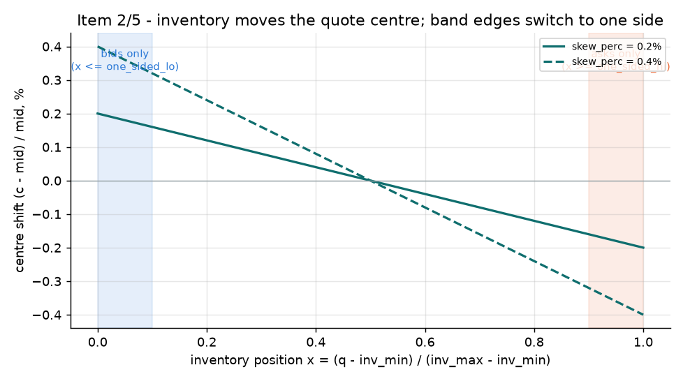

*Figure 1. The centre shift as a function of the band position $x$: a continuous line from $+\sigma_q$ at an empty band to $-\sigma_q$ at a full one.*

### 2.2 Candidate prices on a distance grid, anchored to the book

Distances form a geometric grid, so the search spends its points near the touch where the fill probability changes fastest:

$$\delta_k=\delta_{\min}\,\rho^{\,k-1},\quad k=1,2,\dots\ \text{while}\ \delta_k\le\delta_{\max}\ \Rightarrow\ 0.05,\,0.07,\,0.10,\,0.14,\,0.19,\,0.27,\,0.38,\,0.53,\,0.74,\,1.03,\,1.45\ \%.$$

Each distance becomes a real price by finding the first book level at or beyond the target and quoting one tick inside it:

$$i(\delta)=\min\{i: b_i\le c(1-\delta)\},\ B_\delta=b_{i(\delta)}+\epsilon;\qquad j(\delta)=\min\{j: a_j\ge c(1+\delta)\},\ A_\delta=a_{j(\delta)}-\epsilon.$$

When the book is shallower than the target the candidate is *synthetic*: the tick-rounded target itself. Candidates never cross the touch ($B\le a_0-\epsilon$, $A\ge b_0+\epsilon$) and duplicates are kept once. The realised distance $\hat\delta_b=(c-B)/c$, $\hat\delta_a=(A-c)/c$ is what the fill model sees.

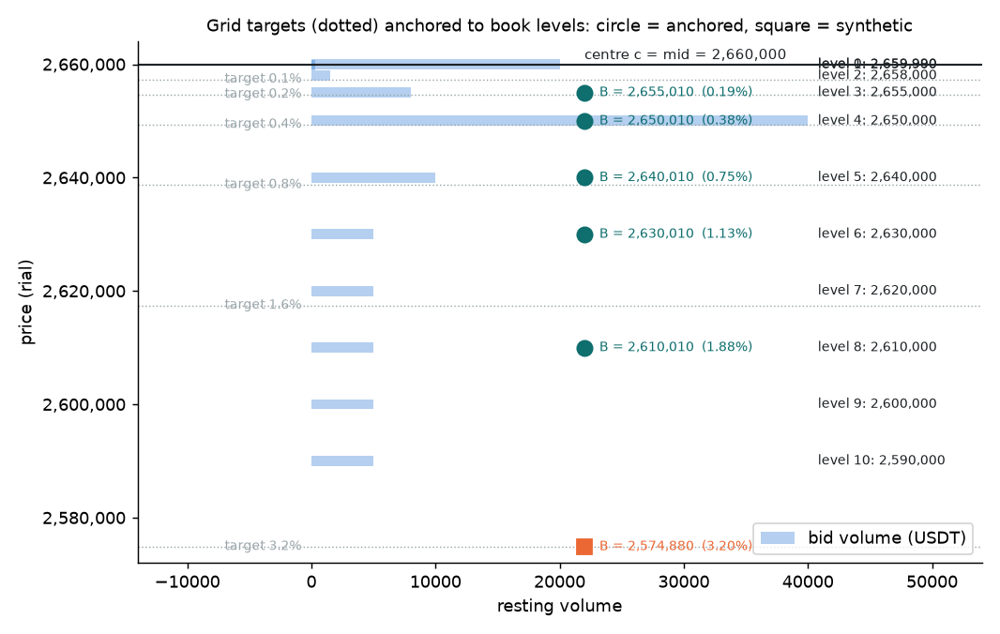

*Figure 2. Grid targets and the book levels they are anchored to; targets beyond the last level become synthetic prices.*

### 2.3 Fill probability

Every candidate gets $p=P(\text{filled within }\tau)$ at its realised distance: the measured table when it is fresh and the bucket has enough samples, otherwise the parametric fallback

$$p(\delta)=1-\exp\!\bigl(-\lambda_\tau e^{-\kappa\delta}\bigr),\qquad \kappa=400,\ \lambda_\tau=1.$$

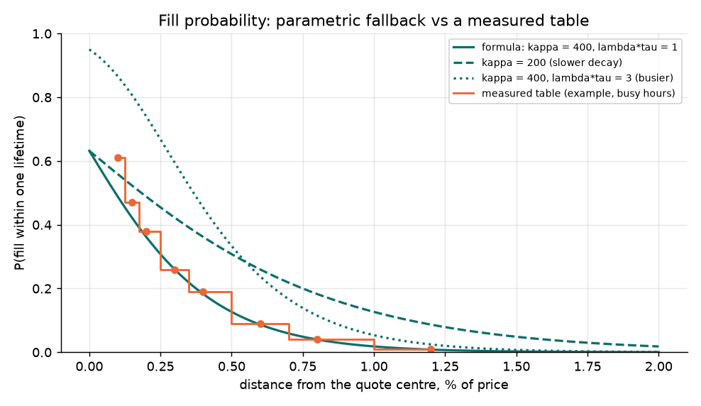

*Figure 3. Fill probability against distance: the fallback curve (dotted) and the shape a measured table takes. Section 5 shows the table in force today.*

### 2.4 Scoring every pair by expected value

For a bid $B$ with probability $p_b$ and an ask $A$ with $p_a$:

$$R_{\text{net}}=(1-f)^2\frac{A}{B}-1,\qquad J=p_b\,p_a\,R_{\text{net}}-\eta\bigl[p_b(1-p_a)+p_a(1-p_b)\bigr].$$

$J$ is the expected value per unit of capital over one lifetime: both legs fill with probability $p_bp_a$ and earn the round trip; exactly one leg fills with the bracketed probability and opens a position whose expected cost is $\eta$. A pair is feasible only if $R_{\text{net}}>r_{\min}$ **and** $J>J_{\min}$, and the choice is

$$(B^*,A^*)=\arg\max_{\text{feasible}} J,\qquad \text{ties}\to\text{smaller }\hat\delta_b+\hat\delta_a.$$

All pairs are scored, at most $11\times11$, so a single odd book level cannot hide a better pair.

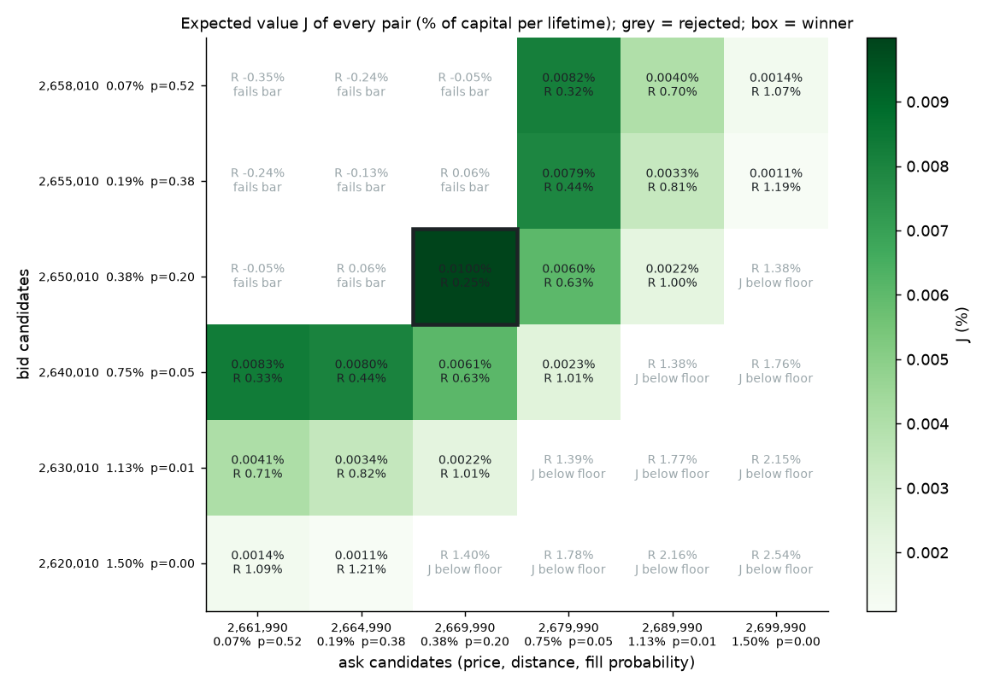

*Figure 4. The expected-value map of all pairs on the specification's example book. Pairs near the touch fail the bar; far pairs clear it but have too small a chance of filling; the best balance is in between.*

### 2.5 One-sided quotes

A lone leg is judged against a reference price $P_{\text{ref}}$, the price the position is expected to be closed at: the centre $c$, or, for a lone ask with inventory of known cost, the average cost $\bar P$ of the units bought.

$$\text{lone ask:}\ A>P_{\text{ref}}(1+G),\qquad \text{lone bid:}\ B<\frac{P_{\text{ref}}}{1+G},\qquad J=p\,R_{\text{net}}-\eta\,p>J_{\min}.$$

| Situation | Decision |
|---|---|
| $x\ge x_{hi}$ (band nearly full) | asks only: best lone ask by $J$ |
| $x\le x_{lo}$ (band nearly empty) | bids only: best lone bid by $J$ |
| otherwise, a feasible pair exists | the pair |
| otherwise | best lone leg on either side; none means no quote |

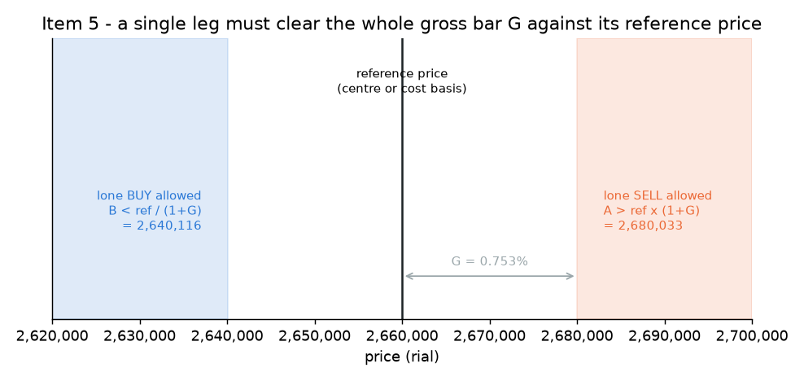

*Figure 5. The bar a lone leg must clear against its reference price, with the gross bar $G$ at the live fee.*

### 2.6 Hysteresis

The strategy remembers the price it last issued on each side. A new price within five ticks of the resting one, while that quote is younger than five minutes, is replaced by the resting price. The engine completes the rule: an order of ours that already rests within the same window is not re-posted that round. This stops cancel-and-repost churn, keeps queue position, and prevents near-identical orders from piling up. If the kept price no longer clears the bar with the new partner leg, both sides are re-quoted.

### 2.7 Sizes (engine, unchanged)

The strategy returns prices only. The engine sizes them with the linear inventory rule, $\text{buy}=2S(1-x)$, $\text{sell}=2Sx$ with resting orders counted, caps them by cash, inventory and $q_{\max}$, applies the locked-exposure guards, and sends. A side the strategy left out is recorded as `one_sided_quote`.

---

## 3. A worked round from the demo

USDT/IRT, 11 October 2026, 10:41 Tehran time, round 241 of the session that ran at a 0.10 % fee. Mid 2,631,250 rial; 11.349 USDT held of a 0 to 50 band, so $x=0.23$ and the centre is $2{,}631{,}250\times(1-0.002\times(0.46-1))=2{,}634{,}124$ (+0.109 %). The grid produced 9 bid and 11 ask candidates; the measured table gave their fill probabilities. Of the 99 pairs, 36 cleared the bar $R_{\text{net}}>0.10\,\%$ and the floor. The winner:

$$B^*=2{,}627{,}040\ (0.269\,\%\ \text{below the centre}),\quad A^*=2{,}636{,}710\ (0.098\,\%\ \text{above}),\quad \frac{A}{B}=1.003681,$$

$$R_{\text{net}}=0.999^2\times1.003681-1=0.168\,\%,\qquad J\approx0.088\times0.338\times0.168\,\%=0.0050\,\%.$$

The ask sits close to the market because the bot holds inventory it wants to sell; the bid sits farther away. The same round is shown on the dashboard in section 7.

The current session runs at the exchange fee of 0.25 %. Round 822 (13:15 Tehran) had an empty inventory, so only bids were scored against the centre $2{,}652{,}690=m(1+0.002)$. A lone bid must satisfy $B<P_{\text{ref}}/(1+G)=2{,}636{,}815$; the first candidate below that line is 2,633,110, at 0.738 % from the centre, with a measured fill probability of 0.006 per lifetime and $J=0.0015\,\%$, just above the floor. That is the order the bot keeps resting, and it is why fills are rare at this fee.

---

## 4. Pseudocode

```text
function decide_order(book, q):                                  # Algo1Strategy.decide_order
    update_cost_basis(q)                                         # inventory delta -> average cost P̄
    E = evaluate(book, q)
    if not E.ok:  forget resting prices;  return None            # reason in no_quote_reason()
    bid, ask = E.chosen_bid.price, E.chosen_ask.price            # either may be None
    bid, ask, kept = apply_hysteresis(bid, ask)                  # keep a resting price within 5 ticks / 5 min
    if kept and not still_clears_bar(bid, ask, E):  re-quote at the new prices
    return {bid, ask, bid level, ask level, mid price, centre, inventory position,
            gross/net return, expected value, fill probs, quote mode, selection reason, ...}

function evaluate(book, q):                                      # pure; also used by diagnostics()
    if depth_cap(book) == 0 or mid(book) is None:  return fail("invalid_or_single_level_order_book")
    x = clamp((q - inv_min) / (inv_max - inv_min), 0, 1)
    c = mid * (1 - skew_perc * (2x - 1))
    bids, asks = build_candidates(book, c)                       # grid, anchoring, p attached
    if x >= one_sided_hi:  return best_single(asks, ref = P̄ or c)  or fail("no_side_clears_bar")
    if x <= one_sided_lo:  return best_single(bids, ref = c)       or fail("no_side_clears_bar")
    best = None
    for B in bids, A in asks:
        R = (1 - f)^2 * A/B - 1
        J = pB*pA*R - eta*(pB*(1 - pA) + pA*(1 - pB))
        if R > r_min and J > ev_min and (best is None or J > best.J):  best = (B, A)
    if best:  return pair(best)
    single = best_single(asks, ref = P̄ or c) ∪ best_single(bids, ref = c)   # fallback
    if single:  return single
    return fail("expected_value_below_floor" if any pair cleared the bar else "no_side_clears_bar")

function build_candidates(book, c):
    for d in grid:
        target = c(1 - d);  i = first level with b_i <= target
        B = b_i + tick  if i exists  else round_down(target)    # synthetic when the book ends
        B = min(B, a_0 - tick);  keep once;  distance = (c - B)/c;  volume_ahead = sum of v_k for k < i
        (asks symmetric with >= and a_j - tick, max(A, b_0 + tick))
```

Cost per round: $O(n\cdot L)$ to build candidates and $O(n^2)$ to score pairs, with $n\le 11$ grid points and $L\le 11$ book levels.

---

## 5. The fill-probability model

The scoring needs, for each distance, the probability that a resting order is filled within one lifetime. Two sources provide it.

### 5.1 The measured table

Every night a job rebuilds `fill_table_<pair>.json` from the data the bot records every round. A bid at $c_t(1-\delta)$ is filled when sellers come down to it, that is when the best ask reaches it within $\tau$:

$$\hat p_b(\delta)=\frac{\#\{t:\ \min_{t<u\le t+\tau}a_0(u)\le c_t(1-\delta)\}}{\#\{t\}},\qquad \hat p_a(\delta)=\frac{\#\{t:\ \max_{t<u\le t+\tau}b_0(u)\ge c_t(1+\delta)\}}{\#\{t\}}.$$

Our own orders add a second estimate (fraction filled per distance bucket); the two are blended with weight $w=n_{\text{own}}/(n_{\text{own}}+100)$, samples are weighted by age with a three-day half-life over a fourteen-day window, and the curve is forced to be non-increasing in distance. The worker reloads the file as soon as it changes.

### 5.2 The table in force today

USDT/IRT, built 11 October 03:00 UTC from 29,736 price-path samples and 11 own orders, horizon 600 s:

| distance | p bid | p ask | samples | reading |
|---:|---:|---:|---:|---|
| 0.10 % | 0.284 | 0.338 | 1,818 | about one lifetime in three |
| 0.15 % | 0.176 | 0.207 | 1,818 | |
| 0.20 % | 0.136 | 0.131 | 1,828 | |
| 0.30 % | 0.067 | 0.060 | 1,818 | |
| 0.40 % | 0.034 | 0.032 | 1,818 | |
| 0.60 % | 0.011 | 0.011 | 1,818 | about one lifetime in a hundred |
| 0.80 % | 0.004 | 0.006 | 1,818 | |
| 1.20 % and beyond | 0.000 | 0.000 | 1,818 | never reached within ten minutes in this window |

BTC/IRT (943 samples, 77 own orders): 0.053 / 0.074 at 0.10 %, 0.018 / 0.015 at 0.15 %, and effectively zero from 0.20 % on. At a gross bar of 0.602 % no BTC pair has a meaningful chance of completing, which is why that worker declines to quote.

### 5.3 The fallback formula

Used when there is no table, the table is older than 48 hours, or a bucket has fewer than 50 samples: $p(\delta)=1-\exp(-\lambda_\tau e^{-\kappa\delta})$. With $\kappa=400$ the fill intensity falls by a factor $e$ every 0.25 %; $\lambda_\tau=1$ is the expected number of fills at zero distance per lifetime. The dashboard draws both curves side by side, so a stale table is visible at once.

---

## 6. What version 2 changed

Version 2 keeps the profitability semantics (a pair is acceptable only if the fee-adjusted round-trip return on the submitted prices exceeds the target), the sizing rule, the accounting, the cancellation logic and the file formats. It changes how prices are chosen:

| Mechanism | What it does now | Problem it addresses |
|---|---|---|
| Clamped band position | $x\in[0,1]$, continuous centre shift | inventory outside the band no longer produces an unusable shift |
| Distance grid with anchoring | candidates at fixed price distances, one tick inside real levels, synthetic beyond the book | a quote's distance no longer depends on how the book happens to be spaced |
| Expected-value scoring | all pairs scored by $J$; best feasible pair wins | no "stop at the first failure" scan; fill probability enters the choice |
| One-sided quotes | lone leg against the centre or the own cost basis at band edges and as a fallback | a full wallet can be sold down; an empty one can be refilled |
| Hysteresis and resting-order guard | keep a resting price within 5 ticks for up to 5 min; never re-post an order that already rests there | cancel churn, lost queue position, order accumulation |
| Robustness | optional last price, safe empty band, candidates clipped to the touch, synthetic levels accepted by the paper ledger | crashes and crossed quotes on unusual books |

All of it is covered by the test suite (828 tests pass on the server) and specified in [ALGORITHM_1_V2.md](../algorithms/ALGORITHM_1_V2.md), whose numbers are pinned by the tests so the text and the code cannot drift apart.

---

## 7. The dashboard and what it computes

The dashboard reads the result stores the workers write, the strategy's per-round diagnostics file, and the fill tables. It never touches the exchange. Six tabs; every chart below is a screenshot of the live page with the real demo data of 11 October (prices in rial, Tehran time on the axes).

### 7.1 Overview

Six headline numbers, then the price with our quotes and fills, where the quotes sat, the inventory with the sizes sent, the decision mix and the portfolio wealth.

| Tile | Formula |
|---|---|
| Quote rate | share of rounds with a quote, split into pair / bid only / ask only / none |
| Fills per hour | $N_{\text{fills}}/(t_{\text{last}}-t_{\text{first}})$ |
| Realised vs computed spread | buys matched to later sells first-in-first-out; realised $=\sum_k w_k\bigl[(1-f)^2A_k/B_k-1\bigr]/\sum_k w_k$ over completed round trips ($w_k$ the amount), computed $=$ mean of $R_{\text{net}}$ at placement over two-sided rounds |
| Adverse selection (60 s) | mean of $(m_{t+60}-P)/P$ after a buy at $P$ and $(P-m_{t+60})/P$ after a sell; negative means the market moved against the position we received |
| Net PnL after fees | wealth now minus wealth at the first round of the view, with the fees paid |
| Inventory position | $x$ of the latest round and the units held |

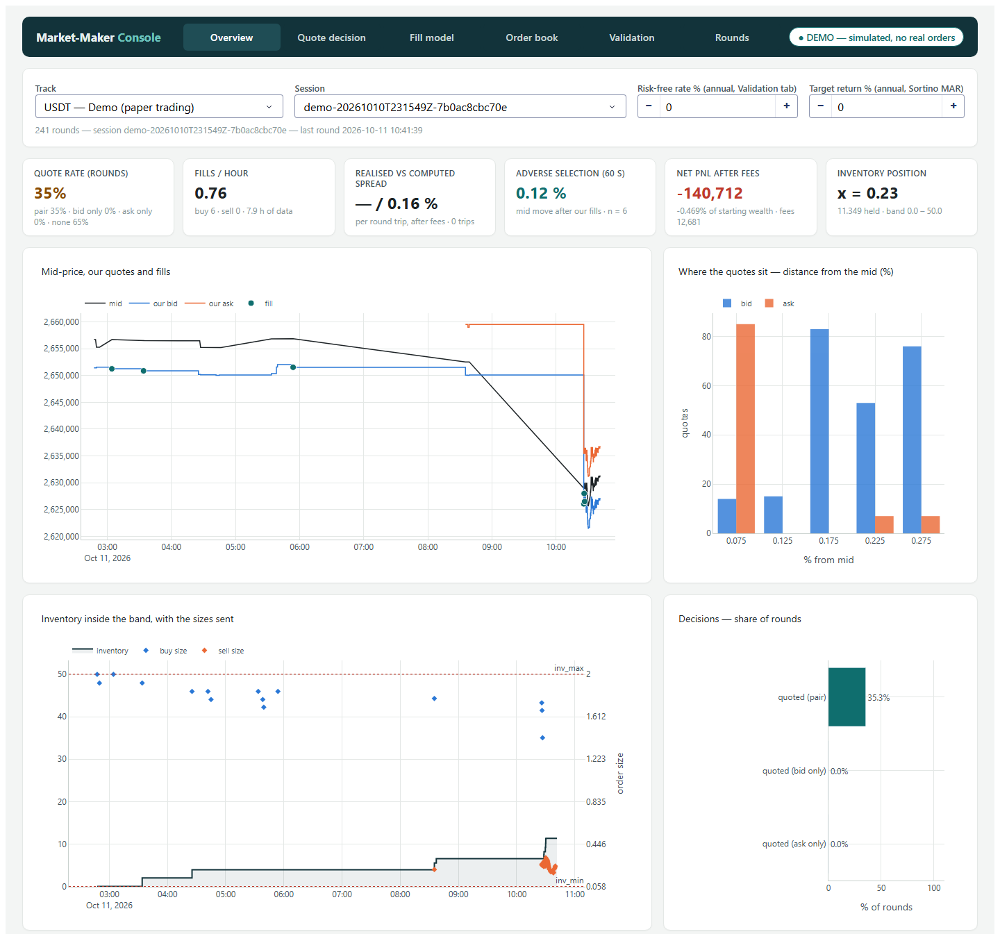

*Figure 6. Overview, USDT/IRT, session at a 0.10 % fee (02:47 to 10:41 Tehran). 241 rounds, 35 % quoted as pairs, 6 buy fills and no sell (0.76 fills per hour), computed net spread 0.16 % per round trip, mid move after our fills +0.12 % in our favour, inventory built up to 11.35 USDT, mark-to-market loss of 140,712 rial (−0.47 %) as the price fell while the inventory was held.*

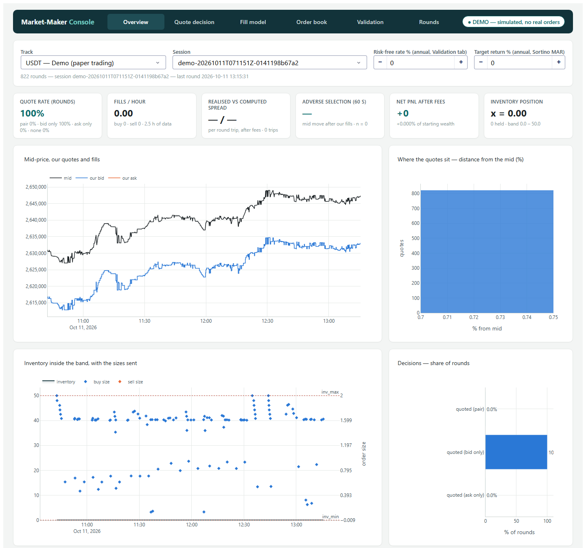

*Figure 7. Overview, the current session at the 0.25 % fee (from 10:42 Tehran). Every round carries one bid at 0.70 to 0.75 % below the mid, no fill yet; the sizes sent follow the linear rule as the band is empty (about 2 USDT per order).*

### 7.2 Quote decision

One round of the strategy, read from its diagnostics file: the candidate ladder (price, distance, book level or synthetic, volume resting ahead of us, fill probability, which were sent), the expected-value map of every pair with the sent pair framed and rejected pairs marked, the decision trace, a round picker that keeps its choice across refreshes, and the last 80 decisions as a strip.

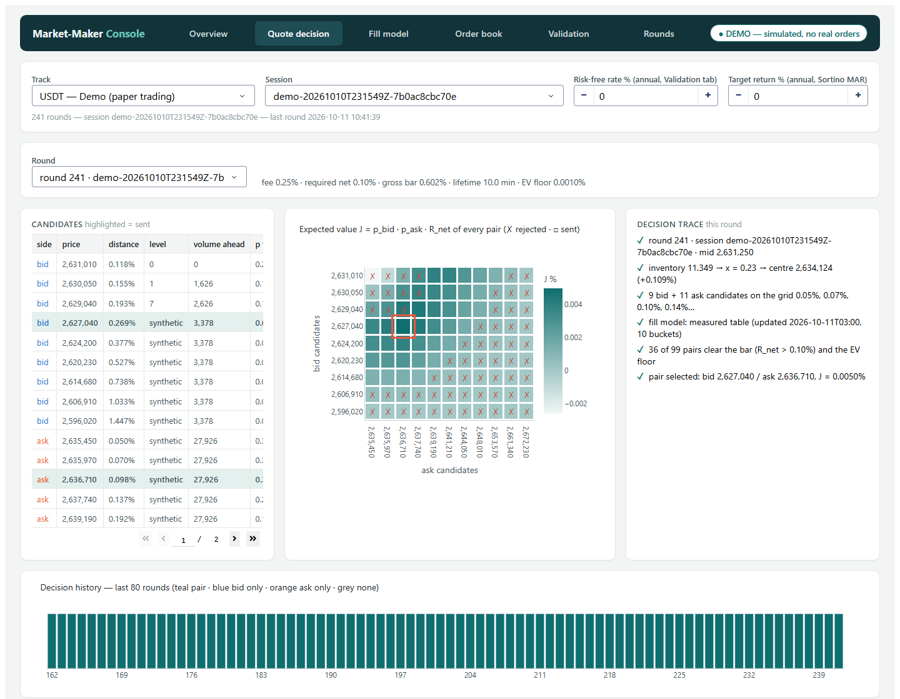

*Figure 8. The worked round of section 3 (round 241). 36 of 99 pairs clear the bar; the framed cell is the sent pair, bid 2,627,040 / ask 2,636,710 with $J=0.0050\,\%$. Crosses mark pairs that fail the bar or the floor.*

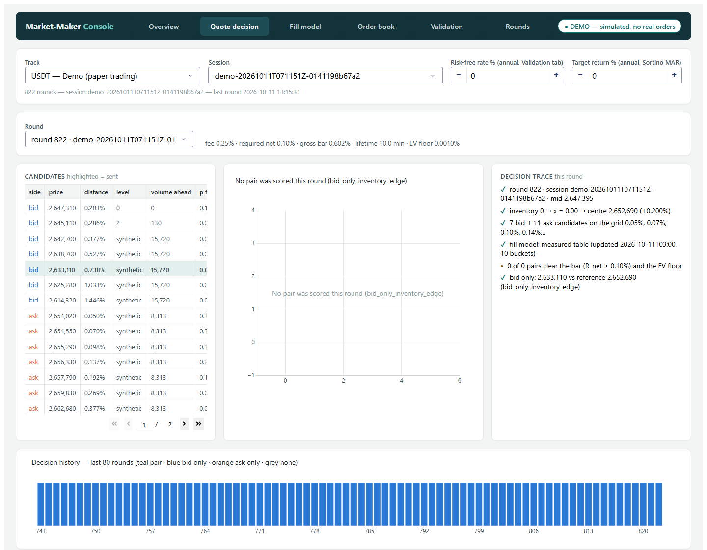

*Figure 9. Round 822 of the current session. With an empty inventory only bids are scored (no pair map); the trace shows the centre at +0.200 %, the measured table in use, and the lone bid at 2,633,110 chosen against the reference 2,652,690.*

### 7.3 Fill model

The measured table against the fallback formula (marker size = samples); calibration, the fill probability written into each order row at placement against the realised fill rate per distance bucket; the mid move after our fills at 10, 30, 60, 300 and 600 s; and the table's health (file, method, age, samples, sources).

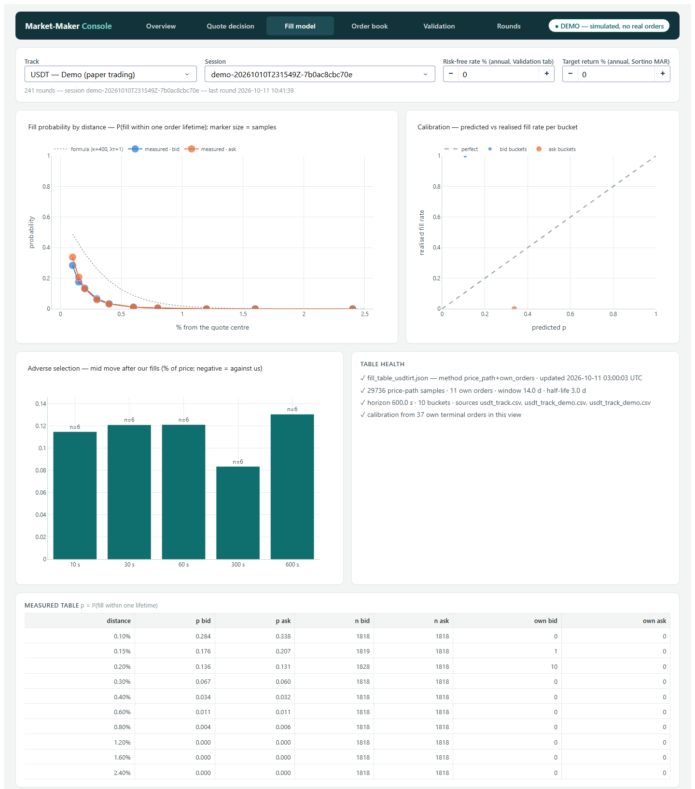

*Figure 10. Fill model, USDT/IRT. The measured curve lies below the formula at every distance: the formula was the placeholder, the table is the market. The mid moved +0.08 to +0.13 % in our favour after the six fills at every horizon (small sample). Calibration will fill in as orders terminate.*

### 7.4 Validation

The switch-to-real gate of section 8 on top (value, threshold, pass / fail / not measurable yet), then the inventory position against the one-sided thresholds, the fill-rate forecast per day (sum of the predicted fill probabilities of the orders placed against the orders that filled), and the performance metrics (return, Sharpe, Sortino, drawdown, Calmar, win rate, profit factor, inventory statistics).

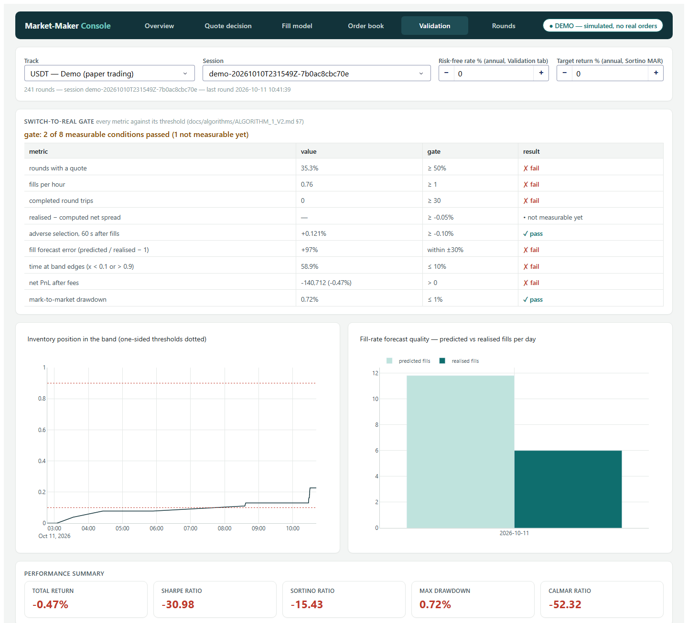

*Figure 11. Validation, the 0.10 %-fee session. Two of nine conditions pass after eight hours: adverse selection (+0.121 %) and drawdown (0.72 %). The forecast error of +97 % says the table predicted about twice the fills that happened on that day's 12 orders, which is what the calibration view is for.*

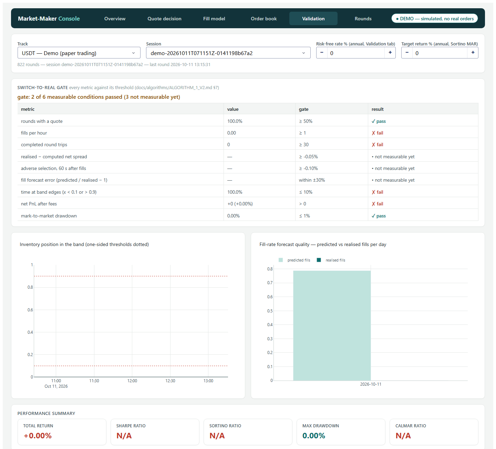

*Figure 12. Validation, the current session. Quote rate 100 % (all bids), nothing filled yet, so most conditions are not measurable; time at the band edge is 100 % by construction while the inventory is empty.*

### 7.5 Order book and Rounds

Order book keeps the selected depth levels and quoted spreads. Rounds lists every round, newest first, sortable and filterable, with the nine decision columns the engine now writes: quote mode, selection reason, centre, bid and ask distance, bid and ask fill probability, expected value, reference price.

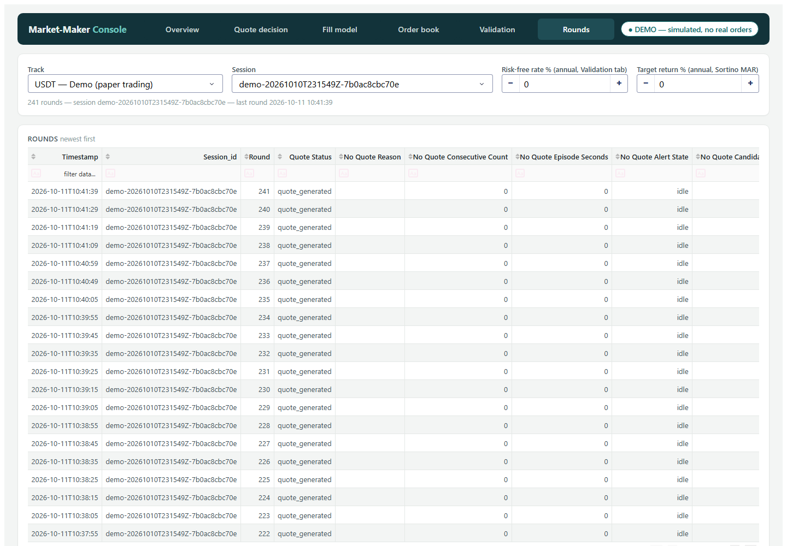

*Figure 13. Rounds, the 0.10 %-fee session. One row per round; the table scrolls to the lifecycle fields of each order and the decision columns.*

---

## 8. The demo-to-real gate

The same code is allowed to trade with money only after at least five days of demo data satisfy every row. The dashboard computes the table live; the readings below are from the two sessions of 11 October.

| Condition | Gate | 0.10 % session (8 h) | current session (2.5 h) |
|---|---|---|---|
| rounds with a quote | ≥ 50 % | 35.3 % (fail) | 100 % (pass) |
| fills per hour | ≥ 1 | 0.76 (fail) | 0.00 (fail) |
| completed round trips | ≥ 30 | 0 (fail) | 0 (fail) |
| realised minus computed net spread | ≥ −0.05 % | not measurable | not measurable |
| adverse selection 60 s after fills | ≥ −0.10 % | +0.121 % (pass) | not measurable |
| fill forecast error, predicted / realised − 1 | within ±30 % | +97 % (fail) | not measurable |
| time at the band edges ($x<0.1$ or $>0.9$) | ≤ 10 % | 58.9 % (fail) | 100 % (fail) |
| net PnL after fees | > 0 | −0.47 % (fail) | 0.00 % (fail) |
| mark-to-market drawdown | ≤ 1 % | 0.72 % (pass) | 0.00 % (pass) |

Two of the rows carry most of the information so far. The adverse-selection row is positive: the prices we were filled at were, on average, better than the mid-price a minute later. The round-trip row is zero because the bot bought six times and never sold; the asks were placed at the required distance and were not reached before the price fell. Both sessions are far too short for the gate; it exists so that the decision to go live is made on these numbers and not on impressions.

---

## 9. The demo run and the infrastructure work

### 9.1 Sessions on 11 October

| Session (Tehran time) | Fee / target | USDT/IRT | BTC/IRT |
|---|---|---|---|
| 02:47 to 10:41 | 0.10 % / 0.10 % | 241 rounds, 85 pair quotes, 6 buy fills | 480 rounds, no quote |
| from 10:42 (current) | 0.25 % / 0.10 % | 822 rounds, one bid every round, no fill | 154 rounds, no quote (no side clears the bar) |

Settings are changed from the admin panel and applied through the control queue; the fee is a new-session field, so the second session was started for it. The paper ledger starts each session with 30,000,000 rial and an empty inventory.

### 9.2 Fixes made while bringing the version up

- **Synthetic levels.** The paper ledger required an integer book level; a candidate placed beyond the displayed book has none, and the USDT worker exited on the first such bid. The ledger now accepts a missing level (commit `8076907`). The thin USDT book makes most candidates synthetic, so this mattered immediately.
- **Memory.** The demo loop reloaded the whole result store twice per round and rewrote the CSV every round; with several thousand rows the worker sat at the container's memory limit and was killed every few minutes. The store is now updated incrementally, the CSV is streamed once a minute, the diagnostics file is rotated by streaming, and the dashboard reads a bounded window (`affb34e`, `28970a7`, `0aa3af3`). Both workers hold at about 87 MB with no restart since.
- **Admin panel.** The HTTPS admin link had been pointing at the forward (live) stack's panel, whose demo pages cannot work; it now serves the demo stack's panel, which also controls the live forward test. Exports of backups (`478d701`) and the panel's password were fixed on the way.
- **Operations.** Every page of the panel and the start/stop and configuration actions are exercised by an automated check after each deploy; the test suite runs on the server before any swap.

---

## 10. Next step: Algorithm 3, order-book imbalance and microprice

Algorithm 1 uses only the prices of the book and the inventory. It ignores the volumes resting at those prices, which are the best-documented short-horizon predictor of the next mid-price move: when far more is bid than offered near the touch, the ask side is the one likely to be consumed and the price is more likely to rise. Algorithm 3 centres the quotes on a volume-weighted mid-price, leans them further in the direction of the imbalance, keeps the inventory skew, and enforces exactly the same fee bar. Sizes, caps, cancellation and the engine stay as they are; it is a drop-in replacement through the same `decide_order` interface. The full design is in `Suggested Algorithm/Algorithm_3_Imbalance_Microprice.pdf`.

### 10.1 Signals

Imbalance over the top $k$ levels with geometric weights $w_i=\rho^i$:

$$V^b=\sum_{i=0}^{k-1}w_iv^b_i,\quad V^a=\sum_{i=0}^{k-1}w_iv^a_i,\quad I=\frac{V^b-V^a}{V^b+V^a}\in[-1,1], \tag{1}$$

set to 0 when the book is too thin ($V^b+V^a<V_{\min}$) and clipped to $[-I_{\max},I_{\max}]$. Microprice, the mid weighted toward the side with less volume at the touch:

$$p_{\text{micro}}=\frac{a_0v^b_0+b_0v^a_0}{v^b_0+v^a_0},\qquad p_{\text{micro}}-m=\frac{s}{2}I_0, \tag{2, 3}$$

with $s=a_0-b_0$ the best spread and $I_0$ the imbalance of the best level alone, so $b_0\le p_{\text{micro}}\le a_0$ always.

### 10.2 Quote construction

$$c_0=p_{\text{micro}},\qquad c_1=c_0(1+\beta I),\qquad c=c_1\bigl(1-\sigma_q(2x-1)\bigr), \tag{4}$$

$$B=c(1-h),\qquad A=c(1+h). \tag{5}$$

The centre starts at the microprice, is raised by $\beta I$ under buying pressure (the bid to be filled before the rise, the ask so it is not lifted cheaply) and lowered when the inventory is above the middle of its band. Because the lean and the skew move the centre and the half-spread is applied afterwards, $A/B=(1+h)/(1-h)$ does not depend on $I$ or $x$: the profitability of a round trip is fixed by $h$ alone.

### 10.3 The fee bar and the minimum half-spread

$$R_{\text{net}}=(1-f)^2\frac{A}{B}-1>r_{\min}\ \Longleftrightarrow\ \frac{1+h}{1-h}>1+G\ \Longleftrightarrow\ h>h_{\min}=\frac{G}{2+G}. \tag{6, 7}$$

At $f=r_{\min}=0.25\,\%$: $G=0.7532\,\%$, $h_{\min}=0.3752\,\%$. At the current demo settings ($f=0.25\,\%$, $r_{\min}=0.10\,\%$): $G=0.602\,\%$, $h_{\min}=0.300\,\%$. The configured half-spread is $h=\max(h_{\text{cfg}},h_{\min}+\text{one tick})$, and the bar is re-checked on the final, tick-rounded prices. Prices are clipped to the touch and rounded outward,

$$B\leftarrow\epsilon\Bigl\lfloor\tfrac{\min(B,\,a_0-\epsilon)}{\epsilon}\Bigr\rfloor,\qquad A\leftarrow\epsilon\Bigl\lceil\tfrac{\max(A,\,b_0+\epsilon)}{\epsilon}\Bigr\rceil, \tag{8}$$

and a resting quote is replaced only if a price moved by $n$ ticks or the quote is older than $T_{\text{refresh}}$ (hysteresis, as in version 2).

### 10.4 Procedure

```text
function decide_order_algo3(book, q):
    if fewer than k levels on either side, or b_0 >= a_0, or a non-positive price:  return None
    m = (b_0 + a_0)/2;  s = a_0 - b_0
    V_b, V_a = weighted volumes over the top k levels (w_i = rho^i)
    I = 0 if V_b + V_a < V_min else clip((V_b - V_a)/(V_b + V_a), -I_max, I_max)        # (1)
    p_micro = (a_0 * v_b0 + b_0 * v_a0) / (v_b0 + v_a0)                                 # (2)
    x = clamp((q - inv_min)/(inv_max - inv_min), 0, 1)
    c = p_micro * (1 + beta * I) * (1 - skew * (2x - 1))                                 # (4)
    h = max(h_cfg, h_min + tick/c)                                                      # (7)
    B = c(1 - h);  A = c(1 + h);  clip to the touch and round outward                   # (5), (8)
    if B >= A or (1 - f)^2 * A/B - 1 <= r_min:  return None                             # (6) re-checked
    if a resting quote exists and neither price moved n ticks nor expired:  return the resting prices
    levels for logging: i* = max{i : b_i >= B}, j* = max{j : a_j <= A}
    return {B, A, i*, j*, m, (A - B)/m, A/B - 1, (1 - f)^2 A/B - 1, r_min, I, p_micro, c}
```

### 10.5 Worked example (USDT/IRT, live settings)

Book: $b_0=2{,}658{,}990$, $a_0=2{,}659{,}010$; top-3 volumes bids 20,000 / 8,000 / 6,000 and asks 5,000 / 4,000 / 3,000 USDT; $k=3$, $\rho=1$, $\beta=0.0010$, $\sigma_q=0.0020$, $h_{\text{cfg}}=0.0038$, $f=r_{\min}=0.0025$; inventory 10 of 50. Then $I=22{,}000/46{,}000=0.478$, $p_{\text{micro}}=2{,}659{,}006$, $x=0.2$, $c=2{,}659{,}006\times1.000478\times1.0012=2{,}663{,}470$, $B=2{,}653{,}340$, $A=2{,}673{,}600$, $A/B=1.007635$, $R_{\text{net}}=0.2604\,\%>0.25\,\%$. Both quotes sit about 4,450 rial higher than symmetric quotes around the mid: the algorithm expects the price to rise and positions to buy before it does and to sell only at a better price.

### 10.6 Properties, calibration, safeguards

- **Well-posed and never crossed:** for $|\beta I|<1$, $\sigma_q<\tfrac12$, $h\in(0,1)$: $0<B<A$, $B\le a_0-\epsilon$, $A\ge b_0+\epsilon$.
- **Profitability guarantee:** every quote returned satisfies $R_{\text{net}}>r_{\min}$ on the exact prices sent; the lean and the skew act on the centre only.
- **Monotone:** $\partial B/\partial I=\partial A/\partial I=\beta c/(1+\beta I)>0$ (more buy pressure moves both quotes up); $\partial B/\partial x=\partial A/\partial x<0$ (more inventory moves both down).
- **Calibration of $\beta$:** regress the forward mid return on the imbalance over the lifetime, $r_{t,\tau}=\beta I_t+e_t$, $\hat\beta=\sum_tI_tr_{t,\tau}/\sum_tI_t^2$ (10); use $\hat\beta$ only if its t-statistic exceeds 3, otherwise $\beta=0$ (the microprice alone); re-estimate weekly; choose $k$ by out-of-sample $R^2$ over $k\in\{1,2,3,5\}$, $\rho=0.5$ when $k>1$.
- **Safeguards:** $I_{\max}=0.8$ against spoofed levels, $V_{\min}$ against thin books, stale-book rejection, and the same stale-order cancellation and inventory caps as today.

### 10.7 Plan

1. Implement `strategy/algo3.py` behind the existing interface, with its parameters editable from the admin panel; reuse version 2's fill model, one-sided logic and hysteresis where they apply.
2. Calibrate $\beta$, $k$ and $\rho$ from the recorded order books; keep $\beta=0$ until the regression is significant.
3. Run it on the demo in its own session next to Algorithm 1 on the same market data and read the same dashboard: quote rate, fills per hour, realised spread, adverse selection after fills, time at the band edges, net PnL. The gate of section 8 decides, for either algorithm, when real money is allowed.

---

## 11. Appendix

### 11.1 Parameters in force on the demo

| Parameter | USDT/IRT | BTC/IRT | Meaning |
|---|---|---|---|
| commission_perc / exp_ret_min | 0.0025 / 0.001 | 0.0025 / 0.001 | fee per leg / required net return |
| order_size | 1 USDT | 0.000015 BTC | base size of the linear rule |
| inv_min to inv_max | 0 to 50 USDT | 0 to 0.000472 BTC | inventory band |
| cancel_after_minutes | 10 | 10 | order lifetime $\tau$ |
| grid_min_perc, grid_ratio, grid_max_perc | 0.0005, 1.4, 0.02 | same | candidate grid |
| skew_perc | 0.002 | same | centre shift at the band edges |
| one_sided_lo, one_sided_hi | 0.1, 0.9 | same | one-sided thresholds |
| ev_min | 0.00001 | same | expected-value floor |
| hysteresis_ticks, refresh_seconds | 5, 300 | same | keep a resting price |
| fill_table_max_age_hours, fill_table_min_samples | 48, 50 | same | when the measured table is used |
| fill_kappa, fill_lambda_tau | 400, 1.0 | same | fallback formula |
| time_step | 10 s | 60 s | round length |

### 11.2 Where to look

- Live dashboard: <https://37.32.31.162/> (opens on the track with the newest data). Deep links: `?tab=decision&track=usdt_demo`, `?tab=fillmodel&track=usdt_demo`, `?tab=validation&track=usdt_demo`.
- Specification [ALGORITHM_1_V2.md](../algorithms/ALGORITHM_1_V2.md), fill model [FILL_MODEL.md](../algorithms/FILL_MODEL.md), change notes [CHANGES_V1_TO_V2.md](../algorithms/CHANGES_V1_TO_V2.md), dashboard guide `usage.md` section 3.

### 11.3 Glossary

- **Round:** one pass of the loop: read the book, decide, place or keep orders, record a row.
- **Lifetime:** how long an order rests before the engine cancels it (10 minutes).
- **Fill probability:** the chance that an order at a given distance from the centre is filled within one lifetime, measured from the recorded market data.
- **Expected value $J$:** the profit per unit of capital expected from a quote over one lifetime, after fees and after the cost of ending up with only one leg filled.
- **Adverse selection:** the price moving against a position right after we were filled; measured here as the mid move 60 seconds after our fills, positive meaning in our favour.
- **Gate:** the nine conditions the demo must meet over at least five days before the same code trades with money.

Figures 1 to 5 are generated from the strategy code by `docs/algorithms/figures/make_figures.py`; figures 6 to 13 are screenshots of the dashboard on 11 October 2026 with the demo data of that day (`docs/reports/figures/`).
